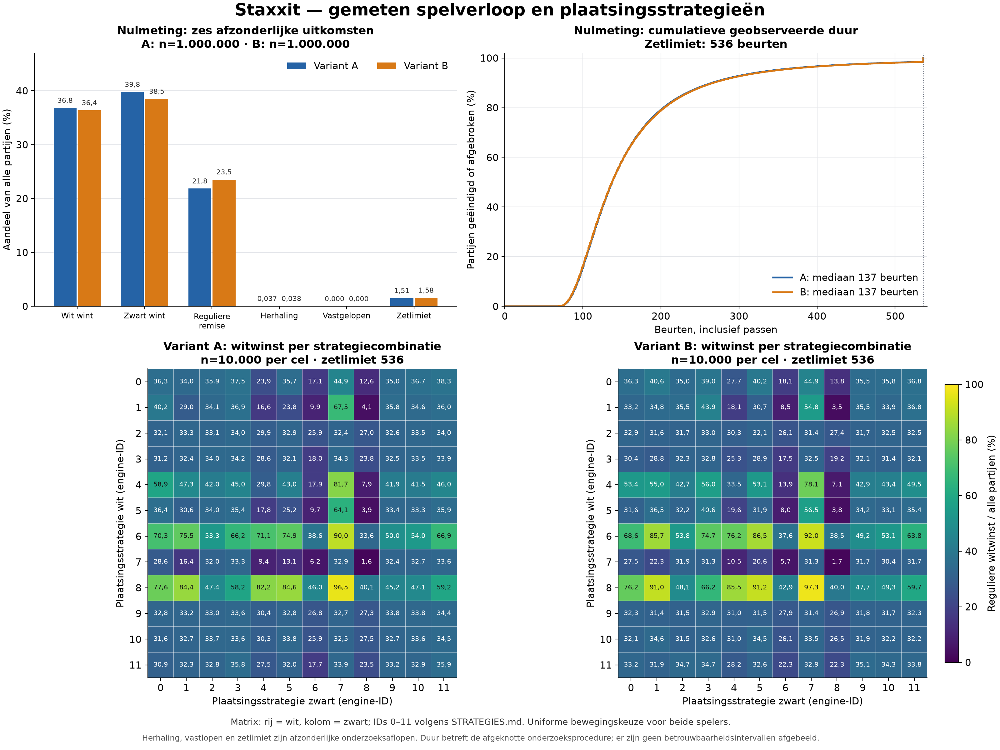

# Staxxit: spelbalans, plaatsingsheuristieken en wiskundige complexiteit

Onderzoeksdatum: 25 november 2026. Onderzoeksbranch: `complexity-analysis-cpp`.

Er zijn **9.120.000 onderzoekspartijen** uitgevoerd in acht volledige series
met samen 498 condities. De nulmeting omvat 1.000.000 partijen per variant;
de volledige plaatsingsmatrix omvat 1.440.000 partijen per variant. Zwart wint
onder uniforme keuzes iets vaker. Buitenringplaatsing presteert het best van
de twaalf geteste heuristieken. Voor variant B verbetert een onafhankelijke
vervolgproef de score door de laatste zes plaatsingen te verspreiden. In
variant B levert uitsluitend vroege ontsnappingsprioriteit 58 tot 60
procentpunt meer winst op voor een snelle plaatser tegen een slaggerichte
tegenstander. Bij twee uniforme voorraadbeleidsregels omvatten de intervallen
voor dezelfde ingreep nul. Beide onbeperkte geschiedenisbomen zijn oneindig
door bereikbare cycli.
De eindige-boomschattingen op grote diepte blijken ondanks de grote steekproef
statistisch instabiel; zij worden daarom verkennend gerapporteerd.

Alle simulatietabellen hieronder komen uit volledig afgeronde bestanden met
`complete: true`. Validatie, benchmarks en reproducties met dezelfde seeds
tellen niet mee in de 9.120.000.

De figuur is uit de complete nulmeting en matrix afgeleid; de tabellen hieronder
geven de bijbehorende onzekerheidsintervallen. `plot_results.py` en
`results/overview.provenance.json` leggen de gebruikte bronbestanden vast.

## Onderzoeksvraag en interpretatie

Het onderzoek vergelijkt twee regelsystemen op hetzelfde bord en onderzoekt
hun gedrag onder reproduceerbare willekeurige keuzes en exact omschreven
heuristieken. Het onderscheidt drie vragen: hoeveel configuraties zijn
theoretisch mogelijk, hoeveel zetgeschiedenissen bevat een afgeknotte spelboom,
en welke van de onderzochte beleidsregels presteert in simulaties goed?
Geen van deze vragen levert zonder aanvullend bewijs een optimale minimaxstrategie.

## Spelmodel

Het bord heeft 91 actieve binnenvelden en 36 buitenvelden: 15 wit, 15 zwart
en 6 neutraal. Iedere speler beschikt over 18 stenen; wit begint op het midden.
Plaatsingen gebeuren op vrije binnenvelden naast een aanwezige binnenstapel.
Een stapel beweegt recht in een van zes richtingen, maximaal zijn eigen hoogte,
zonder andere stapels te passeren. Slaan en ontsnappen vereisen precies die
hoogte als afstand. De bovensteen bepaalt de eigenaar. Een aanvallende stapel
komt boven op een vijandelijke; eigen stapels mogen niet worden geslagen.

Ontsnappen kan naar een vrij eigen of neutraal buitenveld. Ontsnapte stapels
blijven voor materiaal en score geregistreerd en handelen niet meer. Vanaf
hoogte 12 kan een stapel in één beurt worden gesplitst naar een vrij aangrenzend
binnenveld, mits beide resulterende bovenstenen de actieve speler toebehoren.
Na iedere handeling of pas wisselt de beurt.

In **variant A** plaatsen beide spelers eerst al hun stenen. Daarna geldt
over het gehele bord slagplicht voor de speler aan zet. In **variant B** kiest
een speler met voorraad tussen plaatsen en facultatief slaan. Zodra zijn eigen
voorraad op is, kan hij bewegen, splitsen en ontsnappen en geldt voor hem
slagplicht, ongeacht de voorraad van de tegenstander.

De partij eindigt wanneer een speler geen eigen actieve stapel en geen voorraad
meer heeft; bij A geldt dat pas na de plaatsingsfase. De score vergelijkt eerst
het aantal bezette buitenvelden en daarna het totale aantal stenen in de eigen
ontsnapte stapels, inclusief stenen van de andere kleur. Alleen gelijkheid op
beide criteria is een reguliere remise.

De oorspronkelijke engines gebruiken zes neutrale hoekvelden met afwisselend
wit en zwart op de overige buitenvelden. Omdat de opdracht de aantallen maar
geen volledige kleurkaart geeft, is deze bestaande kleurkaart gehandhaafd als
expliciete modelaanname; zie `VALIDATION.md` voor de oriëntatie.

## Voorlopige onderzoeksregels

De hoofdruns gebruiken een geregistreerde zetlimiet. Geen legale zet betekent
passen; twee opeenvolgende passen vormen een afzonderlijke onderzoeksafloop.
De derde keer dezelfde volledige positie, inclusief speler aan zet, voorraden,
stapelvolgorde en relevante passteller, geeft een herhalingsafloop. Een leeg
binnenbord met nog aanwezige voorraad staat voorlopig een nieuwe middenplaatsing
toe. Frequenties van passen, middenherstarts, herhalingen en zetlimieten worden
apart gerapporteerd. Zij worden niet als reguliere remises behandeld.

### Twee opeenvolgende passen kunnen onder dit model niet optreden

Dit volgt ook zonder simulatie. Er zijn maximaal 36 bezette binnenvelden op
een verbonden binnenbord van 91 velden. Een niet-lege bezette deelverzameling
heeft daarom een bezet veld met een vrij aangrenzend binnenveld. Bij aanwezige
voorraad bestaat daar een legale plaatsing. Zonder voorraad kan de eigenaar van
die grensstapel één stap naar dat vrije veld bewegen; als slagplicht dat
verhindert, bestaat er juist een legale slagzet. In de gemengde plaatsingsfase
van A kan de speler met resterende voorraad altijd plaatsen.

Bij een leeg binnenbord geeft resterende voorraad de voorlopige middenplaatsing;
zonder voorraad is al een reguliere eindstand bereikt. Er bestaat dus vóór een
reguliere eindstand steeds voor minstens één speler een legale handeling.
Een pas verandert bord en voorraad niet en kan daardoor niet onmiddellijk
gevolgd worden door een tweede pas. Afzonderlijke passen zijn wel mogelijk.
De categorie `blocked` blijft als diagnostische controle aanwezig: een niet-nul
waarde zou bij deze regels nader onderzoek vereisen. Het bewijs gebruikt
uitdrukkelijk de voorlopige middenherstart en de mogelijkheid één stap te bewegen.

### Middenherstart na de beginzet is eveneens onbereikbaar

Dit volgt scherper uit onmiddellijke reguliere beëindiging. Plaatsen, bewegen
en splitsen maken het actieve bord niet leeg; slaan laat minstens de aanvallende
stapel actief. Alleen ontsnappen kan de laatste actieve stapel verwijderen.
De ontsnappende speler heeft dan al geen voorraad meer en na die handeling geen
eigen actieve stapel, zodat de partij onmiddellijk regulier eindigt. Bij A kan
het bord tijdens het plaatsen sowieso niet leeg raken. Er kan daarom in een
legale volledige partij geen nieuwe beurt ontstaan die een tweede middenstart
nodig heeft. De fallback is defensief voor synthetische of geïmporteerde
toestanden. Een gemeten `center_resets > 0` zou onder dit model een foutsignaal zijn.

## Onafhankelijke validatie

De Pythonbron uit `complexity-analysis` is als herleidbare referentiekopie
bewaard. Daarnaast is een zelfstandige Pythonoracle gemaakt met coördinaten en
immutable kleurreeksen. De C++-engine gebruikt een andere bordrepresentatie,
geprecomputeerde richtingen en compacte stapelcodering. De controle vergelijkt
volledige verzamelingen legale handelingen, volledige volgende toestanden en
einduitslagen; een gedeelde gekozen zet voorkomt schijnverschillen door andere
RNG-implementaties.

Handgemaakte tests isoleren onder meer afstand, blokkering, globale slagplicht,
individuele voorraadrechten, splitsneden, buitenkleuren, score-tiebreaks,
materiaalbehoud en de voorlopige eindprocedures. Gerandomiseerde geldige
materiaalposities vullen werkelijk vanaf de start gespeelde trajecten aan.
Alle stenen van beide kleuren blijven controleerbaar aanwezig in voorraad,
binnenstapels of ontsnapte stapels. De definitieve aantallen en executablehash
staan in `results/validation.json`; `VALIDATION.md` beschrijft hun betekenis.

De definitieve driewegvergelijking omvat 1.000 partijen per variant en 10.000
synthetische materiaalposities: 373.682 toestanden en 351.711 overgangen zonder
verschil. Daarbij zijn alle handelingstypen uitgevoerd, waaronder 3.105
splitsingen en 3.281 ontsnappingen. Er zijn 26 handgemaakte regeltests.
Een afzonderlijke runnercontrole vergelijkt dezelfde partijtrajecten en
integertellers bij 1 en 4 threads en twee batches van 500 partijen. Aanvullende
lange runs testen herhaling en limieten; heuristiekcontroles omvatten 1.440
legale beleidskeuzes en 12.000 tie-breaktrekkingen. Deze audits staan als
`validation*.json` herkenbaar apart van de onderzoeksreeksen.

## Hardware, snelheid en reproduceerbaarheid

Gedetecteerd is een ASUS ROG Flow Z13 GZ302EA met AMD Ryzen AI Max+ 395,
16 fysieke kernen en 32 logische processors. De engine gebruikt de CPU; de GPU
is niet ingezet. `results/hardware.json` bevat besturingssysteem, geheugen,
compilerbron en compilerarchivehash. `results/benchmark.json` bewaart de gemeten
snelheden voor verschillende threadaantallen. Het zijn metingen op een gedeelde
computer zonder gecontroleerde thermische toestand of achtergrondbelasting.

De benchmark gebruikte de definitief gevalideerde executable, 30.000 partijen
per variant en threadaantal. De gemeten snelheid was:

| Threads | A partijen/s | B partijen/s |
|---:|---:|---:|
| 1 | 5 592,4 | 5 036,8 |
| 4 | 20 799,8 | 19 038,3 |
| 8 | 34 883,4 | 31 377,3 |
| 16 | 45 113,0 | 45 979,6 |
| 32 | 60 997,6 | 57 770,3 |

Dit is één gemeten proef per conditie, geen thermisch gecontroleerde
snelheidsgarantie. De 32-threadinstelling is op deze machine voor de grote runs
gebruikt. De compacte vaste borden en een 64-bits kleurcode met afzonderlijke
hoogte per stapel vermijden dynamische stapelallocaties in de binnenste lus;
de zes richtingen zijn vooraf berekend. Een stapel bevat hoogstens 36 stenen.

Iedere partij heeft een deterministische seed uit experimentseed en partij-index.
Integerresultaten blijven daardoor gelijk bij een andere taakverdeling over
threads. De runner schrijft atomische checkpoints per indexblok, met hashes
van executable, bron en runner en alle relevante instellingen. Hetzelfde
commando hervat ontbrekende blokken. Voortgang, snelheid en geschatte resterende
tijd verschijnen tijdens de berekening. Kleine drijvende-komma-afwijkingen in
de boomaggregaten door de somvolgorde hebben geen invloed op de gespeelde partijen.

Tijdens de matrixberekening gaf Windows eenmaal een tijdelijke toegangsfout
bij het atomisch vervangen van een bestand. Dezelfde opdracht is hervat;
850.000 reeds gecheckpointte partijen hoefden niet opnieuw te worden uitgevoerd.
De uiteindelijke aantallen in dit rapport gebruiken uitsluitend de volledig
afgeronde series met gecontroleerde taakdekking.

De Linux-reproductie kreeg op dezelfde CPU-familie twee virtuele kernen.
De GCC 14.2.0-build behaalde met één thread 6.974 partijen per seconde
voor A en 6.232 voor B. Met twee threads was dat 13.482 en 12.168.
De benchmark gebruikte dezelfde seeds als op Windows. De hashes over
de geheeltallige benchmarkuitkomsten komen overeen. Details en de
herhaalde enginevalidatie staan in `results/reproduction_validation.json`.
Alle 8.320.000 partijen uit de oorspronkelijke zeven series zijn met
dezelfde seeds opnieuw gespeeld op Linux. De audit telde 832 nieuwe
chunks op. Elke geheeltallige teller van de 490 taken stemt overeen met
de oorspronkelijke uitkomst, en de twee CSV-winstmatrices zijn
byte-identiek. De nieuwe vroege-ontsnappingsreeks heeft een afzonderlijke
audit. Zie `results/integrity_reproduction.json` en
`results/integrity_early_escape.json`.

## Statistische methode

De zes eindcategorieën zijn witwinst, zwartwinst, reguliere remise, herhaling,
vastlopen en zetlimiet. Winstpercentages hebben primair alle gestarte partijen
als noemer. Per categorie wordt een marginaal Wilsoninterval van 95% berekend.
Dit betekent geen gezamenlijke 95%-dekking voor alle matrixcellen.
De score onder uitsluitend reguliere einduitslagen wordt duidelijk conditioneel
gerapporteerd. Ook worden onder- en bovengrenzen gegeven als de nog onbekende
uitkomsten van afgebroken partijen volledig tegen of mee zouden vallen.

Duurstatistieken betreffen geobserveerde onderzoeksduur met de afbreekregels.
Gemiddelde, normaal benaderd 95%-interval, mediaan, percentielen en de exacte
histogram worden gerapporteerd. Zij schatten niet automatisch de onbeperkte
partijduur. Verhoudingen van legale keuzes worden uit de totale keuzeteller
gedeeld door de totale fasebeurten berekend. `METHODOLOGY.md` bevat de formules,
selectiebeperkingen en de scheiding tussen causaliteit en correlatie.

## Nulmeting

De uniforme nulmeting is volledig uitgevoerd: **1.000.000 partijen per variant**,
met maximaal 536 beurten per partij. De gebruikte bron is
`results/baseline.json` (`complete: true`); de samenvatting staat in
`baseline_summary.json` en `baseline.csv`. Elke legale handeling had dezelfde
selectiekans. De cellen hieronder bevatten aantal; percentage [95%-Wilsoninterval].

| Afloop | Variant A | Variant B |
|---|---:|---:|
| Wit wint | 368.205; 36,8205% [36,7260; 36,9151] | 363.656; 36,3656% [36,2714; 36,4599] |
| Zwart wint | 397.791; 39,7791% [39,6832; 39,8751] | 384.930; 38,4930% [38,3977; 38,5884] |
| Reguliere remise | 218.489; 21,8489% [21,7680; 21,9300] | 235.255; 23,5255% [23,4425; 23,6087] |
| Herhaling | 368; 0,0368% [0,0332; 0,0408] | 385; 0,0385% [0,0348; 0,0425] |
| Twee passen | 0; 0,0000% [0,0000; 0,0004] | 0; 0,0000% [0,0000; 0,0004] |
| Zetlimiet | 15.147; 1,5147% [1,4909; 1,5388] | 15.774; 1,5774% [1,5532; 1,6020] |

Zwart wint in deze uniforme nulmeting vaker dan wit. De conditionele witte score
(winst = 1, reguliere remise = 0,5; alleen reguliere uitslagen) bedraagt
48,4974% bij A en 48,9188% bij B. B ligt onder dit beleid dichter bij een gelijke
scoreverdeling. Dat is geen bewijs van balans onder sterke of optimale spelers.
De nog niet vastgestelde uitslagen worden hierbij zichtbaar gehouden: de
waargenomen witte score ligt tussen 47,74495% en 49,29645% bij A en tussen
48,12835% en 49,74425% bij B als alle onderzoeksafbrekingen respectievelijk
verlies of winst voor wit zouden blijken. Deze laatste grenzen zijn
identificatiegrenzen voor de steekproef, geen betrouwbaarheidsintervallen.

| Geobserveerde duur | Variant A | Variant B |
|---|---:|---:|
| Gemiddeld aantal beurten | 164,344 [164,174; 164,514] | 164,660 [164,488; 164,832] |
| Mediaan | 137 | 137 |
| P10 | 94 | 93 |
| P90 | 265 | 267 |
| P99 | 536 | 536 |

De overeenkomstige duurhistogrammen staan volledig in de JSON-bron. De P99
ligt bij beide varianten op de limiet: de lange staart wordt dus zichtbaar
afgekapt. De gemiddelde onbeperkte partijduur is hiermee niet bepaald.

| Gemiddelde handelingen per partij | Variant A | Variant B |
|---|---:|---:|
| Plaatsen | 36,000000 | 36,000000 |
| Bewegen | 93,244175 | 93,482496 |
| Slaan | 31,917851 | 32,079118 |
| Splitsen | 1,544709 | 1,549387 |
| Ontsnappen | 1,637448 | 1,549196 |

| Gemiddelde legale handelingen per beurt | Variant A | Variant B |
|---|---:|---:|
| Actieve speler heeft voorraad | 23,3528 | 31,7223 |
| Actieve speler heeft geen voorraad | 35,6684 | 36,3919 |
| Eerste zes eigen plaatsingen | 12,8069 | 15,4829 |
| Middelste zes eigen plaatsingen | 25,7757 | 33,1900 |
| Laatste zes eigen plaatsingen | 31,4759 | 44,4363 |

De laatste drie regels bevatten in B ook de vroege slagbeurten terwijl het
aantal reeds geplaatste stenen in het betreffende bereik ligt. Zij tellen
dus spelergebonden voorraadbeurten, niet uitsluitend gekozen plaatsingen.

| Maximale bereikte stapelhoogte per partij | Variant A | Variant B |
|---|---:|---:|
| Gemiddelde maximale hoogte | 14,005135 | 14,050987 |
| Mediaan maximale hoogte | 14 | 14 |
| P90 maximale hoogte | 18 | 18 |
| P99 maximale hoogte | 21 | 21 |
| Hoogste waargenomen hoogte | 36 | 34 |
| Partijen met een stapel van minstens 12 | 79,9435% | 80,2625% |

De volledige verdelingen van gekozen bronstapelhoogtes en maximale hoogtes
staan eveneens in de JSON. Een verdeling over bronstapels weegt handelingen,
terwijl de tabel hierboven iedere partij eenmaal weegt. Hoogte 12 geeft
splitsrecht, maar geen garantie dat een splitsing legaal of wenselijk is.

Er zijn 45 afzonderlijke passen per variant en geen twee opeenvolgende passen
waargenomen. Er waren geen middenherstarts in deze nulmeting. Het behoud
van 18 witte en 18 zwarte stenen is na iedere uitgevoerde handeling en bij
iedere partijafloop gecontroleerd; de exacte controletellers staan in de bron.

### Variant B: vroege slagen en voorraadvolgorde

In B waren er **9.169.035 vroege slagzetten**: gemiddeld 9,169035 per partij.
Er zijn 235 ontsnappingshandelingen uitgevoerd terwijl de tegenstander nog
voorraad had. Dit is een handelingenteller; het aantal verschillende partijen
met zo’n ontsnapping kan daar niet zonder extra registratie uit worden afgeleid.

Wit was in 569.519 partijen als eerste door zijn voorraad heen, zwart in
430.481. Een vergelijking binnen iedere kleur geeft:

| Speler | Zelf als eerste leeg: winstpercentage [95%-BI] | Tegenstander als eerste leeg: winstpercentage [95%-BI] |
|---|---:|---:|
| Wit | 36,7401% [36,6150; 36,8654] | 35,8701% [35,7270; 36,0135] |
| Zwart | 38,7629% [38,6175; 38,9086] | 38,2890% [38,1628; 38,4153] |

De noemers omvatten ook onderzoeksafbrekingen; de kruistabellen per
eindcategorie staan in `first_empty`. Vroege voorraaduitputting hangt in
deze steekproef binnen beide kleuren samen met iets vaker winnen. Het is
geen gerandomiseerde interventie op voorraadvolgorde: eerdere slagen,
bordpositie en keuzekansen kunnen deze samenhang verklaren.

## Plaatsingsstrategieën

De twaalf onderzochte ideeën zijn willekeurig, naast eigen, naast vijandelijke,
naast beide kleuren, weinig vijandelijke buren, compact, verspreid, centrum,
buitenring, omsingelen, eigen mobiliteit en ongunstige slagen uitlokken.
`STRATEGIES.md` definieert de scorefuncties, tie-breaking en alle benaderingen.
Iedere combinatie wordt in beide kleurrollen getest, inclusief de diagonaal;
per variant omvat dat 144 geordende cellen van minimaal 10.000 partijen.
Voor de eerste vergelijking blijft de bewegingskeuze gelijk.

De volledige 12 × 12 matrix is voor beide varianten uitgevoerd: **10.000
partijen per geordende combinatie**, dus 1.440.000 partijen per variant.
`results/matrix.json` en `matrix_summary.json` bevatten alle 288 cellen.
`win_matrix_A.csv` en `win_matrix_B.csv` geven de witwinstpercentages; de rij
is de witte strategie en de kolom de zwarte. Een getal daarin is een
onvoorwaardelijk witwinstpercentage, niet de score inclusief halve remises.

De volgende ranglijst combineert iedere strategie als wit en zwart tegen
alle twaalf opponenten. De maat is de score (winst 1, reguliere remise 0,5)
**conditioneel op reguliere uitslag**. Iedere strategie heeft 240.000
speleroptredens; zelfspel telt dezelfde partij eenmaal in iedere rol.
Dat zijn dus geen 240.000 onderling onafhankelijke partijen voor een
eventueel ranglijstinterval. De laatste kolommen geven identificatiegrenzen
als alle onderzoeksafbrekingen verlies of winst zouden blijken.

| ID | Plaatsingsheuristiek | A conditionele score | B conditionele score | A scoregrenzen alle optredens | B scoregrenzen alle optredens |
|---:|---|---:|---:|---:|---:|
| 8 | Naar buitenring | 73,076% | 74,031% | 72,129%–73,425% | 73,185%–74,328% |
| 6 | Verspreid | 70,916% | 72,213% | 70,031%–71,279% | 71,390%–72,530% |
| 4 | Weinig vijandelijke buren | 54,798% | 55,073% | 53,888%–55,549% | 54,225%–55,765% |
| 9 | Omsingelen | 47,386% | 47,014% | 46,570%–48,293% | 46,222%–47,906% |
| 2 | Naast vijandelijke | 47,101% | 46,972% | 46,299%–48,002% | 46,205%–47,837% |
| 10 | Eigen mobiliteit | 47,040% | 47,121% | 46,236%–47,945% | 46,343%–47,994% |
| 5 | Compact | 45,540% | 43,830% | 44,745%–46,491% | 43,142%–44,711% |
| 1 | Naast eigen | 45,200% | 43,567% | 44,442%–46,119% | 42,887%–44,449% |
| 3 | Naast beide kleuren | 45,036% | 42,598% | 44,282%–45,955% | 41,941%–43,484% |
| 0 | Willekeurig | 44,892% | 46,297% | 44,187%–45,758% | 45,591%–47,115% |
| 11 | Slag uitlokken | 44,865% | 45,714% | 44,131%–45,767% | 44,962%–46,606% |
| 7 | Naar centrum | 33,994% | 35,377% | 33,473%–35,004% | 34,859%–36,321% |

**Naar de buitenring (ID 8) is in beide matrices de verkennende winnaar**,
gevolgd door verspreid plaatsen (ID 6). Centrumplaatsing (ID 7) eindigt
in deze vergelijking onderaan. De verschillen zijn praktisch groot, maar
de rangorde geldt onder de gemeenschappelijke willekeurige bewegingskeuze
en de gelijk gewogen verzameling van deze twaalf opponenten. Zij bewijst
geen minimaxoptimum. In B blijft de plaats-/slagkans vóór voorraaduitputting
afgeleid uit de legale-actieset, zodat dezelfde actietypekeuze voor alle
plaatsingsheuristieken geldt; alleen de plaatsingsbestemming wordt gescoord.

Een direct controleerbaar voorbeeld is buitenring tegen willekeurig
(alle percentages hieronder hebben alle 10.000 partijen als noemer):

| Variant | Kleur van buitenringbeleid | Winst [95%-Wilsoninterval] | Reguliere remise | Afgebroken |
|---|---|---:|---:|---:|
| A | Wit | 77,59% [76,76%; 78,40%] | 6,46% | 1,27% |
| A | Zwart | 80,63% [79,84%; 81,39%] | 5,63% | 1,19% |
| B | Wit | 76,20% [75,36%; 77,02%] | 7,35% | 1,48% |
| B | Zwart | 79,14% [78,33%; 79,93%] | 6,05% | 1,03% |

De selectie van ID 8 is op deze matrix gebaseerd. De erop volgende fase-
en beleidsproeven gebruiken nieuwe taak-seeds, maar de matrixranglijst
zelf blijft een exploratieve selectie met mogelijke winner’s curse.
De afzonderlijke marginale celintervallen corrigeren niet voor selectie
of alle gelijktijdige vergelijkingen.

## Eerste, middelste en laatste zes plaatsingen

Een fase wordt per speler geteld op basis van daadwerkelijk geplaatste stenen:
1–6, 7–12 en 13–18. Slagzetten in B verbruiken geen plaatsingsnummer.
De vervolgstudie varieert een fase ten opzichte van een geselecteerd vast
referentiebeleid. Dat onderzoekt plaatselijke verbeteringen, geen uitputtende
zoektocht door alle `12³` eigen schema's en hun wederzijdse interacties.

De faseproeven zijn volledig uitgevoerd: 2 varianten × 3 fasen × 12
kandidaten × 2 kleuren × 10.000 partijen = **1.440.000 partijen**.
De andere fasen en de tegenstander gebruiken steeds ID 8. Voor iedere
kandidaat zijn de twee kleuren samengevoegd; iedere regel hieronder is
gebaseerd op 20.000 onafhankelijke partijen. De score is conditioneel op
reguliere afloop. De 95%-intervallen zijn normale benaderingen voor de
multinomiale scoreverdeling 0/0,5/1; zij corrigeren niet voor de selectie
uit twaalf kandidaten. Bronnen: `phased.json`, `phase_comparison.csv` en
`experiment_selection.json`.

| Variant | Eigen plaatsingen | Geselecteerd ID | Conditionele score [95%-BI] | Score bij ID 8 in dezelfde fase |
|---|---|---:|---:|---:|
| A | 1–6 | 8 | 49,578% [48,938%; 50,219%] | 49,578% |
| A | 7–12 | 8 | 49,896% [49,254%; 50,538%] | 49,896% |
| A | 13–18 | 6 | 49,726% [49,088%; 50,364%] | 49,430% |
| B | 1–6 | 8 | 50,642% [49,997%; 51,287%] | 50,642% |
| B | 7–12 | 8 | 50,411% [49,765%; 51,058%] | 50,411% |
| B | 13–18 | 6 | 52,711% [52,070%; 53,351%] | 50,018% |

De lokale selectieregel kiest voor beide varianten het schema **8,8,6**:
twaalf plaatsingen richting buitenring, daarna zes verspreid. Bij A is de
geschatte winst van de laatste vervanging klein en onzeker. Bij B is het
verschil duidelijker, maar selectie op de hoogste gemeten waarde kan
nog steeds te gunstig zijn. Daarom is een onafhankelijke bevestigingsserie
uitgevoerd met het complete schema.

### Onafhankelijke vergelijking van het complete schema

`adaptive.json` bevat acht volledige condities van ieder 100.000 partijen:
voor iedere variant de 2 × 2 combinaties van vast 8,8,8 en gemengd 8,8,6.
De volgende hoofdanalyse gebruikt de twee rechtstreekse kruisingen, met
het gemengde beleid eenmaal als wit en eenmaal als zwart: 200.000 nieuwe
partijen per variant. Dezelfde selectiedata worden dus niet opnieuw als
bevestiging gebruikt.

| Variant | Gemengd wint | Vast wint | Reguliere remise | Onderzoeksafbreking | Gemengde conditionele score [95%-BI] |
|---|---:|---:|---:|---:|---:|
| A | 81946 | 81676 | 33431 | 2947 | 50,069% [49,867%; 50,270%] |
| B | 89126 | 77597 | 30444 | 2833 | 52,924% [52,721%; 53,126%] |

**Bij A is geen verbetering van het gemengde schema aangetoond**: het
interval omvat een score van 50%. Bij B behaalt het gemengde schema
52,924% conditionele score tegen het vaste schema, met interval
[52,721%; 53,126%]. Dat ondersteunt deze gerichte faseaanpassing voor B
onder het geteste bewegingsbeleid. Het bewijst geen optimaal faseschema
of voordeel tegen iedere andere plaatsings- en bewegingsstrategie.

## Variant B: plaatsen, vroeg slaan en ontsnappen

Het beleidsonderzoek vergelijkt expliciet vastgelegde keuzes tussen plaatsen en
vroeg slaan. Naast uitslagen worden werkelijk uitgevoerde vroege slagen,
voorraaduitputting en vroege ontsnappingen geteld. De definitie van vroeg
ontsnappen is ontsnappen nadat de eigen voorraad leeg is, terwijl de tegenstander
nog voorraad heeft.

De volledige 6 × 6 beleidsmatrix omvat **360.000 partijen**, 10.000 per
geordende combinatie. Beide spelers plaatsen volgens ID 8; na uitputting
van de eigen voorraad blijven de legale bewegingshandelingen uniform.
`policies.json` en `policies_summary.json` bevatten alle afzonderlijke
uitkomsten en intervallen. De beleidsnamen zijn concrete algoritmen, met
score en drempels in `STRATEGIES.md`, geen optimaliteitsbewijzen.

De volgende gemiddelden gebruiken alle zes tegenbeleidsregels en beide
kleuren: 120.000 speleroptredens per beleid, inclusief beide rollen bij
zelfspel. De verhouding slaat op werkelijk gekozen **eigen vroege slagen /
eigen plaatsingen**; bij vroeg eindigen is niet automatisch 18 geplaatst.

| Policy-ID | Beleid | Conditionele score | Scoregrenzen alle optredens | Vroege slagen per plaatsing | Vroege slagen per optreden |
|---:|---|---:|---:|---:|---:|
| 1 | Zo snel mogelijk plaatsen | 53,900% | 53,398%–54,329% | 0,0000 | 0,0000 |
| 0 | Uniform | 52,555% | 52,009%–53,047% | 0,1924 | 3,4629 |
| 3 | Laatste drie bewaren | 49,755% | 49,264%–50,251% | 0,4900 | 8,8196 |
| 5 | Dynamische drempel | 48,885% | 48,343%–49,453% | 0,5361 | 9,6466 |
| 2 | Slaan zodra mogelijk | 47,961% | 47,602%–48,351% | 0,7950 | 14,0921 |
| 4 | Tactisch gunstig slaan | 46,947% | 46,488%–47,465% | 0,6154 | 11,0594 |

Zo snel mogelijk plaatsen eindigt in deze beleidsmix bovenaan; onmiddellijk
iedere slag nemen presteert lager. De gemeten verhouding loopt van nul
tot ongeveer 0,795 vroege slagen per plaatsing. Een kleine eindige reeks
heuristieken bepaalt echter geen globaal optimale verhouding.
De tactische en dynamische drempels kunnen onder sterkere bewegingskeuze
anders uitvallen. De ranglijst is exploratief en afhankelijk van de
tegenstandermix.

In de rechtstreekse matrixcellen zijn snel plaatsen en uniforme
keuze tegen elkaar gespeeld. Snel plaatsen wint als wit
41,86% [40,90%; 42,83%] en als zwart 45,99% [45,01%; 46,97%] van de
10.000 partijen per kleur. Deze marginaal gerapporteerde Wilsonintervallen
gebruiken alle partijen; hun noemers sluiten afbrekingen niet uit.

### Ontsnappen prioriteit geven

De 2 × 2 ontsnappingsproef bevat **40.000 partijen** met beide
plaatsingsstrategieën op ID 8 en uniform voorraadbeleid. De voorkeur kiest
een ontsnapping zodra zij legaal is en blijft gedurende de gehele
bewegingsfase actief. Slagplicht blijft voorgaan. Elke cel bevat 10.000
partijen; percentages gebruiken alle partijen.

| Ontsnappingsprioriteit wit / zwart | Witwinst [95%-BI] | Zwartwinst [95%-BI] | Reguliere remise | Afgebroken | Gemiddelde duur |
|---|---:|---:|---:|---:|---:|
| nee / nee | 39,870% [38,914%; 40,833%] | 44,850% [43,877%; 45,827%] | 13,930% | 1,350% | 165,265 |
| nee / ja | 0,610% [0,475%; 0,783%] | 99,230% [99,039%; 99,383%] | 0,160% | 0,000% | 97,761 |
| ja / nee | 99,090% [98,884%; 99,258%] | 0,730% [0,581%; 0,917%] | 0,170% | 0,010% | 101,430 |
| ja / ja | 47,730% [46,752%; 48,710%] | 50,940% [49,960%; 51,919%] | 1,320% | 0,010% | 91,717 |

Eenzijdige ontsnappingsprioriteit wint hier ruim 99% tegen de uniforme
bewegingskeuze, ongeacht de kleur. Wanneer beide spelers ontsnapping
prioriteren, wordt de partij veel korter en verdwijnt het eenzijdige
voordeel. Dat is een sterk praktisch effect tegen deze beperkte
tegenstander, **geen bewijs van een dominante strategie**.
In de vier condities waren er respectievelijk
5, 27, 95 en 97 ontsnappingshandelingen vóór uitputting van de
tegenstandersvoorraad. De vlag verandert ook alle latere keuzes, waardoor
deze proef het gezamenlijke effect over de bewegingsfase meet.

### Uitsluitend vroeg ontsnappen prioriteren

In **800.000 nieuwe partijen** varieert de prioriteit uitsluitend zolang de
tegenstander voorraad heeft. Na uitputting kiezen beide spelers weer uniform
uit de legale bewegingshandelingen. Elke conditie telt 100.000 partijen,
met plaatsingsstrategie ID 8 aan beide kanten. De vier uniforme condities
testen de schakelaar voor beide kleuren. De overige vier geven de behandelde
speler zo snel mogelijk een lege voorraad (policy 1), tegen een tegenstander
die indien mogelijk eerst slaat (policy 2).

| Voorraadbeleid | Speler met gewijzigde prioriteit | Prioriteit tegenstander | Eigen winst uit → aan | Verschil [95%-BI] in procentpunt | Eigen vroege ontsnappingen uit → aan |
|---|---|---|---:|---:|---:|
| Beide uniform | Wit | Uit | 39,964% → 40,364% | +0,400 [−0,030; +0,830] | 72 → 787 |
| Beide uniform | Zwart | Uit | 43,989% → 43,851% | −0,138 [−0,573; +0,297] | 30 → 305 |
| Beide uniform | Wit | Aan | 40,222% → 40,451% | +0,229 [−0,201; +0,659] | 88 → 773 |
| Beide uniform | Zwart | Aan | 43,546% → 43,734% | +0,188 [−0,247; +0,623] | 34 → 295 |
| Snel plaatsen tegen vroeg slaan | Wit | Uit | 32,335% → 91,957% | +59,622 [+59,285; +59,956] | 34.180 → 216.798 |
| Snel plaatsen tegen vroeg slaan | Zwart | Uit | 34,665% → 92,592% | +57,927 [+57,589; +58,262] | 34.208 → 213.479 |

De snelle plaatser putte in alle vier asymmetrische condities als eerste zijn
voorraad uit. Zolang de slaggerichte tegenstander voorraad heeft, kan deze
geen buitenvelden bezetten. De prioriteit benut die periode om buitenvelden
te bezetten. Het effect is aangetoond tegen het geteste slaggerichte beleid
met uniforme keuzes na voorraaduitputting. Een uitspraak over dominantie
zou ook de uitkomst tegen alle andere tegenstrategieën vereisen.
Een partij kan meerdere vroege ontsnappingen bevatten. De winstnoemer blijft
alle partijen, inclusief afzonderlijk geregistreerde onderzoeksafbrekingen.
De intervallen zijn per vergelijking berekend met methode 10 van Newcombe
voor twee onafhankelijke proporties. Vergelijkingen die een conditie delen,
zijn onderling afhankelijk. [Newcombe (1998)](https://pubmed.ncbi.nlm.nih.gov/9595617/)

De acht uitkomstverdelingen, zes contrasten en gegevensherkomst staan in
`results/early_escape.csv`, `results/early_escape_contrasts.csv` en
`results/early_escape.json`.

## Gevoeligheid voor voorlopige regels en zetlimiet

Een aanvullende uniforme nulmeting varieert uitsluitend de zetlimiet:
**100.000 partijen per variant en limiet 128, 256, 1.024 en 2.048**.
Dat zijn 800.000 extra partijen. De hoofdnulmeting op limiet 536 heeft
1.000.000 partijen per variant en is ter vergelijking in dezelfde tabel
opgenomen. Taak-seeds verschillen per limiet: dit is geen gepaarde
voortzetting van dezelfde eerder afgebroken partijen. Bron:
`sensitivity.json` en `sensitivity_summary.json`.

| Variant | Limiet | n | Witwinst | Zwartwinst | Reguliere remise | Herhaling | Limiet bereikt | Gemiddelde duur [95%-BI] |
|---|---:|---:|---:|---:|---:|---:|---:|---:|
| A | 128 | 100000 | 13,347% | 17,564% | 11,678% | 0,001% | 57,410% | 118,273 [118,184; 118,363] |
| A | 256 | 100000 | 32,399% | 35,801% | 20,876% | 0,006% | 10,918% | 152,487 [152,154; 152,821] |
| A | 536 | 1000000 | 36,821% | 39,779% | 21,849% | 0,037% | 1,515% | 164,344 [164,174; 164,514] |
| A | 1024 | 100000 | 37,398% | 40,172% | 22,125% | 0,103% | 0,202% | 166,979 [166,340; 167,618] |
| A | 2048 | 100000 | 37,792% | 40,085% | 21,959% | 0,154% | 0,010% | 168,727 [168,023; 169,430] |
| B | 128 | 100000 | 13,507% | 16,769% | 12,635% | 0,000% | 57,089% | 118,070 [117,979; 118,161] |
| B | 256 | 100000 | 32,071% | 34,367% | 22,471% | 0,010% | 11,081% | 152,353 [152,016; 152,690] |
| B | 536 | 1000000 | 36,366% | 38,493% | 23,526% | 0,038% | 1,577% | 164,660 [164,488; 164,832] |
| B | 1024 | 100000 | 37,242% | 39,047% | 23,392% | 0,119% | 0,200% | 168,283 [167,631; 168,935] |
| B | 2048 | 100000 | 37,086% | 39,158% | 23,606% | 0,146% | 0,004% | 168,212 [167,531; 168,893] |

Bij limiet 128 blijft ruim 57% zonder reguliere uitslag; die grens is voor
balansonderzoek dus sterk selectief. Bij 2.048 resteert 0,010% limietuitval
bij A en 0,004% bij B, naast respectievelijk 0,154% en 0,146% herhalingen.
De langere limiet verschuift ook herhalingen uit de limietcategorie naar
hun eigen categorie. De gemiddelde geobserveerde duur stabiliseert
ongeveer rond 168–169 beurten, maar bewijst geen eindige gemiddelde
duur zonder afbreekregels.
Passen en middenherstarts blijven afzonderlijk geregistreerd; hun
structurele beperkingen zijn hierboven bewezen. Een alternatieve
definitieve herhalingsregel is niet onderzocht.

## Configuratiecomplexiteit

De exacte combinatorische afleiding staat in `COMPLEXITY.md`. Zij telt
onderscheiden bordcoördinaten, geordende kleurstrings in stapels, voorraden,
beide kleuren aan zet en de topkleurbeperkingen van de buitenring. Ontsnapte
stapels hebben bovendien noodzakelijk hoogte maximaal 11 door de bordgeometrie.
Deze beperking wordt expliciet meegenomen.

| Variant | Bovengrens aantal configuraties inclusief speler aan zet | log10 |
|---|---:|---:|
| A, inclusief afzonderlijk getelde plaatsingsfase | 637661402863836725726181693973225337460403038 | 44,804590130284176 |
| B, inclusief alle voorraden | 823444427278144967900654111032274842667357228 | 44,91563429477373 |

Dit zijn exact berekende aantallen van combinatorische **supersets**. Er is
geen exacte telling van daadwerkelijk bereikbare legale posities gevonden.
De berekening laat onder meer delen van de historische stapelvorming,
plaatsingsconnectiviteit, beurtcompatibiliteit en verplichte beëindiging los.
Alle 361 coëfficiënten van een onafhankelijke minder strenge formule zijn
geverifieerd; ook kleurwisselsymmetrie en de beperking door maximale ontsnapte
hoogte zijn gecontroleerd. `results/complexity.json` bewaart de gehele getallen.

## Oneindige spelverlopen en afgeknotte spelboom

Voor beide varianten is een werkelijk vanaf de beginpositie bereikbare
vierzetten-cyclus opgeslagen, na prefixes van respectievelijk 56 en 64 zetten.
De volledige toestand keert terug, zonder tussentijdse eindstand of passen.
Pythonreferentie, onafhankelijke oracle en C++ hebben deze trajecten nagespeeld;
zie `results/cycle_witness_A.json`, `results/cycle_witness_B.json` en
`tests/cycle_witness.py`. Zonder de voorlopige herhalings-/zetlimietregels kan
de cyclus onbeperkt worden herhaald. De onbeperkte boom van zetgeschiedenissen
is dus voor beide varianten **oneindig**, ondanks het eindige aantal bordposities.

Voor een eindige afknotting gebruikt het onderzoek de Knuthschatter. Een uniform
gekozen pad met vertakkingen `b_i` draagt `1+b_0+b_0b_1+...` bij; het
rekenkundige gemiddelde schat de omvang van de geschiedenisboom met precies
de geregistreerde stopregels. De schatting wordt via log-sum-exp berekend.
De gemiddelde logschatting en `gemiddelde vertakking ^ gemiddelde duur`
worden niet als alternatief gebruikt. De theoretische grondslag en zware
variantie staan bij
[Knuth (1975)](https://www-cs-faculty.stanford.edu/~knuth/persi75-talk.pdf) en
[Belov e.a. (IJCAI 2017), paragraaf 2](https://ijcai.org/proceedings/2017/67).

Als kalibratie zijn alle legale zetgeschiedenissen tot diepte 8 exact door de
onafhankelijke Pythonoracle opgesomd, zonder transposities samen te voegen.
De resultaten staan in `results/tree_prefix_exact_depth8.json`.

| Diepte in handelingen | Exact aantal geschiedenisknopen A | Exact aantal geschiedenisknopen B |
|---|---:|---:|
| 0 | 1 | 1 |
| 1 | 1 | 1 |
| 2 | 6 | 6 |
| 3 | 48 | 54 |
| 4 | 468 | 582 |
| 5 | 5.328 | 7.560 |
| 6 | 68.928 | 112.134 |
| 7 | 994.086 | 1.885.614 |
| 8 | 15.752.700 | 34.919.910 |

De nulmeting schat het aantal knopen op diepte 6 op respectievelijk 68.945,16
en 112.108,07: afwijkingen van +0,0249% en −0,0231% ten opzichte van de exacte
tellingen. Op diepte 8 schat de nulmeting 15.757.597,44 voor A (+0,0311%)
en 34.903.434,31 voor B (−0,0472%). Dieptes 6 tot en met 8 vallen alle
binnen de empirische 95%-intervallen van de nulmeting. De precisie op
grotere diepte wordt hieronder afzonderlijk beoordeeld.

De volledige nulmeting levert de volgende **empirische, sterk instabiele**
schattingen voor het aantal knopen in de geschiedenisboom tot de vastgelegde
afbreking. De resultaten staan in `results/tree_summary.json` en het
diepteprofiel in `tree_summary.csv`. Alle 100 checkpoints per variant
zijn in de batchdiagnostiek teruggevonden.

| Variant | log10 gemiddelde Knuth-nodegewicht | ESS uit 1.000.000 paden | Relatieve empirische standaardfout |
|---|---:|---:|
| A | 828,738944 | 2,4289 | 64,16% |
| B | 838,669744 | 1,0001 | 100,00% |

De grote exponenten mogen niet worden gelezen als betrouwbare boomgroottes.
Het effectieve aantal dragende waarnemingen is ongeveer 2,4 voor A en 1 voor B.
De batchgemiddelden variëren ongeveer van log10 801,13 tot 830,43 bij A en
van 809,40 tot 840,67 bij B. De empirische normale 95%-intervallen hebben
beide een niet-positieve ondergrens op de oorspronkelijke schaal en geven
geen bruikbare ordegarantie. Er is hiermee ook geen betrouwbare schatting
van het verschil tussen de volledige boomgroottes van A en B.

| Diepte | A: log10 geschat aantal knopen | A: ESS | B: log10 geschat aantal knopen | B: ESS |
|---|---:|---:|---:|---:|
| 10 | 9,7010 | 861251,1 | 10,1936 | 615435,9 |
| 18 | 20,6772 | 462279,8 | 21,8683 | 202924,7 |
| 36 | 48,1549 | 27988,3 | 51,6099 | 4995,0 |
| 50 | 65,8049 | 5661,2 | 72,6790 | 296,2 |
| 100 | 139,7568 | 2,2 | 146,1721 | 2,6 |
| 200 | 297,9657 | 2,3 | 304,6457 | 1,1 |
| 536 | 828,7247 | 2,4 | 838,3650 | 1,0 |

De eerste niveaus bieden veel meer effectieve waarnemingen. Op diepte 36
is B onder deze schatter sterker vertakt dan A, maar vanaf grotere dieptes
stort de precisie in. Dit illustreert waarom één gemiddelde vertakking en
één gemiddelde partijduur onvoldoende zijn. Een betrouwbaar vervolg vraagt
stratificatie, meerdere paden per deelboom of zorgvuldig gekozen importance
sampling met strikt positieve bekende selectiekansen, plus validatie tegen
kleine exact getelde bomen.

## Grenzen van de conclusies

Het onderzoek levert reproduceerbare meetresultaten voor de ingevoerde regels
en geteste heuristieken. Het bewijst geen perfecte spelbalans, algemene dominante
strategie of minimaxoptimum. Ranglijsten zijn afhankelijk van bewegingsbeleid,
tegenstanderselectie, voorlopige regels en steekproeffout. Fasekeuzes en
kampioenen uit dezelfde gegevens zijn exploratief en kunnen selectiebias bevatten.
De exacte omvang van de bereikbare posities en de oplossing van het spel blijven
open vragen. `Handover.md` beschrijft hoe vervolgonderzoek op deze resultaten kan
voortbouwen.

## Bronnen en bestanden

- `results/baseline.json` en `baseline_summary.json`: afgeronde uniforme nulmeting.
- `results/matrix.json`, `matrix.csv`, `win_matrix_A.csv`, `win_matrix_B.csv`:
  geordende plaatsingsvergelijkingen en witwinstmatrices.
- De afzonderlijke vervolgseries in `results/`: fase-, beleid-, ontsnappings-,
  schema- en gevoeligheidsvergelijkingen met eigen manifests.
- `results/tree_summary.json` en `.csv`: afgeknotte boomschattingen en ESS.
- `VALIDATION.md`, `STRATEGIES.md`, `METHODOLOGY.md`, `COMPLEXITY.md`:
  regelcontrole, exacte heuristieken, statistiek en afleidingen.
- [NIST/SEMATECH, 7.2.4.1](https://itl.nist.gov/div898/handbook/prc/section2/prc241.htm):
  score-inversie voor proportie-intervallen.

Alle acht onderzoekseries zijn volledig geregistreerd. De JSON-manifests,
bronhashes en taakdekking leggen de exacte herkomst van de meetresultaten vast.
