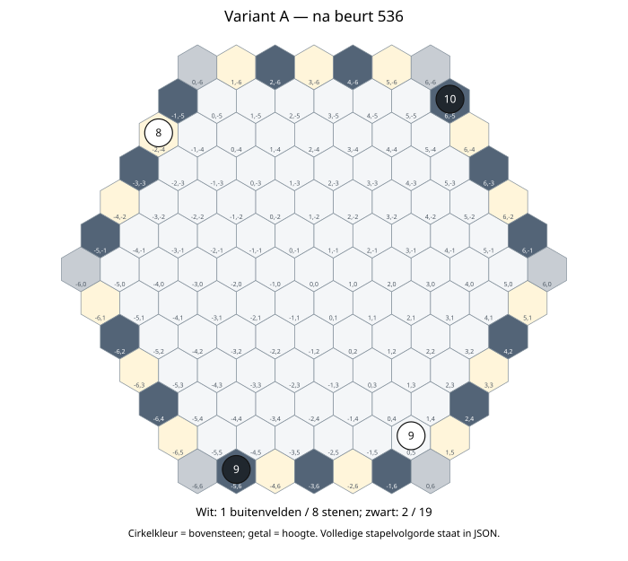

# Partij A-baseline_A-g000022583

Variant **A**, afloop **zwart wint**, 536 beurten.

Seed `149805519438865530`, partij-index `22583`. Wit: Willekeurig; zwart: Willekeurig.

Voorraadbeleid wit/zwart: `0/0`. Ontsnappingsvoorkeur: `False/False`. Faseschema's: `[-1, -1, -1]` / `[-1, -1, -1]`.

Slagzetten: **36**. Grootste stapel: **16**. Zetlimiet: 536.

Geselecteerd voor: Langste regulier beëindigde partij.

[Volledig reproduceerbaar JSON-bestand](A-baseline_A-g000022583.json) · [Zetten als CSV](A-baseline_A-g000022583.csv) · [Bordcoördinaten en buitenkleuren](../board.json)

## Volledig zetverloop

Coördinaten zijn axiaal: het midden is (0,0). Stapels worden in JSON van onder naar boven weergegeven; 0 is wit, 1 is zwart.

| Beurt | Speler | Handeling | Voorraad W/Z | Buitenvelden W/Z | Ontsnapte stenen W/Z |
|---:|---|---|---|---|---|
| 1 | wit | plaatsen op (0,0) | 17/18 | 0/0 | 0/0 |
| 2 | zwart | plaatsen op (-1,0) | 17/17 | 0/0 | 0/0 |
| 3 | wit | plaatsen op (-1,-1) | 16/17 | 0/0 | 0/0 |
| 4 | zwart | plaatsen op (-2,0) | 16/16 | 0/0 | 0/0 |
| 5 | wit | plaatsen op (-3,0) | 15/16 | 0/0 | 0/0 |
| 6 | zwart | plaatsen op (1,0) | 15/15 | 0/0 | 0/0 |
| 7 | wit | plaatsen op (0,-1) | 14/15 | 0/0 | 0/0 |
| 8 | zwart | plaatsen op (1,-1) | 14/14 | 0/0 | 0/0 |
| 9 | wit | plaatsen op (0,1) | 13/14 | 0/0 | 0/0 |
| 10 | zwart | plaatsen op (1,-2) | 13/13 | 0/0 | 0/0 |
| 11 | wit | plaatsen op (-4,1) | 12/13 | 0/0 | 0/0 |
| 12 | zwart | plaatsen op (1,1) | 12/12 | 0/0 | 0/0 |
| 13 | wit | plaatsen op (2,-1) | 11/12 | 0/0 | 0/0 |
| 14 | zwart | plaatsen op (-4,2) | 11/11 | 0/0 | 0/0 |
| 15 | wit | plaatsen op (2,1) | 10/11 | 0/0 | 0/0 |
| 16 | zwart | plaatsen op (-1,-2) | 10/10 | 0/0 | 0/0 |
| 17 | wit | plaatsen op (-3,-1) | 9/10 | 0/0 | 0/0 |
| 18 | zwart | plaatsen op (-1,1) | 9/9 | 0/0 | 0/0 |
| 19 | wit | plaatsen op (3,-2) | 8/9 | 0/0 | 0/0 |
| 20 | zwart | plaatsen op (-1,-3) | 8/8 | 0/0 | 0/0 |
| 21 | wit | plaatsen op (-4,0) | 7/8 | 0/0 | 0/0 |
| 22 | zwart | plaatsen op (3,-1) | 7/7 | 0/0 | 0/0 |
| 23 | wit | plaatsen op (0,2) | 6/7 | 0/0 | 0/0 |
| 24 | zwart | plaatsen op (-5,1) | 6/6 | 0/0 | 0/0 |
| 25 | wit | plaatsen op (2,2) | 5/6 | 0/0 | 0/0 |
| 26 | zwart | plaatsen op (-2,-3) | 5/5 | 0/0 | 0/0 |
| 27 | wit | plaatsen op (-2,-2) | 4/5 | 0/0 | 0/0 |
| 28 | zwart | plaatsen op (1,2) | 4/4 | 0/0 | 0/0 |
| 29 | wit | plaatsen op (2,0) | 3/4 | 0/0 | 0/0 |
| 30 | zwart | plaatsen op (3,-3) | 3/3 | 0/0 | 0/0 |
| 31 | wit | plaatsen op (2,-2) | 2/3 | 0/0 | 0/0 |
| 32 | zwart | plaatsen op (4,-2) | 2/2 | 0/0 | 0/0 |
| 33 | wit | plaatsen op (5,-2) | 1/2 | 0/0 | 0/0 |
| 34 | zwart | plaatsen op (-4,3) | 1/1 | 0/0 | 0/0 |
| 35 | wit | plaatsen op (-5,3) | 0/1 | 0/0 | 0/0 |
| 36 | zwart | plaatsen op (0,3) | 0/0 | 0/0 | 0/0 |
| 37 | wit | slaan (0, 0) → (-1,0) | 0/0 | 0/0 | 0/0 |
| 38 | zwart | slaan (-1, 1) → (0,1) | 0/0 | 0/0 | 0/0 |
| 39 | wit | slaan (-1, -1) → (-2,0) | 0/0 | 0/0 | 0/0 |
| 40 | zwart | slaan (-5, 1) → (-4,1) | 0/0 | 0/0 | 0/0 |
| 41 | wit | slaan (0, -1) → (1,-2) | 0/0 | 0/0 | 0/0 |
| 42 | zwart | slaan (-2, -3) → (-2,-2) | 0/0 | 0/0 | 0/0 |
| 43 | wit | slaan (2, 0) → (3,-1) | 0/0 | 0/0 | 0/0 |
| 44 | zwart | slaan (1, -1) → (1,-2) | 0/0 | 0/0 | 0/0 |
| 45 | wit | slaan (-1, 0) → (1,-2) | 0/0 | 0/0 | 0/0 |
| 46 | zwart | slaan (1, 2) → (2,1) | 0/0 | 0/0 | 0/0 |
| 47 | wit | slaan (1, -2) → (-4,3) | 0/0 | 0/0 | 0/0 |
| 48 | zwart | slaan (4, -2) → (3,-2) | 0/0 | 0/0 | 0/0 |
| 49 | wit | slaan (-4, 0) → (-4,1) | 0/0 | 0/0 | 0/0 |
| 50 | zwart | slaan (1, 1) → (0,2) | 0/0 | 0/0 | 0/0 |
| 51 | wit | slaan (-2, 0) → (-2,-2) | 0/0 | 0/0 | 0/0 |
| 52 | zwart | slaan (0, 2) → (2,2) | 0/0 | 0/0 | 0/0 |
| 53 | wit | slaan (2, -2) → (3,-2) | 0/0 | 0/0 | 0/0 |
| 54 | zwart | slaan (-1, -3) → (-2,-2) | 0/0 | 0/0 | 0/0 |
| 55 | wit | slaan (-5, 3) → (-4,2) | 0/0 | 0/0 | 0/0 |
| 56 | zwart | slaan (3, -3) → (3,-2) | 0/0 | 0/0 | 0/0 |
| 57 | wit | slaan (-3, -1) → (-2,-2) | 0/0 | 0/0 | 0/0 |
| 58 | zwart | slaan (2, 1) → (2,-1) | 0/0 | 0/0 | 0/0 |
| 59 | wit | bewegen (-2, -2) → (-2,0) | 0/0 | 0/0 | 0/0 |
| 60 | zwart | bewegen (0, 1) → (-2,3) | 0/0 | 0/0 | 0/0 |
| 61 | wit | bewegen (-2, 0) → (0,-2) | 0/0 | 0/0 | 0/0 |
| 62 | zwart | slaan (-1, -2) → (0,-2) | 0/0 | 0/0 | 0/0 |
| 63 | wit | bewegen (-4, 2) → (-2,0) | 0/0 | 0/0 | 0/0 |
| 64 | zwart | slaan (-2, 3) → (-4,3) | 0/0 | 0/0 | 0/0 |
| 65 | wit | slaan (-2, 0) → (0,-2) | 0/0 | 0/0 | 0/0 |
| 66 | zwart | bewegen (0, 3) → (1,2) | 0/0 | 0/0 | 0/0 |
| 67 | wit | bewegen (-4, 1) → (-4,-1) | 0/0 | 0/0 | 0/0 |
| 68 | zwart | bewegen (-4, 3) → (0,3) | 0/0 | 0/0 | 0/0 |
| 69 | wit | bewegen (3, -1) → (2,0) | 0/0 | 0/0 | 0/0 |
| 70 | zwart | slaan (1, 0) → (2,0) | 0/0 | 0/0 | 0/0 |
| 71 | wit | bewegen (-3, 0) → (-3,1) | 0/0 | 0/0 | 0/0 |
| 72 | zwart | bewegen (2, 0) → (4,0) | 0/0 | 0/0 | 0/0 |
| 73 | wit | bewegen (0, -2) → (-2,0) | 0/0 | 0/0 | 0/0 |
| 74 | zwart | bewegen (3, -2) → (4,-2) | 0/0 | 0/0 | 0/0 |
| 75 | wit | slaan (5, -2) → (4,-2) | 0/0 | 0/0 | 0/0 |
| 76 | zwart | bewegen (4, 0) → (1,0) | 0/0 | 0/0 | 0/0 |
| 77 | wit | bewegen (4, -2) → (4,0) | 0/0 | 0/0 | 0/0 |
| 78 | zwart | slaan (1, 0) → (-2,0) | 0/0 | 0/0 | 0/0 |
| 79 | wit | slaan (-3, 1) → (-2,0) | 0/0 | 0/0 | 0/0 |
| 80 | zwart | bewegen (2, 2) → (-1,5) | 0/0 | 0/0 | 0/0 |
| 81 | wit | slaan (4, 0) → (-1,5) | 0/0 | 0/0 | 0/0 |
| 82 | zwart | bewegen (2, -1) → (1,0) | 0/0 | 0/0 | 0/0 |
| 83 | wit | splitsen (-2, 0) → (-3,0); onderstuk 1 blijft | 0/0 | 0/0 | 0/0 |
| 84 | zwart | slaan (1, 0) → (-2,0) | 0/0 | 0/0 | 0/0 |
| 85 | wit | bewegen (-1, 5) → (-1,-3) | 0/0 | 0/0 | 0/0 |
| 86 | zwart | bewegen (-2, 0) → (-2,-1) | 0/0 | 0/0 | 0/0 |
| 87 | wit | bewegen (-3, 0) → (-4,0) | 0/0 | 0/0 | 0/0 |
| 88 | zwart | bewegen (-2, -1) → (-2,0) | 0/0 | 0/0 | 0/0 |
| 89 | wit | splitsen (-4, 0) → (-5,0); onderstuk 5 blijft | 0/0 | 0/0 | 0/0 |
| 90 | zwart | bewegen (0, 3) → (0,2) | 0/0 | 0/0 | 0/0 |
| 91 | wit | bewegen (-5, 0) → (-5,1) | 0/0 | 0/0 | 0/0 |
| 92 | zwart | bewegen (0, 2) → (0,1) | 0/0 | 0/0 | 0/0 |
| 93 | wit | bewegen (-4, -1) → (-1,-1) | 0/0 | 0/0 | 0/0 |
| 94 | zwart | bewegen (-2, 0) → (-2,-1) | 0/0 | 0/0 | 0/0 |
| 95 | wit | bewegen (-1, -1) → (2,-1) | 0/0 | 0/0 | 0/0 |
| 96 | zwart | slaan (-2, -1) → (2,-1) | 0/0 | 0/0 | 0/0 |
| 97 | wit | bewegen (-4, 0) → (-4,1) | 0/0 | 0/0 | 0/0 |
| 98 | zwart | bewegen (0, 1) → (-1,1) | 0/0 | 0/0 | 0/0 |
| 99 | wit | bewegen (-4, 1) → (-4,5) | 0/0 | 0/0 | 0/0 |
| 100 | zwart | bewegen (-1, 1) → (4,1) | 0/0 | 0/0 | 0/0 |
| 101 | wit | bewegen (-4, 5) → (0,5) | 0/0 | 0/0 | 0/0 |
| 102 | zwart | bewegen (4, 1) → (2,1) | 0/0 | 0/0 | 0/0 |
| 103 | wit | slaan (-5, 1) → (2,1) | 0/0 | 0/0 | 0/0 |
| 104 | zwart | slaan (1, 2) → (2,1) | 0/0 | 0/0 | 0/0 |
| 105 | wit | bewegen (-1, -3) → (-2,-2) | 0/0 | 0/0 | 0/0 |
| 106 | zwart | splitsen (2, 1) → (2,2); onderstuk 9 blijft | 0/0 | 0/0 | 0/0 |
| 107 | wit | bewegen (-2, -2) → (-2,0) | 0/0 | 0/0 | 0/0 |
| 108 | zwart | bewegen (2, -1) → (-3,4) | 0/0 | 0/0 | 0/0 |
| 109 | wit | bewegen (-2, 0) → (-2,-1) | 0/0 | 0/0 | 0/0 |
| 110 | zwart | bewegen (2, 1) → (2,0) | 0/0 | 0/0 | 0/0 |
| 111 | wit | bewegen (0, 5) → (0,2) | 0/0 | 0/0 | 0/0 |
| 112 | zwart | bewegen (-3, 4) → (0,1) | 0/0 | 0/0 | 0/0 |
| 113 | wit | bewegen (-2, -1) → (-3,-1) | 0/0 | 0/0 | 0/0 |
| 114 | zwart | bewegen (0, 1) → (-2,3) | 0/0 | 0/0 | 0/0 |
| 115 | wit | bewegen (-3, -1) → (-1,-3) | 0/0 | 0/0 | 0/0 |
| 116 | zwart | bewegen (-2, 3) → (-2,-2) | 0/0 | 0/0 | 0/0 |
| 117 | wit | bewegen (0, 2) → (-4,2) | 0/0 | 0/0 | 0/0 |
| 118 | zwart | bewegen (2, 0) → (5,-3) | 0/0 | 0/0 | 0/0 |
| 119 | wit | bewegen (-1, -3) → (1,-3) | 0/0 | 0/0 | 0/0 |
| 120 | zwart | bewegen (-2, -2) → (-3,-1) | 0/0 | 0/0 | 0/0 |
| 121 | wit | bewegen (1, -3) → (1,0) | 0/0 | 0/0 | 0/0 |
| 122 | zwart | bewegen (2, 2) → (2,1) | 0/0 | 0/0 | 0/0 |
| 123 | wit | bewegen (1, 0) → (0,1) | 0/0 | 0/0 | 0/0 |
| 124 | zwart | bewegen (5, -3) → (4,-3) | 0/0 | 0/0 | 0/0 |
| 125 | wit | bewegen (-4, 2) → (-4,4) | 0/0 | 0/0 | 0/0 |
| 126 | zwart | bewegen (-3, -1) → (1,-1) | 0/0 | 0/0 | 0/0 |
| 127 | wit | slaan (-4, 4) → (1,-1) | 0/0 | 0/0 | 0/0 |
| 128 | zwart | bewegen (4, -3) → (4,0) | 0/0 | 0/0 | 0/0 |
| 129 | wit | bewegen (0, 1) → (0,-4) | 0/0 | 0/0 | 0/0 |
| 130 | zwart | bewegen (4, 0) → (-1,0) | 0/0 | 0/0 | 0/0 |
| 131 | wit | bewegen (1, -1) → (4,-1) | 0/0 | 0/0 | 0/0 |
| 132 | zwart | bewegen (2, 1) → (-4,1) | 0/0 | 0/0 | 0/0 |
| 133 | wit | splitsen (4, -1) → (5,-2); onderstuk 3 blijft | 0/0 | 0/0 | 0/0 |
| 134 | zwart | bewegen (-1, 0) → (2,-3) | 0/0 | 0/0 | 0/0 |
| 135 | wit | bewegen (0, -4) → (-2,-2) | 0/0 | 0/0 | 0/0 |
| 136 | zwart | bewegen (-4, 1) → (2,-5) | 0/0 | 0/0 | 0/0 |
| 137 | wit | bewegen (4, -1) → (3,0) | 0/0 | 0/0 | 0/0 |
| 138 | zwart | bewegen (2, -3) → (1,-3) | 0/0 | 0/0 | 0/0 |
| 139 | wit | bewegen (5, -2) → (-1,-2) | 0/0 | 0/0 | 0/0 |
| 140 | zwart | bewegen (1, -3) → (-2,-3) | 0/0 | 0/0 | 0/0 |
| 141 | wit | bewegen (-2, -2) → (-3,-1) | 0/0 | 0/0 | 0/0 |
| 142 | zwart | bewegen (-2, -3) → (-5,0) | 0/0 | 0/0 | 0/0 |
| 143 | wit | bewegen (-1, -2) → (-1,3) | 0/0 | 0/0 | 0/0 |
| 144 | zwart | bewegen (-5, 0) → (-3,0) | 0/0 | 0/0 | 0/0 |
| 145 | wit | bewegen (-1, 3) → (-1,1) | 0/0 | 0/0 | 0/0 |
| 146 | zwart | bewegen (2, -5) → (1,-5) | 0/0 | 0/0 | 0/0 |
| 147 | wit | bewegen (3, 0) → (3,-1) | 0/0 | 0/0 | 0/0 |
| 148 | zwart | bewegen (-3, 0) → (0,0) | 0/0 | 0/0 | 0/0 |
| 149 | wit | bewegen (-3, -1) → (-2,-1) | 0/0 | 0/0 | 0/0 |
| 150 | zwart | bewegen (1, -5) → (0,-5) | 0/0 | 0/0 | 0/0 |
| 151 | wit | bewegen (-1, 1) → (1,1) | 0/0 | 0/0 | 0/0 |
| 152 | zwart | bewegen (0, -5) → (-4,-1) | 0/0 | 0/0 | 0/0 |
| 153 | wit | bewegen (-2, -1) → (-2,2) | 0/0 | 0/0 | 0/0 |
| 154 | zwart | slaan (-4, -1) → (3,-1) | 0/0 | 0/0 | 0/0 |
| 155 | wit | bewegen (1, 1) → (4,1) | 0/0 | 0/0 | 0/0 |
| 156 | zwart | bewegen (3, -1) → (3,-4) | 0/0 | 0/0 | 0/0 |
| 157 | wit | bewegen (-2, 2) → (1,2) | 0/0 | 0/0 | 0/0 |
| 158 | zwart | bewegen (3, -4) → (-1,0) | 0/0 | 0/0 | 0/0 |
| 159 | wit | bewegen (4, 1) → (4,-1) | 0/0 | 0/0 | 0/0 |
| 160 | zwart | bewegen (0, 0) → (0,-5) | 0/0 | 0/0 | 0/0 |
| 161 | wit | bewegen (1, 2) → (1,4) | 0/0 | 0/0 | 0/0 |
| 162 | zwart | bewegen (-1, 0) → (3,-4) | 0/0 | 0/0 | 0/0 |
| 163 | wit | bewegen (1, 4) → (1,2) | 0/0 | 0/0 | 0/0 |
| 164 | zwart | bewegen (3, -4) → (-4,3) | 0/0 | 0/0 | 0/0 |
| 165 | wit | bewegen (4, -1) → (3,0) | 0/0 | 0/0 | 0/0 |
| 166 | zwart | bewegen (-4, 3) → (-3,3) | 0/0 | 0/0 | 0/0 |
| 167 | wit | bewegen (3, 0) → (2,0) | 0/0 | 0/0 | 0/0 |
| 168 | zwart | bewegen (0, -5) → (2,-5) | 0/0 | 0/0 | 0/0 |
| 169 | wit | bewegen (1, 2) → (2,2) | 0/0 | 0/0 | 0/0 |
| 170 | zwart | bewegen (-3, 3) → (-2,2) | 0/0 | 0/0 | 0/0 |
| 171 | wit | bewegen (2, 0) → (0,0) | 0/0 | 0/0 | 0/0 |
| 172 | zwart | bewegen (2, -5) → (1,-5) | 0/0 | 0/0 | 0/0 |
| 173 | wit | bewegen (0, 0) → (1,-1) | 0/0 | 0/0 | 0/0 |
| 174 | zwart | bewegen (-2, 2) → (-3,3) | 0/0 | 0/0 | 0/0 |
| 175 | wit | bewegen (2, 2) → (0,4) | 0/0 | 0/0 | 0/0 |
| 176 | zwart | bewegen (1, -5) → (1,-2) | 0/0 | 0/0 | 0/0 |
| 177 | wit | bewegen (1, -1) → (-1,1) | 0/0 | 0/0 | 0/0 |
| 178 | zwart | bewegen (1, -2) → (2,-2) | 0/0 | 0/0 | 0/0 |
| 179 | wit | bewegen (-1, 1) → (-1,0) | 0/0 | 0/0 | 0/0 |
| 180 | zwart | bewegen (-3, 3) → (-2,3) | 0/0 | 0/0 | 0/0 |
| 181 | wit | bewegen (-1, 0) → (-1,-3) | 0/0 | 0/0 | 0/0 |
| 182 | zwart | bewegen (-2, 3) → (-2,2) | 0/0 | 0/0 | 0/0 |
| 183 | wit | bewegen (0, 4) → (-2,4) | 0/0 | 0/0 | 0/0 |
| 184 | zwart | bewegen (-2, 2) → (-4,4) | 0/0 | 0/0 | 0/0 |
| 185 | wit | ontsnappen (-2, 4) → (-2,-4) | 0/0 | 1/0 | 8/0 |
| 186 | zwart | bewegen (2, -2) → (1,-1) | 0/0 | 1/0 | 8/0 |
| 187 | wit | bewegen (-1, -3) → (-2,-2) | 0/0 | 1/0 | 8/0 |
| 188 | zwart | bewegen (-4, 4) → (1,4) | 0/0 | 1/0 | 8/0 |
| 189 | wit | bewegen (-2, -2) → (-2,2) | 0/0 | 1/0 | 8/0 |
| 190 | zwart | bewegen (1, -1) → (1,1) | 0/0 | 1/0 | 8/0 |
| 191 | wit | bewegen (-2, 2) → (5,-5) | 0/0 | 1/0 | 8/0 |
| 192 | zwart | bewegen (1, 1) → (4,1) | 0/0 | 1/0 | 8/0 |
| 193 | wit | bewegen (5, -5) → (-2,2) | 0/0 | 1/0 | 8/0 |
| 194 | zwart | bewegen (1, 4) → (1,-5) | 0/0 | 1/0 | 8/0 |
| 195 | wit | bewegen (-2, 2) → (-2,3) | 0/0 | 1/0 | 8/0 |
| 196 | zwart | bewegen (1, -5) → (-2,-2) | 0/0 | 1/0 | 8/0 |
| 197 | wit | bewegen (-2, 3) → (3,-2) | 0/0 | 1/0 | 8/0 |
| 198 | zwart | bewegen (-2, -2) → (-1,-3) | 0/0 | 1/0 | 8/0 |
| 199 | wit | bewegen (3, -2) → (-4,5) | 0/0 | 1/0 | 8/0 |
| 200 | zwart | bewegen (-1, -3) → (-1,0) | 0/0 | 1/0 | 8/0 |
| 201 | wit | bewegen (-4, 5) → (1,0) | 0/0 | 1/0 | 8/0 |
| 202 | zwart | bewegen (4, 1) → (3,2) | 0/0 | 1/0 | 8/0 |
| 203 | wit | bewegen (1, 0) → (1,-5) | 0/0 | 1/0 | 8/0 |
| 204 | zwart | bewegen (3, 2) → (3,-5) | 0/0 | 1/0 | 8/0 |
| 205 | wit | bewegen (1, -5) → (1,3) | 0/0 | 1/0 | 8/0 |
| 206 | zwart | bewegen (-1, 0) → (4,0) | 0/0 | 1/0 | 8/0 |
| 207 | wit | bewegen (1, 3) → (1,1) | 0/0 | 1/0 | 8/0 |
| 208 | zwart | bewegen (3, -5) → (4,-5) | 0/0 | 1/0 | 8/0 |
| 209 | wit | bewegen (1, 1) → (1,-4) | 0/0 | 1/0 | 8/0 |
| 210 | zwart | bewegen (4, -5) → (4,-1) | 0/0 | 1/0 | 8/0 |
| 211 | wit | bewegen (1, -4) → (1,3) | 0/0 | 1/0 | 8/0 |
| 212 | zwart | bewegen (4, -1) → (-1,4) | 0/0 | 1/0 | 8/0 |
| 213 | wit | bewegen (1, 3) → (0,4) | 0/0 | 1/0 | 8/0 |
| 214 | zwart | bewegen (4, 0) → (-3,0) | 0/0 | 1/0 | 8/0 |
| 215 | wit | bewegen (0, 4) → (1,4) | 0/0 | 1/0 | 8/0 |
| 216 | zwart | bewegen (-3, 0) → (-3,3) | 0/0 | 1/0 | 8/0 |
| 217 | wit | bewegen (1, 4) → (4,1) | 0/0 | 1/0 | 8/0 |
| 218 | zwart | bewegen (-1, 4) → (0,3) | 0/0 | 1/0 | 8/0 |
| 219 | wit | bewegen (4, 1) → (0,5) | 0/0 | 1/0 | 8/0 |
| 220 | zwart | bewegen (0, 3) → (0,-2) | 0/0 | 1/0 | 8/0 |
| 221 | wit | bewegen (0, 5) → (0,2) | 0/0 | 1/0 | 8/0 |
| 222 | zwart | bewegen (0, -2) → (-3,-2) | 0/0 | 1/0 | 8/0 |
| 223 | wit | bewegen (0, 2) → (-5,2) | 0/0 | 1/0 | 8/0 |
| 224 | zwart | bewegen (-3, -2) → (0,-2) | 0/0 | 1/0 | 8/0 |
| 225 | wit | bewegen (-5, 2) → (0,2) | 0/0 | 1/0 | 8/0 |
| 226 | zwart | bewegen (-3, 3) → (0,0) | 0/0 | 1/0 | 8/0 |
| 227 | wit | bewegen (0, 2) → (-1,2) | 0/0 | 1/0 | 8/0 |
| 228 | zwart | bewegen (0, 0) → (3,-3) | 0/0 | 1/0 | 8/0 |
| 229 | wit | bewegen (-1, 2) → (-4,2) | 0/0 | 1/0 | 8/0 |
| 230 | zwart | bewegen (0, -2) → (0,0) | 0/0 | 1/0 | 8/0 |
| 231 | wit | bewegen (-4, 2) → (-3,2) | 0/0 | 1/0 | 8/0 |
| 232 | zwart | bewegen (3, -3) → (5,-3) | 0/0 | 1/0 | 8/0 |
| 233 | wit | bewegen (-3, 2) → (0,2) | 0/0 | 1/0 | 8/0 |
| 234 | zwart | bewegen (5, -3) → (5,-4) | 0/0 | 1/0 | 8/0 |
| 235 | wit | bewegen (0, 2) → (-1,2) | 0/0 | 1/0 | 8/0 |
| 236 | zwart | bewegen (0, 0) → (-2,0) | 0/0 | 1/0 | 8/0 |
| 237 | wit | bewegen (-1, 2) → (-1,-2) | 0/0 | 1/0 | 8/0 |
| 238 | zwart | bewegen (5, -4) → (5,-5) | 0/0 | 1/0 | 8/0 |
| 239 | wit | bewegen (-1, -2) → (-1,0) | 0/0 | 1/0 | 8/0 |
| 240 | zwart | bewegen (5, -5) → (5,-2) | 0/0 | 1/0 | 8/0 |
| 241 | wit | bewegen (-1, 0) → (-1,1) | 0/0 | 1/0 | 8/0 |
| 242 | zwart | bewegen (-2, 0) → (1,0) | 0/0 | 1/0 | 8/0 |
| 243 | wit | bewegen (-1, 1) → (-5,1) | 0/0 | 1/0 | 8/0 |
| 244 | zwart | bewegen (5, -2) → (3,0) | 0/0 | 1/0 | 8/0 |
| 245 | wit | bewegen (-5, 1) → (0,1) | 0/0 | 1/0 | 8/0 |
| 246 | zwart | bewegen (3, 0) → (1,2) | 0/0 | 1/0 | 8/0 |
| 247 | wit | bewegen (0, 1) → (-5,1) | 0/0 | 1/0 | 8/0 |
| 248 | zwart | bewegen (1, 2) → (-2,5) | 0/0 | 1/0 | 8/0 |
| 249 | wit | bewegen (-5, 1) → (-5,0) | 0/0 | 1/0 | 8/0 |
| 250 | zwart | bewegen (1, 0) → (2,-1) | 0/0 | 1/0 | 8/0 |
| 251 | wit | bewegen (-5, 0) → (3,0) | 0/0 | 1/0 | 8/0 |
| 252 | zwart | bewegen (-2, 5) → (2,1) | 0/0 | 1/0 | 8/0 |
| 253 | wit | bewegen (3, 0) → (4,0) | 0/0 | 1/0 | 8/0 |
| 254 | zwart | bewegen (2, 1) → (-1,4) | 0/0 | 1/0 | 8/0 |
| 255 | wit | bewegen (4, 0) → (0,4) | 0/0 | 1/0 | 8/0 |
| 256 | zwart | bewegen (2, -1) → (2,-2) | 0/0 | 1/0 | 8/0 |
| 257 | wit | bewegen (0, 4) → (0,2) | 0/0 | 1/0 | 8/0 |
| 258 | zwart | bewegen (2, -2) → (-5,5) | 0/0 | 1/0 | 8/0 |
| 259 | wit | bewegen (0, 2) → (3,-1) | 0/0 | 1/0 | 8/0 |
| 260 | zwart | bewegen (-1, 4) → (-1,-4) | 0/0 | 1/0 | 8/0 |
| 261 | wit | bewegen (3, -1) → (-3,-1) | 0/0 | 1/0 | 8/0 |
| 262 | zwart | bewegen (-5, 5) → (-5,2) | 0/0 | 1/0 | 8/0 |
| 263 | wit | bewegen (-3, -1) → (-5,1) | 0/0 | 1/0 | 8/0 |
| 264 | zwart | bewegen (-1, -4) → (2,-4) | 0/0 | 1/0 | 8/0 |
| 265 | wit | bewegen (-5, 1) → (2,1) | 0/0 | 1/0 | 8/0 |
| 266 | zwart | bewegen (-5, 2) → (-3,2) | 0/0 | 1/0 | 8/0 |
| 267 | wit | bewegen (2, 1) → (3,1) | 0/0 | 1/0 | 8/0 |
| 268 | zwart | bewegen (2, -4) → (2,-3) | 0/0 | 1/0 | 8/0 |
| 269 | wit | bewegen (3, 1) → (-3,1) | 0/0 | 1/0 | 8/0 |
| 270 | zwart | bewegen (2, -3) → (2,-2) | 0/0 | 1/0 | 8/0 |
| 271 | wit | bewegen (-3, 1) → (-1,-1) | 0/0 | 1/0 | 8/0 |
| 272 | zwart | bewegen (2, -2) → (4,-2) | 0/0 | 1/0 | 8/0 |
| 273 | wit | bewegen (-1, -1) → (-1,0) | 0/0 | 1/0 | 8/0 |
| 274 | zwart | bewegen (4, -2) → (0,-2) | 0/0 | 1/0 | 8/0 |
| 275 | wit | bewegen (-1, 0) → (0,0) | 0/0 | 1/0 | 8/0 |
| 276 | zwart | bewegen (-3, 2) → (4,-5) | 0/0 | 1/0 | 8/0 |
| 277 | wit | bewegen (0, 0) → (0,-1) | 0/0 | 1/0 | 8/0 |
| 278 | zwart | bewegen (0, -2) → (3,-2) | 0/0 | 1/0 | 8/0 |
| 279 | wit | bewegen (0, -1) → (0,-3) | 0/0 | 1/0 | 8/0 |
| 280 | zwart | bewegen (3, -2) → (-1,2) | 0/0 | 1/0 | 8/0 |
| 281 | wit | bewegen (0, -3) → (-3,0) | 0/0 | 1/0 | 8/0 |
| 282 | zwart | bewegen (4, -5) → (4,-3) | 0/0 | 1/0 | 8/0 |
| 283 | wit | bewegen (-3, 0) → (4,0) | 0/0 | 1/0 | 8/0 |
| 284 | zwart | bewegen (4, -3) → (2,-3) | 0/0 | 1/0 | 8/0 |
| 285 | wit | bewegen (4, 0) → (4,1) | 0/0 | 1/0 | 8/0 |
| 286 | zwart | bewegen (-1, 2) → (-4,2) | 0/0 | 1/0 | 8/0 |
| 287 | wit | bewegen (4, 1) → (5,0) | 0/0 | 1/0 | 8/0 |
| 288 | zwart | bewegen (2, -3) → (-3,2) | 0/0 | 1/0 | 8/0 |
| 289 | wit | bewegen (5, 0) → (2,3) | 0/0 | 1/0 | 8/0 |
| 290 | zwart | bewegen (-4, 2) → (3,-5) | 0/0 | 1/0 | 8/0 |
| 291 | wit | bewegen (2, 3) → (-2,3) | 0/0 | 1/0 | 8/0 |
| 292 | zwart | bewegen (-3, 2) → (-1,2) | 0/0 | 1/0 | 8/0 |
| 293 | wit | bewegen (-2, 3) → (-2,0) | 0/0 | 1/0 | 8/0 |
| 294 | zwart | bewegen (-1, 2) → (-1,4) | 0/0 | 1/0 | 8/0 |
| 295 | wit | bewegen (-2, 0) → (2,-4) | 0/0 | 1/0 | 8/0 |
| 296 | zwart | bewegen (3, -5) → (5,-5) | 0/0 | 1/0 | 8/0 |
| 297 | wit | bewegen (2, -4) → (0,-4) | 0/0 | 1/0 | 8/0 |
| 298 | zwart | bewegen (5, -5) → (-4,4) | 0/0 | 1/0 | 8/0 |
| 299 | wit | bewegen (0, -4) → (5,-4) | 0/0 | 1/0 | 8/0 |
| 300 | zwart | bewegen (-1, 4) → (1,2) | 0/0 | 1/0 | 8/0 |
| 301 | wit | bewegen (5, -4) → (5,-1) | 0/0 | 1/0 | 8/0 |
| 302 | zwart | bewegen (-4, 4) → (-1,4) | 0/0 | 1/0 | 8/0 |
| 303 | wit | bewegen (5, -1) → (-4,-1) | 0/0 | 1/0 | 8/0 |
| 304 | zwart | bewegen (1, 2) → (1,3) | 0/0 | 1/0 | 8/0 |
| 305 | wit | bewegen (-4, -1) → (0,-1) | 0/0 | 1/0 | 8/0 |
| 306 | zwart | bewegen (-1, 4) → (-1,3) | 0/0 | 1/0 | 8/0 |
| 307 | wit | bewegen (0, -1) → (-4,3) | 0/0 | 1/0 | 8/0 |
| 308 | zwart | bewegen (1, 3) → (1,-4) | 0/0 | 1/0 | 8/0 |
| 309 | wit | bewegen (-4, 3) → (-5,3) | 0/0 | 1/0 | 8/0 |
| 310 | zwart | bewegen (1, -4) → (-1,-2) | 0/0 | 1/0 | 8/0 |
| 311 | wit | bewegen (-5, 3) → (-1,-1) | 0/0 | 1/0 | 8/0 |
| 312 | zwart | bewegen (-1, 3) → (1,1) | 0/0 | 1/0 | 8/0 |
| 313 | wit | bewegen (-1, -1) → (-1,0) | 0/0 | 1/0 | 8/0 |
| 314 | zwart | bewegen (1, 1) → (-5,1) | 0/0 | 1/0 | 8/0 |
| 315 | wit | bewegen (-1, 0) → (-1,1) | 0/0 | 1/0 | 8/0 |
| 316 | zwart | bewegen (-5, 1) → (-4,0) | 0/0 | 1/0 | 8/0 |
| 317 | wit | bewegen (-1, 1) → (4,-4) | 0/0 | 1/0 | 8/0 |
| 318 | zwart | bewegen (-4, 0) → (-1,0) | 0/0 | 1/0 | 8/0 |
| 319 | wit | bewegen (4, -4) → (4,1) | 0/0 | 1/0 | 8/0 |
| 320 | zwart | bewegen (-1, 0) → (-1,4) | 0/0 | 1/0 | 8/0 |
| 321 | wit | bewegen (4, 1) → (1,4) | 0/0 | 1/0 | 8/0 |
| 322 | zwart | bewegen (-1, 4) → (-2,5) | 0/0 | 1/0 | 8/0 |
| 323 | wit | bewegen (1, 4) → (1,3) | 0/0 | 1/0 | 8/0 |
| 324 | zwart | bewegen (-1, -2) → (-1,2) | 0/0 | 1/0 | 8/0 |
| 325 | wit | bewegen (1, 3) → (1,-2) | 0/0 | 1/0 | 8/0 |
| 326 | zwart | bewegen (-2, 5) → (-2,3) | 0/0 | 1/0 | 8/0 |
| 327 | wit | bewegen (1, -2) → (5,-2) | 0/0 | 1/0 | 8/0 |
| 328 | zwart | bewegen (-1, 2) → (0,2) | 0/0 | 1/0 | 8/0 |
| 329 | wit | bewegen (5, -2) → (0,-2) | 0/0 | 1/0 | 8/0 |
| 330 | zwart | bewegen (0, 2) → (-3,5) | 0/0 | 1/0 | 8/0 |
| 331 | wit | bewegen (0, -2) → (5,-2) | 0/0 | 1/0 | 8/0 |
| 332 | zwart | bewegen (-3, 5) → (-5,5) | 0/0 | 1/0 | 8/0 |
| 333 | wit | bewegen (5, -2) → (3,-2) | 0/0 | 1/0 | 8/0 |
| 334 | zwart | bewegen (-2, 3) → (1,0) | 0/0 | 1/0 | 8/0 |
| 335 | wit | bewegen (3, -2) → (4,-3) | 0/0 | 1/0 | 8/0 |
| 336 | zwart | bewegen (1, 0) → (1,-2) | 0/0 | 1/0 | 8/0 |
| 337 | wit | bewegen (4, -3) → (4,-1) | 0/0 | 1/0 | 8/0 |
| 338 | zwart | bewegen (1, -2) → (-5,4) | 0/0 | 1/0 | 8/0 |
| 339 | wit | bewegen (4, -1) → (4,1) | 0/0 | 1/0 | 8/0 |
| 340 | zwart | bewegen (-5, 5) → (2,-2) | 0/0 | 1/0 | 8/0 |
| 341 | wit | bewegen (4, 1) → (-5,1) | 0/0 | 1/0 | 8/0 |
| 342 | zwart | bewegen (-5, 4) → (3,-4) | 0/0 | 1/0 | 8/0 |
| 343 | wit | bewegen (-5, 1) → (0,-4) | 0/0 | 1/0 | 8/0 |
| 344 | zwart | bewegen (2, -2) → (2,-4) | 0/0 | 1/0 | 8/0 |
| 345 | wit | bewegen (0, -4) → (-1,-4) | 0/0 | 1/0 | 8/0 |
| 346 | zwart | bewegen (3, -4) → (4,-5) | 0/0 | 1/0 | 8/0 |
| 347 | wit | bewegen (-1, -4) → (-1,-1) | 0/0 | 1/0 | 8/0 |
| 348 | zwart | bewegen (2, -4) → (5,-4) | 0/0 | 1/0 | 8/0 |
| 349 | wit | bewegen (-1, -1) → (-1,-4) | 0/0 | 1/0 | 8/0 |
| 350 | zwart | bewegen (4, -5) → (4,0) | 0/0 | 1/0 | 8/0 |
| 351 | wit | bewegen (-1, -4) → (-1,3) | 0/0 | 1/0 | 8/0 |
| 352 | zwart | bewegen (4, 0) → (3,1) | 0/0 | 1/0 | 8/0 |
| 353 | wit | bewegen (-1, 3) → (-1,-4) | 0/0 | 1/0 | 8/0 |
| 354 | zwart | bewegen (3, 1) → (3,-1) | 0/0 | 1/0 | 8/0 |
| 355 | wit | bewegen (-1, -4) → (-4,-1) | 0/0 | 1/0 | 8/0 |
| 356 | zwart | bewegen (5, -4) → (0,1) | 0/0 | 1/0 | 8/0 |
| 357 | wit | bewegen (-4, -1) → (1,-1) | 0/0 | 1/0 | 8/0 |
| 358 | zwart | bewegen (3, -1) → (0,2) | 0/0 | 1/0 | 8/0 |
| 359 | wit | bewegen (1, -1) → (-1,1) | 0/0 | 1/0 | 8/0 |
| 360 | zwart | bewegen (0, 2) → (0,5) | 0/0 | 1/0 | 8/0 |
| 361 | wit | bewegen (-1, 1) → (-1,0) | 0/0 | 1/0 | 8/0 |
| 362 | zwart | bewegen (0, 5) → (4,1) | 0/0 | 1/0 | 8/0 |
| 363 | wit | bewegen (-1, 0) → (-5,0) | 0/0 | 1/0 | 8/0 |
| 364 | zwart | bewegen (0, 1) → (2,1) | 0/0 | 1/0 | 8/0 |
| 365 | wit | bewegen (-5, 0) → (4,0) | 0/0 | 1/0 | 8/0 |
| 366 | zwart | bewegen (2, 1) → (-1,1) | 0/0 | 1/0 | 8/0 |
| 367 | wit | bewegen (4, 0) → (3,0) | 0/0 | 1/0 | 8/0 |
| 368 | zwart | bewegen (-1, 1) → (-1,2) | 0/0 | 1/0 | 8/0 |
| 369 | wit | bewegen (3, 0) → (2,1) | 0/0 | 1/0 | 8/0 |
| 370 | zwart | bewegen (-1, 2) → (-4,5) | 0/0 | 1/0 | 8/0 |
| 371 | wit | bewegen (2, 1) → (1,2) | 0/0 | 1/0 | 8/0 |
| 372 | zwart | bewegen (4, 1) → (4,0) | 0/0 | 1/0 | 8/0 |
| 373 | wit | bewegen (1, 2) → (-4,2) | 0/0 | 1/0 | 8/0 |
| 374 | zwart | bewegen (-4, 5) → (3,-2) | 0/0 | 1/0 | 8/0 |
| 375 | wit | bewegen (-4, 2) → (-1,-1) | 0/0 | 1/0 | 8/0 |
| 376 | zwart | bewegen (4, 0) → (3,0) | 0/0 | 1/0 | 8/0 |
| 377 | wit | bewegen (-1, -1) → (5,-1) | 0/0 | 1/0 | 8/0 |
| 378 | zwart | bewegen (3, -2) → (1,-2) | 0/0 | 1/0 | 8/0 |
| 379 | wit | bewegen (5, -1) → (1,3) | 0/0 | 1/0 | 8/0 |
| 380 | zwart | bewegen (1, -2) → (-4,3) | 0/0 | 1/0 | 8/0 |
| 381 | wit | bewegen (1, 3) → (-1,3) | 0/0 | 1/0 | 8/0 |
| 382 | zwart | bewegen (-4, 3) → (0,-1) | 0/0 | 1/0 | 8/0 |
| 383 | wit | bewegen (-1, 3) → (-1,0) | 0/0 | 1/0 | 8/0 |
| 384 | zwart | bewegen (3, 0) → (2,1) | 0/0 | 1/0 | 8/0 |
| 385 | wit | bewegen (-1, 0) → (-1,4) | 0/0 | 1/0 | 8/0 |
| 386 | zwart | bewegen (0, -1) → (1,-1) | 0/0 | 1/0 | 8/0 |
| 387 | wit | bewegen (-1, 4) → (-1,-2) | 0/0 | 1/0 | 8/0 |
| 388 | zwart | bewegen (1, -1) → (-1,-1) | 0/0 | 1/0 | 8/0 |
| 389 | wit | bewegen (-1, -2) → (-3,-2) | 0/0 | 1/0 | 8/0 |
| 390 | zwart | bewegen (-1, -1) → (4,-1) | 0/0 | 1/0 | 8/0 |
| 391 | wit | bewegen (-3, -2) → (1,-2) | 0/0 | 1/0 | 8/0 |
| 392 | zwart | bewegen (2, 1) → (-2,5) | 0/0 | 1/0 | 8/0 |
| 393 | wit | bewegen (1, -2) → (-3,-2) | 0/0 | 1/0 | 8/0 |
| 394 | zwart | bewegen (-2, 5) → (-2,0) | 0/0 | 1/0 | 8/0 |
| 395 | wit | bewegen (-3, -2) → (1,-2) | 0/0 | 1/0 | 8/0 |
| 396 | zwart | bewegen (-2, 0) → (4,0) | 0/0 | 1/0 | 8/0 |
| 397 | wit | bewegen (1, -2) → (-1,0) | 0/0 | 1/0 | 8/0 |
| 398 | zwart | bewegen (4, 0) → (0,0) | 0/0 | 1/0 | 8/0 |
| 399 | wit | bewegen (-1, 0) → (-4,0) | 0/0 | 1/0 | 8/0 |
| 400 | zwart | bewegen (0, 0) → (0,1) | 0/0 | 1/0 | 8/0 |
| 401 | wit | bewegen (-4, 0) → (5,0) | 0/0 | 1/0 | 8/0 |
| 402 | zwart | bewegen (0, 1) → (-1,1) | 0/0 | 1/0 | 8/0 |
| 403 | wit | bewegen (5, 0) → (2,0) | 0/0 | 1/0 | 8/0 |
| 404 | zwart | bewegen (4, -1) → (2,1) | 0/0 | 1/0 | 8/0 |
| 405 | wit | bewegen (2, 0) → (0,2) | 0/0 | 1/0 | 8/0 |
| 406 | zwart | bewegen (2, 1) → (2,-1) | 0/0 | 1/0 | 8/0 |
| 407 | wit | bewegen (0, 2) → (-1,3) | 0/0 | 1/0 | 8/0 |
| 408 | zwart | bewegen (-1, 1) → (0,1) | 0/0 | 1/0 | 8/0 |
| 409 | wit | bewegen (-1, 3) → (-2,4) | 0/0 | 1/0 | 8/0 |
| 410 | zwart | bewegen (0, 1) → (-2,3) | 0/0 | 1/0 | 8/0 |
| 411 | wit | bewegen (-2, 4) → (4,-2) | 0/0 | 1/0 | 8/0 |
| 412 | zwart | bewegen (2, -1) → (2,3) | 0/0 | 1/0 | 8/0 |
| 413 | wit | bewegen (4, -2) → (1,-2) | 0/0 | 1/0 | 8/0 |
| 414 | zwart | bewegen (-2, 3) → (-2,5) | 0/0 | 1/0 | 8/0 |
| 415 | wit | bewegen (1, -2) → (1,3) | 0/0 | 1/0 | 8/0 |
| 416 | zwart | bewegen (2, 3) → (2,-5) | 0/0 | 1/0 | 8/0 |
| 417 | wit | bewegen (1, 3) → (-2,3) | 0/0 | 1/0 | 8/0 |
| 418 | zwart | bewegen (2, -5) → (2,-3) | 0/0 | 1/0 | 8/0 |
| 419 | wit | bewegen (-2, 3) → (4,-3) | 0/0 | 1/0 | 8/0 |
| 420 | zwart | bewegen (-2, 5) → (-2,2) | 0/0 | 1/0 | 8/0 |
| 421 | wit | bewegen (4, -3) → (4,1) | 0/0 | 1/0 | 8/0 |
| 422 | zwart | bewegen (2, -3) → (1,-2) | 0/0 | 1/0 | 8/0 |
| 423 | wit | bewegen (4, 1) → (1,4) | 0/0 | 1/0 | 8/0 |
| 424 | zwart | bewegen (-2, 2) → (-5,5) | 0/0 | 1/0 | 8/0 |
| 425 | wit | bewegen (1, 4) → (0,4) | 0/0 | 1/0 | 8/0 |
| 426 | zwart | bewegen (-5, 5) → (0,0) | 0/0 | 1/0 | 8/0 |
| 427 | wit | bewegen (0, 4) → (1,4) | 0/0 | 1/0 | 8/0 |
| 428 | zwart | bewegen (1, -2) → (4,-2) | 0/0 | 1/0 | 8/0 |
| 429 | wit | bewegen (1, 4) → (-2,4) | 0/0 | 1/0 | 8/0 |
| 430 | zwart | bewegen (0, 0) → (-4,4) | 0/0 | 1/0 | 8/0 |
| 431 | wit | bewegen (-2, 4) → (-1,3) | 0/0 | 1/0 | 8/0 |
| 432 | zwart | bewegen (-4, 4) → (-4,2) | 0/0 | 1/0 | 8/0 |
| 433 | wit | bewegen (-1, 3) → (-1,-3) | 0/0 | 1/0 | 8/0 |
| 434 | zwart | bewegen (4, -2) → (-1,3) | 0/0 | 1/0 | 8/0 |
| 435 | wit | bewegen (-1, -3) → (1,-3) | 0/0 | 1/0 | 8/0 |
| 436 | zwart | bewegen (-1, 3) → (-1,1) | 0/0 | 1/0 | 8/0 |
| 437 | wit | bewegen (1, -3) → (1,2) | 0/0 | 1/0 | 8/0 |
| 438 | zwart | bewegen (-4, 2) → (-4,3) | 0/0 | 1/0 | 8/0 |
| 439 | wit | bewegen (1, 2) → (1,1) | 0/0 | 1/0 | 8/0 |
| 440 | zwart | bewegen (-4, 3) → (-2,1) | 0/0 | 1/0 | 8/0 |
| 441 | wit | bewegen (1, 1) → (1,-3) | 0/0 | 1/0 | 8/0 |
| 442 | zwart | bewegen (-2, 1) → (-2,-1) | 0/0 | 1/0 | 8/0 |
| 443 | wit | bewegen (1, -3) → (2,-3) | 0/0 | 1/0 | 8/0 |
| 444 | zwart | bewegen (-1, 1) → (-5,1) | 0/0 | 1/0 | 8/0 |
| 445 | wit | bewegen (2, -3) → (4,-5) | 0/0 | 1/0 | 8/0 |
| 446 | zwart | bewegen (-2, -1) → (-2,-2) | 0/0 | 1/0 | 8/0 |
| 447 | wit | bewegen (4, -5) → (1,-2) | 0/0 | 1/0 | 8/0 |
| 448 | zwart | bewegen (-2, -2) → (-2,4) | 0/0 | 1/0 | 8/0 |
| 449 | wit | bewegen (1, -2) → (1,-5) | 0/0 | 1/0 | 8/0 |
| 450 | zwart | bewegen (-5, 1) → (-4,1) | 0/0 | 1/0 | 8/0 |
| 451 | wit | bewegen (1, -5) → (4,-5) | 0/0 | 1/0 | 8/0 |
| 452 | zwart | bewegen (-4, 1) → (-2,-1) | 0/0 | 1/0 | 8/0 |
| 453 | wit | bewegen (4, -5) → (1,-5) | 0/0 | 1/0 | 8/0 |
| 454 | zwart | bewegen (-2, -1) → (5,-1) | 0/0 | 1/0 | 8/0 |
| 455 | wit | bewegen (1, -5) → (0,-4) | 0/0 | 1/0 | 8/0 |
| 456 | zwart | bewegen (5, -1) → (3,1) | 0/0 | 1/0 | 8/0 |
| 457 | wit | bewegen (0, -4) → (-1,-3) | 0/0 | 1/0 | 8/0 |
| 458 | zwart | bewegen (-2, 4) → (1,4) | 0/0 | 1/0 | 8/0 |
| 459 | wit | bewegen (-1, -3) → (5,-3) | 0/0 | 1/0 | 8/0 |
| 460 | zwart | bewegen (3, 1) → (3,-2) | 0/0 | 1/0 | 8/0 |
| 461 | wit | bewegen (5, -3) → (-1,-3) | 0/0 | 1/0 | 8/0 |
| 462 | zwart | bewegen (3, -2) → (1,-2) | 0/0 | 1/0 | 8/0 |
| 463 | wit | bewegen (-1, -3) → (1,-3) | 0/0 | 1/0 | 8/0 |
| 464 | zwart | bewegen (1, -2) → (3,-2) | 0/0 | 1/0 | 8/0 |
| 465 | wit | bewegen (1, -3) → (4,-3) | 0/0 | 1/0 | 8/0 |
| 466 | zwart | bewegen (1, 4) → (-4,4) | 0/0 | 1/0 | 8/0 |
| 467 | wit | bewegen (4, -3) → (3,-3) | 0/0 | 1/0 | 8/0 |
| 468 | zwart | bewegen (-4, 4) → (-4,-1) | 0/0 | 1/0 | 8/0 |
| 469 | wit | bewegen (3, -3) → (0,0) | 0/0 | 1/0 | 8/0 |
| 470 | zwart | bewegen (-4, -1) → (-4,5) | 0/0 | 1/0 | 8/0 |
| 471 | wit | bewegen (0, 0) → (0,-2) | 0/0 | 1/0 | 8/0 |
| 472 | zwart | bewegen (3, -2) → (5,-2) | 0/0 | 1/0 | 8/0 |
| 473 | wit | bewegen (0, -2) → (0,3) | 0/0 | 1/0 | 8/0 |
| 474 | zwart | bewegen (-4, 5) → (2,-1) | 0/0 | 1/0 | 8/0 |
| 475 | wit | bewegen (0, 3) → (1,3) | 0/0 | 1/0 | 8/0 |
| 476 | zwart | bewegen (5, -2) → (4,-2) | 0/0 | 1/0 | 8/0 |
| 477 | wit | bewegen (1, 3) → (-4,3) | 0/0 | 1/0 | 8/0 |
| 478 | zwart | bewegen (4, -2) → (1,-2) | 0/0 | 1/0 | 8/0 |
| 479 | wit | bewegen (-4, 3) → (-4,4) | 0/0 | 1/0 | 8/0 |
| 480 | zwart | bewegen (1, -2) → (2,-2) | 0/0 | 1/0 | 8/0 |
| 481 | wit | bewegen (-4, 4) → (-2,4) | 0/0 | 1/0 | 8/0 |
| 482 | zwart | bewegen (2, -1) → (2,3) | 0/0 | 1/0 | 8/0 |
| 483 | wit | bewegen (-2, 4) → (5,-3) | 0/0 | 1/0 | 8/0 |
| 484 | zwart | bewegen (2, -2) → (0,-2) | 0/0 | 1/0 | 8/0 |
| 485 | wit | bewegen (5, -3) → (2,0) | 0/0 | 1/0 | 8/0 |
| 486 | zwart | bewegen (0, -2) → (1,-2) | 0/0 | 1/0 | 8/0 |
| 487 | wit | bewegen (2, 0) → (-5,0) | 0/0 | 1/0 | 8/0 |
| 488 | zwart | bewegen (1, -2) → (3,-2) | 0/0 | 1/0 | 8/0 |
| 489 | wit | bewegen (-5, 0) → (-5,4) | 0/0 | 1/0 | 8/0 |
| 490 | zwart | bewegen (3, -2) → (3,-3) | 0/0 | 1/0 | 8/0 |
| 491 | wit | bewegen (-5, 4) → (-5,1) | 0/0 | 1/0 | 8/0 |
| 492 | zwart | bewegen (3, -3) → (5,-5) | 0/0 | 1/0 | 8/0 |
| 493 | wit | bewegen (-5, 1) → (1,-5) | 0/0 | 1/0 | 8/0 |
| 494 | zwart | bewegen (5, -5) → (5,-1) | 0/0 | 1/0 | 8/0 |
| 495 | wit | bewegen (1, -5) → (1,4) | 0/0 | 1/0 | 8/0 |
| 496 | zwart | bewegen (5, -1) → (4,-1) | 0/0 | 1/0 | 8/0 |
| 497 | wit | bewegen (1, 4) → (1,-4) | 0/0 | 1/0 | 8/0 |
| 498 | zwart | bewegen (2, 3) → (-4,3) | 0/0 | 1/0 | 8/0 |
| 499 | wit | bewegen (1, -4) → (1,0) | 0/0 | 1/0 | 8/0 |
| 500 | zwart | bewegen (-4, 3) → (-4,4) | 0/0 | 1/0 | 8/0 |
| 501 | wit | bewegen (1, 0) → (1,1) | 0/0 | 1/0 | 8/0 |
| 502 | zwart | bewegen (4, -1) → (4,-5) | 0/0 | 1/0 | 8/0 |
| 503 | wit | bewegen (1, 1) → (1,-2) | 0/0 | 1/0 | 8/0 |
| 504 | zwart | bewegen (4, -5) → (3,-5) | 0/0 | 1/0 | 8/0 |
| 505 | wit | bewegen (1, -2) → (1,-4) | 0/0 | 1/0 | 8/0 |
| 506 | zwart | bewegen (-4, 4) → (-4,5) | 0/0 | 1/0 | 8/0 |
| 507 | wit | bewegen (1, -4) → (4,-4) | 0/0 | 1/0 | 8/0 |
| 508 | zwart | bewegen (-4, 5) → (3,-2) | 0/0 | 1/0 | 8/0 |
| 509 | wit | bewegen (4, -4) → (4,0) | 0/0 | 1/0 | 8/0 |
| 510 | zwart | bewegen (3, -2) → (-1,2) | 0/0 | 1/0 | 8/0 |
| 511 | wit | bewegen (4, 0) → (2,2) | 0/0 | 1/0 | 8/0 |
| 512 | zwart | bewegen (3, -5) → (-1,-1) | 0/0 | 1/0 | 8/0 |
| 513 | wit | bewegen (2, 2) → (2,3) | 0/0 | 1/0 | 8/0 |
| 514 | zwart | bewegen (-1, 2) → (-4,2) | 0/0 | 1/0 | 8/0 |
| 515 | wit | bewegen (2, 3) → (2,-1) | 0/0 | 1/0 | 8/0 |
| 516 | zwart | bewegen (-4, 2) → (-4,3) | 0/0 | 1/0 | 8/0 |
| 517 | wit | bewegen (2, -1) → (-1,2) | 0/0 | 1/0 | 8/0 |
| 518 | zwart | bewegen (-4, 3) → (-4,4) | 0/0 | 1/0 | 8/0 |
| 519 | wit | bewegen (-1, 2) → (2,-1) | 0/0 | 1/0 | 8/0 |
| 520 | zwart | bewegen (-4, 4) → (-4,5) | 0/0 | 1/0 | 8/0 |
| 521 | wit | bewegen (2, -1) → (2,1) | 0/0 | 1/0 | 8/0 |
| 522 | zwart | ontsnappen (-4, 5) → (6,-5) | 0/0 | 1/1 | 8/10 |
| 523 | wit | bewegen (2, 1) → (4,-1) | 0/0 | 1/1 | 8/10 |
| 524 | zwart | bewegen (-1, -1) → (3,-5) | 0/0 | 1/1 | 8/10 |
| 525 | wit | bewegen (4, -1) → (0,-1) | 0/0 | 1/1 | 8/10 |
| 526 | zwart | bewegen (3, -5) → (5,-5) | 0/0 | 1/1 | 8/10 |
| 527 | wit | bewegen (0, -1) → (4,-5) | 0/0 | 1/1 | 8/10 |
| 528 | zwart | bewegen (5, -5) → (4,-4) | 0/0 | 1/1 | 8/10 |
| 529 | wit | bewegen (4, -5) → (-4,3) | 0/0 | 1/1 | 8/10 |
| 530 | zwart | bewegen (4, -4) → (4,-1) | 0/0 | 1/1 | 8/10 |
| 531 | wit | bewegen (-4, 3) → (2,3) | 0/0 | 1/1 | 8/10 |
| 532 | zwart | bewegen (4, -1) → (4,-5) | 0/0 | 1/1 | 8/10 |
| 533 | wit | bewegen (2, 3) → (4,1) | 0/0 | 1/1 | 8/10 |
| 534 | zwart | bewegen (4, -5) → (4,-3) | 0/0 | 1/1 | 8/10 |
| 535 | wit | bewegen (4, 1) → (0,5) | 0/0 | 1/1 | 8/10 |
| 536 | zwart | ontsnappen (4, -3) → (-5,6) | 0/0 | 1/2 | 8/19 |
