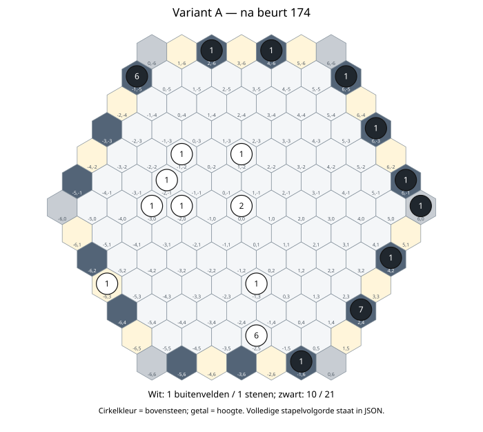

# Partij A-matrix_A_w01_b04-g000003672

Variant **A**, afloop **zwart wint**, 174 beurten.

Seed `1333058312689410288`, partij-index `3672`. Wit: Naast eigen; zwart: Weinig vijandelijke buren.

Voorraadbeleid wit/zwart: `0/0`. Ontsnappingsvoorkeur: `False/False`. Faseschema's: `[-1, -1, -1]` / `[-1, -1, -1]`.

Slagzetten: **17**. Grootste stapel: **7**. Zetlimiet: 536.

Geselecteerd voor: Gewonnen voorbeeld per plaatsingsstrategie.

[Volledig reproduceerbaar JSON-bestand](A-matrix_A_w01_b04-g000003672.json) · [Zetten als CSV](A-matrix_A_w01_b04-g000003672.csv) · [Bordcoördinaten en buitenkleuren](../board.json)

## Volledig zetverloop

Coördinaten zijn axiaal: het midden is (0,0). Stapels worden in JSON van onder naar boven weergegeven; 0 is wit, 1 is zwart.

| Beurt | Speler | Handeling | Voorraad W/Z | Buitenvelden W/Z | Ontsnapte stenen W/Z |
|---:|---|---|---|---|---|
| 1 | wit | plaatsen op (0,0) | 17/18 | 0/0 | 0/0 |
| 2 | zwart | plaatsen op (1,-1) | 17/17 | 0/0 | 0/0 |
| 3 | wit | plaatsen op (0,-1) | 16/17 | 0/0 | 0/0 |
| 4 | zwart | plaatsen op (2,-1) | 16/16 | 0/0 | 0/0 |
| 5 | wit | plaatsen op (-1,0) | 15/16 | 0/0 | 0/0 |
| 6 | zwart | plaatsen op (3,-1) | 15/15 | 0/0 | 0/0 |
| 7 | wit | plaatsen op (-1,1) | 14/15 | 0/0 | 0/0 |
| 8 | zwart | plaatsen op (2,-2) | 14/14 | 0/0 | 0/0 |
| 9 | wit | plaatsen op (-2,1) | 13/14 | 0/0 | 0/0 |
| 10 | zwart | plaatsen op (3,-2) | 13/13 | 0/0 | 0/0 |
| 11 | wit | plaatsen op (-2,2) | 12/13 | 0/0 | 0/0 |
| 12 | zwart | plaatsen op (3,0) | 12/12 | 0/0 | 0/0 |
| 13 | wit | plaatsen op (-2,0) | 11/12 | 0/0 | 0/0 |
| 14 | zwart | plaatsen op (2,1) | 11/11 | 0/0 | 0/0 |
| 15 | wit | plaatsen op (-1,-1) | 10/11 | 0/0 | 0/0 |
| 16 | zwart | plaatsen op (4,-2) | 10/10 | 0/0 | 0/0 |
| 17 | wit | plaatsen op (0,1) | 9/10 | 0/0 | 0/0 |
| 18 | zwart | plaatsen op (3,-3) | 9/9 | 0/0 | 0/0 |
| 19 | wit | plaatsen op (-1,2) | 8/9 | 0/0 | 0/0 |
| 20 | zwart | plaatsen op (2,0) | 8/8 | 0/0 | 0/0 |
| 21 | wit | plaatsen op (-3,2) | 7/8 | 0/0 | 0/0 |
| 22 | zwart | plaatsen op (4,-3) | 7/7 | 0/0 | 0/0 |
| 23 | wit | plaatsen op (-3,1) | 6/7 | 0/0 | 0/0 |
| 24 | zwart | plaatsen op (3,1) | 6/6 | 0/0 | 0/0 |
| 25 | wit | plaatsen op (-3,0) | 5/6 | 0/0 | 0/0 |
| 26 | zwart | plaatsen op (2,2) | 5/5 | 0/0 | 0/0 |
| 27 | wit | plaatsen op (-2,-1) | 4/5 | 0/0 | 0/0 |
| 28 | zwart | plaatsen op (3,2) | 4/4 | 0/0 | 0/0 |
| 29 | wit | plaatsen op (-2,3) | 3/4 | 0/0 | 0/0 |
| 30 | zwart | plaatsen op (1,3) | 3/3 | 0/0 | 0/0 |
| 31 | wit | plaatsen op (-3,3) | 2/3 | 0/0 | 0/0 |
| 32 | zwart | plaatsen op (0,4) | 2/2 | 0/0 | 0/0 |
| 33 | wit | plaatsen op (-1,3) | 1/2 | 0/0 | 0/0 |
| 34 | zwart | plaatsen op (5,-4) | 1/1 | 0/0 | 0/0 |
| 35 | wit | plaatsen op (0,2) | 0/1 | 0/0 | 0/0 |
| 36 | zwart | plaatsen op (3,-4) | 0/0 | 0/0 | 0/0 |
| 37 | wit | slaan (0, 0) → (1,-1) | 0/0 | 0/0 | 0/0 |
| 38 | zwart | slaan (2, -1) → (1,-1) | 0/0 | 0/0 | 0/0 |
| 39 | wit | slaan (0, -1) → (1,-1) | 0/0 | 0/0 | 0/0 |
| 40 | zwart | slaan (2, -2) → (1,-1) | 0/0 | 0/0 | 0/0 |
| 41 | wit | bewegen (-1, 0) → (0,0) | 0/0 | 0/0 | 0/0 |
| 42 | zwart | bewegen (3, 0) → (4,0) | 0/0 | 0/0 | 0/0 |
| 43 | wit | slaan (0, 0) → (1,-1) | 0/0 | 0/0 | 0/0 |
| 44 | zwart | bewegen (1, 3) → (1,4) | 0/0 | 0/0 | 0/0 |
| 45 | wit | bewegen (0, 1) → (1,1) | 0/0 | 0/0 | 0/0 |
| 46 | zwart | slaan (2, 1) → (1,1) | 0/0 | 0/0 | 0/0 |
| 47 | wit | slaan (0, 2) → (1,1) | 0/0 | 0/0 | 0/0 |
| 48 | zwart | slaan (2, 0) → (1,1) | 0/0 | 0/0 | 0/0 |
| 49 | wit | bewegen (-1, -1) → (-1,0) | 0/0 | 0/0 | 0/0 |
| 50 | zwart | bewegen (0, 4) → (-1,5) | 0/0 | 0/0 | 0/0 |
| 51 | wit | bewegen (-3, 0) → (-4,1) | 0/0 | 0/0 | 0/0 |
| 52 | zwart | bewegen (4, 0) → (5,0) | 0/0 | 0/0 | 0/0 |
| 53 | wit | bewegen (-2, -1) → (-1,-1) | 0/0 | 0/0 | 0/0 |
| 54 | zwart | bewegen (1, 1) → (2,1) | 0/0 | 0/0 | 0/0 |
| 55 | wit | bewegen (-1, -1) → (0,-2) | 0/0 | 0/0 | 0/0 |
| 56 | zwart | bewegen (3, -4) → (2,-4) | 0/0 | 0/0 | 0/0 |
| 57 | wit | bewegen (1, -1) → (1,0) | 0/0 | 0/0 | 0/0 |
| 58 | zwart | bewegen (2, 1) → (2,-3) | 0/0 | 0/0 | 0/0 |
| 59 | wit | bewegen (1, 0) → (1,1) | 0/0 | 0/0 | 0/0 |
| 60 | zwart | bewegen (2, 2) → (2,3) | 0/0 | 0/0 | 0/0 |
| 61 | wit | bewegen (0, -2) → (-1,-2) | 0/0 | 0/0 | 0/0 |
| 62 | zwart | bewegen (2, -3) → (-1,-3) | 0/0 | 0/0 | 0/0 |
| 63 | wit | slaan (-1, -2) → (-1,-3) | 0/0 | 0/0 | 0/0 |
| 64 | zwart | ontsnappen (5, 0) → (6,0) | 0/0 | 0/1 | 0/1 |
| 65 | wit | bewegen (-1, 0) → (-1,-1) | 0/0 | 0/1 | 0/1 |
| 66 | zwart | bewegen (-1, 5) → (-2,5) | 0/0 | 0/1 | 0/1 |
| 67 | wit | bewegen (1, 1) → (1,2) | 0/0 | 0/1 | 0/1 |
| 68 | zwart | bewegen (2, -4) → (1,-3) | 0/0 | 0/1 | 0/1 |
| 69 | wit | bewegen (1, 2) → (0,2) | 0/0 | 0/1 | 0/1 |
| 70 | zwart | ontsnappen (3, 2) → (4,2) | 0/0 | 0/2 | 0/2 |
| 71 | wit | bewegen (-1, -3) → (1,-5) | 0/0 | 0/2 | 0/2 |
| 72 | zwart | bewegen (4, -3) → (5,-3) | 0/0 | 0/2 | 0/2 |
| 73 | wit | bewegen (0, 2) → (2,2) | 0/0 | 0/2 | 0/2 |
| 74 | zwart | slaan (2, 3) → (2,2) | 0/0 | 0/2 | 0/2 |
| 75 | wit | bewegen (-2, 0) → (-2,-1) | 0/0 | 0/2 | 0/2 |
| 76 | zwart | bewegen (1, 4) → (1,3) | 0/0 | 0/2 | 0/2 |
| 77 | wit | bewegen (-1, -1) → (0,-1) | 0/0 | 0/2 | 0/2 |
| 78 | zwart | bewegen (2, 2) → (2,-3) | 0/0 | 0/2 | 0/2 |
| 79 | wit | bewegen (-4, 1) → (-3,0) | 0/0 | 0/2 | 0/2 |
| 80 | zwart | ontsnappen (2, -3) → (2,4) | 0/0 | 0/3 | 0/9 |
| 81 | wit | bewegen (-2, -1) → (-1,-1) | 0/0 | 0/3 | 0/9 |
| 82 | zwart | bewegen (3, 1) → (3,0) | 0/0 | 0/3 | 0/9 |
| 83 | wit | bewegen (0, -1) → (1,-1) | 0/0 | 0/3 | 0/9 |
| 84 | zwart | ontsnappen (5, -3) → (6,-3) | 0/0 | 0/4 | 0/10 |
| 85 | wit | bewegen (-1, -1) → (0,-1) | 0/0 | 0/4 | 0/10 |
| 86 | zwart | bewegen (5, -4) → (5,-5) | 0/0 | 0/4 | 0/10 |
| 87 | wit | bewegen (-1, 3) → (0,3) | 0/0 | 0/4 | 0/10 |
| 88 | zwart | slaan (1, 3) → (0,3) | 0/0 | 0/4 | 0/10 |
| 89 | wit | bewegen (1, -5) → (-3,-1) | 0/0 | 0/4 | 0/10 |
| 90 | zwart | slaan (0, 3) → (-2,3) | 0/0 | 0/4 | 0/10 |
| 91 | wit | slaan (-2, 2) → (-2,3) | 0/0 | 0/4 | 0/10 |
| 92 | zwart | bewegen (3, -3) → (4,-4) | 0/0 | 0/4 | 0/10 |
| 93 | wit | bewegen (-3, -1) → (0,-4) | 0/0 | 0/4 | 0/10 |
| 94 | zwart | bewegen (5, -5) → (5,-4) | 0/0 | 0/4 | 0/10 |
| 95 | wit | bewegen (0, -4) → (1,-4) | 0/0 | 0/4 | 0/10 |
| 96 | zwart | slaan (1, -3) → (1,-4) | 0/0 | 0/4 | 0/10 |
| 97 | wit | bewegen (-1, 1) → (0,0) | 0/0 | 0/4 | 0/10 |
| 98 | zwart | bewegen (1, -4) → (1,-5) | 0/0 | 0/4 | 0/10 |
| 99 | wit | bewegen (0, 0) → (-1,1) | 0/0 | 0/4 | 0/10 |
| 100 | zwart | bewegen (3, -1) → (4,-1) | 0/0 | 0/4 | 0/10 |
| 101 | wit | bewegen (0, -1) → (1,-2) | 0/0 | 0/4 | 0/10 |
| 102 | zwart | bewegen (-2, 5) → (-1,5) | 0/0 | 0/4 | 0/10 |
| 103 | wit | bewegen (-1, 1) → (0,1) | 0/0 | 0/4 | 0/10 |
| 104 | zwart | ontsnappen (-1, 5) → (-1,6) | 0/0 | 0/5 | 0/11 |
| 105 | wit | bewegen (1, -2) → (0,-2) | 0/0 | 0/5 | 0/11 |
| 106 | zwart | bewegen (3, -2) → (3,-3) | 0/0 | 0/5 | 0/11 |
| 107 | wit | bewegen (1, -1) → (1,0) | 0/0 | 0/5 | 0/11 |
| 108 | zwart | bewegen (1, -5) → (5,-5) | 0/0 | 0/5 | 0/11 |
| 109 | wit | bewegen (0, 1) → (-1,1) | 0/0 | 0/5 | 0/11 |
| 110 | zwart | bewegen (5, -4) → (4,-3) | 0/0 | 0/5 | 0/11 |
| 111 | wit | bewegen (-2, 3) → (2,3) | 0/0 | 0/5 | 0/11 |
| 112 | zwart | ontsnappen (5, -5) → (-1,-5) | 0/0 | 0/6 | 0/17 |
| 113 | wit | bewegen (2, 3) → (2,-1) | 0/0 | 0/6 | 0/17 |
| 114 | zwart | bewegen (4, -2) → (5,-2) | 0/0 | 0/6 | 0/17 |
| 115 | wit | bewegen (-3, 0) → (-4,1) | 0/0 | 0/6 | 0/17 |
| 116 | zwart | bewegen (5, -2) → (5,-1) | 0/0 | 0/6 | 0/17 |
| 117 | wit | bewegen (2, -1) → (2,1) | 0/0 | 0/6 | 0/17 |
| 118 | zwart | slaan (3, 0) → (2,1) | 0/0 | 0/6 | 0/17 |
| 119 | wit | bewegen (-3, 1) → (-2,0) | 0/0 | 0/6 | 0/17 |
| 120 | zwart | bewegen (3, -3) → (2,-3) | 0/0 | 0/6 | 0/17 |
| 121 | wit | bewegen (-4, 1) → (-3,0) | 0/0 | 0/6 | 0/17 |
| 122 | zwart | bewegen (5, -1) → (4,0) | 0/0 | 0/6 | 0/17 |
| 123 | wit | bewegen (1, 0) → (0,1) | 0/0 | 0/6 | 0/17 |
| 124 | zwart | bewegen (4, -4) → (3,-3) | 0/0 | 0/6 | 0/17 |
| 125 | wit | bewegen (-3, 2) → (-4,2) | 0/0 | 0/6 | 0/17 |
| 126 | zwart | bewegen (4, 0) → (5,-1) | 0/0 | 0/6 | 0/17 |
| 127 | wit | bewegen (0, -2) → (-1,-2) | 0/0 | 0/6 | 0/17 |
| 128 | zwart | bewegen (4, -3) → (5,-4) | 0/0 | 0/6 | 0/17 |
| 129 | wit | bewegen (0, 1) → (0,0) | 0/0 | 0/6 | 0/17 |
| 130 | zwart | ontsnappen (5, -4) → (6,-5) | 0/0 | 0/7 | 0/18 |
| 131 | wit | bewegen (-3, 3) → (-4,4) | 0/0 | 0/7 | 0/18 |
| 132 | zwart | bewegen (2, -3) → (1,-3) | 0/0 | 0/7 | 0/18 |
| 133 | wit | bewegen (0, 0) → (0,-1) | 0/0 | 0/7 | 0/18 |
| 134 | zwart | bewegen (5, -1) → (4,0) | 0/0 | 0/7 | 0/18 |
| 135 | wit | bewegen (-2, 0) → (-2,-1) | 0/0 | 0/7 | 0/18 |
| 136 | zwart | bewegen (2, 1) → (2,2) | 0/0 | 0/7 | 0/18 |
| 137 | wit | bewegen (-4, 2) → (-5,2) | 0/0 | 0/7 | 0/18 |
| 138 | zwart | bewegen (2, 2) → (1,2) | 0/0 | 0/7 | 0/18 |
| 139 | wit | bewegen (-2, 1) → (-3,1) | 0/0 | 0/7 | 0/18 |
| 140 | zwart | bewegen (1, 2) → (0,3) | 0/0 | 0/7 | 0/18 |
| 141 | wit | bewegen (-3, 1) → (-2,0) | 0/0 | 0/7 | 0/18 |
| 142 | zwart | bewegen (0, 3) → (0,2) | 0/0 | 0/7 | 0/18 |
| 143 | wit | slaan (-1, 2) → (0,2) | 0/0 | 0/7 | 0/18 |
| 144 | zwart | bewegen (1, -3) → (1,-4) | 0/0 | 0/7 | 0/18 |
| 145 | wit | bewegen (-5, 2) → (-4,2) | 0/0 | 0/7 | 0/18 |
| 146 | zwart | bewegen (4, 0) → (3,1) | 0/0 | 0/7 | 0/18 |
| 147 | wit | bewegen (-4, 4) → (-3,4) | 0/0 | 0/7 | 0/18 |
| 148 | zwart | bewegen (3, 1) → (2,1) | 0/0 | 0/7 | 0/18 |
| 149 | wit | bewegen (0, 2) → (0,3) | 0/0 | 0/7 | 0/18 |
| 150 | zwart | bewegen (1, -4) → (2,-5) | 0/0 | 0/7 | 0/18 |
| 151 | wit | bewegen (0, 3) → (-1,3) | 0/0 | 0/7 | 0/18 |
| 152 | zwart | bewegen (4, -1) → (5,-1) | 0/0 | 0/7 | 0/18 |
| 153 | wit | bewegen (-3, 0) → (-4,1) | 0/0 | 0/7 | 0/18 |
| 154 | zwart | bewegen (3, -3) → (2,-3) | 0/0 | 0/7 | 0/18 |
| 155 | wit | bewegen (-4, 1) → (-3,1) | 0/0 | 0/7 | 0/18 |
| 156 | zwart | ontsnappen (5, -1) → (6,-1) | 0/0 | 0/8 | 0/19 |
| 157 | wit | bewegen (-1, 3) → (-1,4) | 0/0 | 0/8 | 0/19 |
| 158 | zwart | bewegen (2, 1) → (2,0) | 0/0 | 0/8 | 0/19 |
| 159 | wit | bewegen (-4, 2) → (-5,3) | 0/0 | 0/8 | 0/19 |
| 160 | zwart | bewegen (2, -3) → (3,-3) | 0/0 | 0/8 | 0/19 |
| 161 | wit | bewegen (-3, 4) → (-2,4) | 0/0 | 0/8 | 0/19 |
| 162 | zwart | ontsnappen (2, -5) → (2,-6) | 0/0 | 0/9 | 0/20 |
| 163 | wit | ontsnappen (-5, 3) → (-6,3) | 0/0 | 1/9 | 1/20 |
| 164 | zwart | bewegen (2, 0) → (1,0) | 0/0 | 1/9 | 1/20 |
| 165 | wit | bewegen (-2, 4) → (-1,3) | 0/0 | 1/9 | 1/20 |
| 166 | zwart | bewegen (3, -3) → (4,-3) | 0/0 | 1/9 | 1/20 |
| 167 | wit | bewegen (-1, 4) → (-2,5) | 0/0 | 1/9 | 1/20 |
| 168 | zwart | bewegen (4, -3) → (4,-4) | 0/0 | 1/9 | 1/20 |
| 169 | wit | bewegen (0, -1) → (1,-2) | 0/0 | 1/9 | 1/20 |
| 170 | zwart | bewegen (1, 0) → (0,0) | 0/0 | 1/9 | 1/20 |
| 171 | wit | slaan (-1, 1) → (0,0) | 0/0 | 1/9 | 1/20 |
| 172 | zwart | bewegen (4, -4) → (4,-5) | 0/0 | 1/9 | 1/20 |
| 173 | wit | bewegen (-3, 1) → (-3,0) | 0/0 | 1/9 | 1/20 |
| 174 | zwart | ontsnappen (4, -5) → (4,-6) | 0/0 | 1/10 | 1/21 |
