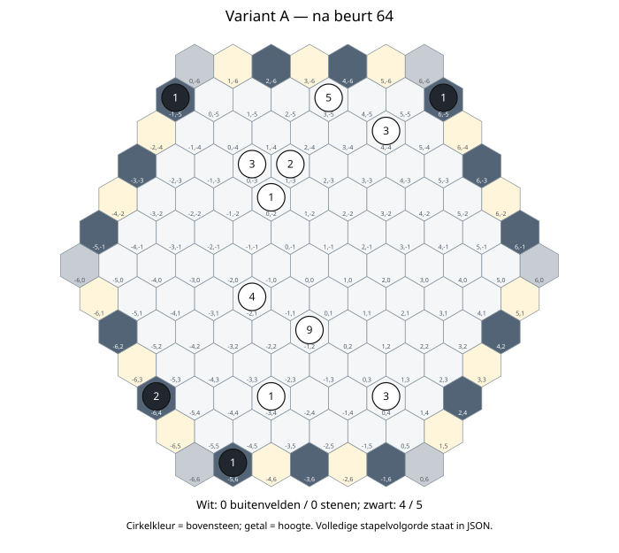

# Partij A-matrix_A_w09_b06-g000004907

Variant **A**, afloop **zwart wint**, 64 beurten.

Seed `15889882869105506929`, partij-index `4907`. Wit: Omsingelen; zwart: Verspreid.

Voorraadbeleid wit/zwart: `0/0`. Ontsnappingsvoorkeur: `False/False`. Faseschema's: `[-1, -1, -1]` / `[-1, -1, -1]`.

Slagzetten: **23**. Grootste stapel: **9**. Zetlimiet: 536.

Geselecteerd voor: Kortste gewonnen partij.

[Volledig reproduceerbaar JSON-bestand](A-matrix_A_w09_b06-g000004907.json) · [Zetten als CSV](A-matrix_A_w09_b06-g000004907.csv) · [Bordcoördinaten en buitenkleuren](../board.json)

## Volledig zetverloop

Coördinaten zijn axiaal: het midden is (0,0). Stapels worden in JSON van onder naar boven weergegeven; 0 is wit, 1 is zwart.

| Beurt | Speler | Handeling | Voorraad W/Z | Buitenvelden W/Z | Ontsnapte stenen W/Z |
|---:|---|---|---|---|---|
| 1 | wit | plaatsen op (0,0) | 17/18 | 0/0 | 0/0 |
| 2 | zwart | plaatsen op (0,-1) | 17/17 | 0/0 | 0/0 |
| 3 | wit | plaatsen op (0,-2) | 16/17 | 0/0 | 0/0 |
| 4 | zwart | plaatsen op (-1,1) | 16/16 | 0/0 | 0/0 |
| 5 | wit | plaatsen op (-1,0) | 15/16 | 0/0 | 0/0 |
| 6 | zwart | plaatsen op (1,-3) | 15/15 | 0/0 | 0/0 |
| 7 | wit | plaatsen op (1,-2) | 14/15 | 0/0 | 0/0 |
| 8 | zwart | plaatsen op (-2,2) | 14/14 | 0/0 | 0/0 |
| 9 | wit | plaatsen op (-2,1) | 13/14 | 0/0 | 0/0 |
| 10 | zwart | plaatsen op (1,-4) | 13/13 | 0/0 | 0/0 |
| 11 | wit | plaatsen op (-1,2) | 12/13 | 0/0 | 0/0 |
| 12 | zwart | plaatsen op (-1,3) | 12/12 | 0/0 | 0/0 |
| 13 | wit | plaatsen op (2,-4) | 11/12 | 0/0 | 0/0 |
| 14 | zwart | plaatsen op (3,-5) | 11/11 | 0/0 | 0/0 |
| 15 | wit | plaatsen op (0,-3) | 10/11 | 0/0 | 0/0 |
| 16 | zwart | plaatsen op (-1,4) | 10/10 | 0/0 | 0/0 |
| 17 | wit | plaatsen op (2,-5) | 9/10 | 0/0 | 0/0 |
| 18 | zwart | plaatsen op (-1,5) | 9/9 | 0/0 | 0/0 |
| 19 | wit | plaatsen op (-2,5) | 8/9 | 0/0 | 0/0 |
| 20 | zwart | plaatsen op (4,-5) | 8/8 | 0/0 | 0/0 |
| 21 | wit | plaatsen op (3,-4) | 7/8 | 0/0 | 0/0 |
| 22 | zwart | plaatsen op (0,5) | 7/7 | 0/0 | 0/0 |
| 23 | wit | plaatsen op (0,4) | 6/7 | 0/0 | 0/0 |
| 24 | zwart | plaatsen op (5,-5) | 6/6 | 0/0 | 0/0 |
| 25 | wit | plaatsen op (4,-4) | 5/6 | 0/0 | 0/0 |
| 26 | zwart | plaatsen op (-3,5) | 5/5 | 0/0 | 0/0 |
| 27 | wit | plaatsen op (-2,4) | 4/5 | 0/0 | 0/0 |
| 28 | zwart | plaatsen op (1,-5) | 4/4 | 0/0 | 0/0 |
| 29 | wit | plaatsen op (0,-4) | 3/4 | 0/0 | 0/0 |
| 30 | zwart | plaatsen op (-4,5) | 3/3 | 0/0 | 0/0 |
| 31 | wit | plaatsen op (0,3) | 2/3 | 0/0 | 0/0 |
| 32 | zwart | plaatsen op (0,-5) | 2/2 | 0/0 | 0/0 |
| 33 | wit | plaatsen op (-3,4) | 1/2 | 0/0 | 0/0 |
| 34 | zwart | plaatsen op (-5,5) | 1/1 | 0/0 | 0/0 |
| 35 | wit | plaatsen op (-4,4) | 0/1 | 0/0 | 0/0 |
| 36 | zwart | plaatsen op (5,-4) | 0/0 | 0/0 | 0/0 |
| 37 | wit | slaan (-2, 4) → (-1,4) | 0/0 | 0/0 | 0/0 |
| 38 | zwart | slaan (-1, 1) → (-1,0) | 0/0 | 0/0 | 0/0 |
| 39 | wit | slaan (1, -2) → (1,-3) | 0/0 | 0/0 | 0/0 |
| 40 | zwart | slaan (0, 5) → (0,4) | 0/0 | 0/0 | 0/0 |
| 41 | wit | slaan (2, -4) → (3,-5) | 0/0 | 0/0 | 0/0 |
| 42 | zwart | slaan (1, -4) → (0,-3) | 0/0 | 0/0 | 0/0 |
| 43 | wit | slaan (0, 0) → (0,-1) | 0/0 | 0/0 | 0/0 |
| 44 | zwart | slaan (-1, 3) → (-1,2) | 0/0 | 0/0 | 0/0 |
| 45 | wit | slaan (-1, 4) → (-1,2) | 0/0 | 0/0 | 0/0 |
| 46 | zwart | slaan (-4, 5) → (-4,4) | 0/0 | 0/0 | 0/0 |
| 47 | wit | slaan (2, -5) → (1,-5) | 0/0 | 0/0 | 0/0 |
| 48 | zwart | slaan (-2, 2) → (-2,1) | 0/0 | 0/0 | 0/0 |
| 49 | wit | slaan (-2, 5) → (-3,5) | 0/0 | 0/0 | 0/0 |
| 50 | zwart | slaan (5, -5) → (4,-4) | 0/0 | 0/0 | 0/0 |
| 51 | wit | slaan (0, -4) → (0,-3) | 0/0 | 0/0 | 0/0 |
| 52 | zwart | slaan (4, -5) → (3,-5) | 0/0 | 0/0 | 0/0 |
| 53 | wit | slaan (1, -5) → (3,-5) | 0/0 | 0/0 | 0/0 |
| 54 | zwart | slaan (-1, 0) → (-1,2) | 0/0 | 0/0 | 0/0 |
| 55 | wit | slaan (0, -1) → (-2,1) | 0/0 | 0/0 | 0/0 |
| 56 | zwart | ontsnappen (5, -4) → (6,-5) | 0/0 | 0/1 | 0/1 |
| 57 | wit | slaan (3, -4) → (4,-4) | 0/0 | 0/1 | 0/1 |
| 58 | zwart | ontsnappen (-4, 4) → (-6,4) | 0/0 | 0/2 | 0/3 |
| 59 | wit | slaan (-3, 5) → (-1,5) | 0/0 | 0/2 | 0/3 |
| 60 | zwart | bewegen (0, -5) → (-1,-4) | 0/0 | 0/2 | 0/3 |
| 61 | wit | slaan (-1, 5) → (-1,2) | 0/0 | 0/2 | 0/3 |
| 62 | zwart | ontsnappen (-1, -4) → (-1,-5) | 0/0 | 0/3 | 0/4 |
| 63 | wit | slaan (0, 3) → (0,4) | 0/0 | 0/3 | 0/4 |
| 64 | zwart | ontsnappen (-5, 5) → (-5,6) | 0/0 | 0/4 | 0/5 |
