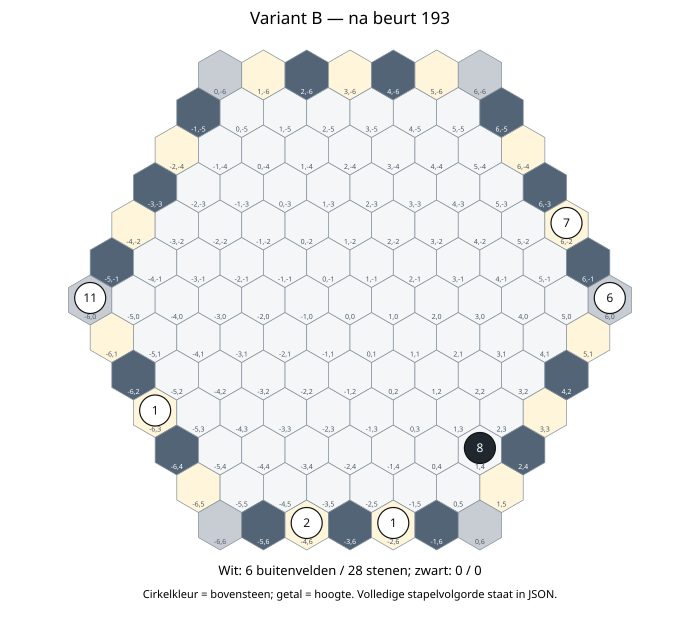

# Partij B-matrix_B_w02_b02-g000007159

Variant **B**, afloop **wit wint**, 193 beurten.

Seed `16536390203589672186`, partij-index `7159`. Wit: Naast vijandelijke; zwart: Naast vijandelijke.

Voorraadbeleid wit/zwart: `0/0`. Ontsnappingsvoorkeur: `False/False`. Faseschema's: `[-1, -1, -1]` / `[-1, -1, -1]`.

Slagzetten: **33**. Grootste stapel: **15**. Zetlimiet: 536.

Geselecteerd voor: Gewonnen voorbeeld per plaatsingsstrategie.

[Volledig reproduceerbaar JSON-bestand](B-matrix_B_w02_b02-g000007159.json) · [Zetten als CSV](B-matrix_B_w02_b02-g000007159.csv) · [Bordcoördinaten en buitenkleuren](../board.json)

## Volledig zetverloop

Coördinaten zijn axiaal: het midden is (0,0). Stapels worden in JSON van onder naar boven weergegeven; 0 is wit, 1 is zwart.

| Beurt | Speler | Handeling | Voorraad W/Z | Buitenvelden W/Z | Ontsnapte stenen W/Z |
|---:|---|---|---|---|---|
| 1 | wit | plaatsen op (0,0) | 17/18 | 0/0 | 0/0 |
| 2 | zwart | plaatsen op (0,-1) | 17/17 | 0/0 | 0/0 |
| 3 | wit | plaatsen op (0,-2) | 16/17 | 0/0 | 0/0 |
| 4 | zwart | plaatsen op (0,1) | 16/16 | 0/0 | 0/0 |
| 5 | wit | slaan (0, -2) → (0,-1) | 16/16 | 0/0 | 0/0 |
| 6 | zwart | plaatsen op (-1,0) | 16/15 | 0/0 | 0/0 |
| 7 | wit | plaatsen op (-1,1) | 15/15 | 0/0 | 0/0 |
| 8 | zwart | plaatsen op (1,-1) | 15/14 | 0/0 | 0/0 |
| 9 | wit | plaatsen op (1,0) | 14/14 | 0/0 | 0/0 |
| 10 | zwart | plaatsen op (-1,2) | 14/13 | 0/0 | 0/0 |
| 11 | wit | slaan (-1, 1) → (0,1) | 14/13 | 0/0 | 0/0 |
| 12 | zwart | plaatsen op (1,1) | 14/12 | 0/0 | 0/0 |
| 13 | wit | plaatsen op (-1,1) | 13/12 | 0/0 | 0/0 |
| 14 | zwart | plaatsen op (0,2) | 13/11 | 0/0 | 0/0 |
| 15 | wit | slaan (-1, 1) → (-1,0) | 13/11 | 0/0 | 0/0 |
| 16 | zwart | plaatsen op (-1,1) | 13/10 | 0/0 | 0/0 |
| 17 | wit | slaan (0, 0) → (-1,1) | 13/10 | 0/0 | 0/0 |
| 18 | zwart | slaan (0, 2) → (0,1) | 13/10 | 0/0 | 0/0 |
| 19 | wit | plaatsen op (0,2) | 12/10 | 0/0 | 0/0 |
| 20 | zwart | slaan (-1, 2) → (0,2) | 12/10 | 0/0 | 0/0 |
| 21 | wit | plaatsen op (-1,2) | 11/10 | 0/0 | 0/0 |
| 22 | zwart | plaatsen op (0,0) | 11/9 | 0/0 | 0/0 |
| 23 | wit | plaatsen op (1,2) | 10/9 | 0/0 | 0/0 |
| 24 | zwart | slaan (0, 0) → (1,0) | 10/9 | 0/0 | 0/0 |
| 25 | wit | plaatsen op (0,0) | 9/9 | 0/0 | 0/0 |
| 26 | zwart | plaatsen op (-1,-1) | 9/8 | 0/0 | 0/0 |
| 27 | wit | slaan (1, 2) → (0,2) | 9/8 | 0/0 | 0/0 |
| 28 | zwart | plaatsen op (-2,2) | 9/7 | 0/0 | 0/0 |
| 29 | wit | plaatsen op (2,-1) | 8/7 | 0/0 | 0/0 |
| 30 | zwart | plaatsen op (-2,1) | 8/6 | 0/0 | 0/0 |
| 31 | wit | plaatsen op (-2,0) | 7/6 | 0/0 | 0/0 |
| 32 | zwart | plaatsen op (-1,3) | 7/5 | 0/0 | 0/0 |
| 33 | wit | slaan (0, 0) → (1,-1) | 7/5 | 0/0 | 0/0 |
| 34 | zwart | slaan (-1, -1) → (-2,0) | 7/5 | 0/0 | 0/0 |
| 35 | wit | plaatsen op (-2,3) | 6/5 | 0/0 | 0/0 |
| 36 | zwart | slaan (1, 1) → (0,2) | 6/5 | 0/0 | 0/0 |
| 37 | wit | plaatsen op (1,1) | 5/5 | 0/0 | 0/0 |
| 38 | zwart | plaatsen op (0,0) | 5/4 | 0/0 | 0/0 |
| 39 | wit | plaatsen op (-3,2) | 4/4 | 0/0 | 0/0 |
| 40 | zwart | plaatsen op (-1,-1) | 4/3 | 0/0 | 0/0 |
| 41 | wit | plaatsen op (-2,-1) | 3/3 | 0/0 | 0/0 |
| 42 | zwart | slaan (-1, -1) → (0,-1) | 3/3 | 0/0 | 0/0 |
| 43 | wit | plaatsen op (-3,1) | 2/3 | 0/0 | 0/0 |
| 44 | zwart | plaatsen op (-1,-1) | 2/2 | 0/0 | 0/0 |
| 45 | wit | slaan (-3, 1) → (-2,0) | 2/2 | 0/0 | 0/0 |
| 46 | zwart | slaan (0, 0) → (1,-1) | 2/2 | 0/0 | 0/0 |
| 47 | wit | slaan (-1, 2) → (-1,3) | 2/2 | 0/0 | 0/0 |
| 48 | zwart | slaan (-2, 2) → (-1,1) | 2/2 | 0/0 | 0/0 |
| 49 | wit | plaatsen op (0,0) | 1/2 | 0/0 | 0/0 |
| 50 | zwart | plaatsen op (-2,4) | 1/1 | 0/0 | 0/0 |
| 51 | wit | plaatsen op (-1,2) | 0/1 | 0/0 | 0/0 |
| 52 | zwart | plaatsen op (-2,2) | 0/0 | 0/0 | 0/0 |
| 53 | wit | slaan (-3, 2) → (-2,2) | 0/0 | 0/0 | 0/0 |
| 54 | zwart | slaan (-2, 4) → (-2,3) | 0/0 | 0/0 | 0/0 |
| 55 | wit | slaan (-2, -1) → (-1,-1) | 0/0 | 0/0 | 0/0 |
| 56 | zwart | slaan (-2, 1) → (-2,0) | 0/0 | 0/0 | 0/0 |
| 57 | wit | slaan (2, -1) → (1,-1) | 0/0 | 0/0 | 0/0 |
| 58 | zwart | bewegen (1, 0) → (2,-1) | 0/0 | 0/0 | 0/0 |
| 59 | wit | slaan (-1, 2) → (-1,1) | 0/0 | 0/0 | 0/0 |
| 60 | zwart | bewegen (0, -1) → (3,-4) | 0/0 | 0/0 | 0/0 |
| 61 | wit | slaan (1, 1) → (0,1) | 0/0 | 0/0 | 0/0 |
| 62 | zwart | slaan (-2, 3) → (0,1) | 0/0 | 0/0 | 0/0 |
| 63 | wit | slaan (-2, 2) → (0,2) | 0/0 | 0/0 | 0/0 |
| 64 | zwart | bewegen (2, -1) → (3,-1) | 0/0 | 0/0 | 0/0 |
| 65 | wit | slaan (0, 0) → (0,1) | 0/0 | 0/0 | 0/0 |
| 66 | zwart | slaan (3, -1) → (1,-1) | 0/0 | 0/0 | 0/0 |
| 67 | wit | slaan (-1, -1) → (1,-1) | 0/0 | 0/0 | 0/0 |
| 68 | zwart | bewegen (3, -4) → (4,-5) | 0/0 | 0/0 | 0/0 |
| 69 | wit | bewegen (-1, 0) → (1,-2) | 0/0 | 0/0 | 0/0 |
| 70 | zwart | slaan (4, -5) → (1,-2) | 0/0 | 0/0 | 0/0 |
| 71 | wit | bewegen (0, 1) → (-1,2) | 0/0 | 0/0 | 0/0 |
| 72 | zwart | bewegen (1, -2) → (-2,1) | 0/0 | 0/0 | 0/0 |
| 73 | wit | bewegen (1, -1) → (1,2) | 0/0 | 0/0 | 0/0 |
| 74 | zwart | bewegen (-2, 1) → (1,-2) | 0/0 | 0/0 | 0/0 |
| 75 | wit | bewegen (-1, 3) → (-1,5) | 0/0 | 0/0 | 0/0 |
| 76 | zwart | bewegen (1, -2) → (0,-1) | 0/0 | 0/0 | 0/0 |
| 77 | wit | bewegen (-1, 2) → (-4,5) | 0/0 | 0/0 | 0/0 |
| 78 | zwart | bewegen (0, -1) → (-4,3) | 0/0 | 0/0 | 0/0 |
| 79 | wit | bewegen (0, 2) → (0,0) | 0/0 | 0/0 | 0/0 |
| 80 | zwart | bewegen (-4, 3) → (-3,2) | 0/0 | 0/0 | 0/0 |
| 81 | wit | bewegen (-1, 1) → (-2,1) | 0/0 | 0/0 | 0/0 |
| 82 | zwart | bewegen (-3, 2) → (-3,5) | 0/0 | 0/0 | 0/0 |
| 83 | wit | slaan (-1, 5) → (-3,5) | 0/0 | 0/0 | 0/0 |
| 84 | zwart | bewegen (-2, 0) → (-1,0) | 0/0 | 0/0 | 0/0 |
| 85 | wit | bewegen (-2, 1) → (-4,3) | 0/0 | 0/0 | 0/0 |
| 86 | zwart | bewegen (-1, 0) → (-5,0) | 0/0 | 0/0 | 0/0 |
| 87 | wit | bewegen (-3, 5) → (-3,0) | 0/0 | 0/0 | 0/0 |
| 88 | zwart | bewegen (-5, 0) → (-5,2) | 0/0 | 0/0 | 0/0 |
| 89 | wit | bewegen (1, 2) → (-1,2) | 0/0 | 0/0 | 0/0 |
| 90 | zwart | slaan (-5, 2) → (-1,2) | 0/0 | 0/0 | 0/0 |
| 91 | wit | ontsnappen (0, 0) → (6,0) | 0/0 | 1/0 | 6/0 |
| 92 | zwart | splitsen (-1, 2) → (-1,3); onderstuk 1 blijft | 0/0 | 1/0 | 6/0 |
| 93 | wit | bewegen (-4, 5) → (-2,5) | 0/0 | 1/0 | 6/0 |
| 94 | zwart | bewegen (-1, 3) → (2,3) | 0/0 | 1/0 | 6/0 |
| 95 | wit | bewegen (-2, 5) → (-1,5) | 0/0 | 1/0 | 6/0 |
| 96 | zwart | bewegen (2, 3) → (3,2) | 0/0 | 1/0 | 6/0 |
| 97 | wit | bewegen (-3, 0) → (-3,5) | 0/0 | 1/0 | 6/0 |
| 98 | zwart | bewegen (-1, 2) → (-2,3) | 0/0 | 1/0 | 6/0 |
| 99 | wit | ontsnappen (-1, 5) → (6,-2) | 0/0 | 2/0 | 13/0 |
| 100 | zwart | bewegen (3, 2) → (4,1) | 0/0 | 2/0 | 13/0 |
| 101 | wit | bewegen (-3, 5) → (0,5) | 0/0 | 2/0 | 13/0 |
| 102 | zwart | bewegen (4, 1) → (4,-4) | 0/0 | 2/0 | 13/0 |
| 103 | wit | bewegen (0, 5) → (1,4) | 0/0 | 2/0 | 13/0 |
| 104 | zwart | bewegen (4, -4) → (-2,2) | 0/0 | 2/0 | 13/0 |
| 105 | wit | bewegen (1, 4) → (4,1) | 0/0 | 2/0 | 13/0 |
| 106 | zwart | bewegen (-2, 2) → (5,-5) | 0/0 | 2/0 | 13/0 |
| 107 | wit | bewegen (4, 1) → (3,2) | 0/0 | 2/0 | 13/0 |
| 108 | zwart | bewegen (5, -5) → (1,-5) | 0/0 | 2/0 | 13/0 |
| 109 | wit | bewegen (-4, 3) → (-1,0) | 0/0 | 2/0 | 13/0 |
| 110 | zwart | bewegen (-2, 3) → (-2,4) | 0/0 | 2/0 | 13/0 |
| 111 | wit | bewegen (3, 2) → (3,-5) | 0/0 | 2/0 | 13/0 |
| 112 | zwart | bewegen (1, -5) → (1,4) | 0/0 | 2/0 | 13/0 |
| 113 | wit | bewegen (3, -5) → (-3,1) | 0/0 | 2/0 | 13/0 |
| 114 | zwart | bewegen (-2, 4) → (-3,4) | 0/0 | 2/0 | 13/0 |
| 115 | wit | bewegen (-1, 0) → (-3,0) | 0/0 | 2/0 | 13/0 |
| 116 | zwart | bewegen (-3, 4) → (-2,4) | 0/0 | 2/0 | 13/0 |
| 117 | wit | bewegen (-3, 0) → (-1,-2) | 0/0 | 2/0 | 13/0 |
| 118 | zwart | bewegen (1, 4) → (1,0) | 0/0 | 2/0 | 13/0 |
| 119 | wit | bewegen (-1, -2) → (-1,1) | 0/0 | 2/0 | 13/0 |
| 120 | zwart | bewegen (1, 0) → (-1,2) | 0/0 | 2/0 | 13/0 |
| 121 | wit | bewegen (-3, 1) → (-3,0) | 0/0 | 2/0 | 13/0 |
| 122 | zwart | bewegen (-1, 2) → (-1,5) | 0/0 | 2/0 | 13/0 |
| 123 | wit | slaan (-1, 1) → (-1,5) | 0/0 | 2/0 | 13/0 |
| 124 | zwart | bewegen (-2, 4) → (-3,4) | 0/0 | 2/0 | 13/0 |
| 125 | wit | bewegen (-3, 0) → (-3,3) | 0/0 | 2/0 | 13/0 |
| 126 | zwart | slaan (-3, 4) → (-3,3) | 0/0 | 2/0 | 13/0 |
| 127 | wit | splitsen (-1, 5) → (-1,4); onderstuk 1 blijft | 0/0 | 2/0 | 13/0 |
| 128 | zwart | bewegen (-3, 3) → (-5,5) | 0/0 | 2/0 | 13/0 |
| 129 | wit | splitsen (-1, 4) → (-1,3); onderstuk 2 blijft | 0/0 | 2/0 | 13/0 |
| 130 | zwart | bewegen (-5, 5) → (2,-2) | 0/0 | 2/0 | 13/0 |
| 131 | wit | splitsen (-1, 3) → (-2,3); onderstuk 1 blijft | 0/0 | 2/0 | 13/0 |
| 132 | zwart | bewegen (2, -2) → (5,-2) | 0/0 | 2/0 | 13/0 |
| 133 | wit | bewegen (-1, 5) → (0,5) | 0/0 | 2/0 | 13/0 |
| 134 | zwart | bewegen (5, -2) → (5,-5) | 0/0 | 2/0 | 13/0 |
| 135 | wit | bewegen (0, 5) → (-1,5) | 0/0 | 2/0 | 13/0 |
| 136 | zwart | bewegen (5, -5) → (2,-5) | 0/0 | 2/0 | 13/0 |
| 137 | wit | bewegen (-1, 3) → (0,3) | 0/0 | 2/0 | 13/0 |
| 138 | zwart | bewegen (2, -5) → (2,-3) | 0/0 | 2/0 | 13/0 |
| 139 | wit | bewegen (-2, 3) → (3,-2) | 0/0 | 2/0 | 13/0 |
| 140 | zwart | bewegen (2, -3) → (-2,1) | 0/0 | 2/0 | 13/0 |
| 141 | wit | bewegen (3, -2) → (2,-1) | 0/0 | 2/0 | 13/0 |
| 142 | zwart | bewegen (-2, 1) → (-2,-3) | 0/0 | 2/0 | 13/0 |
| 143 | wit | bewegen (0, 3) → (0,2) | 0/0 | 2/0 | 13/0 |
| 144 | zwart | bewegen (-2, -3) → (2,-3) | 0/0 | 2/0 | 13/0 |
| 145 | wit | bewegen (2, -1) → (2,3) | 0/0 | 2/0 | 13/0 |
| 146 | zwart | bewegen (2, -3) → (2,0) | 0/0 | 2/0 | 13/0 |
| 147 | wit | bewegen (2, 3) → (0,3) | 0/0 | 2/0 | 13/0 |
| 148 | zwart | bewegen (2, 0) → (1,0) | 0/0 | 2/0 | 13/0 |
| 149 | wit | bewegen (0, 3) → (-5,3) | 0/0 | 2/0 | 13/0 |
| 150 | zwart | bewegen (1, 0) → (1,-5) | 0/0 | 2/0 | 13/0 |
| 151 | wit | ontsnappen (-1, 5) → (-2,6) | 0/0 | 3/0 | 14/0 |
| 152 | zwart | bewegen (1, -5) → (1,-2) | 0/0 | 3/0 | 14/0 |
| 153 | wit | bewegen (-5, 3) → (-2,0) | 0/0 | 3/0 | 14/0 |
| 154 | zwart | bewegen (1, -2) → (4,-5) | 0/0 | 3/0 | 14/0 |
| 155 | wit | bewegen (-2, 0) → (-1,0) | 0/0 | 3/0 | 14/0 |
| 156 | zwart | bewegen (4, -5) → (4,-2) | 0/0 | 3/0 | 14/0 |
| 157 | wit | bewegen (0, 2) → (-1,2) | 0/0 | 3/0 | 14/0 |
| 158 | zwart | bewegen (4, -2) → (-3,5) | 0/0 | 3/0 | 14/0 |
| 159 | wit | bewegen (-1, 0) → (-3,2) | 0/0 | 3/0 | 14/0 |
| 160 | zwart | bewegen (-3, 5) → (3,-1) | 0/0 | 3/0 | 14/0 |
| 161 | wit | bewegen (-3, 2) → (-3,5) | 0/0 | 3/0 | 14/0 |
| 162 | zwart | bewegen (3, -1) → (5,-1) | 0/0 | 3/0 | 14/0 |
| 163 | wit | bewegen (-3, 5) → (-3,1) | 0/0 | 3/0 | 14/0 |
| 164 | zwart | bewegen (5, -1) → (-2,-1) | 0/0 | 3/0 | 14/0 |
| 165 | wit | bewegen (-3, 1) → (-3,0) | 0/0 | 3/0 | 14/0 |
| 166 | zwart | bewegen (-2, -1) → (-1,-2) | 0/0 | 3/0 | 14/0 |
| 167 | wit | bewegen (-3, 0) → (5,0) | 0/0 | 3/0 | 14/0 |
| 168 | zwart | bewegen (-1, -2) → (-1,-3) | 0/0 | 3/0 | 14/0 |
| 169 | wit | ontsnappen (5, 0) → (-6,0) | 0/0 | 4/0 | 25/0 |
| 170 | zwart | bewegen (-1, -3) → (0,-3) | 0/0 | 4/0 | 25/0 |
| 171 | wit | bewegen (-1, 2) → (-2,3) | 0/0 | 4/0 | 25/0 |
| 172 | zwart | bewegen (0, -3) → (0,-5) | 0/0 | 4/0 | 25/0 |
| 173 | wit | bewegen (-1, 4) → (-2,4) | 0/0 | 4/0 | 25/0 |
| 174 | zwart | bewegen (0, -5) → (0,-3) | 0/0 | 4/0 | 25/0 |
| 175 | wit | bewegen (-2, 4) → (-2,5) | 0/0 | 4/0 | 25/0 |
| 176 | zwart | bewegen (0, -3) → (-3,0) | 0/0 | 4/0 | 25/0 |
| 177 | wit | bewegen (-2, 3) → (-3,3) | 0/0 | 4/0 | 25/0 |
| 178 | zwart | bewegen (-3, 0) → (0,0) | 0/0 | 4/0 | 25/0 |
| 179 | wit | bewegen (-3, 3) → (-4,3) | 0/0 | 4/0 | 25/0 |
| 180 | zwart | bewegen (0, 0) → (3,0) | 0/0 | 4/0 | 25/0 |
| 181 | wit | bewegen (-4, 3) → (-5,3) | 0/0 | 4/0 | 25/0 |
| 182 | zwart | bewegen (3, 0) → (3,-1) | 0/0 | 4/0 | 25/0 |
| 183 | wit | bewegen (-2, 5) → (-3,5) | 0/0 | 4/0 | 25/0 |
| 184 | zwart | bewegen (3, -1) → (-4,-1) | 0/0 | 4/0 | 25/0 |
| 185 | wit | bewegen (-5, 3) → (-5,4) | 0/0 | 4/0 | 25/0 |
| 186 | zwart | bewegen (-4, -1) → (-2,-1) | 0/0 | 4/0 | 25/0 |
| 187 | wit | bewegen (-5, 4) → (-5,3) | 0/0 | 4/0 | 25/0 |
| 188 | zwart | bewegen (-2, -1) → (5,-1) | 0/0 | 4/0 | 25/0 |
| 189 | wit | ontsnappen (-5, 3) → (-6,3) | 0/0 | 5/0 | 26/0 |
| 190 | zwart | bewegen (5, -1) → (0,4) | 0/0 | 5/0 | 26/0 |
| 191 | wit | bewegen (-3, 5) → (-2,4) | 0/0 | 5/0 | 26/0 |
| 192 | zwart | bewegen (0, 4) → (1,4) | 0/0 | 5/0 | 26/0 |
| 193 | wit | ontsnappen (-2, 4) → (-4,6) | 0/0 | 6/0 | 28/0 |
