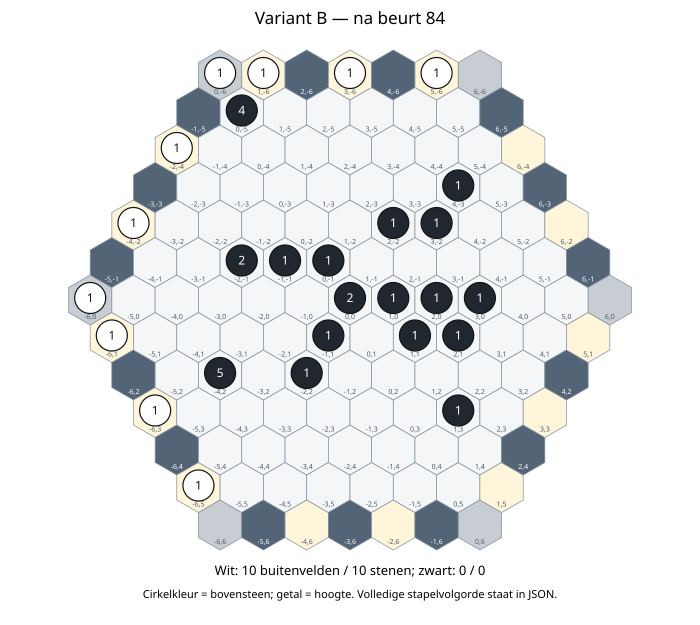

# Partij B-matrix_B_w08_b01-g000004863

Variant **B**, afloop **wit wint**, 84 beurten.

Seed `3400092927904783605`, partij-index `4863`. Wit: Naar buitenring; zwart: Naast eigen.

Voorraadbeleid wit/zwart: `0/0`. Ontsnappingsvoorkeur: `False/False`. Faseschema's: `[-1, -1, -1]` / `[-1, -1, -1]`.

Slagzetten: **9**. Grootste stapel: **5**. Zetlimiet: 536.

Geselecteerd voor: Gewonnen voorbeeld per plaatsingsstrategie.

[Volledig reproduceerbaar JSON-bestand](B-matrix_B_w08_b01-g000004863.json) · [Zetten als CSV](B-matrix_B_w08_b01-g000004863.csv) · [Bordcoördinaten en buitenkleuren](../board.json)

## Volledig zetverloop

Coördinaten zijn axiaal: het midden is (0,0). Stapels worden in JSON van onder naar boven weergegeven; 0 is wit, 1 is zwart.

| Beurt | Speler | Handeling | Voorraad W/Z | Buitenvelden W/Z | Ontsnapte stenen W/Z |
|---:|---|---|---|---|---|
| 1 | wit | plaatsen op (0,0) | 17/18 | 0/0 | 0/0 |
| 2 | zwart | plaatsen op (0,-1) | 17/17 | 0/0 | 0/0 |
| 3 | wit | plaatsen op (0,-2) | 16/17 | 0/0 | 0/0 |
| 4 | zwart | slaan (0, -1) → (0,0) | 16/17 | 0/0 | 0/0 |
| 5 | wit | plaatsen op (0,-3) | 15/17 | 0/0 | 0/0 |
| 6 | zwart | plaatsen op (1,0) | 15/16 | 0/0 | 0/0 |
| 7 | wit | plaatsen op (0,-4) | 14/16 | 0/0 | 0/0 |
| 8 | zwart | plaatsen op (0,1) | 14/15 | 0/0 | 0/0 |
| 9 | wit | plaatsen op (1,-5) | 13/15 | 0/0 | 0/0 |
| 10 | zwart | plaatsen op (-1,1) | 13/14 | 0/0 | 0/0 |
| 11 | wit | plaatsen op (-1,-4) | 12/14 | 0/0 | 0/0 |
| 12 | zwart | plaatsen op (-1,0) | 12/13 | 0/0 | 0/0 |
| 13 | wit | plaatsen op (-2,-3) | 11/13 | 0/0 | 0/0 |
| 14 | zwart | plaatsen op (1,-1) | 11/12 | 0/0 | 0/0 |
| 15 | wit | plaatsen op (-3,-2) | 10/12 | 0/0 | 0/0 |
| 16 | zwart | plaatsen op (0,-1) | 10/11 | 0/0 | 0/0 |
| 17 | wit | plaatsen op (2,-5) | 9/11 | 0/0 | 0/0 |
| 18 | zwart | plaatsen op (-1,-1) | 9/10 | 0/0 | 0/0 |
| 19 | wit | plaatsen op (-4,-1) | 8/10 | 0/0 | 0/0 |
| 20 | zwart | plaatsen op (2,-1) | 8/9 | 0/0 | 0/0 |
| 21 | wit | plaatsen op (0,-5) | 7/9 | 0/0 | 0/0 |
| 22 | zwart | plaatsen op (1,-2) | 7/8 | 0/0 | 0/0 |
| 23 | wit | plaatsen op (3,-5) | 6/8 | 0/0 | 0/0 |
| 24 | zwart | plaatsen op (2,-2) | 6/7 | 0/0 | 0/0 |
| 25 | wit | plaatsen op (-5,0) | 5/7 | 0/0 | 0/0 |
| 26 | zwart | plaatsen op (1,1) | 5/6 | 0/0 | 0/0 |
| 27 | wit | plaatsen op (-5,1) | 4/6 | 0/0 | 0/0 |
| 28 | zwart | plaatsen op (2,0) | 4/5 | 0/0 | 0/0 |
| 29 | wit | plaatsen op (-5,2) | 3/5 | 0/0 | 0/0 |
| 30 | zwart | slaan (1, -2) → (0,-2) | 3/5 | 0/0 | 0/0 |
| 31 | wit | plaatsen op (-5,3) | 2/5 | 0/0 | 0/0 |
| 32 | zwart | plaatsen op (1,-2) | 2/4 | 0/0 | 0/0 |
| 33 | wit | plaatsen op (-5,4) | 1/4 | 0/0 | 0/0 |
| 34 | zwart | plaatsen op (2,1) | 1/3 | 0/0 | 0/0 |
| 35 | wit | plaatsen op (4,-5) | 0/3 | 0/0 | 0/0 |
| 36 | zwart | plaatsen op (3,0) | 0/2 | 0/0 | 0/0 |
| 37 | wit | slaan (0, -3) → (0,-2) | 0/2 | 0/0 | 0/0 |
| 38 | zwart | slaan (0, -1) → (0,-2) | 0/2 | 0/0 | 0/0 |
| 39 | wit | ontsnappen (0, -5) → (1,-6) | 0/2 | 1/0 | 1/0 |
| 40 | zwart | plaatsen op (0,-1) | 0/1 | 1/0 | 1/0 |
| 41 | wit | ontsnappen (-1, -4) → (-2,-4) | 0/1 | 2/0 | 2/0 |
| 42 | zwart | plaatsen op (3,-1) | 0/0 | 2/0 | 2/0 |
| 43 | wit | bewegen (4, -5) → (5,-5) | 0/0 | 2/0 | 2/0 |
| 44 | zwart | bewegen (3, -1) → (4,-2) | 0/0 | 2/0 | 2/0 |
| 45 | wit | ontsnappen (-5, 3) → (-6,3) | 0/0 | 3/0 | 3/0 |
| 46 | zwart | bewegen (4, -2) → (4,-3) | 0/0 | 3/0 | 3/0 |
| 47 | wit | bewegen (0, -4) → (0,-5) | 0/0 | 3/0 | 3/0 |
| 48 | zwart | bewegen (2, -1) → (3,-2) | 0/0 | 3/0 | 3/0 |
| 49 | wit | bewegen (-5, 2) → (-4,2) | 0/0 | 3/0 | 3/0 |
| 50 | zwart | bewegen (1, -1) → (2,-1) | 0/0 | 3/0 | 3/0 |
| 51 | wit | ontsnappen (-5, 4) → (-6,5) | 0/0 | 4/0 | 4/0 |
| 52 | zwart | bewegen (1, 1) → (0,2) | 0/0 | 4/0 | 4/0 |
| 53 | wit | bewegen (-2, -3) → (-1,-4) | 0/0 | 4/0 | 4/0 |
| 54 | zwart | bewegen (1, 0) → (1,1) | 0/0 | 4/0 | 4/0 |
| 55 | wit | bewegen (1, -5) → (1,-4) | 0/0 | 4/0 | 4/0 |
| 56 | zwart | bewegen (-1, 1) → (-2,2) | 0/0 | 4/0 | 4/0 |
| 57 | wit | ontsnappen (-4, -1) → (-4,-2) | 0/0 | 5/0 | 5/0 |
| 58 | zwart | bewegen (0, 2) → (1,2) | 0/0 | 5/0 | 5/0 |
| 59 | wit | bewegen (-3, -2) → (-3,-1) | 0/0 | 5/0 | 5/0 |
| 60 | zwart | bewegen (1, 2) → (1,3) | 0/0 | 5/0 | 5/0 |
| 61 | wit | ontsnappen (0, -5) → (0,-6) | 0/0 | 6/0 | 6/0 |
| 62 | zwart | bewegen (-1, -1) → (-2,0) | 0/0 | 6/0 | 6/0 |
| 63 | wit | bewegen (-3, -1) → (-2,-1) | 0/0 | 6/0 | 6/0 |
| 64 | zwart | slaan (-2, 0) → (-2,-1) | 0/0 | 6/0 | 6/0 |
| 65 | wit | bewegen (1, -4) → (2,-4) | 0/0 | 6/0 | 6/0 |
| 66 | zwart | slaan (0, -2) → (-4,2) | 0/0 | 6/0 | 6/0 |
| 67 | wit | ontsnappen (-5, 0) → (-6,0) | 0/0 | 7/0 | 7/0 |
| 68 | zwart | bewegen (-2, 2) → (-1,2) | 0/0 | 7/0 | 7/0 |
| 69 | wit | ontsnappen (-5, 1) → (-6,1) | 0/0 | 8/0 | 8/0 |
| 70 | zwart | bewegen (0, 1) → (-1,1) | 0/0 | 8/0 | 8/0 |
| 71 | wit | bewegen (2, -4) → (1,-4) | 0/0 | 8/0 | 8/0 |
| 72 | zwart | bewegen (1, -2) → (0,-2) | 0/0 | 8/0 | 8/0 |
| 73 | wit | bewegen (1, -4) → (1,-3) | 0/0 | 8/0 | 8/0 |
| 74 | zwart | slaan (0, -2) → (1,-3) | 0/0 | 8/0 | 8/0 |
| 75 | wit | ontsnappen (2, -5) → (3,-6) | 0/0 | 9/0 | 9/0 |
| 76 | zwart | slaan (1, -3) → (3,-5) | 0/0 | 9/0 | 9/0 |
| 77 | wit | ontsnappen (5, -5) → (5,-6) | 0/0 | 10/0 | 10/0 |
| 78 | zwart | bewegen (2, -1) → (1,0) | 0/0 | 10/0 | 10/0 |
| 79 | wit | bewegen (-1, -4) → (0,-4) | 0/0 | 10/0 | 10/0 |
| 80 | zwart | bewegen (-1, 2) → (-2,2) | 0/0 | 10/0 | 10/0 |
| 81 | wit | bewegen (0, -4) → (-1,-4) | 0/0 | 10/0 | 10/0 |
| 82 | zwart | bewegen (-1, 0) → (-1,-1) | 0/0 | 10/0 | 10/0 |
| 83 | wit | bewegen (-1, -4) → (0,-5) | 0/0 | 10/0 | 10/0 |
| 84 | zwart | slaan (3, -5) → (0,-5) | 0/0 | 10/0 | 10/0 |
