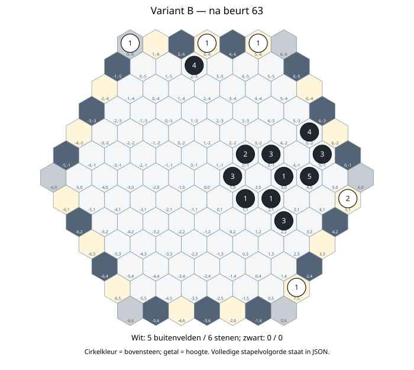

# Partij B-matrix_B_w08_b05-g000002508

Variant **B**, afloop **wit wint**, 63 beurten.

Seed `16228259881896218526`, partij-index `2508`. Wit: Naar buitenring; zwart: Compact.

Voorraadbeleid wit/zwart: `0/0`. Ontsnappingsvoorkeur: `False/False`. Faseschema's: `[-1, -1, -1]` / `[-1, -1, -1]`.

Slagzetten: **20**. Grootste stapel: **5**. Zetlimiet: 536.

Geselecteerd voor: Kortste gewonnen partij.

[Volledig reproduceerbaar JSON-bestand](B-matrix_B_w08_b05-g000002508.json) · [Zetten als CSV](B-matrix_B_w08_b05-g000002508.csv) · [Bordcoördinaten en buitenkleuren](../board.json)

## Volledig zetverloop

Coördinaten zijn axiaal: het midden is (0,0). Stapels worden in JSON van onder naar boven weergegeven; 0 is wit, 1 is zwart.

| Beurt | Speler | Handeling | Voorraad W/Z | Buitenvelden W/Z | Ontsnapte stenen W/Z |
|---:|---|---|---|---|---|
| 1 | wit | plaatsen op (0,0) | 17/18 | 0/0 | 0/0 |
| 2 | zwart | plaatsen op (1,0) | 17/17 | 0/0 | 0/0 |
| 3 | wit | plaatsen op (2,-1) | 16/17 | 0/0 | 0/0 |
| 4 | zwart | plaatsen op (2,0) | 16/16 | 0/0 | 0/0 |
| 5 | wit | plaatsen op (3,-1) | 15/16 | 0/0 | 0/0 |
| 6 | zwart | plaatsen op (1,1) | 15/15 | 0/0 | 0/0 |
| 7 | wit | plaatsen op (4,-2) | 14/15 | 0/0 | 0/0 |
| 8 | zwart | slaan (1, 0) → (2,-1) | 14/15 | 0/0 | 0/0 |
| 9 | wit | plaatsen op (5,-2) | 13/15 | 0/0 | 0/0 |
| 10 | zwart | plaatsen op (1,0) | 13/14 | 0/0 | 0/0 |
| 11 | wit | plaatsen op (5,-1) | 12/14 | 0/0 | 0/0 |
| 12 | zwart | slaan (2, 0) → (3,-1) | 12/14 | 0/0 | 0/0 |
| 13 | wit | plaatsen op (5,0) | 11/14 | 0/0 | 0/0 |
| 14 | zwart | plaatsen op (2,0) | 11/13 | 0/0 | 0/0 |
| 15 | wit | plaatsen op (5,-3) | 10/13 | 0/0 | 0/0 |
| 16 | zwart | plaatsen op (2,1) | 10/12 | 0/0 | 0/0 |
| 17 | wit | plaatsen op (4,1) | 9/12 | 0/0 | 0/0 |
| 18 | zwart | plaatsen op (3,0) | 9/11 | 0/0 | 0/0 |
| 19 | wit | plaatsen op (5,-4) | 8/11 | 0/0 | 0/0 |
| 20 | zwart | slaan (3, -1) → (5,-1) | 8/11 | 0/0 | 0/0 |
| 21 | wit | plaatsen op (5,-5) | 7/11 | 0/0 | 0/0 |
| 22 | zwart | plaatsen op (3,-1) | 7/10 | 0/0 | 0/0 |
| 23 | wit | plaatsen op (3,2) | 6/10 | 0/0 | 0/0 |
| 24 | zwart | plaatsen op (4,-1) | 6/9 | 0/0 | 0/0 |
| 25 | wit | plaatsen op (2,3) | 5/9 | 0/0 | 0/0 |
| 26 | zwart | plaatsen op (4,0) | 5/8 | 0/0 | 0/0 |
| 27 | wit | plaatsen op (4,-5) | 4/8 | 0/0 | 0/0 |
| 28 | zwart | slaan (4, -1) → (5,-2) | 4/8 | 0/0 | 0/0 |
| 29 | wit | plaatsen op (1,4) | 3/8 | 0/0 | 0/0 |
| 30 | zwart | plaatsen op (4,-1) | 3/7 | 0/0 | 0/0 |
| 31 | wit | plaatsen op (3,-5) | 2/7 | 0/0 | 0/0 |
| 32 | zwart | plaatsen op (3,1) | 2/6 | 0/0 | 0/0 |
| 33 | wit | slaan (4, 1) → (4,0) | 2/6 | 0/0 | 0/0 |
| 34 | zwart | plaatsen op (3,-2) | 2/5 | 0/0 | 0/0 |
| 35 | wit | plaatsen op (2,-5) | 1/5 | 0/0 | 0/0 |
| 36 | zwart | plaatsen op (2,2) | 1/4 | 0/0 | 0/0 |
| 37 | wit | plaatsen op (1,-5) | 0/4 | 0/0 | 0/0 |
| 38 | zwart | plaatsen op (1,2) | 0/3 | 0/0 | 0/0 |
| 39 | wit | slaan (5, -3) → (5,-2) | 0/3 | 0/0 | 0/0 |
| 40 | zwart | slaan (3, 1) → (4,0) | 0/3 | 0/0 | 0/0 |
| 41 | wit | slaan (0, 0) → (1,0) | 0/3 | 0/0 | 0/0 |
| 42 | zwart | plaatsen op (3,1) | 0/2 | 0/0 | 0/0 |
| 43 | wit | slaan (4, -2) → (3,-1) | 0/2 | 0/0 | 0/0 |
| 44 | zwart | slaan (3, -2) → (3,-1) | 0/2 | 0/0 | 0/0 |
| 45 | wit | slaan (3, 2) → (3,1) | 0/2 | 0/0 | 0/0 |
| 46 | zwart | slaan (4, -1) → (5,-2) | 0/2 | 0/0 | 0/0 |
| 47 | wit | slaan (2, 3) → (2,2) | 0/2 | 0/0 | 0/0 |
| 48 | zwart | plaatsen op (4,-1) | 0/1 | 0/0 | 0/0 |
| 49 | wit | slaan (5, 0) → (4,0) | 0/1 | 0/0 | 0/0 |
| 50 | zwart | plaatsen op (4,-2) | 0/0 | 0/0 | 0/0 |
| 51 | wit | ontsnappen (3, 1) → (5,1) | 0/0 | 1/0 | 2/0 |
| 52 | zwart | slaan (1, 2) → (2,2) | 0/0 | 1/0 | 2/0 |
| 53 | wit | ontsnappen (4, -5) → (5,-6) | 0/0 | 2/0 | 3/0 |
| 54 | zwart | slaan (4, -1) → (4,0) | 0/0 | 2/0 | 3/0 |
| 55 | wit | ontsnappen (3, -5) → (3,-6) | 0/0 | 3/0 | 4/0 |
| 56 | zwart | slaan (2, 0) → (1,0) | 0/0 | 3/0 | 4/0 |
| 57 | wit | bewegen (5, -4) → (5,-3) | 0/0 | 3/0 | 4/0 |
| 58 | zwart | slaan (4, -2) → (5,-3) | 0/0 | 3/0 | 4/0 |
| 59 | wit | bewegen (1, -5) → (0,-5) | 0/0 | 3/0 | 4/0 |
| 60 | zwart | slaan (5, -3) → (5,-5) | 0/0 | 3/0 | 4/0 |
| 61 | wit | ontsnappen (0, -5) → (0,-6) | 0/0 | 4/0 | 5/0 |
| 62 | zwart | slaan (5, -5) → (2,-5) | 0/0 | 4/0 | 5/0 |
| 63 | wit | ontsnappen (1, 4) → (1,5) | 0/0 | 5/0 | 6/0 |
