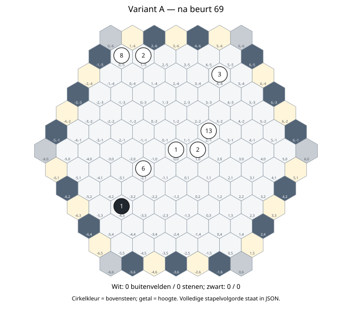
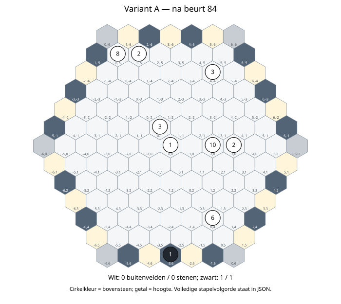

# Partij A-baseline_A-g000042836

Variant **A**, afloop **zwart wint**, 84 beurten.

Seed `149805519438865530`, partij-index `42836`. Wit: Willekeurig; zwart: Willekeurig.

Voorraadbeleid wit/zwart: `0/0`. Ontsnappingsvoorkeur: `False/False`. Faseschema's: `[-1, -1, -1]` / `[-1, -1, -1]`.

Slagzetten: **28**. Grootste stapel: **13**. Zetlimiet: 10000.

Geselecteerd voor: Grootste comeback in stapelcontrole.

[Volledig reproduceerbaar JSON-bestand](A-baseline_A-g000042836.json) · [Zetten als CSV](A-baseline_A-g000042836.csv) · [Bordcoördinaten en buitenkleuren](../board.json)

Selectie **Grootste comeback in stapelcontrole**, speler zwart: `{"ply": 69, "deficit": 34}`.

## Volledig zetverloop

Coördinaten zijn axiaal: het midden is (0,0). Stapels worden in JSON van onder naar boven weergegeven; 0 is wit, 1 is zwart.

| Beurt | Speler | Handeling | Voorraad W/Z | Buitenvelden W/Z | Ontsnapte stenen W/Z |
|---:|---|---|---|---|---|
| 1 | wit | plaatsen op (0,0) | 17/18 | 0/0 | 0/0 |
| 2 | zwart | plaatsen op (0,-1) | 17/17 | 0/0 | 0/0 |
| 3 | wit | plaatsen op (1,-1) | 16/17 | 0/0 | 0/0 |
| 4 | zwart | plaatsen op (0,-2) | 16/16 | 0/0 | 0/0 |
| 5 | wit | plaatsen op (0,-3) | 15/16 | 0/0 | 0/0 |
| 6 | zwart | plaatsen op (1,-3) | 15/15 | 0/0 | 0/0 |
| 7 | wit | plaatsen op (-1,-2) | 14/15 | 0/0 | 0/0 |
| 8 | zwart | plaatsen op (1,0) | 14/14 | 0/0 | 0/0 |
| 9 | wit | plaatsen op (-2,-1) | 13/14 | 0/0 | 0/0 |
| 10 | zwart | plaatsen op (-1,-3) | 13/13 | 0/0 | 0/0 |
| 11 | wit | plaatsen op (-1,-4) | 12/13 | 0/0 | 0/0 |
| 12 | zwart | plaatsen op (-2,-2) | 12/12 | 0/0 | 0/0 |
| 13 | wit | plaatsen op (-3,0) | 11/12 | 0/0 | 0/0 |
| 14 | zwart | plaatsen op (-2,0) | 11/11 | 0/0 | 0/0 |
| 15 | wit | plaatsen op (0,1) | 10/11 | 0/0 | 0/0 |
| 16 | zwart | plaatsen op (-1,0) | 10/10 | 0/0 | 0/0 |
| 17 | wit | plaatsen op (-1,1) | 9/10 | 0/0 | 0/0 |
| 18 | zwart | plaatsen op (2,-4) | 9/9 | 0/0 | 0/0 |
| 19 | wit | plaatsen op (2,-5) | 8/9 | 0/0 | 0/0 |
| 20 | zwart | plaatsen op (-3,1) | 8/8 | 0/0 | 0/0 |
| 21 | wit | plaatsen op (-2,-3) | 7/8 | 0/0 | 0/0 |
| 22 | zwart | plaatsen op (-2,1) | 7/7 | 0/0 | 0/0 |
| 23 | wit | plaatsen op (2,0) | 6/7 | 0/0 | 0/0 |
| 24 | zwart | plaatsen op (-4,0) | 6/6 | 0/0 | 0/0 |
| 25 | wit | plaatsen op (-4,2) | 5/6 | 0/0 | 0/0 |
| 26 | zwart | plaatsen op (-1,-1) | 5/5 | 0/0 | 0/0 |
| 27 | wit | plaatsen op (-2,2) | 4/5 | 0/0 | 0/0 |
| 28 | zwart | plaatsen op (0,-4) | 4/4 | 0/0 | 0/0 |
| 29 | wit | plaatsen op (3,-5) | 3/4 | 0/0 | 0/0 |
| 30 | zwart | plaatsen op (1,-5) | 3/3 | 0/0 | 0/0 |
| 31 | wit | plaatsen op (3,-4) | 2/3 | 0/0 | 0/0 |
| 32 | zwart | plaatsen op (-5,1) | 2/2 | 0/0 | 0/0 |
| 33 | wit | plaatsen op (-3,2) | 1/2 | 0/0 | 0/0 |
| 34 | zwart | plaatsen op (4,-4) | 1/1 | 0/0 | 0/0 |
| 35 | wit | plaatsen op (4,-3) | 0/1 | 0/0 | 0/0 |
| 36 | zwart | plaatsen op (-4,3) | 0/0 | 0/0 | 0/0 |
| 37 | wit | slaan (-3, 2) → (-2,1) | 0/0 | 0/0 | 0/0 |
| 38 | zwart | slaan (-1, 0) → (-2,1) | 0/0 | 0/0 | 0/0 |
| 39 | wit | slaan (0, 1) → (1,0) | 0/0 | 0/0 | 0/0 |
| 40 | zwart | slaan (1, -3) → (0,-3) | 0/0 | 0/0 | 0/0 |
| 41 | wit | slaan (1, -1) → (0,-1) | 0/0 | 0/0 | 0/0 |
| 42 | zwart | slaan (-1, -1) → (-2,-1) | 0/0 | 0/0 | 0/0 |
| 43 | wit | slaan (-3, 0) → (-4,0) | 0/0 | 0/0 | 0/0 |
| 44 | zwart | slaan (-1, -3) → (-1,-2) | 0/0 | 0/0 | 0/0 |
| 45 | wit | slaan (-2, 2) → (-2,1) | 0/0 | 0/0 | 0/0 |
| 46 | zwart | slaan (4, -4) → (3,-4) | 0/0 | 0/0 | 0/0 |
| 47 | wit | slaan (0, -1) → (-2,-1) | 0/0 | 0/0 | 0/0 |
| 48 | zwart | slaan (0, -4) → (-1,-4) | 0/0 | 0/0 | 0/0 |
| 49 | wit | slaan (3, -5) → (2,-4) | 0/0 | 0/0 | 0/0 |
| 50 | zwart | slaan (-2, 0) → (-2,1) | 0/0 | 0/0 | 0/0 |
| 51 | wit | slaan (-4, 2) → (-3,1) | 0/0 | 0/0 | 0/0 |
| 52 | zwart | slaan (-2, -2) → (-2,-1) | 0/0 | 0/0 | 0/0 |
| 53 | wit | slaan (2, -5) → (1,-5) | 0/0 | 0/0 | 0/0 |
| 54 | zwart | slaan (-5, 1) → (-4,0) | 0/0 | 0/0 | 0/0 |
| 55 | wit | slaan (-2, -3) → (-1,-4) | 0/0 | 0/0 | 0/0 |
| 56 | zwart | slaan (-1, -2) → (-1,-4) | 0/0 | 0/0 | 0/0 |
| 57 | wit | slaan (-1, 1) → (-2,1) | 0/0 | 0/0 | 0/0 |
| 58 | zwart | bewegen (-4, 0) → (-3,-1) | 0/0 | 0/0 | 0/0 |
| 59 | wit | slaan (-3, 1) → (-3,-1) | 0/0 | 0/0 | 0/0 |
| 60 | zwart | bewegen (-2, -1) → (2,-1) | 0/0 | 0/0 | 0/0 |
| 61 | wit | slaan (-3, -1) → (2,-1) | 0/0 | 0/0 | 0/0 |
| 62 | zwart | bewegen (0, -3) → (2,-3) | 0/0 | 0/0 | 0/0 |
| 63 | wit | slaan (2, -4) → (0,-2) | 0/0 | 0/0 | 0/0 |
| 64 | zwart | slaan (2, -3) → (2,-1) | 0/0 | 0/0 | 0/0 |
| 65 | wit | slaan (2, 0) → (2,-1) | 0/0 | 0/0 | 0/0 |
| 66 | zwart | bewegen (-1, -4) → (0,-5) | 0/0 | 0/0 | 0/0 |
| 67 | wit | slaan (0, -2) → (0,-5) | 0/0 | 0/0 | 0/0 |
| 68 | zwart | bewegen (3, -4) → (4,-4) | 0/0 | 0/0 | 0/0 |
| 69 | wit | slaan (4, -3) → (4,-4) | 0/0 | 0/0 | 0/0 |
| 70 | zwart | bewegen (-4, 3) → (-5,4) | 0/0 | 0/0 | 0/0 |
| 71 | wit | bewegen (1, 0) → (3,0) | 0/0 | 0/0 | 0/0 |
| 72 | zwart | bewegen (-5, 4) → (-4,3) | 0/0 | 0/0 | 0/0 |
| 73 | wit | splitsen (2, -1) → (3,-1); onderstuk 10 blijft | 0/0 | 0/0 | 0/0 |
| 74 | zwart | bewegen (-4, 3) → (-3,3) | 0/0 | 0/0 | 0/0 |
| 75 | wit | bewegen (2, -1) → (2,-4) | 0/0 | 0/0 | 0/0 |
| 76 | zwart | bewegen (-3, 3) → (-3,4) | 0/0 | 0/0 | 0/0 |
| 77 | wit | bewegen (-2, 1) → (3,1) | 0/0 | 0/0 | 0/0 |
| 78 | zwart | bewegen (-3, 4) → (-4,4) | 0/0 | 0/0 | 0/0 |
| 79 | wit | bewegen (3, -1) → (0,-1) | 0/0 | 0/0 | 0/0 |
| 80 | zwart | bewegen (-4, 4) → (-4,5) | 0/0 | 0/0 | 0/0 |
| 81 | wit | bewegen (2, -4) → (2,0) | 0/0 | 0/0 | 0/0 |
| 82 | zwart | bewegen (-4, 5) → (-3,5) | 0/0 | 0/0 | 0/0 |
| 83 | wit | bewegen (3, 1) → (0,4) | 0/0 | 0/0 | 0/0 |
| 84 | zwart | ontsnappen (-3, 5) → (-3,6) | 0/0 | 0/1 | 0/1 |
