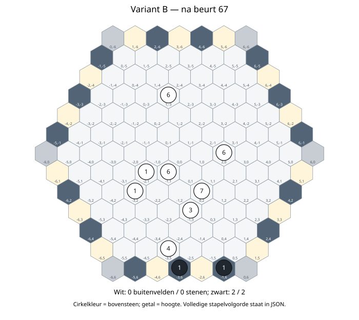

# Partij B-baseline_B-g000019771

Variant **B**, afloop **zwart wint**, 67 beurten.

Seed `3975178610736981847`, partij-index `19771`. Wit: Willekeurig; zwart: Willekeurig.

Voorraadbeleid wit/zwart: `0/0`. Ontsnappingsvoorkeur: `False/False`. Faseschema's: `[-1, -1, -1]` / `[-1, -1, -1]`.

Slagzetten: **26**. Grootste stapel: **7**. Zetlimiet: 10000.

Geselecteerd voor: Kortste gewonnen partij.

[Volledig reproduceerbaar JSON-bestand](B-baseline_B-g000019771.json) · [Zetten als CSV](B-baseline_B-g000019771.csv) · [Bordcoördinaten en buitenkleuren](../board.json)

## Volledig zetverloop

Coördinaten zijn axiaal: het midden is (0,0). Stapels worden in JSON van onder naar boven weergegeven; 0 is wit, 1 is zwart.

| Beurt | Speler | Handeling | Voorraad W/Z | Buitenvelden W/Z | Ontsnapte stenen W/Z |
|---:|---|---|---|---|---|
| 1 | wit | plaatsen op (0,0) | 17/18 | 0/0 | 0/0 |
| 2 | zwart | plaatsen op (1,0) | 17/17 | 0/0 | 0/0 |
| 3 | wit | slaan (0, 0) → (1,0) | 17/17 | 0/0 | 0/0 |
| 4 | zwart | plaatsen op (1,1) | 17/16 | 0/0 | 0/0 |
| 5 | wit | plaatsen op (1,2) | 16/16 | 0/0 | 0/0 |
| 6 | zwart | plaatsen op (1,3) | 16/15 | 0/0 | 0/0 |
| 7 | wit | plaatsen op (0,3) | 15/15 | 0/0 | 0/0 |
| 8 | zwart | plaatsen op (0,4) | 15/14 | 0/0 | 0/0 |
| 9 | wit | plaatsen op (0,0) | 14/14 | 0/0 | 0/0 |
| 10 | zwart | plaatsen op (2,3) | 14/13 | 0/0 | 0/0 |
| 11 | wit | plaatsen op (0,1) | 13/13 | 0/0 | 0/0 |
| 12 | zwart | plaatsen op (3,2) | 13/12 | 0/0 | 0/0 |
| 13 | wit | plaatsen op (3,1) | 12/12 | 0/0 | 0/0 |
| 14 | zwart | plaatsen op (-1,2) | 12/11 | 0/0 | 0/0 |
| 15 | wit | plaatsen op (-1,3) | 11/11 | 0/0 | 0/0 |
| 16 | zwart | plaatsen op (-1,5) | 11/10 | 0/0 | 0/0 |
| 17 | wit | slaan (0, 3) → (1,3) | 11/10 | 0/0 | 0/0 |
| 18 | zwart | plaatsen op (-1,4) | 11/9 | 0/0 | 0/0 |
| 19 | wit | plaatsen op (-2,3) | 10/9 | 0/0 | 0/0 |
| 20 | zwart | plaatsen op (-1,1) | 10/8 | 0/0 | 0/0 |
| 21 | wit | slaan (3, 1) → (3,2) | 10/8 | 0/0 | 0/0 |
| 22 | zwart | slaan (-1, 2) → (-2,3) | 10/8 | 0/0 | 0/0 |
| 23 | wit | plaatsen op (2,0) | 9/8 | 0/0 | 0/0 |
| 24 | zwart | plaatsen op (0,-1) | 9/7 | 0/0 | 0/0 |
| 25 | wit | slaan (0, 0) → (-1,1) | 9/7 | 0/0 | 0/0 |
| 26 | zwart | plaatsen op (-1,0) | 9/6 | 0/0 | 0/0 |
| 27 | wit | plaatsen op (1,-1) | 8/6 | 0/0 | 0/0 |
| 28 | zwart | plaatsen op (4,1) | 8/5 | 0/0 | 0/0 |
| 29 | wit | slaan (1, 0) → (-1,0) | 8/5 | 0/0 | 0/0 |
| 30 | zwart | slaan (1, 1) → (0,1) | 8/5 | 0/0 | 0/0 |
| 31 | wit | plaatsen op (1,1) | 7/5 | 0/0 | 0/0 |
| 32 | zwart | plaatsen op (-2,5) | 7/4 | 0/0 | 0/0 |
| 33 | wit | plaatsen op (4,0) | 6/4 | 0/0 | 0/0 |
| 34 | zwart | slaan (0, -1) → (1,-1) | 6/4 | 0/0 | 0/0 |
| 35 | wit | slaan (1, 1) → (0,1) | 6/4 | 0/0 | 0/0 |
| 36 | zwart | plaatsen op (-3,3) | 6/3 | 0/0 | 0/0 |
| 37 | wit | plaatsen op (2,2) | 5/3 | 0/0 | 0/0 |
| 38 | zwart | plaatsen op (-3,5) | 5/2 | 0/0 | 0/0 |
| 39 | wit | slaan (2, 2) → (2,3) | 5/2 | 0/0 | 0/0 |
| 40 | zwart | plaatsen op (1,-2) | 5/1 | 0/0 | 0/0 |
| 41 | wit | plaatsen op (-3,2) | 4/1 | 0/0 | 0/0 |
| 42 | zwart | slaan (0, 4) → (1,3) | 4/1 | 0/0 | 0/0 |
| 43 | wit | plaatsen op (-3,4) | 3/1 | 0/0 | 0/0 |
| 44 | zwart | plaatsen op (0,5) | 3/0 | 0/0 | 0/0 |
| 45 | wit | plaatsen op (-2,1) | 2/0 | 0/0 | 0/0 |
| 46 | zwart | slaan (-1, 4) → (-1,3) | 2/0 | 0/0 | 0/0 |
| 47 | wit | slaan (-3, 4) → (-3,3) | 2/0 | 0/0 | 0/0 |
| 48 | zwart | slaan (-2, 3) → (0,1) | 2/0 | 0/0 | 0/0 |
| 49 | wit | plaatsen op (0,2) | 1/0 | 0/0 | 0/0 |
| 50 | zwart | slaan (4, 1) → (4,0) | 1/0 | 0/0 | 0/0 |
| 51 | wit | plaatsen op (0,3) | 0/0 | 0/0 | 0/0 |
| 52 | zwart | slaan (1, -1) → (-1,1) | 0/0 | 0/0 | 0/0 |
| 53 | wit | slaan (0, 3) → (-1,3) | 0/0 | 0/0 | 0/0 |
| 54 | zwart | slaan (4, 0) → (2,0) | 0/0 | 0/0 | 0/0 |
| 55 | wit | slaan (-1, 0) → (2,0) | 0/0 | 0/0 | 0/0 |
| 56 | zwart | bewegen (0, 1) → (0,-3) | 0/0 | 0/0 | 0/0 |
| 57 | wit | slaan (-3, 3) → (-1,1) | 0/0 | 0/0 | 0/0 |
| 58 | zwart | slaan (0, -3) → (0,2) | 0/0 | 0/0 | 0/0 |
| 59 | wit | slaan (1, 2) → (0,2) | 0/0 | 0/0 | 0/0 |
| 60 | zwart | ontsnappen (-1, 5) → (-1,6) | 0/0 | 0/1 | 0/1 |
| 61 | wit | slaan (2, 3) → (0,5) | 0/0 | 0/1 | 0/1 |
| 62 | zwart | bewegen (1, 3) → (1,2) | 0/0 | 0/1 | 0/1 |
| 63 | wit | slaan (3, 2) → (1,2) | 0/0 | 0/1 | 0/1 |
| 64 | zwart | bewegen (1, -2) → (1,-3) | 0/0 | 0/1 | 0/1 |
| 65 | wit | slaan (1, 2) → (1,-3) | 0/0 | 0/1 | 0/1 |
| 66 | zwart | ontsnappen (-2, 5) → (-3,6) | 0/0 | 0/2 | 0/2 |
| 67 | wit | slaan (0, 5) → (-3,5) | 0/0 | 0/2 | 0/2 |
