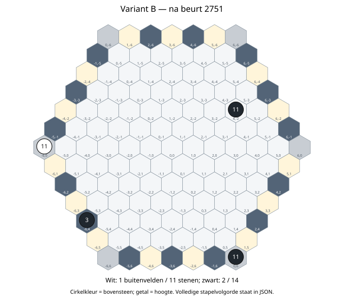

# Partij B-baseline_B-g000022974

Variant **B**, afloop **zwart wint**, 2751 beurten.

Seed `3975178610736981847`, partij-index `22974`. Wit: Willekeurig; zwart: Willekeurig.

Voorraadbeleid wit/zwart: `0/0`. Ontsnappingsvoorkeur: `False/False`. Faseschema's: `[-1, -1, -1]` / `[-1, -1, -1]`.

Slagzetten: **35**. Grootste stapel: **15**. Zetlimiet: 10000.

Geselecteerd voor: Langste waargenomen partij, Langste regulier beëindigde partij.

[Volledig reproduceerbaar JSON-bestand](B-baseline_B-g000022974.json) · [Zetten als CSV](B-baseline_B-g000022974.csv) · [Bordcoördinaten en buitenkleuren](../board.json)

## Volledig zetverloop

Coördinaten zijn axiaal: het midden is (0,0). Stapels worden in JSON van onder naar boven weergegeven; 0 is wit, 1 is zwart.

| Beurt | Speler | Handeling | Voorraad W/Z | Buitenvelden W/Z | Ontsnapte stenen W/Z |
|---:|---|---|---|---|---|
| 1 | wit | plaatsen op (0,0) | 17/18 | 0/0 | 0/0 |
| 2 | zwart | plaatsen op (0,-1) | 17/17 | 0/0 | 0/0 |
| 3 | wit | slaan (0, 0) → (0,-1) | 17/17 | 0/0 | 0/0 |
| 4 | zwart | plaatsen op (1,-1) | 17/16 | 0/0 | 0/0 |
| 5 | wit | plaatsen op (-1,-1) | 16/16 | 0/0 | 0/0 |
| 6 | zwart | plaatsen op (-1,0) | 16/15 | 0/0 | 0/0 |
| 7 | wit | plaatsen op (1,0) | 15/15 | 0/0 | 0/0 |
| 8 | zwart | plaatsen op (-1,-2) | 15/14 | 0/0 | 0/0 |
| 9 | wit | slaan (-1, -1) → (-1,-2) | 15/14 | 0/0 | 0/0 |
| 10 | zwart | plaatsen op (2,-1) | 15/13 | 0/0 | 0/0 |
| 11 | wit | plaatsen op (-2,-2) | 14/13 | 0/0 | 0/0 |
| 12 | zwart | plaatsen op (0,-2) | 14/12 | 0/0 | 0/0 |
| 13 | wit | plaatsen op (1,1) | 13/12 | 0/0 | 0/0 |
| 14 | zwart | plaatsen op (3,-1) | 13/11 | 0/0 | 0/0 |
| 15 | wit | plaatsen op (1,-3) | 12/11 | 0/0 | 0/0 |
| 16 | zwart | plaatsen op (2,0) | 12/10 | 0/0 | 0/0 |
| 17 | wit | plaatsen op (3,-2) | 11/10 | 0/0 | 0/0 |
| 18 | zwart | slaan (2, 0) → (1,0) | 11/10 | 0/0 | 0/0 |
| 19 | wit | slaan (3, -2) → (2,-1) | 11/10 | 0/0 | 0/0 |
| 20 | zwart | plaatsen op (2,-3) | 11/9 | 0/0 | 0/0 |
| 21 | wit | plaatsen op (4,-2) | 10/9 | 0/0 | 0/0 |
| 22 | zwart | plaatsen op (1,2) | 10/8 | 0/0 | 0/0 |
| 23 | wit | plaatsen op (0,0) | 9/8 | 0/0 | 0/0 |
| 24 | zwart | plaatsen op (-1,-3) | 9/7 | 0/0 | 0/0 |
| 25 | wit | plaatsen op (3,-4) | 8/7 | 0/0 | 0/0 |
| 26 | zwart | slaan (0, -2) → (1,-3) | 8/7 | 0/0 | 0/0 |
| 27 | wit | plaatsen op (4,-4) | 7/7 | 0/0 | 0/0 |
| 28 | zwart | plaatsen op (-1,-1) | 7/6 | 0/0 | 0/0 |
| 29 | wit | slaan (-2, -2) → (-1,-3) | 7/6 | 0/0 | 0/0 |
| 30 | zwart | plaatsen op (-2,0) | 7/5 | 0/0 | 0/0 |
| 31 | wit | plaatsen op (0,2) | 6/5 | 0/0 | 0/0 |
| 32 | zwart | slaan (-1, -1) → (-1,-2) | 6/5 | 0/0 | 0/0 |
| 33 | wit | plaatsen op (-2,-3) | 5/5 | 0/0 | 0/0 |
| 34 | zwart | plaatsen op (-1,3) | 5/4 | 0/0 | 0/0 |
| 35 | wit | plaatsen op (-2,-2) | 4/4 | 0/0 | 0/0 |
| 36 | zwart | slaan (3, -1) → (2,-1) | 4/4 | 0/0 | 0/0 |
| 37 | wit | slaan (1, 1) → (1,0) | 4/4 | 0/0 | 0/0 |
| 38 | zwart | plaatsen op (4,-3) | 4/3 | 0/0 | 0/0 |
| 39 | wit | plaatsen op (5,-3) | 3/3 | 0/0 | 0/0 |
| 40 | zwart | plaatsen op (2,-4) | 3/2 | 0/0 | 0/0 |
| 41 | wit | plaatsen op (2,0) | 2/2 | 0/0 | 0/0 |
| 42 | zwart | plaatsen op (-1,2) | 2/1 | 0/0 | 0/0 |
| 43 | wit | plaatsen op (4,-5) | 1/1 | 0/0 | 0/0 |
| 44 | zwart | plaatsen op (2,-2) | 1/0 | 0/0 | 0/0 |
| 45 | wit | plaatsen op (0,1) | 0/0 | 0/0 | 0/0 |
| 46 | zwart | slaan (2, -3) → (3,-4) | 0/0 | 0/0 | 0/0 |
| 47 | wit | slaan (5, -3) → (4,-3) | 0/0 | 0/0 | 0/0 |
| 48 | zwart | slaan (1, -1) → (0,0) | 0/0 | 0/0 | 0/0 |
| 49 | wit | slaan (0, 1) → (-1,2) | 0/0 | 0/0 | 0/0 |
| 50 | zwart | slaan (1, -3) → (-1,-3) | 0/0 | 0/0 | 0/0 |
| 51 | wit | slaan (-2, -2) → (-1,-3) | 0/0 | 0/0 | 0/0 |
| 52 | zwart | slaan (-1, 0) → (0,-1) | 0/0 | 0/0 | 0/0 |
| 53 | wit | slaan (4, -4) → (3,-4) | 0/0 | 0/0 | 0/0 |
| 54 | zwart | slaan (-1, 3) → (0,2) | 0/0 | 0/0 | 0/0 |
| 55 | wit | slaan (3, -4) → (0,-1) | 0/0 | 0/0 | 0/0 |
| 56 | zwart | slaan (0, 2) → (2,0) | 0/0 | 0/0 | 0/0 |
| 57 | wit | slaan (4, -3) → (2,-1) | 0/0 | 0/0 | 0/0 |
| 58 | zwart | slaan (2, -2) → (2,-1) | 0/0 | 0/0 | 0/0 |
| 59 | wit | slaan (-1, 2) → (1,2) | 0/0 | 0/0 | 0/0 |
| 60 | zwart | bewegen (2, 0) → (4,0) | 0/0 | 0/0 | 0/0 |
| 61 | wit | slaan (1, 0) → (4,0) | 0/0 | 0/0 | 0/0 |
| 62 | zwart | bewegen (2, -1) → (3,-1) | 0/0 | 0/0 | 0/0 |
| 63 | wit | slaan (4, -2) → (3,-1) | 0/0 | 0/0 | 0/0 |
| 64 | zwart | bewegen (-2, 0) → (-2,-1) | 0/0 | 0/0 | 0/0 |
| 65 | wit | bewegen (-1, -3) → (0,-3) | 0/0 | 0/0 | 0/0 |
| 66 | zwart | bewegen (-1, -2) → (2,-2) | 0/0 | 0/0 | 0/0 |
| 67 | wit | bewegen (4, 0) → (1,3) | 0/0 | 0/0 | 0/0 |
| 68 | zwart | bewegen (2, -2) → (2,-3) | 0/0 | 0/0 | 0/0 |
| 69 | wit | bewegen (1, 3) → (0,4) | 0/0 | 0/0 | 0/0 |
| 70 | zwart | bewegen (0, 0) → (-1,0) | 0/0 | 0/0 | 0/0 |
| 71 | wit | bewegen (0, 4) → (-5,4) | 0/0 | 0/0 | 0/0 |
| 72 | zwart | bewegen (2, -4) → (1,-3) | 0/0 | 0/0 | 0/0 |
| 73 | wit | bewegen (1, 2) → (1,4) | 0/0 | 0/0 | 0/0 |
| 74 | zwart | slaan (1, -3) → (0,-3) | 0/0 | 0/0 | 0/0 |
| 75 | wit | bewegen (3, -1) → (3,0) | 0/0 | 0/0 | 0/0 |
| 76 | zwart | bewegen (2, -3) → (1,-2) | 0/0 | 0/0 | 0/0 |
| 77 | wit | bewegen (3, 0) → (3,-5) | 0/0 | 0/0 | 0/0 |
| 78 | zwart | slaan (1, -2) → (4,-5) | 0/0 | 0/0 | 0/0 |
| 79 | wit | bewegen (3, -5) → (3,-2) | 0/0 | 0/0 | 0/0 |
| 80 | zwart | slaan (4, -5) → (0,-1) | 0/0 | 0/0 | 0/0 |
| 81 | wit | bewegen (-5, 4) → (-4,3) | 0/0 | 0/0 | 0/0 |
| 82 | zwart | bewegen (0, -3) → (1,-3) | 0/0 | 0/0 | 0/0 |
| 83 | wit | bewegen (1, 4) → (1,1) | 0/0 | 0/0 | 0/0 |
| 84 | zwart | bewegen (0, -1) → (-1,-1) | 0/0 | 0/0 | 0/0 |
| 85 | wit | bewegen (1, 1) → (1,-2) | 0/0 | 0/0 | 0/0 |
| 86 | zwart | slaan (-1, 0) → (1,-2) | 0/0 | 0/0 | 0/0 |
| 87 | wit | bewegen (-4, 3) → (-5,3) | 0/0 | 0/0 | 0/0 |
| 88 | zwart | bewegen (1, -2) → (1,-1) | 0/0 | 0/0 | 0/0 |
| 89 | wit | bewegen (-2, -3) → (-1,-3) | 0/0 | 0/0 | 0/0 |
| 90 | zwart | bewegen (1, -1) → (3,-3) | 0/0 | 0/0 | 0/0 |
| 91 | wit | bewegen (3, -2) → (2,-2) | 0/0 | 0/0 | 0/0 |
| 92 | zwart | bewegen (-1, -1) → (-1,2) | 0/0 | 0/0 | 0/0 |
| 93 | wit | slaan (-5, 3) → (1,-3) | 0/0 | 0/0 | 0/0 |
| 94 | zwart | bewegen (-2, -1) → (-2,0) | 0/0 | 0/0 | 0/0 |
| 95 | wit | splitsen (1, -3) → (0,-3); onderstuk 10 blijft | 0/0 | 0/0 | 0/0 |
| 96 | zwart | bewegen (-1, 2) → (-4,5) | 0/0 | 0/0 | 0/0 |
| 97 | wit | bewegen (2, -2) → (2,1) | 0/0 | 0/0 | 0/0 |
| 98 | zwart | bewegen (3, -3) → (4,-4) | 0/0 | 0/0 | 0/0 |
| 99 | wit | bewegen (0, -3) → (1,-4) | 0/0 | 0/0 | 0/0 |
| 100 | zwart | bewegen (4, -4) → (4,-1) | 0/0 | 0/0 | 0/0 |
| 101 | wit | bewegen (2, 1) → (-3,1) | 0/0 | 0/0 | 0/0 |
| 102 | zwart | slaan (-2, 0) → (-3,1) | 0/0 | 0/0 | 0/0 |
| 103 | wit | bewegen (1, -4) → (-1,-4) | 0/0 | 0/0 | 0/0 |
| 104 | zwart | bewegen (-3, 1) → (-3,3) | 0/0 | 0/0 | 0/0 |
| 105 | wit | bewegen (1, -3) → (0,-3) | 0/0 | 0/0 | 0/0 |
| 106 | zwart | bewegen (-3, 3) → (-3,5) | 0/0 | 0/0 | 0/0 |
| 107 | wit | bewegen (-1, -3) → (-2,-3) | 0/0 | 0/0 | 0/0 |
| 108 | zwart | bewegen (4, -1) → (0,3) | 0/0 | 0/0 | 0/0 |
| 109 | wit | bewegen (0, -3) → (-4,1) | 0/0 | 0/0 | 0/0 |
| 110 | zwart | bewegen (-4, 5) → (0,1) | 0/0 | 0/0 | 0/0 |
| 111 | wit | bewegen (-4, 1) → (-2,1) | 0/0 | 0/0 | 0/0 |
| 112 | zwart | bewegen (-3, 5) → (-1,5) | 0/0 | 0/0 | 0/0 |
| 113 | wit | bewegen (-1, -4) → (0,-4) | 0/0 | 0/0 | 0/0 |
| 114 | zwart | bewegen (0, 3) → (5,-2) | 0/0 | 0/0 | 0/0 |
| 115 | wit | bewegen (-2, 1) → (-2,-1) | 0/0 | 0/0 | 0/0 |
| 116 | zwart | bewegen (-1, 5) → (-1,-2) | 0/0 | 0/0 | 0/0 |
| 117 | wit | bewegen (-2, -1) → (-3,0) | 0/0 | 0/0 | 0/0 |
| 118 | zwart | bewegen (0, 1) → (-3,1) | 0/0 | 0/0 | 0/0 |
| 119 | wit | bewegen (-3, 0) → (-5,2) | 0/0 | 0/0 | 0/0 |
| 120 | zwart | bewegen (-3, 1) → (-3,3) | 0/0 | 0/0 | 0/0 |
| 121 | wit | bewegen (0, -4) → (0,-5) | 0/0 | 0/0 | 0/0 |
| 122 | zwart | bewegen (5, -2) → (2,1) | 0/0 | 0/0 | 0/0 |
| 123 | wit | bewegen (-5, 2) → (-2,2) | 0/0 | 0/0 | 0/0 |
| 124 | zwart | bewegen (-3, 3) → (-4,4) | 0/0 | 0/0 | 0/0 |
| 125 | wit | bewegen (0, -5) → (0,-3) | 0/0 | 0/0 | 0/0 |
| 126 | zwart | bewegen (2, 1) → (0,3) | 0/0 | 0/0 | 0/0 |
| 127 | wit | bewegen (0, -3) → (1,-3) | 0/0 | 0/0 | 0/0 |
| 128 | zwart | bewegen (-4, 4) → (-2,4) | 0/0 | 0/0 | 0/0 |
| 129 | wit | bewegen (1, -3) → (1,-2) | 0/0 | 0/0 | 0/0 |
| 130 | zwart | bewegen (-2, 4) → (2,0) | 0/0 | 0/0 | 0/0 |
| 131 | wit | slaan (1, -2) → (-1,-2) | 0/0 | 0/0 | 0/0 |
| 132 | zwart | bewegen (2, 0) → (0,2) | 0/0 | 0/0 | 0/0 |
| 133 | wit | bewegen (-2, 2) → (-5,5) | 0/0 | 0/0 | 0/0 |
| 134 | zwart | bewegen (0, 2) → (4,-2) | 0/0 | 0/0 | 0/0 |
| 135 | wit | bewegen (-5, 5) → (-4,5) | 0/0 | 0/0 | 0/0 |
| 136 | zwart | bewegen (4, -2) → (4,-1) | 0/0 | 0/0 | 0/0 |
| 137 | wit | bewegen (-4, 5) → (1,0) | 0/0 | 0/0 | 0/0 |
| 138 | zwart | bewegen (4, -1) → (2,-1) | 0/0 | 0/0 | 0/0 |
| 139 | wit | bewegen (-1, -2) → (-2,-1) | 0/0 | 0/0 | 0/0 |
| 140 | zwart | bewegen (0, 3) → (-4,3) | 0/0 | 0/0 | 0/0 |
| 141 | wit | bewegen (1, 0) → (-4,0) | 0/0 | 0/0 | 0/0 |
| 142 | zwart | bewegen (2, -1) → (0,-1) | 0/0 | 0/0 | 0/0 |
| 143 | wit | bewegen (-4, 0) → (5,0) | 0/0 | 0/0 | 0/0 |
| 144 | zwart | bewegen (0, -1) → (-3,2) | 0/0 | 0/0 | 0/0 |
| 145 | wit | bewegen (-2, -1) → (-2,5) | 0/0 | 0/0 | 0/0 |
| 146 | zwart | bewegen (-3, 2) → (1,2) | 0/0 | 0/0 | 0/0 |
| 147 | wit | bewegen (-2, 5) → (0,3) | 0/0 | 0/0 | 0/0 |
| 148 | zwart | bewegen (-4, 3) → (-2,3) | 0/0 | 0/0 | 0/0 |
| 149 | wit | bewegen (-2, -3) → (-1,-4) | 0/0 | 0/0 | 0/0 |
| 150 | zwart | bewegen (-2, 3) → (2,-1) | 0/0 | 0/0 | 0/0 |
| 151 | wit | bewegen (0, 3) → (0,5) | 0/0 | 0/0 | 0/0 |
| 152 | zwart | bewegen (1, 2) → (5,-2) | 0/0 | 0/0 | 0/0 |
| 153 | wit | bewegen (5, 0) → (-4,0) | 0/0 | 0/0 | 0/0 |
| 154 | zwart | bewegen (2, -1) → (2,-4) | 0/0 | 0/0 | 0/0 |
| 155 | wit | bewegen (0, 5) → (0,-2) | 0/0 | 0/0 | 0/0 |
| 156 | zwart | bewegen (2, -4) → (2,-1) | 0/0 | 0/0 | 0/0 |
| 157 | wit | bewegen (0, -2) → (-3,-2) | 0/0 | 0/0 | 0/0 |
| 158 | zwart | bewegen (2, -1) → (1,-1) | 0/0 | 0/0 | 0/0 |
| 159 | wit | bewegen (-3, -2) → (4,-2) | 0/0 | 0/0 | 0/0 |
| 160 | zwart | bewegen (5, -2) → (5,0) | 0/0 | 0/0 | 0/0 |
| 161 | wit | bewegen (-4, 0) → (-4,-1) | 0/0 | 0/0 | 0/0 |
| 162 | zwart | slaan (1, -1) → (-4,-1) | 0/0 | 0/0 | 0/0 |
| 163 | wit | bewegen (4, -2) → (4,1) | 0/0 | 0/0 | 0/0 |
| 164 | zwart | splitsen (-4, -1) → (-3,-2); onderstuk 12 blijft | 0/0 | 0/0 | 0/0 |
| 165 | wit | bewegen (4, 1) → (4,-1) | 0/0 | 0/0 | 0/0 |
| 166 | zwart | splitsen (-4, -1) → (-5,0); onderstuk 1 blijft | 0/0 | 0/0 | 0/0 |
| 167 | wit | bewegen (4, -1) → (2,-1) | 0/0 | 0/0 | 0/0 |
| 168 | zwart | bewegen (-5, 0) → (-1,0) | 0/0 | 0/0 | 0/0 |
| 169 | wit | bewegen (2, -1) → (2,-3) | 0/0 | 0/0 | 0/0 |
| 170 | zwart | bewegen (5, 0) → (5,-3) | 0/0 | 0/0 | 0/0 |
| 171 | wit | bewegen (2, -3) → (1,-3) | 0/0 | 0/0 | 0/0 |
| 172 | zwart | bewegen (5, -3) → (-1,3) | 0/0 | 0/0 | 0/0 |
| 173 | wit | bewegen (1, -3) → (1,-2) | 0/0 | 0/0 | 0/0 |
| 174 | zwart | bewegen (-1, 3) → (0,2) | 0/0 | 0/0 | 0/0 |
| 175 | wit | bewegen (1, -2) → (5,-2) | 0/0 | 0/0 | 0/0 |
| 176 | zwart | bewegen (0, 2) → (-2,4) | 0/0 | 0/0 | 0/0 |
| 177 | wit | bewegen (5, -2) → (4,-2) | 0/0 | 0/0 | 0/0 |
| 178 | zwart | bewegen (-1, 0) → (-3,2) | 0/0 | 0/0 | 0/0 |
| 179 | wit | bewegen (4, -2) → (2,-2) | 0/0 | 0/0 | 0/0 |
| 180 | zwart | bewegen (-3, 2) → (3,-4) | 0/0 | 0/0 | 0/0 |
| 181 | wit | bewegen (-1, -4) → (0,-4) | 0/0 | 0/0 | 0/0 |
| 182 | zwart | bewegen (3, -4) → (3,-2) | 0/0 | 0/0 | 0/0 |
| 183 | wit | bewegen (2, -2) → (2,1) | 0/0 | 0/0 | 0/0 |
| 184 | zwart | bewegen (-2, 4) → (-2,-1) | 0/0 | 0/0 | 0/0 |
| 185 | wit | bewegen (2, 1) → (0,3) | 0/0 | 0/0 | 0/0 |
| 186 | zwart | bewegen (3, -2) → (3,-1) | 0/0 | 0/0 | 0/0 |
| 187 | wit | bewegen (0, 3) → (0,4) | 0/0 | 0/0 | 0/0 |
| 188 | zwart | bewegen (-2, -1) → (1,-4) | 0/0 | 0/0 | 0/0 |
| 189 | wit | slaan (0, -4) → (1,-4) | 0/0 | 0/0 | 0/0 |
| 190 | zwart | bewegen (3, -1) → (-3,5) | 0/0 | 0/0 | 0/0 |
| 191 | wit | bewegen (1, -4) → (0,-3) | 0/0 | 0/0 | 0/0 |
| 192 | zwart | bewegen (-3, -2) → (-3,1) | 0/0 | 0/0 | 0/0 |
| 193 | wit | bewegen (0, -3) → (1,-4) | 0/0 | 0/0 | 0/0 |
| 194 | zwart | bewegen (-4, -1) → (-5,0) | 0/0 | 0/0 | 0/0 |
| 195 | wit | bewegen (1, -4) → (1,1) | 0/0 | 0/0 | 0/0 |
| 196 | zwart | bewegen (-3, 5) → (-1,3) | 0/0 | 0/0 | 0/0 |
| 197 | wit | bewegen (0, 4) → (-5,4) | 0/0 | 0/0 | 0/0 |
| 198 | zwart | bewegen (-1, 3) → (-1,-1) | 0/0 | 0/0 | 0/0 |
| 199 | wit | bewegen (1, 1) → (1,0) | 0/0 | 0/0 | 0/0 |
| 200 | zwart | bewegen (-1, -1) → (4,-1) | 0/0 | 0/0 | 0/0 |
| 201 | wit | bewegen (-5, 4) → (2,-3) | 0/0 | 0/0 | 0/0 |
| 202 | zwart | bewegen (4, -1) → (-2,-1) | 0/0 | 0/0 | 0/0 |
| 203 | wit | bewegen (1, 0) → (1,3) | 0/0 | 0/0 | 0/0 |
| 204 | zwart | bewegen (-2, -1) → (-2,3) | 0/0 | 0/0 | 0/0 |
| 205 | wit | bewegen (1, 3) → (-1,5) | 0/0 | 0/0 | 0/0 |
| 206 | zwart | bewegen (-5, 0) → (-5,1) | 0/0 | 0/0 | 0/0 |
| 207 | wit | bewegen (-1, 5) → (3,1) | 0/0 | 0/0 | 0/0 |
| 208 | zwart | bewegen (-2, 3) → (0,1) | 0/0 | 0/0 | 0/0 |
| 209 | wit | bewegen (2, -3) → (4,-3) | 0/0 | 0/0 | 0/0 |
| 210 | zwart | bewegen (-5, 1) → (-5,2) | 0/0 | 0/0 | 0/0 |
| 211 | wit | bewegen (4, -3) → (-2,-3) | 0/0 | 0/0 | 0/0 |
| 212 | zwart | bewegen (0, 1) → (0,-4) | 0/0 | 0/0 | 0/0 |
| 213 | wit | bewegen (3, 1) → (5,-1) | 0/0 | 0/0 | 0/0 |
| 214 | zwart | bewegen (0, -4) → (0,2) | 0/0 | 0/0 | 0/0 |
| 215 | wit | bewegen (5, -1) → (5,0) | 0/0 | 0/0 | 0/0 |
| 216 | zwart | bewegen (-3, 1) → (-5,1) | 0/0 | 0/0 | 0/0 |
| 217 | wit | bewegen (-2, -3) → (-2,4) | 0/0 | 0/0 | 0/0 |
| 218 | zwart | bewegen (0, 2) → (0,-2) | 0/0 | 0/0 | 0/0 |
| 219 | wit | bewegen (-2, 4) → (0,2) | 0/0 | 0/0 | 0/0 |
| 220 | zwart | bewegen (0, -2) → (-5,3) | 0/0 | 0/0 | 0/0 |
| 221 | wit | bewegen (5, 0) → (5,-1) | 0/0 | 0/0 | 0/0 |
| 222 | zwart | bewegen (-5, 3) → (0,-2) | 0/0 | 0/0 | 0/0 |
| 223 | wit | bewegen (0, 2) → (-2,2) | 0/0 | 0/0 | 0/0 |
| 224 | zwart | bewegen (0, -2) → (-2,0) | 0/0 | 0/0 | 0/0 |
| 225 | wit | bewegen (-2, 2) → (2,-2) | 0/0 | 0/0 | 0/0 |
| 226 | zwart | bewegen (-2, 0) → (-4,2) | 0/0 | 0/0 | 0/0 |
| 227 | wit | bewegen (5, -1) → (3,-1) | 0/0 | 0/0 | 0/0 |
| 228 | zwart | bewegen (-4, 2) → (-2,2) | 0/0 | 0/0 | 0/0 |
| 229 | wit | bewegen (2, -2) → (2,-3) | 0/0 | 0/0 | 0/0 |
| 230 | zwart | bewegen (-2, 2) → (3,-3) | 0/0 | 0/0 | 0/0 |
| 231 | wit | bewegen (3, -1) → (1,1) | 0/0 | 0/0 | 0/0 |
| 232 | zwart | bewegen (3, -3) → (4,-4) | 0/0 | 0/0 | 0/0 |
| 233 | wit | bewegen (2, -3) → (2,-5) | 0/0 | 0/0 | 0/0 |
| 234 | zwart | bewegen (-5, 1) → (-3,1) | 0/0 | 0/0 | 0/0 |
| 235 | wit | bewegen (2, -5) → (2,1) | 0/0 | 0/0 | 0/0 |
| 236 | zwart | bewegen (4, -4) → (-3,3) | 0/0 | 0/0 | 0/0 |
| 237 | wit | bewegen (1, 1) → (-2,4) | 0/0 | 0/0 | 0/0 |
| 238 | zwart | bewegen (-3, 3) → (-3,5) | 0/0 | 0/0 | 0/0 |
| 239 | wit | bewegen (2, 1) → (2,-3) | 0/0 | 0/0 | 0/0 |
| 240 | zwart | bewegen (-5, 2) → (-5,1) | 0/0 | 0/0 | 0/0 |
| 241 | wit | bewegen (2, -3) → (0,-1) | 0/0 | 0/0 | 0/0 |
| 242 | zwart | bewegen (-3, 1) → (-3,2) | 0/0 | 0/0 | 0/0 |
| 243 | wit | bewegen (0, -1) → (0,4) | 0/0 | 0/0 | 0/0 |
| 244 | zwart | bewegen (-3, 5) → (-3,4) | 0/0 | 0/0 | 0/0 |
| 245 | wit | bewegen (-2, 4) → (-2,-1) | 0/0 | 0/0 | 0/0 |
| 246 | zwart | bewegen (-3, 4) → (4,-3) | 0/0 | 0/0 | 0/0 |
| 247 | wit | bewegen (0, 4) → (0,3) | 0/0 | 0/0 | 0/0 |
| 248 | zwart | bewegen (-3, 2) → (-3,1) | 0/0 | 0/0 | 0/0 |
| 249 | wit | bewegen (0, 3) → (0,2) | 0/0 | 0/0 | 0/0 |
| 250 | zwart | bewegen (-5, 1) → (-5,0) | 0/0 | 0/0 | 0/0 |
| 251 | wit | bewegen (-2, -1) → (-2,1) | 0/0 | 0/0 | 0/0 |
| 252 | zwart | bewegen (-3, 1) → (-3,-1) | 0/0 | 0/0 | 0/0 |
| 253 | wit | bewegen (-2, 1) → (-1,1) | 0/0 | 0/0 | 0/0 |
| 254 | zwart | bewegen (4, -3) → (5,-3) | 0/0 | 0/0 | 0/0 |
| 255 | wit | bewegen (-1, 1) → (5,-5) | 0/0 | 0/0 | 0/0 |
| 256 | zwart | bewegen (5, -3) → (2,-3) | 0/0 | 0/0 | 0/0 |
| 257 | wit | bewegen (5, -5) → (5,-2) | 0/0 | 0/0 | 0/0 |
| 258 | zwart | bewegen (-3, -1) → (0,-4) | 0/0 | 0/0 | 0/0 |
| 259 | wit | bewegen (0, 2) → (2,0) | 0/0 | 0/0 | 0/0 |
| 260 | zwart | bewegen (2, -3) → (2,-1) | 0/0 | 0/0 | 0/0 |
| 261 | wit | bewegen (2, 0) → (-4,0) | 0/0 | 0/0 | 0/0 |
| 262 | zwart | slaan (-5, 0) → (-4,0) | 0/0 | 0/0 | 0/0 |
| 263 | wit | bewegen (5, -2) → (-1,-2) | 0/0 | 0/0 | 0/0 |
| 264 | zwart | bewegen (-4, 0) → (0,0) | 0/0 | 0/0 | 0/0 |
| 265 | wit | bewegen (-1, -2) → (-1,1) | 0/0 | 0/0 | 0/0 |
| 266 | zwart | bewegen (0, 0) → (1,0) | 0/0 | 0/0 | 0/0 |
| 267 | wit | bewegen (-1, 1) → (5,-5) | 0/0 | 0/0 | 0/0 |
| 268 | zwart | bewegen (2, -1) → (2,-4) | 0/0 | 0/0 | 0/0 |
| 269 | wit | bewegen (5, -5) → (-1,1) | 0/0 | 0/0 | 0/0 |
| 270 | zwart | bewegen (2, -4) → (3,-4) | 0/0 | 0/0 | 0/0 |
| 271 | wit | bewegen (-1, 1) → (3,1) | 0/0 | 0/0 | 0/0 |
| 272 | zwart | bewegen (3, -4) → (2,-3) | 0/0 | 0/0 | 0/0 |
| 273 | wit | bewegen (3, 1) → (2,1) | 0/0 | 0/0 | 0/0 |
| 274 | zwart | bewegen (1, 0) → (-2,0) | 0/0 | 0/0 | 0/0 |
| 275 | wit | bewegen (2, 1) → (3,1) | 0/0 | 0/0 | 0/0 |
| 276 | zwart | bewegen (2, -3) → (-2,1) | 0/0 | 0/0 | 0/0 |
| 277 | wit | bewegen (3, 1) → (2,1) | 0/0 | 0/0 | 0/0 |
| 278 | zwart | bewegen (-2, 1) → (-1,0) | 0/0 | 0/0 | 0/0 |
| 279 | wit | bewegen (2, 1) → (2,2) | 0/0 | 0/0 | 0/0 |
| 280 | zwart | bewegen (-1, 0) → (2,-3) | 0/0 | 0/0 | 0/0 |
| 281 | wit | bewegen (2, 2) → (-3,2) | 0/0 | 0/0 | 0/0 |
| 282 | zwart | bewegen (-2, 0) → (-2,-1) | 0/0 | 0/0 | 0/0 |
| 283 | wit | bewegen (-3, 2) → (-3,1) | 0/0 | 0/0 | 0/0 |
| 284 | zwart | bewegen (2, -3) → (2,3) | 0/0 | 0/0 | 0/0 |
| 285 | wit | bewegen (-3, 1) → (0,1) | 0/0 | 0/0 | 0/0 |
| 286 | zwart | bewegen (2, 3) → (3,2) | 0/0 | 0/0 | 0/0 |
| 287 | wit | bewegen (0, 1) → (-4,1) | 0/0 | 0/0 | 0/0 |
| 288 | zwart | bewegen (-2, -1) → (-2,-2) | 0/0 | 0/0 | 0/0 |
| 289 | wit | bewegen (-4, 1) → (-4,5) | 0/0 | 0/0 | 0/0 |
| 290 | zwart | bewegen (0, -4) → (-1,-4) | 0/0 | 0/0 | 0/0 |
| 291 | wit | bewegen (-4, 5) → (-5,5) | 0/0 | 0/0 | 0/0 |
| 292 | zwart | bewegen (3, 2) → (3,1) | 0/0 | 0/0 | 0/0 |
| 293 | wit | bewegen (-5, 5) → (-5,1) | 0/0 | 0/0 | 0/0 |
| 294 | zwart | bewegen (3, 1) → (3,-3) | 0/0 | 0/0 | 0/0 |
| 295 | wit | bewegen (-5, 1) → (2,1) | 0/0 | 0/0 | 0/0 |
| 296 | zwart | bewegen (-2, -2) → (-5,1) | 0/0 | 0/0 | 0/0 |
| 297 | wit | bewegen (2, 1) → (5,-2) | 0/0 | 0/0 | 0/0 |
| 298 | zwart | bewegen (-5, 1) → (0,-4) | 0/0 | 0/0 | 0/0 |
| 299 | wit | bewegen (5, -2) → (3,0) | 0/0 | 0/0 | 0/0 |
| 300 | zwart | bewegen (3, -3) → (-5,5) | 0/0 | 0/0 | 0/0 |
| 301 | wit | bewegen (3, 0) → (-5,0) | 0/0 | 0/0 | 0/0 |
| 302 | zwart | bewegen (-1, -4) → (-2,-3) | 0/0 | 0/0 | 0/0 |
| 303 | wit | bewegen (-5, 0) → (4,0) | 0/0 | 0/0 | 0/0 |
| 304 | zwart | bewegen (0, -4) → (0,3) | 0/0 | 0/0 | 0/0 |
| 305 | wit | bewegen (4, 0) → (4,-4) | 0/0 | 0/0 | 0/0 |
| 306 | zwart | bewegen (0, 3) → (1,2) | 0/0 | 0/0 | 0/0 |
| 307 | wit | bewegen (4, -4) → (1,-4) | 0/0 | 0/0 | 0/0 |
| 308 | zwart | bewegen (-5, 5) → (-2,2) | 0/0 | 0/0 | 0/0 |
| 309 | wit | bewegen (1, -4) → (1,1) | 0/0 | 0/0 | 0/0 |
| 310 | zwart | bewegen (1, 2) → (3,2) | 0/0 | 0/0 | 0/0 |
| 311 | wit | bewegen (1, 1) → (-3,5) | 0/0 | 0/0 | 0/0 |
| 312 | zwart | bewegen (-2, -3) → (-2,-1) | 0/0 | 0/0 | 0/0 |
| 313 | wit | bewegen (-3, 5) → (-3,2) | 0/0 | 0/0 | 0/0 |
| 314 | zwart | bewegen (-2, 2) → (4,-4) | 0/0 | 0/0 | 0/0 |
| 315 | wit | bewegen (-3, 2) → (-1,0) | 0/0 | 0/0 | 0/0 |
| 316 | zwart | bewegen (4, -4) → (3,-4) | 0/0 | 0/0 | 0/0 |
| 317 | wit | bewegen (-1, 0) → (2,0) | 0/0 | 0/0 | 0/0 |
| 318 | zwart | bewegen (3, 2) → (-5,2) | 0/0 | 0/0 | 0/0 |
| 319 | wit | bewegen (2, 0) → (2,-2) | 0/0 | 0/0 | 0/0 |
| 320 | zwart | bewegen (3, -4) → (3,2) | 0/0 | 0/0 | 0/0 |
| 321 | wit | bewegen (2, -2) → (-3,3) | 0/0 | 0/0 | 0/0 |
| 322 | zwart | bewegen (-5, 2) → (-4,1) | 0/0 | 0/0 | 0/0 |
| 323 | wit | bewegen (-3, 3) → (-1,3) | 0/0 | 0/0 | 0/0 |
| 324 | zwart | bewegen (3, 2) → (3,0) | 0/0 | 0/0 | 0/0 |
| 325 | wit | bewegen (-1, 3) → (1,3) | 0/0 | 0/0 | 0/0 |
| 326 | zwart | bewegen (3, 0) → (3,-4) | 0/0 | 0/0 | 0/0 |
| 327 | wit | bewegen (1, 3) → (2,3) | 0/0 | 0/0 | 0/0 |
| 328 | zwart | bewegen (-4, 1) → (0,1) | 0/0 | 0/0 | 0/0 |
| 329 | wit | bewegen (2, 3) → (-1,3) | 0/0 | 0/0 | 0/0 |
| 330 | zwart | bewegen (3, -4) → (1,-4) | 0/0 | 0/0 | 0/0 |
| 331 | wit | bewegen (-1, 3) → (0,2) | 0/0 | 0/0 | 0/0 |
| 332 | zwart | bewegen (-2, -1) → (0,-3) | 0/0 | 0/0 | 0/0 |
| 333 | wit | bewegen (0, 2) → (-3,2) | 0/0 | 0/0 | 0/0 |
| 334 | zwart | bewegen (0, 1) → (-4,5) | 0/0 | 0/0 | 0/0 |
| 335 | wit | bewegen (-3, 2) → (-5,2) | 0/0 | 0/0 | 0/0 |
| 336 | zwart | bewegen (-4, 5) → (-3,4) | 0/0 | 0/0 | 0/0 |
| 337 | wit | bewegen (-5, 2) → (1,2) | 0/0 | 0/0 | 0/0 |
| 338 | zwart | bewegen (-3, 4) → (-3,0) | 0/0 | 0/0 | 0/0 |
| 339 | wit | bewegen (1, 2) → (1,-2) | 0/0 | 0/0 | 0/0 |
| 340 | zwart | bewegen (-3, 0) → (-3,5) | 0/0 | 0/0 | 0/0 |
| 341 | wit | bewegen (1, -2) → (0,-2) | 0/0 | 0/0 | 0/0 |
| 342 | zwart | bewegen (1, -4) → (4,-4) | 0/0 | 0/0 | 0/0 |
| 343 | wit | bewegen (0, -2) → (2,-2) | 0/0 | 0/0 | 0/0 |
| 344 | zwart | bewegen (0, -3) → (1,-3) | 0/0 | 0/0 | 0/0 |
| 345 | wit | bewegen (2, -2) → (0,0) | 0/0 | 0/0 | 0/0 |
| 346 | zwart | bewegen (4, -4) → (-1,-4) | 0/0 | 0/0 | 0/0 |
| 347 | wit | bewegen (0, 0) → (-5,0) | 0/0 | 0/0 | 0/0 |
| 348 | zwart | bewegen (-3, 5) → (0,2) | 0/0 | 0/0 | 0/0 |
| 349 | wit | bewegen (-5, 0) → (-3,-2) | 0/0 | 0/0 | 0/0 |
| 350 | zwart | bewegen (0, 2) → (4,-2) | 0/0 | 0/0 | 0/0 |
| 351 | wit | bewegen (-3, -2) → (0,-2) | 0/0 | 0/0 | 0/0 |
| 352 | zwart | bewegen (-1, -4) → (-1,3) | 0/0 | 0/0 | 0/0 |
| 353 | wit | bewegen (0, -2) → (1,-2) | 0/0 | 0/0 | 0/0 |
| 354 | zwart | bewegen (1, -3) → (3,-3) | 0/0 | 0/0 | 0/0 |
| 355 | wit | bewegen (1, -2) → (-4,3) | 0/0 | 0/0 | 0/0 |
| 356 | zwart | bewegen (4, -2) → (2,-2) | 0/0 | 0/0 | 0/0 |
| 357 | wit | bewegen (-4, 3) → (-1,0) | 0/0 | 0/0 | 0/0 |
| 358 | zwart | bewegen (2, -2) → (2,1) | 0/0 | 0/0 | 0/0 |
| 359 | wit | bewegen (-1, 0) → (2,-3) | 0/0 | 0/0 | 0/0 |
| 360 | zwart | bewegen (2, 1) → (-2,5) | 0/0 | 0/0 | 0/0 |
| 361 | wit | bewegen (2, -3) → (-4,3) | 0/0 | 0/0 | 0/0 |
| 362 | zwart | bewegen (-2, 5) → (-2,0) | 0/0 | 0/0 | 0/0 |
| 363 | wit | bewegen (-4, 3) → (2,-3) | 0/0 | 0/0 | 0/0 |
| 364 | zwart | bewegen (-1, 3) → (1,3) | 0/0 | 0/0 | 0/0 |
| 365 | wit | bewegen (2, -3) → (-2,1) | 0/0 | 0/0 | 0/0 |
| 366 | zwart | bewegen (3, -3) → (0,0) | 0/0 | 0/0 | 0/0 |
| 367 | wit | bewegen (-2, 1) → (0,-1) | 0/0 | 0/0 | 0/0 |
| 368 | zwart | bewegen (1, 3) → (1,-5) | 0/0 | 0/0 | 0/0 |
| 369 | wit | bewegen (0, -1) → (-2,-1) | 0/0 | 0/0 | 0/0 |
| 370 | zwart | bewegen (-2, 0) → (0,-2) | 0/0 | 0/0 | 0/0 |
| 371 | wit | bewegen (-2, -1) → (-4,1) | 0/0 | 0/0 | 0/0 |
| 372 | zwart | bewegen (1, -5) → (-4,0) | 0/0 | 0/0 | 0/0 |
| 373 | wit | bewegen (-4, 1) → (-1,-2) | 0/0 | 0/0 | 0/0 |
| 374 | zwart | bewegen (0, 0) → (0,2) | 0/0 | 0/0 | 0/0 |
| 375 | wit | bewegen (-1, -2) → (-1,5) | 0/0 | 0/0 | 0/0 |
| 376 | zwart | bewegen (-4, 0) → (5,0) | 0/0 | 0/0 | 0/0 |
| 377 | wit | bewegen (-1, 5) → (-1,-1) | 0/0 | 0/0 | 0/0 |
| 378 | zwart | bewegen (0, 2) → (0,4) | 0/0 | 0/0 | 0/0 |
| 379 | wit | bewegen (-1, -1) → (-1,-2) | 0/0 | 0/0 | 0/0 |
| 380 | zwart | bewegen (0, 4) → (-3,4) | 0/0 | 0/0 | 0/0 |
| 381 | wit | bewegen (-1, -2) → (-1,-3) | 0/0 | 0/0 | 0/0 |
| 382 | zwart | bewegen (5, 0) → (2,3) | 0/0 | 0/0 | 0/0 |
| 383 | wit | bewegen (-1, -3) → (-1,-4) | 0/0 | 0/0 | 0/0 |
| 384 | zwart | ontsnappen (-3, 4) → (-6,4) | 0/0 | 0/1 | 0/3 |
| 385 | wit | bewegen (-1, -4) → (-1,4) | 0/0 | 0/1 | 0/3 |
| 386 | zwart | bewegen (0, -2) → (2,-2) | 0/0 | 0/1 | 0/3 |
| 387 | wit | bewegen (-1, 4) → (-1,-2) | 0/0 | 0/1 | 0/3 |
| 388 | zwart | bewegen (2, -2) → (4,-2) | 0/0 | 0/1 | 0/3 |
| 389 | wit | bewegen (-1, -2) → (-2,-2) | 0/0 | 0/1 | 0/3 |
| 390 | zwart | bewegen (2, 3) → (-2,3) | 0/0 | 0/1 | 0/3 |
| 391 | wit | bewegen (-2, -2) → (-2,1) | 0/0 | 0/1 | 0/3 |
| 392 | zwart | bewegen (4, -2) → (-1,-2) | 0/0 | 0/1 | 0/3 |
| 393 | wit | bewegen (-2, 1) → (-3,1) | 0/0 | 0/1 | 0/3 |
| 394 | zwart | bewegen (-1, -2) → (2,-2) | 0/0 | 0/1 | 0/3 |
| 395 | wit | bewegen (-3, 1) → (-3,2) | 0/0 | 0/1 | 0/3 |
| 396 | zwart | bewegen (2, -2) → (4,-4) | 0/0 | 0/1 | 0/3 |
| 397 | wit | bewegen (-3, 2) → (-3,-2) | 0/0 | 0/1 | 0/3 |
| 398 | zwart | bewegen (-2, 3) → (-2,-2) | 0/0 | 0/1 | 0/3 |
| 399 | wit | bewegen (-3, -2) → (-2,-3) | 0/0 | 0/1 | 0/3 |
| 400 | zwart | bewegen (4, -4) → (4,0) | 0/0 | 0/1 | 0/3 |
| 401 | wit | bewegen (-2, -3) → (-4,-1) | 0/0 | 0/1 | 0/3 |
| 402 | zwart | bewegen (4, 0) → (4,-5) | 0/0 | 0/1 | 0/3 |
| 403 | wit | bewegen (-4, -1) → (-4,5) | 0/0 | 0/1 | 0/3 |
| 404 | zwart | bewegen (-2, -2) → (-3,-1) | 0/0 | 0/1 | 0/3 |
| 405 | wit | bewegen (-4, 5) → (-1,5) | 0/0 | 0/1 | 0/3 |
| 406 | zwart | bewegen (4, -5) → (-2,1) | 0/0 | 0/1 | 0/3 |
| 407 | wit | bewegen (-1, 5) → (-2,5) | 0/0 | 0/1 | 0/3 |
| 408 | zwart | bewegen (-2, 1) → (-2,0) | 0/0 | 0/1 | 0/3 |
| 409 | wit | bewegen (-2, 5) → (-3,5) | 0/0 | 0/1 | 0/3 |
| 410 | zwart | bewegen (-3, -1) → (-3,2) | 0/0 | 0/1 | 0/3 |
| 411 | wit | bewegen (-3, 5) → (-1,3) | 0/0 | 0/1 | 0/3 |
| 412 | zwart | bewegen (-2, 0) → (-2,3) | 0/0 | 0/1 | 0/3 |
| 413 | wit | bewegen (-1, 3) → (-1,-4) | 0/0 | 0/1 | 0/3 |
| 414 | zwart | bewegen (-3, 2) → (-4,2) | 0/0 | 0/1 | 0/3 |
| 415 | wit | bewegen (-1, -4) → (1,-4) | 0/0 | 0/1 | 0/3 |
| 416 | zwart | bewegen (-2, 3) → (-1,3) | 0/0 | 0/1 | 0/3 |
| 417 | wit | bewegen (1, -4) → (2,-5) | 0/0 | 0/1 | 0/3 |
| 418 | zwart | bewegen (-1, 3) → (-1,4) | 0/0 | 0/1 | 0/3 |
| 419 | wit | bewegen (2, -5) → (4,-5) | 0/0 | 0/1 | 0/3 |
| 420 | zwart | bewegen (-1, 4) → (-1,2) | 0/0 | 0/1 | 0/3 |
| 421 | wit | bewegen (4, -5) → (-1,0) | 0/0 | 0/1 | 0/3 |
| 422 | zwart | bewegen (-4, 2) → (2,-4) | 0/0 | 0/1 | 0/3 |
| 423 | wit | bewegen (-1, 0) → (2,-3) | 0/0 | 0/1 | 0/3 |
| 424 | zwart | bewegen (-1, 2) → (-1,-4) | 0/0 | 0/1 | 0/3 |
| 425 | wit | bewegen (2, -3) → (2,3) | 0/0 | 0/1 | 0/3 |
| 426 | zwart | bewegen (-1, -4) → (-1,0) | 0/0 | 0/1 | 0/3 |
| 427 | wit | bewegen (2, 3) → (-4,3) | 0/0 | 0/1 | 0/3 |
| 428 | zwart | bewegen (-1, 0) → (-1,-2) | 0/0 | 0/1 | 0/3 |
| 429 | wit | bewegen (-4, 3) → (-5,3) | 0/0 | 0/1 | 0/3 |
| 430 | zwart | bewegen (-1, -2) → (-1,-4) | 0/0 | 0/1 | 0/3 |
| 431 | wit | bewegen (-5, 3) → (-3,3) | 0/0 | 0/1 | 0/3 |
| 432 | zwart | bewegen (-1, -4) → (-1,2) | 0/0 | 0/1 | 0/3 |
| 433 | wit | bewegen (-3, 3) → (-2,3) | 0/0 | 0/1 | 0/3 |
| 434 | zwart | bewegen (-1, 2) → (-1,0) | 0/0 | 0/1 | 0/3 |
| 435 | wit | bewegen (-2, 3) → (0,1) | 0/0 | 0/1 | 0/3 |
| 436 | zwart | bewegen (2, -4) → (2,-2) | 0/0 | 0/1 | 0/3 |
| 437 | wit | bewegen (0, 1) → (-3,4) | 0/0 | 0/1 | 0/3 |
| 438 | zwart | bewegen (2, -2) → (2,-3) | 0/0 | 0/1 | 0/3 |
| 439 | wit | bewegen (-3, 4) → (0,1) | 0/0 | 0/1 | 0/3 |
| 440 | zwart | bewegen (-1, 0) → (-1,-3) | 0/0 | 0/1 | 0/3 |
| 441 | wit | bewegen (0, 1) → (0,2) | 0/0 | 0/1 | 0/3 |
| 442 | zwart | bewegen (-1, -3) → (-1,3) | 0/0 | 0/1 | 0/3 |
| 443 | wit | bewegen (0, 2) → (-5,2) | 0/0 | 0/1 | 0/3 |
| 444 | zwart | bewegen (-1, 3) → (-1,-1) | 0/0 | 0/1 | 0/3 |
| 445 | wit | bewegen (-5, 2) → (-4,1) | 0/0 | 0/1 | 0/3 |
| 446 | zwart | bewegen (-1, -1) → (-1,4) | 0/0 | 0/1 | 0/3 |
| 447 | wit | bewegen (-4, 1) → (-4,0) | 0/0 | 0/1 | 0/3 |
| 448 | zwart | bewegen (-1, 4) → (-1,3) | 0/0 | 0/1 | 0/3 |
| 449 | wit | bewegen (-4, 0) → (5,0) | 0/0 | 0/1 | 0/3 |
| 450 | zwart | bewegen (2, -3) → (2,3) | 0/0 | 0/1 | 0/3 |
| 451 | wit | bewegen (5, 0) → (2,0) | 0/0 | 0/1 | 0/3 |
| 452 | zwart | bewegen (-1, 3) → (-2,4) | 0/0 | 0/1 | 0/3 |
| 453 | wit | bewegen (2, 0) → (5,0) | 0/0 | 0/1 | 0/3 |
| 454 | zwart | bewegen (-2, 4) → (2,0) | 0/0 | 0/1 | 0/3 |
| 455 | wit | bewegen (5, 0) → (5,-5) | 0/0 | 0/1 | 0/3 |
| 456 | zwart | bewegen (2, 0) → (-4,0) | 0/0 | 0/1 | 0/3 |
| 457 | wit | bewegen (5, -5) → (0,-5) | 0/0 | 0/1 | 0/3 |
| 458 | zwart | bewegen (2, 3) → (0,3) | 0/0 | 0/1 | 0/3 |
| 459 | wit | bewegen (0, -5) → (5,-5) | 0/0 | 0/1 | 0/3 |
| 460 | zwart | bewegen (0, 3) → (-2,5) | 0/0 | 0/1 | 0/3 |
| 461 | wit | bewegen (5, -5) → (5,-3) | 0/0 | 0/1 | 0/3 |
| 462 | zwart | bewegen (-2, 5) → (-4,5) | 0/0 | 0/1 | 0/3 |
| 463 | wit | bewegen (5, -3) → (3,-3) | 0/0 | 0/1 | 0/3 |
| 464 | zwart | bewegen (-4, 0) → (-4,-1) | 0/0 | 0/1 | 0/3 |
| 465 | wit | bewegen (3, -3) → (3,1) | 0/0 | 0/1 | 0/3 |
| 466 | zwart | bewegen (-4, 5) → (2,-1) | 0/0 | 0/1 | 0/3 |
| 467 | wit | bewegen (3, 1) → (3,-3) | 0/0 | 0/1 | 0/3 |
| 468 | zwart | bewegen (2, -1) → (2,1) | 0/0 | 0/1 | 0/3 |
| 469 | wit | bewegen (3, -3) → (-4,4) | 0/0 | 0/1 | 0/3 |
| 470 | zwart | bewegen (-4, -1) → (0,-5) | 0/0 | 0/1 | 0/3 |
| 471 | wit | bewegen (-4, 4) → (2,-2) | 0/0 | 0/1 | 0/3 |
| 472 | zwart | bewegen (0, -5) → (0,-4) | 0/0 | 0/1 | 0/3 |
| 473 | wit | bewegen (2, -2) → (-1,1) | 0/0 | 0/1 | 0/3 |
| 474 | zwart | bewegen (0, -4) → (-3,-1) | 0/0 | 0/1 | 0/3 |
| 475 | wit | bewegen (-1, 1) → (2,-2) | 0/0 | 0/1 | 0/3 |
| 476 | zwart | bewegen (2, 1) → (2,0) | 0/0 | 0/1 | 0/3 |
| 477 | wit | bewegen (2, -2) → (-5,5) | 0/0 | 0/1 | 0/3 |
| 478 | zwart | bewegen (2, 0) → (2,3) | 0/0 | 0/1 | 0/3 |
| 479 | wit | bewegen (-5, 5) → (4,-4) | 0/0 | 0/1 | 0/3 |
| 480 | zwart | bewegen (2, 3) → (0,5) | 0/0 | 0/1 | 0/3 |
| 481 | wit | bewegen (4, -4) → (1,-4) | 0/0 | 0/1 | 0/3 |
| 482 | zwart | bewegen (-3, -1) → (0,-4) | 0/0 | 0/1 | 0/3 |
| 483 | wit | bewegen (1, -4) → (0,-3) | 0/0 | 0/1 | 0/3 |
| 484 | zwart | bewegen (0, -4) → (-1,-3) | 0/0 | 0/1 | 0/3 |
| 485 | wit | bewegen (0, -3) → (-5,2) | 0/0 | 0/1 | 0/3 |
| 486 | zwart | bewegen (0, 5) → (-3,5) | 0/0 | 0/1 | 0/3 |
| 487 | wit | bewegen (-5, 2) → (-2,-1) | 0/0 | 0/1 | 0/3 |
| 488 | zwart | bewegen (-1, -3) → (-1,4) | 0/0 | 0/1 | 0/3 |
| 489 | wit | bewegen (-2, -1) → (-3,0) | 0/0 | 0/1 | 0/3 |
| 490 | zwart | bewegen (-1, 4) → (-1,-2) | 0/0 | 0/1 | 0/3 |
| 491 | wit | bewegen (-3, 0) → (-5,2) | 0/0 | 0/1 | 0/3 |
| 492 | zwart | bewegen (-3, 5) → (0,5) | 0/0 | 0/1 | 0/3 |
| 493 | wit | bewegen (-5, 2) → (3,2) | 0/0 | 0/1 | 0/3 |
| 494 | zwart | bewegen (-1, -2) → (2,-5) | 0/0 | 0/1 | 0/3 |
| 495 | wit | bewegen (3, 2) → (2,3) | 0/0 | 0/1 | 0/3 |
| 496 | zwart | bewegen (0, 5) → (0,-1) | 0/0 | 0/1 | 0/3 |
| 497 | wit | bewegen (2, 3) → (1,4) | 0/0 | 0/1 | 0/3 |
| 498 | zwart | bewegen (0, -1) → (5,-1) | 0/0 | 0/1 | 0/3 |
| 499 | wit | bewegen (1, 4) → (1,-1) | 0/0 | 0/1 | 0/3 |
| 500 | zwart | bewegen (2, -5) → (2,-1) | 0/0 | 0/1 | 0/3 |
| 501 | wit | bewegen (1, -1) → (1,0) | 0/0 | 0/1 | 0/3 |
| 502 | zwart | bewegen (2, -1) → (5,-4) | 0/0 | 0/1 | 0/3 |
| 503 | wit | bewegen (1, 0) → (1,-2) | 0/0 | 0/1 | 0/3 |
| 504 | zwart | bewegen (5, -1) → (4,0) | 0/0 | 0/1 | 0/3 |
| 505 | wit | bewegen (1, -2) → (-3,-2) | 0/0 | 0/1 | 0/3 |
| 506 | zwart | bewegen (5, -4) → (1,0) | 0/0 | 0/1 | 0/3 |
| 507 | wit | bewegen (-3, -2) → (-3,0) | 0/0 | 0/1 | 0/3 |
| 508 | zwart | bewegen (1, 0) → (1,-2) | 0/0 | 0/1 | 0/3 |
| 509 | wit | bewegen (-3, 0) → (2,-5) | 0/0 | 0/1 | 0/3 |
| 510 | zwart | bewegen (1, -2) → (2,-2) | 0/0 | 0/1 | 0/3 |
| 511 | wit | bewegen (2, -5) → (1,-5) | 0/0 | 0/1 | 0/3 |
| 512 | zwart | bewegen (2, -2) → (2,-3) | 0/0 | 0/1 | 0/3 |
| 513 | wit | bewegen (1, -5) → (1,-4) | 0/0 | 0/1 | 0/3 |
| 514 | zwart | bewegen (4, 0) → (3,1) | 0/0 | 0/1 | 0/3 |
| 515 | wit | bewegen (1, -4) → (5,-4) | 0/0 | 0/1 | 0/3 |
| 516 | zwart | bewegen (3, 1) → (3,0) | 0/0 | 0/1 | 0/3 |
| 517 | wit | bewegen (5, -4) → (5,-3) | 0/0 | 0/1 | 0/3 |
| 518 | zwart | bewegen (2, -3) → (-1,-3) | 0/0 | 0/1 | 0/3 |
| 519 | wit | bewegen (5, -3) → (4,-3) | 0/0 | 0/1 | 0/3 |
| 520 | zwart | bewegen (3, 0) → (3,2) | 0/0 | 0/1 | 0/3 |
| 521 | wit | bewegen (4, -3) → (1,0) | 0/0 | 0/1 | 0/3 |
| 522 | zwart | bewegen (-1, -3) → (1,-5) | 0/0 | 0/1 | 0/3 |
| 523 | wit | bewegen (1, 0) → (1,-3) | 0/0 | 0/1 | 0/3 |
| 524 | zwart | bewegen (3, 2) → (2,2) | 0/0 | 0/1 | 0/3 |
| 525 | wit | bewegen (1, -3) → (1,0) | 0/0 | 0/1 | 0/3 |
| 526 | zwart | bewegen (1, -5) → (5,-5) | 0/0 | 0/1 | 0/3 |
| 527 | wit | bewegen (1, 0) → (-1,2) | 0/0 | 0/1 | 0/3 |
| 528 | zwart | bewegen (2, 2) → (5,-1) | 0/0 | 0/1 | 0/3 |
| 529 | wit | bewegen (-1, 2) → (-1,0) | 0/0 | 0/1 | 0/3 |
| 530 | zwart | bewegen (5, -5) → (1,-1) | 0/0 | 0/1 | 0/3 |
| 531 | wit | bewegen (-1, 0) → (-1,1) | 0/0 | 0/1 | 0/3 |
| 532 | zwart | bewegen (5, -1) → (4,-1) | 0/0 | 0/1 | 0/3 |
| 533 | wit | bewegen (-1, 1) → (-1,-1) | 0/0 | 0/1 | 0/3 |
| 534 | zwart | bewegen (1, -1) → (0,0) | 0/0 | 0/1 | 0/3 |
| 535 | wit | bewegen (-1, -1) → (-2,0) | 0/0 | 0/1 | 0/3 |
| 536 | zwart | bewegen (4, -1) → (2,-1) | 0/0 | 0/1 | 0/3 |
| 537 | wit | bewegen (-2, 0) → (-2,-3) | 0/0 | 0/1 | 0/3 |
| 538 | zwart | bewegen (0, 0) → (-2,2) | 0/0 | 0/1 | 0/3 |
| 539 | wit | bewegen (-2, -3) → (4,-3) | 0/0 | 0/1 | 0/3 |
| 540 | zwart | bewegen (-2, 2) → (-2,0) | 0/0 | 0/1 | 0/3 |
| 541 | wit | bewegen (4, -3) → (5,-3) | 0/0 | 0/1 | 0/3 |
| 542 | zwart | bewegen (2, -1) → (-4,-1) | 0/0 | 0/1 | 0/3 |
| 543 | wit | bewegen (5, -3) → (2,-3) | 0/0 | 0/1 | 0/3 |
| 544 | zwart | bewegen (-4, -1) → (-3,-1) | 0/0 | 0/1 | 0/3 |
| 545 | wit | bewegen (2, -3) → (-2,1) | 0/0 | 0/1 | 0/3 |
| 546 | zwart | bewegen (-3, -1) → (2,-1) | 0/0 | 0/1 | 0/3 |
| 547 | wit | bewegen (-2, 1) → (0,-1) | 0/0 | 0/1 | 0/3 |
| 548 | zwart | bewegen (2, -1) → (5,-4) | 0/0 | 0/1 | 0/3 |
| 549 | wit | bewegen (0, -1) → (0,4) | 0/0 | 0/1 | 0/3 |
| 550 | zwart | bewegen (-2, 0) → (5,0) | 0/0 | 0/1 | 0/3 |
| 551 | wit | bewegen (0, 4) → (0,-1) | 0/0 | 0/1 | 0/3 |
| 552 | zwart | bewegen (5, -4) → (4,-3) | 0/0 | 0/1 | 0/3 |
| 553 | wit | bewegen (0, -1) → (-2,1) | 0/0 | 0/1 | 0/3 |
| 554 | zwart | bewegen (5, 0) → (5,-2) | 0/0 | 0/1 | 0/3 |
| 555 | wit | bewegen (-2, 1) → (-2,-1) | 0/0 | 0/1 | 0/3 |
| 556 | zwart | bewegen (5, -2) → (-2,-2) | 0/0 | 0/1 | 0/3 |
| 557 | wit | bewegen (-2, -1) → (4,-1) | 0/0 | 0/1 | 0/3 |
| 558 | zwart | bewegen (4, -3) → (-4,5) | 0/0 | 0/1 | 0/3 |
| 559 | wit | bewegen (4, -1) → (2,1) | 0/0 | 0/1 | 0/3 |
| 560 | zwart | bewegen (-2, -2) → (-4,0) | 0/0 | 0/1 | 0/3 |
| 561 | wit | bewegen (2, 1) → (2,2) | 0/0 | 0/1 | 0/3 |
| 562 | zwart | bewegen (-4, 0) → (-1,0) | 0/0 | 0/1 | 0/3 |
| 563 | wit | bewegen (2, 2) → (-3,2) | 0/0 | 0/1 | 0/3 |
| 564 | zwart | bewegen (-4, 5) → (-4,2) | 0/0 | 0/1 | 0/3 |
| 565 | wit | bewegen (-3, 2) → (-2,1) | 0/0 | 0/1 | 0/3 |
| 566 | zwart | bewegen (-1, 0) → (2,0) | 0/0 | 0/1 | 0/3 |
| 567 | wit | bewegen (-2, 1) → (2,1) | 0/0 | 0/1 | 0/3 |
| 568 | zwart | bewegen (-4, 2) → (-4,-1) | 0/0 | 0/1 | 0/3 |
| 569 | wit | bewegen (2, 1) → (2,2) | 0/0 | 0/1 | 0/3 |
| 570 | zwart | bewegen (-4, -1) → (-3,-2) | 0/0 | 0/1 | 0/3 |
| 571 | wit | bewegen (2, 2) → (1,3) | 0/0 | 0/1 | 0/3 |
| 572 | zwart | bewegen (2, 0) → (0,0) | 0/0 | 0/1 | 0/3 |
| 573 | wit | bewegen (1, 3) → (4,0) | 0/0 | 0/1 | 0/3 |
| 574 | zwart | bewegen (0, 0) → (-4,4) | 0/0 | 0/1 | 0/3 |
| 575 | wit | bewegen (4, 0) → (2,2) | 0/0 | 0/1 | 0/3 |
| 576 | zwart | bewegen (-3, -2) → (-2,-2) | 0/0 | 0/1 | 0/3 |
| 577 | wit | bewegen (2, 2) → (-1,2) | 0/0 | 0/1 | 0/3 |
| 578 | zwart | bewegen (-2, -2) → (-2,-1) | 0/0 | 0/1 | 0/3 |
| 579 | wit | bewegen (-1, 2) → (0,1) | 0/0 | 0/1 | 0/3 |
| 580 | zwart | bewegen (-4, 4) → (-4,2) | 0/0 | 0/1 | 0/3 |
| 581 | wit | bewegen (0, 1) → (-1,2) | 0/0 | 0/1 | 0/3 |
| 582 | zwart | bewegen (-4, 2) → (1,-3) | 0/0 | 0/1 | 0/3 |
| 583 | wit | bewegen (-1, 2) → (-4,5) | 0/0 | 0/1 | 0/3 |
| 584 | zwart | bewegen (-2, -1) → (3,-1) | 0/0 | 0/1 | 0/3 |
| 585 | wit | bewegen (-4, 5) → (-4,-1) | 0/0 | 0/1 | 0/3 |
| 586 | zwart | bewegen (1, -3) → (-3,1) | 0/0 | 0/1 | 0/3 |
| 587 | wit | bewegen (-4, -1) → (-5,0) | 0/0 | 0/1 | 0/3 |
| 588 | zwart | bewegen (-3, 1) → (-4,2) | 0/0 | 0/1 | 0/3 |
| 589 | wit | bewegen (-5, 0) → (4,0) | 0/0 | 0/1 | 0/3 |
| 590 | zwart | bewegen (3, -1) → (2,0) | 0/0 | 0/1 | 0/3 |
| 591 | wit | bewegen (4, 0) → (5,-1) | 0/0 | 0/1 | 0/3 |
| 592 | zwart | bewegen (2, 0) → (2,-5) | 0/0 | 0/1 | 0/3 |
| 593 | wit | bewegen (5, -1) → (0,4) | 0/0 | 0/1 | 0/3 |
| 594 | zwart | bewegen (-4, 2) → (3,2) | 0/0 | 0/1 | 0/3 |
| 595 | wit | bewegen (0, 4) → (0,2) | 0/0 | 0/1 | 0/3 |
| 596 | zwart | bewegen (3, 2) → (3,0) | 0/0 | 0/1 | 0/3 |
| 597 | wit | bewegen (0, 2) → (0,-4) | 0/0 | 0/1 | 0/3 |
| 598 | zwart | bewegen (2, -5) → (-1,-2) | 0/0 | 0/1 | 0/3 |
| 599 | wit | bewegen (0, -4) → (1,-5) | 0/0 | 0/1 | 0/3 |
| 600 | zwart | bewegen (3, 0) → (4,0) | 0/0 | 0/1 | 0/3 |
| 601 | wit | bewegen (1, -5) → (1,4) | 0/0 | 0/1 | 0/3 |
| 602 | zwart | bewegen (-1, -2) → (-1,0) | 0/0 | 0/1 | 0/3 |
| 603 | wit | bewegen (1, 4) → (1,-1) | 0/0 | 0/1 | 0/3 |
| 604 | zwart | bewegen (-1, 0) → (-3,0) | 0/0 | 0/1 | 0/3 |
| 605 | wit | bewegen (1, -1) → (5,-1) | 0/0 | 0/1 | 0/3 |
| 606 | zwart | bewegen (-3, 0) → (-3,3) | 0/0 | 0/1 | 0/3 |
| 607 | wit | bewegen (5, -1) → (4,-1) | 0/0 | 0/1 | 0/3 |
| 608 | zwart | bewegen (-3, 3) → (-3,4) | 0/0 | 0/1 | 0/3 |
| 609 | wit | bewegen (4, -1) → (4,-3) | 0/0 | 0/1 | 0/3 |
| 610 | zwart | bewegen (4, 0) → (-1,0) | 0/0 | 0/1 | 0/3 |
| 611 | wit | bewegen (4, -3) → (4,-5) | 0/0 | 0/1 | 0/3 |
| 612 | zwart | bewegen (-1, 0) → (3,-4) | 0/0 | 0/1 | 0/3 |
| 613 | wit | bewegen (4, -5) → (4,0) | 0/0 | 0/1 | 0/3 |
| 614 | zwart | bewegen (-3, 4) → (-2,3) | 0/0 | 0/1 | 0/3 |
| 615 | wit | bewegen (4, 0) → (-3,0) | 0/0 | 0/1 | 0/3 |
| 616 | zwart | bewegen (3, -4) → (0,-4) | 0/0 | 0/1 | 0/3 |
| 617 | wit | bewegen (-3, 0) → (2,-5) | 0/0 | 0/1 | 0/3 |
| 618 | zwart | bewegen (0, -4) → (-3,-1) | 0/0 | 0/1 | 0/3 |
| 619 | wit | bewegen (2, -5) → (2,-2) | 0/0 | 0/1 | 0/3 |
| 620 | zwart | bewegen (-3, -1) → (-2,-2) | 0/0 | 0/1 | 0/3 |
| 621 | wit | bewegen (2, -2) → (3,-3) | 0/0 | 0/1 | 0/3 |
| 622 | zwart | bewegen (-2, 3) → (4,-3) | 0/0 | 0/1 | 0/3 |
| 623 | wit | bewegen (3, -3) → (3,-1) | 0/0 | 0/1 | 0/3 |
| 624 | zwart | bewegen (-2, -2) → (-2,-3) | 0/0 | 0/1 | 0/3 |
| 625 | wit | bewegen (3, -1) → (-2,4) | 0/0 | 0/1 | 0/3 |
| 626 | zwart | bewegen (4, -3) → (5,-3) | 0/0 | 0/1 | 0/3 |
| 627 | wit | bewegen (-2, 4) → (0,2) | 0/0 | 0/1 | 0/3 |
| 628 | zwart | bewegen (5, -3) → (5,0) | 0/0 | 0/1 | 0/3 |
| 629 | wit | bewegen (0, 2) → (3,-1) | 0/0 | 0/1 | 0/3 |
| 630 | zwart | bewegen (5, 0) → (-1,0) | 0/0 | 0/1 | 0/3 |
| 631 | wit | bewegen (3, -1) → (-4,-1) | 0/0 | 0/1 | 0/3 |
| 632 | zwart | bewegen (-2, -3) → (-2,-2) | 0/0 | 0/1 | 0/3 |
| 633 | wit | bewegen (-4, -1) → (-1,-1) | 0/0 | 0/1 | 0/3 |
| 634 | zwart | bewegen (-1, 0) → (-3,2) | 0/0 | 0/1 | 0/3 |
| 635 | wit | bewegen (-1, -1) → (4,-1) | 0/0 | 0/1 | 0/3 |
| 636 | zwart | bewegen (-2, -2) → (-2,2) | 0/0 | 0/1 | 0/3 |
| 637 | wit | bewegen (4, -1) → (-4,-1) | 0/0 | 0/1 | 0/3 |
| 638 | zwart | bewegen (-3, 2) → (-3,1) | 0/0 | 0/1 | 0/3 |
| 639 | wit | bewegen (-4, -1) → (-4,3) | 0/0 | 0/1 | 0/3 |
| 640 | zwart | bewegen (-3, 1) → (0,-2) | 0/0 | 0/1 | 0/3 |
| 641 | wit | bewegen (-4, 3) → (1,-2) | 0/0 | 0/1 | 0/3 |
| 642 | zwart | bewegen (0, -2) → (0,-5) | 0/0 | 0/1 | 0/3 |
| 643 | wit | bewegen (1, -2) → (3,-2) | 0/0 | 0/1 | 0/3 |
| 644 | zwart | bewegen (0, -5) → (-2,-3) | 0/0 | 0/1 | 0/3 |
| 645 | wit | bewegen (3, -2) → (5,-2) | 0/0 | 0/1 | 0/3 |
| 646 | zwart | bewegen (-2, -3) → (3,-3) | 0/0 | 0/1 | 0/3 |
| 647 | wit | bewegen (5, -2) → (5,-5) | 0/0 | 0/1 | 0/3 |
| 648 | zwart | bewegen (-2, 2) → (1,2) | 0/0 | 0/1 | 0/3 |
| 649 | wit | bewegen (5, -5) → (4,-5) | 0/0 | 0/1 | 0/3 |
| 650 | zwart | bewegen (1, 2) → (1,3) | 0/0 | 0/1 | 0/3 |
| 651 | wit | bewegen (4, -5) → (0,-1) | 0/0 | 0/1 | 0/3 |
| 652 | zwart | bewegen (3, -3) → (3,0) | 0/0 | 0/1 | 0/3 |
| 653 | wit | bewegen (0, -1) → (4,-1) | 0/0 | 0/1 | 0/3 |
| 654 | zwart | bewegen (1, 3) → (3,1) | 0/0 | 0/1 | 0/3 |
| 655 | wit | bewegen (4, -1) → (-3,-1) | 0/0 | 0/1 | 0/3 |
| 656 | zwart | bewegen (3, 0) → (-2,5) | 0/0 | 0/1 | 0/3 |
| 657 | wit | bewegen (-3, -1) → (-3,3) | 0/0 | 0/1 | 0/3 |
| 658 | zwart | bewegen (3, 1) → (3,-2) | 0/0 | 0/1 | 0/3 |
| 659 | wit | bewegen (-3, 3) → (1,3) | 0/0 | 0/1 | 0/3 |
| 660 | zwart | bewegen (-2, 5) → (-2,-2) | 0/0 | 0/1 | 0/3 |
| 661 | wit | bewegen (1, 3) → (-4,3) | 0/0 | 0/1 | 0/3 |
| 662 | zwart | bewegen (-2, -2) → (0,-4) | 0/0 | 0/1 | 0/3 |
| 663 | wit | bewegen (-4, 3) → (-4,2) | 0/0 | 0/1 | 0/3 |
| 664 | zwart | bewegen (3, -2) → (0,-2) | 0/0 | 0/1 | 0/3 |
| 665 | wit | bewegen (-4, 2) → (-1,-1) | 0/0 | 0/1 | 0/3 |
| 666 | zwart | bewegen (0, -4) → (-1,-4) | 0/0 | 0/1 | 0/3 |
| 667 | wit | bewegen (-1, -1) → (-2,0) | 0/0 | 0/1 | 0/3 |
| 668 | zwart | bewegen (0, -2) → (1,-2) | 0/0 | 0/1 | 0/3 |
| 669 | wit | bewegen (-2, 0) → (-2,2) | 0/0 | 0/1 | 0/3 |
| 670 | zwart | bewegen (-1, -4) → (-2,-3) | 0/0 | 0/1 | 0/3 |
| 671 | wit | bewegen (-2, 2) → (-2,3) | 0/0 | 0/1 | 0/3 |
| 672 | zwart | bewegen (-2, -3) → (-2,-2) | 0/0 | 0/1 | 0/3 |
| 673 | wit | bewegen (-2, 3) → (-2,0) | 0/0 | 0/1 | 0/3 |
| 674 | zwart | bewegen (1, -2) → (1,4) | 0/0 | 0/1 | 0/3 |
| 675 | wit | bewegen (-2, 0) → (-2,2) | 0/0 | 0/1 | 0/3 |
| 676 | zwart | bewegen (-2, -2) → (-2,1) | 0/0 | 0/1 | 0/3 |
| 677 | wit | bewegen (-2, 2) → (-1,1) | 0/0 | 0/1 | 0/3 |
| 678 | zwart | bewegen (1, 4) → (-3,4) | 0/0 | 0/1 | 0/3 |
| 679 | wit | bewegen (-1, 1) → (-1,4) | 0/0 | 0/1 | 0/3 |
| 680 | zwart | bewegen (-3, 4) → (4,-3) | 0/0 | 0/1 | 0/3 |
| 681 | wit | bewegen (-1, 4) → (-1,1) | 0/0 | 0/1 | 0/3 |
| 682 | zwart | bewegen (-2, 1) → (-2,-1) | 0/0 | 0/1 | 0/3 |
| 683 | wit | bewegen (-1, 1) → (-2,1) | 0/0 | 0/1 | 0/3 |
| 684 | zwart | bewegen (-2, -1) → (0,-1) | 0/0 | 0/1 | 0/3 |
| 685 | wit | bewegen (-2, 1) → (-2,2) | 0/0 | 0/1 | 0/3 |
| 686 | zwart | bewegen (4, -3) → (4,-1) | 0/0 | 0/1 | 0/3 |
| 687 | wit | bewegen (-2, 2) → (-4,4) | 0/0 | 0/1 | 0/3 |
| 688 | zwart | bewegen (0, -1) → (4,-5) | 0/0 | 0/1 | 0/3 |
| 689 | wit | bewegen (-4, 4) → (-5,5) | 0/0 | 0/1 | 0/3 |
| 690 | zwart | bewegen (4, -1) → (-4,-1) | 0/0 | 0/1 | 0/3 |
| 691 | wit | bewegen (-5, 5) → (-5,2) | 0/0 | 0/1 | 0/3 |
| 692 | zwart | bewegen (-4, -1) → (0,-5) | 0/0 | 0/1 | 0/3 |
| 693 | wit | bewegen (-5, 2) → (2,2) | 0/0 | 0/1 | 0/3 |
| 694 | zwart | bewegen (4, -5) → (4,0) | 0/0 | 0/1 | 0/3 |
| 695 | wit | bewegen (2, 2) → (0,2) | 0/0 | 0/1 | 0/3 |
| 696 | zwart | bewegen (4, 0) → (1,3) | 0/0 | 0/1 | 0/3 |
| 697 | wit | bewegen (0, 2) → (0,3) | 0/0 | 0/1 | 0/3 |
| 698 | zwart | bewegen (0, -5) → (0,-2) | 0/0 | 0/1 | 0/3 |
| 699 | wit | bewegen (0, 3) → (3,0) | 0/0 | 0/1 | 0/3 |
| 700 | zwart | bewegen (0, -2) → (-1,-2) | 0/0 | 0/1 | 0/3 |
| 701 | wit | bewegen (3, 0) → (0,0) | 0/0 | 0/1 | 0/3 |
| 702 | zwart | bewegen (1, 3) → (-1,3) | 0/0 | 0/1 | 0/3 |
| 703 | wit | bewegen (0, 0) → (0,-1) | 0/0 | 0/1 | 0/3 |
| 704 | zwart | bewegen (-1, 3) → (-4,3) | 0/0 | 0/1 | 0/3 |
| 705 | wit | bewegen (0, -1) → (-3,2) | 0/0 | 0/1 | 0/3 |
| 706 | zwart | bewegen (-4, 3) → (-3,3) | 0/0 | 0/1 | 0/3 |
| 707 | wit | bewegen (-3, 2) → (1,-2) | 0/0 | 0/1 | 0/3 |
| 708 | zwart | bewegen (-3, 3) → (1,3) | 0/0 | 0/1 | 0/3 |
| 709 | wit | bewegen (1, -2) → (5,-2) | 0/0 | 0/1 | 0/3 |
| 710 | zwart | bewegen (1, 3) → (1,-5) | 0/0 | 0/1 | 0/3 |
| 711 | wit | bewegen (5, -2) → (1,2) | 0/0 | 0/1 | 0/3 |
| 712 | zwart | bewegen (1, -5) → (1,0) | 0/0 | 0/1 | 0/3 |
| 713 | wit | bewegen (1, 2) → (2,1) | 0/0 | 0/1 | 0/3 |
| 714 | zwart | bewegen (1, 0) → (-1,2) | 0/0 | 0/1 | 0/3 |
| 715 | wit | bewegen (2, 1) → (2,3) | 0/0 | 0/1 | 0/3 |
| 716 | zwart | bewegen (-1, 2) → (3,2) | 0/0 | 0/1 | 0/3 |
| 717 | wit | bewegen (2, 3) → (2,-4) | 0/0 | 0/1 | 0/3 |
| 718 | zwart | bewegen (-1, -2) → (-4,1) | 0/0 | 0/1 | 0/3 |
| 719 | wit | bewegen (2, -4) → (1,-4) | 0/0 | 0/1 | 0/3 |
| 720 | zwart | bewegen (-4, 1) → (1,1) | 0/0 | 0/1 | 0/3 |
| 721 | wit | bewegen (1, -4) → (4,-4) | 0/0 | 0/1 | 0/3 |
| 722 | zwart | bewegen (1, 1) → (-2,4) | 0/0 | 0/1 | 0/3 |
| 723 | wit | bewegen (4, -4) → (4,1) | 0/0 | 0/1 | 0/3 |
| 724 | zwart | bewegen (-2, 4) → (-5,4) | 0/0 | 0/1 | 0/3 |
| 725 | wit | bewegen (4, 1) → (-2,1) | 0/0 | 0/1 | 0/3 |
| 726 | zwart | bewegen (3, 2) → (3,-5) | 0/0 | 0/1 | 0/3 |
| 727 | wit | bewegen (-2, 1) → (-2,-3) | 0/0 | 0/1 | 0/3 |
| 728 | zwart | bewegen (3, -5) → (4,-5) | 0/0 | 0/1 | 0/3 |
| 729 | wit | bewegen (-2, -3) → (-2,0) | 0/0 | 0/1 | 0/3 |
| 730 | zwart | bewegen (4, -5) → (2,-5) | 0/0 | 0/1 | 0/3 |
| 731 | wit | bewegen (-2, 0) → (-2,-1) | 0/0 | 0/1 | 0/3 |
| 732 | zwart | bewegen (-5, 4) → (-5,5) | 0/0 | 0/1 | 0/3 |
| 733 | wit | bewegen (-2, -1) → (-2,1) | 0/0 | 0/1 | 0/3 |
| 734 | zwart | bewegen (-5, 5) → (-3,5) | 0/0 | 0/1 | 0/3 |
| 735 | wit | bewegen (-2, 1) → (-2,-2) | 0/0 | 0/1 | 0/3 |
| 736 | zwart | bewegen (-3, 5) → (-3,-1) | 0/0 | 0/1 | 0/3 |
| 737 | wit | bewegen (-2, -2) → (0,-2) | 0/0 | 0/1 | 0/3 |
| 738 | zwart | bewegen (2, -5) → (2,-2) | 0/0 | 0/1 | 0/3 |
| 739 | wit | bewegen (0, -2) → (-2,-2) | 0/0 | 0/1 | 0/3 |
| 740 | zwart | bewegen (-3, -1) → (-3,-2) | 0/0 | 0/1 | 0/3 |
| 741 | wit | bewegen (-2, -2) → (-2,0) | 0/0 | 0/1 | 0/3 |
| 742 | zwart | bewegen (2, -2) → (4,-2) | 0/0 | 0/1 | 0/3 |
| 743 | wit | bewegen (-2, 0) → (3,0) | 0/0 | 0/1 | 0/3 |
| 744 | zwart | bewegen (4, -2) → (4,1) | 0/0 | 0/1 | 0/3 |
| 745 | wit | bewegen (3, 0) → (5,0) | 0/0 | 0/1 | 0/3 |
| 746 | zwart | bewegen (4, 1) → (4,-3) | 0/0 | 0/1 | 0/3 |
| 747 | wit | bewegen (5, 0) → (0,0) | 0/0 | 0/1 | 0/3 |
| 748 | zwart | bewegen (4, -3) → (5,-4) | 0/0 | 0/1 | 0/3 |
| 749 | wit | bewegen (0, 0) → (-4,0) | 0/0 | 0/1 | 0/3 |
| 750 | zwart | bewegen (5, -4) → (-1,-4) | 0/0 | 0/1 | 0/3 |
| 751 | wit | bewegen (-4, 0) → (-5,1) | 0/0 | 0/1 | 0/3 |
| 752 | zwart | bewegen (-1, -4) → (-1,3) | 0/0 | 0/1 | 0/3 |
| 753 | wit | bewegen (-5, 1) → (-3,1) | 0/0 | 0/1 | 0/3 |
| 754 | zwart | bewegen (-3, -2) → (-2,-3) | 0/0 | 0/1 | 0/3 |
| 755 | wit | bewegen (-3, 1) → (-3,4) | 0/0 | 0/1 | 0/3 |
| 756 | zwart | bewegen (-2, -3) → (-2,5) | 0/0 | 0/1 | 0/3 |
| 757 | wit | bewegen (-3, 4) → (-1,2) | 0/0 | 0/1 | 0/3 |
| 758 | zwart | bewegen (-1, 3) → (-1,4) | 0/0 | 0/1 | 0/3 |
| 759 | wit | bewegen (-1, 2) → (-5,2) | 0/0 | 0/1 | 0/3 |
| 760 | zwart | bewegen (-2, 5) → (0,5) | 0/0 | 0/1 | 0/3 |
| 761 | wit | bewegen (-5, 2) → (-5,4) | 0/0 | 0/1 | 0/3 |
| 762 | zwart | bewegen (-1, 4) → (-1,5) | 0/0 | 0/1 | 0/3 |
| 763 | wit | bewegen (-5, 4) → (-4,4) | 0/0 | 0/1 | 0/3 |
| 764 | zwart | bewegen (-1, 5) → (3,1) | 0/0 | 0/1 | 0/3 |
| 765 | wit | bewegen (-4, 4) → (-4,5) | 0/0 | 0/1 | 0/3 |
| 766 | zwart | bewegen (0, 5) → (0,0) | 0/0 | 0/1 | 0/3 |
| 767 | wit | bewegen (-4, 5) → (-2,5) | 0/0 | 0/1 | 0/3 |
| 768 | zwart | bewegen (3, 1) → (-4,1) | 0/0 | 0/1 | 0/3 |
| 769 | wit | bewegen (-2, 5) → (-5,5) | 0/0 | 0/1 | 0/3 |
| 770 | zwart | bewegen (0, 0) → (5,0) | 0/0 | 0/1 | 0/3 |
| 771 | wit | bewegen (-5, 5) → (2,-2) | 0/0 | 0/1 | 0/3 |
| 772 | zwart | bewegen (-4, 1) → (1,1) | 0/0 | 0/1 | 0/3 |
| 773 | wit | bewegen (2, -2) → (-2,-2) | 0/0 | 0/1 | 0/3 |
| 774 | zwart | bewegen (1, 1) → (2,0) | 0/0 | 0/1 | 0/3 |
| 775 | wit | bewegen (-2, -2) → (-2,0) | 0/0 | 0/1 | 0/3 |
| 776 | zwart | bewegen (2, 0) → (2,-2) | 0/0 | 0/1 | 0/3 |
| 777 | wit | bewegen (-2, 0) → (-2,4) | 0/0 | 0/1 | 0/3 |
| 778 | zwart | bewegen (5, 0) → (2,0) | 0/0 | 0/1 | 0/3 |
| 779 | wit | bewegen (-2, 4) → (-1,4) | 0/0 | 0/1 | 0/3 |
| 780 | zwart | bewegen (2, 0) → (0,0) | 0/0 | 0/1 | 0/3 |
| 781 | wit | bewegen (-1, 4) → (-1,-4) | 0/0 | 0/1 | 0/3 |
| 782 | zwart | bewegen (2, -2) → (2,3) | 0/0 | 0/1 | 0/3 |
| 783 | wit | bewegen (-1, -4) → (-1,-3) | 0/0 | 0/1 | 0/3 |
| 784 | zwart | bewegen (2, 3) → (0,3) | 0/0 | 0/1 | 0/3 |
| 785 | wit | bewegen (-1, -3) → (3,-3) | 0/0 | 0/1 | 0/3 |
| 786 | zwart | bewegen (0, 0) → (0,-2) | 0/0 | 0/1 | 0/3 |
| 787 | wit | bewegen (3, -3) → (5,-3) | 0/0 | 0/1 | 0/3 |
| 788 | zwart | bewegen (0, -2) → (4,-2) | 0/0 | 0/1 | 0/3 |
| 789 | wit | bewegen (5, -3) → (5,-4) | 0/0 | 0/1 | 0/3 |
| 790 | zwart | bewegen (0, 3) → (0,-5) | 0/0 | 0/1 | 0/3 |
| 791 | wit | bewegen (5, -4) → (-3,4) | 0/0 | 0/1 | 0/3 |
| 792 | zwart | bewegen (4, -2) → (2,-2) | 0/0 | 0/1 | 0/3 |
| 793 | wit | bewegen (-3, 4) → (-3,0) | 0/0 | 0/1 | 0/3 |
| 794 | zwart | bewegen (0, -5) → (2,-5) | 0/0 | 0/1 | 0/3 |
| 795 | wit | bewegen (-3, 0) → (1,0) | 0/0 | 0/1 | 0/3 |
| 796 | zwart | bewegen (2, -2) → (1,-1) | 0/0 | 0/1 | 0/3 |
| 797 | wit | bewegen (1, 0) → (-1,2) | 0/0 | 0/1 | 0/3 |
| 798 | zwart | bewegen (1, -1) → (1,2) | 0/0 | 0/1 | 0/3 |
| 799 | wit | bewegen (-1, 2) → (-1,3) | 0/0 | 0/1 | 0/3 |
| 800 | zwart | bewegen (2, -5) → (2,1) | 0/0 | 0/1 | 0/3 |
| 801 | wit | bewegen (-1, 3) → (1,3) | 0/0 | 0/1 | 0/3 |
| 802 | zwart | bewegen (2, 1) → (3,0) | 0/0 | 0/1 | 0/3 |
| 803 | wit | bewegen (1, 3) → (4,0) | 0/0 | 0/1 | 0/3 |
| 804 | zwart | bewegen (1, 2) → (3,2) | 0/0 | 0/1 | 0/3 |
| 805 | wit | bewegen (4, 0) → (4,-1) | 0/0 | 0/1 | 0/3 |
| 806 | zwart | bewegen (3, 0) → (-2,5) | 0/0 | 0/1 | 0/3 |
| 807 | wit | bewegen (4, -1) → (-2,-1) | 0/0 | 0/1 | 0/3 |
| 808 | zwart | bewegen (3, 2) → (3,-5) | 0/0 | 0/1 | 0/3 |
| 809 | wit | bewegen (-2, -1) → (-2,4) | 0/0 | 0/1 | 0/3 |
| 810 | zwart | bewegen (3, -5) → (0,-2) | 0/0 | 0/1 | 0/3 |
| 811 | wit | bewegen (-2, 4) → (-3,4) | 0/0 | 0/1 | 0/3 |
| 812 | zwart | bewegen (-2, 5) → (-2,1) | 0/0 | 0/1 | 0/3 |
| 813 | wit | bewegen (-3, 4) → (-3,-2) | 0/0 | 0/1 | 0/3 |
| 814 | zwart | bewegen (-2, 1) → (-2,-3) | 0/0 | 0/1 | 0/3 |
| 815 | wit | bewegen (-3, -2) → (-1,-2) | 0/0 | 0/1 | 0/3 |
| 816 | zwart | bewegen (0, -2) → (0,-5) | 0/0 | 0/1 | 0/3 |
| 817 | wit | bewegen (-1, -2) → (-1,1) | 0/0 | 0/1 | 0/3 |
| 818 | zwart | bewegen (0, -5) → (0,4) | 0/0 | 0/1 | 0/3 |
| 819 | wit | bewegen (-1, 1) → (-1,3) | 0/0 | 0/1 | 0/3 |
| 820 | zwart | bewegen (-2, -3) → (-2,3) | 0/0 | 0/1 | 0/3 |
| 821 | wit | bewegen (-1, 3) → (1,1) | 0/0 | 0/1 | 0/3 |
| 822 | zwart | bewegen (0, 4) → (-3,4) | 0/0 | 0/1 | 0/3 |
| 823 | wit | bewegen (1, 1) → (4,1) | 0/0 | 0/1 | 0/3 |
| 824 | zwart | bewegen (-2, 3) → (-2,-3) | 0/0 | 0/1 | 0/3 |
| 825 | wit | bewegen (4, 1) → (-1,1) | 0/0 | 0/1 | 0/3 |
| 826 | zwart | bewegen (-2, -3) → (-2,0) | 0/0 | 0/1 | 0/3 |
| 827 | wit | bewegen (-1, 1) → (-2,1) | 0/0 | 0/1 | 0/3 |
| 828 | zwart | bewegen (-3, 4) → (-1,2) | 0/0 | 0/1 | 0/3 |
| 829 | wit | bewegen (-2, 1) → (-4,1) | 0/0 | 0/1 | 0/3 |
| 830 | zwart | bewegen (-2, 0) → (-4,2) | 0/0 | 0/1 | 0/3 |
| 831 | wit | bewegen (-4, 1) → (-4,-1) | 0/0 | 0/1 | 0/3 |
| 832 | zwart | bewegen (-4, 2) → (-4,5) | 0/0 | 0/1 | 0/3 |
| 833 | wit | bewegen (-4, -1) → (-1,-1) | 0/0 | 0/1 | 0/3 |
| 834 | zwart | bewegen (-1, 2) → (2,-1) | 0/0 | 0/1 | 0/3 |
| 835 | wit | bewegen (-1, -1) → (-2,0) | 0/0 | 0/1 | 0/3 |
| 836 | zwart | bewegen (2, -1) → (-1,-1) | 0/0 | 0/1 | 0/3 |
| 837 | wit | bewegen (-2, 0) → (-5,3) | 0/0 | 0/1 | 0/3 |
| 838 | zwart | bewegen (-4, 5) → (3,-2) | 0/0 | 0/1 | 0/3 |
| 839 | wit | bewegen (-5, 3) → (-2,3) | 0/0 | 0/1 | 0/3 |
| 840 | zwart | bewegen (3, -2) → (5,-2) | 0/0 | 0/1 | 0/3 |
| 841 | wit | bewegen (-2, 3) → (-2,5) | 0/0 | 0/1 | 0/3 |
| 842 | zwart | bewegen (-1, -1) → (-1,2) | 0/0 | 0/1 | 0/3 |
| 843 | wit | bewegen (-2, 5) → (-5,5) | 0/0 | 0/1 | 0/3 |
| 844 | zwart | bewegen (-1, 2) → (1,0) | 0/0 | 0/1 | 0/3 |
| 845 | wit | bewegen (-5, 5) → (0,0) | 0/0 | 0/1 | 0/3 |
| 846 | zwart | bewegen (1, 0) → (1,-2) | 0/0 | 0/1 | 0/3 |
| 847 | wit | bewegen (0, 0) → (-3,3) | 0/0 | 0/1 | 0/3 |
| 848 | zwart | bewegen (5, -2) → (3,-2) | 0/0 | 0/1 | 0/3 |
| 849 | wit | bewegen (-3, 3) → (1,-1) | 0/0 | 0/1 | 0/3 |
| 850 | zwart | bewegen (1, -2) → (4,-5) | 0/0 | 0/1 | 0/3 |
| 851 | wit | bewegen (1, -1) → (1,2) | 0/0 | 0/1 | 0/3 |
| 852 | zwart | bewegen (3, -2) → (-3,4) | 0/0 | 0/1 | 0/3 |
| 853 | wit | bewegen (1, 2) → (-1,2) | 0/0 | 0/1 | 0/3 |
| 854 | zwart | bewegen (-3, 4) → (-3,-2) | 0/0 | 0/1 | 0/3 |
| 855 | wit | bewegen (-1, 2) → (2,-1) | 0/0 | 0/1 | 0/3 |
| 856 | zwart | bewegen (4, -5) → (4,-1) | 0/0 | 0/1 | 0/3 |
| 857 | wit | bewegen (2, -1) → (5,-4) | 0/0 | 0/1 | 0/3 |
| 858 | zwart | bewegen (-3, -2) → (1,-2) | 0/0 | 0/1 | 0/3 |
| 859 | wit | bewegen (5, -4) → (3,-2) | 0/0 | 0/1 | 0/3 |
| 860 | zwart | bewegen (1, -2) → (1,-3) | 0/0 | 0/1 | 0/3 |
| 861 | wit | bewegen (3, -2) → (-4,5) | 0/0 | 0/1 | 0/3 |
| 862 | zwart | bewegen (4, -1) → (5,-1) | 0/0 | 0/1 | 0/3 |
| 863 | wit | bewegen (-4, 5) → (-4,4) | 0/0 | 0/1 | 0/3 |
| 864 | zwart | bewegen (1, -3) → (-1,-3) | 0/0 | 0/1 | 0/3 |
| 865 | wit | bewegen (-4, 4) → (-5,4) | 0/0 | 0/1 | 0/3 |
| 866 | zwart | bewegen (-1, -3) → (1,-5) | 0/0 | 0/1 | 0/3 |
| 867 | wit | bewegen (-5, 4) → (-1,0) | 0/0 | 0/1 | 0/3 |
| 868 | zwart | bewegen (1, -5) → (-1,-3) | 0/0 | 0/1 | 0/3 |
| 869 | wit | bewegen (-1, 0) → (-1,-1) | 0/0 | 0/1 | 0/3 |
| 870 | zwart | bewegen (5, -1) → (3,1) | 0/0 | 0/1 | 0/3 |
| 871 | wit | bewegen (-1, -1) → (-2,-1) | 0/0 | 0/1 | 0/3 |
| 872 | zwart | bewegen (3, 1) → (3,-2) | 0/0 | 0/1 | 0/3 |
| 873 | wit | bewegen (-2, -1) → (2,-1) | 0/0 | 0/1 | 0/3 |
| 874 | zwart | bewegen (3, -2) → (3,-5) | 0/0 | 0/1 | 0/3 |
| 875 | wit | bewegen (2, -1) → (-3,4) | 0/0 | 0/1 | 0/3 |
| 876 | zwart | bewegen (3, -5) → (2,-5) | 0/0 | 0/1 | 0/3 |
| 877 | wit | bewegen (-3, 4) → (2,-1) | 0/0 | 0/1 | 0/3 |
| 878 | zwart | bewegen (-1, -3) → (-1,4) | 0/0 | 0/1 | 0/3 |
| 879 | wit | bewegen (2, -1) → (0,-1) | 0/0 | 0/1 | 0/3 |
| 880 | zwart | bewegen (2, -5) → (2,3) | 0/0 | 0/1 | 0/3 |
| 881 | wit | bewegen (0, -1) → (0,1) | 0/0 | 0/1 | 0/3 |
| 882 | zwart | bewegen (2, 3) → (-3,3) | 0/0 | 0/1 | 0/3 |
| 883 | wit | bewegen (0, 1) → (-1,1) | 0/0 | 0/1 | 0/3 |
| 884 | zwart | bewegen (-3, 3) → (-2,3) | 0/0 | 0/1 | 0/3 |
| 885 | wit | bewegen (-1, 1) → (4,1) | 0/0 | 0/1 | 0/3 |
| 886 | zwart | bewegen (-2, 3) → (-3,3) | 0/0 | 0/1 | 0/3 |
| 887 | wit | bewegen (4, 1) → (5,0) | 0/0 | 0/1 | 0/3 |
| 888 | zwart | bewegen (-3, 3) → (-1,3) | 0/0 | 0/1 | 0/3 |
| 889 | wit | bewegen (5, 0) → (5,-5) | 0/0 | 0/1 | 0/3 |
| 890 | zwart | bewegen (-1, 3) → (5,-3) | 0/0 | 0/1 | 0/3 |
| 891 | wit | bewegen (5, -5) → (1,-5) | 0/0 | 0/1 | 0/3 |
| 892 | zwart | bewegen (-1, 4) → (4,-1) | 0/0 | 0/1 | 0/3 |
| 893 | wit | bewegen (1, -5) → (1,-4) | 0/0 | 0/1 | 0/3 |
| 894 | zwart | bewegen (5, -3) → (1,-3) | 0/0 | 0/1 | 0/3 |
| 895 | wit | bewegen (1, -4) → (0,-3) | 0/0 | 0/1 | 0/3 |
| 896 | zwart | bewegen (1, -3) → (1,-1) | 0/0 | 0/1 | 0/3 |
| 897 | wit | bewegen (0, -3) → (2,-5) | 0/0 | 0/1 | 0/3 |
| 898 | zwart | bewegen (1, -1) → (4,-4) | 0/0 | 0/1 | 0/3 |
| 899 | wit | bewegen (2, -5) → (0,-3) | 0/0 | 0/1 | 0/3 |
| 900 | zwart | bewegen (4, -1) → (-2,-1) | 0/0 | 0/1 | 0/3 |
| 901 | wit | bewegen (0, -3) → (0,-4) | 0/0 | 0/1 | 0/3 |
| 902 | zwart | bewegen (4, -4) → (4,-2) | 0/0 | 0/1 | 0/3 |
| 903 | wit | bewegen (0, -4) → (1,-4) | 0/0 | 0/1 | 0/3 |
| 904 | zwart | bewegen (-2, -1) → (-2,-2) | 0/0 | 0/1 | 0/3 |
| 905 | wit | bewegen (1, -4) → (0,-3) | 0/0 | 0/1 | 0/3 |
| 906 | zwart | bewegen (4, -2) → (4,-3) | 0/0 | 0/1 | 0/3 |
| 907 | wit | bewegen (0, -3) → (-1,-2) | 0/0 | 0/1 | 0/3 |
| 908 | zwart | bewegen (4, -3) → (3,-3) | 0/0 | 0/1 | 0/3 |
| 909 | wit | bewegen (-1, -2) → (-1,5) | 0/0 | 0/1 | 0/3 |
| 910 | zwart | bewegen (3, -3) → (-2,-3) | 0/0 | 0/1 | 0/3 |
| 911 | wit | bewegen (-1, 5) → (-5,5) | 0/0 | 0/1 | 0/3 |
| 912 | zwart | bewegen (-2, -2) → (1,-5) | 0/0 | 0/1 | 0/3 |
| 913 | wit | bewegen (-5, 5) → (-5,1) | 0/0 | 0/1 | 0/3 |
| 914 | zwart | bewegen (-2, -3) → (0,-5) | 0/0 | 0/1 | 0/3 |
| 915 | wit | bewegen (-5, 1) → (-4,0) | 0/0 | 0/1 | 0/3 |
| 916 | zwart | bewegen (1, -5) → (1,3) | 0/0 | 0/1 | 0/3 |
| 917 | wit | bewegen (-4, 0) → (5,0) | 0/0 | 0/1 | 0/3 |
| 918 | zwart | bewegen (0, -5) → (1,-5) | 0/0 | 0/1 | 0/3 |
| 919 | wit | bewegen (5, 0) → (4,0) | 0/0 | 0/1 | 0/3 |
| 920 | zwart | bewegen (1, 3) → (-4,3) | 0/0 | 0/1 | 0/3 |
| 921 | wit | bewegen (4, 0) → (4,-1) | 0/0 | 0/1 | 0/3 |
| 922 | zwart | bewegen (-4, 3) → (-4,5) | 0/0 | 0/1 | 0/3 |
| 923 | wit | bewegen (4, -1) → (-2,5) | 0/0 | 0/1 | 0/3 |
| 924 | zwart | bewegen (1, -5) → (1,-3) | 0/0 | 0/1 | 0/3 |
| 925 | wit | bewegen (-2, 5) → (-2,1) | 0/0 | 0/1 | 0/3 |
| 926 | zwart | bewegen (-4, 5) → (-5,5) | 0/0 | 0/1 | 0/3 |
| 927 | wit | bewegen (-2, 1) → (-2,5) | 0/0 | 0/1 | 0/3 |
| 928 | zwart | bewegen (1, -3) → (4,-3) | 0/0 | 0/1 | 0/3 |
| 929 | wit | bewegen (-2, 5) → (5,-2) | 0/0 | 0/1 | 0/3 |
| 930 | zwart | bewegen (-5, 5) → (-1,1) | 0/0 | 0/1 | 0/3 |
| 931 | wit | bewegen (5, -2) → (0,3) | 0/0 | 0/1 | 0/3 |
| 932 | zwart | bewegen (-1, 1) → (-1,-2) | 0/0 | 0/1 | 0/3 |
| 933 | wit | bewegen (0, 3) → (4,-1) | 0/0 | 0/1 | 0/3 |
| 934 | zwart | bewegen (-1, -2) → (3,-2) | 0/0 | 0/1 | 0/3 |
| 935 | wit | bewegen (4, -1) → (3,0) | 0/0 | 0/1 | 0/3 |
| 936 | zwart | bewegen (3, -2) → (0,1) | 0/0 | 0/1 | 0/3 |
| 937 | wit | bewegen (3, 0) → (-2,0) | 0/0 | 0/1 | 0/3 |
| 938 | zwart | bewegen (0, 1) → (0,4) | 0/0 | 0/1 | 0/3 |
| 939 | wit | bewegen (-2, 0) → (2,-4) | 0/0 | 0/1 | 0/3 |
| 940 | zwart | bewegen (0, 4) → (1,3) | 0/0 | 0/1 | 0/3 |
| 941 | wit | bewegen (2, -4) → (-1,-1) | 0/0 | 0/1 | 0/3 |
| 942 | zwart | bewegen (4, -3) → (4,0) | 0/0 | 0/1 | 0/3 |
| 943 | wit | bewegen (-1, -1) → (-1,1) | 0/0 | 0/1 | 0/3 |
| 944 | zwart | bewegen (4, 0) → (-1,0) | 0/0 | 0/1 | 0/3 |
| 945 | wit | bewegen (-1, 1) → (3,-3) | 0/0 | 0/1 | 0/3 |
| 946 | zwart | bewegen (-1, 0) → (-1,-2) | 0/0 | 0/1 | 0/3 |
| 947 | wit | bewegen (3, -3) → (-1,-3) | 0/0 | 0/1 | 0/3 |
| 948 | zwart | bewegen (1, 3) → (-2,3) | 0/0 | 0/1 | 0/3 |
| 949 | wit | bewegen (-1, -3) → (1,-5) | 0/0 | 0/1 | 0/3 |
| 950 | zwart | bewegen (-1, -2) → (2,-5) | 0/0 | 0/1 | 0/3 |
| 951 | wit | bewegen (1, -5) → (-5,1) | 0/0 | 0/1 | 0/3 |
| 952 | zwart | bewegen (-2, 3) → (2,-1) | 0/0 | 0/1 | 0/3 |
| 953 | wit | bewegen (-5, 1) → (0,1) | 0/0 | 0/1 | 0/3 |
| 954 | zwart | bewegen (2, -5) → (-1,-2) | 0/0 | 0/1 | 0/3 |
| 955 | wit | bewegen (0, 1) → (0,3) | 0/0 | 0/1 | 0/3 |
| 956 | zwart | bewegen (-1, -2) → (-2,-2) | 0/0 | 0/1 | 0/3 |
| 957 | wit | bewegen (0, 3) → (0,-2) | 0/0 | 0/1 | 0/3 |
| 958 | zwart | bewegen (2, -1) → (3,-1) | 0/0 | 0/1 | 0/3 |
| 959 | wit | bewegen (0, -2) → (0,2) | 0/0 | 0/1 | 0/3 |
| 960 | zwart | bewegen (-2, -2) → (-3,-2) | 0/0 | 0/1 | 0/3 |
| 961 | wit | bewegen (0, 2) → (3,2) | 0/0 | 0/1 | 0/3 |
| 962 | zwart | bewegen (3, -1) → (3,0) | 0/0 | 0/1 | 0/3 |
| 963 | wit | bewegen (3, 2) → (-2,2) | 0/0 | 0/1 | 0/3 |
| 964 | zwart | bewegen (3, 0) → (5,-2) | 0/0 | 0/1 | 0/3 |
| 965 | wit | bewegen (-2, 2) → (-2,3) | 0/0 | 0/1 | 0/3 |
| 966 | zwart | bewegen (-3, -2) → (0,-2) | 0/0 | 0/1 | 0/3 |
| 967 | wit | bewegen (-2, 3) → (2,-1) | 0/0 | 0/1 | 0/3 |
| 968 | zwart | bewegen (5, -2) → (5,0) | 0/0 | 0/1 | 0/3 |
| 969 | wit | bewegen (2, -1) → (2,-3) | 0/0 | 0/1 | 0/3 |
| 970 | zwart | bewegen (0, -2) → (0,4) | 0/0 | 0/1 | 0/3 |
| 971 | wit | bewegen (2, -3) → (-5,4) | 0/0 | 0/1 | 0/3 |
| 972 | zwart | bewegen (0, 4) → (4,0) | 0/0 | 0/1 | 0/3 |
| 973 | wit | bewegen (-5, 4) → (-3,4) | 0/0 | 0/1 | 0/3 |
| 974 | zwart | bewegen (4, 0) → (4,-3) | 0/0 | 0/1 | 0/3 |
| 975 | wit | bewegen (-3, 4) → (-3,-1) | 0/0 | 0/1 | 0/3 |
| 976 | zwart | bewegen (5, 0) → (5,-2) | 0/0 | 0/1 | 0/3 |
| 977 | wit | bewegen (-3, -1) → (-3,5) | 0/0 | 0/1 | 0/3 |
| 978 | zwart | bewegen (4, -3) → (1,-3) | 0/0 | 0/1 | 0/3 |
| 979 | wit | bewegen (-3, 5) → (-2,4) | 0/0 | 0/1 | 0/3 |
| 980 | zwart | bewegen (1, -3) → (-2,-3) | 0/0 | 0/1 | 0/3 |
| 981 | wit | bewegen (-2, 4) → (-2,5) | 0/0 | 0/1 | 0/3 |
| 982 | zwart | bewegen (-2, -3) → (-2,1) | 0/0 | 0/1 | 0/3 |
| 983 | wit | bewegen (-2, 5) → (-3,5) | 0/0 | 0/1 | 0/3 |
| 984 | zwart | bewegen (5, -2) → (-2,5) | 0/0 | 0/1 | 0/3 |
| 985 | wit | bewegen (-3, 5) → (-3,4) | 0/0 | 0/1 | 0/3 |
| 986 | zwart | bewegen (-2, 5) → (-4,5) | 0/0 | 0/1 | 0/3 |
| 987 | wit | bewegen (-3, 4) → (-1,2) | 0/0 | 0/1 | 0/3 |
| 988 | zwart | bewegen (-4, 5) → (-4,1) | 0/0 | 0/1 | 0/3 |
| 989 | wit | bewegen (-1, 2) → (3,2) | 0/0 | 0/1 | 0/3 |
| 990 | zwart | bewegen (-2, 1) → (-4,3) | 0/0 | 0/1 | 0/3 |
| 991 | wit | bewegen (3, 2) → (3,1) | 0/0 | 0/1 | 0/3 |
| 992 | zwart | bewegen (-4, 3) → (4,-5) | 0/0 | 0/1 | 0/3 |
| 993 | wit | bewegen (3, 1) → (3,-1) | 0/0 | 0/1 | 0/3 |
| 994 | zwart | bewegen (4, -5) → (4,-4) | 0/0 | 0/1 | 0/3 |
| 995 | wit | bewegen (3, -1) → (4,-2) | 0/0 | 0/1 | 0/3 |
| 996 | zwart | bewegen (-4, 1) → (1,-4) | 0/0 | 0/1 | 0/3 |
| 997 | wit | bewegen (4, -2) → (2,-2) | 0/0 | 0/1 | 0/3 |
| 998 | zwart | bewegen (1, -4) → (1,-2) | 0/0 | 0/1 | 0/3 |
| 999 | wit | bewegen (2, -2) → (1,-1) | 0/0 | 0/1 | 0/3 |
| 1000 | zwart | bewegen (1, -2) → (0,-1) | 0/0 | 0/1 | 0/3 |
| 1001 | wit | bewegen (1, -1) → (1,-2) | 0/0 | 0/1 | 0/3 |
| 1002 | zwart | bewegen (0, -1) → (-3,-1) | 0/0 | 0/1 | 0/3 |
| 1003 | wit | bewegen (1, -2) → (2,-2) | 0/0 | 0/1 | 0/3 |
| 1004 | zwart | bewegen (4, -4) → (5,-5) | 0/0 | 0/1 | 0/3 |
| 1005 | wit | bewegen (2, -2) → (3,-3) | 0/0 | 0/1 | 0/3 |
| 1006 | zwart | bewegen (-3, -1) → (-4,-1) | 0/0 | 0/1 | 0/3 |
| 1007 | wit | bewegen (3, -3) → (-4,4) | 0/0 | 0/1 | 0/3 |
| 1008 | zwart | bewegen (5, -5) → (0,-5) | 0/0 | 0/1 | 0/3 |
| 1009 | wit | bewegen (-4, 4) → (-4,3) | 0/0 | 0/1 | 0/3 |
| 1010 | zwart | bewegen (-4, -1) → (-1,-4) | 0/0 | 0/1 | 0/3 |
| 1011 | wit | bewegen (-4, 3) → (-2,1) | 0/0 | 0/1 | 0/3 |
| 1012 | zwart | bewegen (0, -5) → (0,2) | 0/0 | 0/1 | 0/3 |
| 1013 | wit | bewegen (-2, 1) → (3,1) | 0/0 | 0/1 | 0/3 |
| 1014 | zwart | bewegen (0, 2) → (0,-5) | 0/0 | 0/1 | 0/3 |
| 1015 | wit | bewegen (3, 1) → (3,2) | 0/0 | 0/1 | 0/3 |
| 1016 | zwart | bewegen (-1, -4) → (-1,3) | 0/0 | 0/1 | 0/3 |
| 1017 | wit | bewegen (3, 2) → (1,4) | 0/0 | 0/1 | 0/3 |
| 1018 | zwart | bewegen (-1, 3) → (1,1) | 0/0 | 0/1 | 0/3 |
| 1019 | wit | bewegen (1, 4) → (0,5) | 0/0 | 0/1 | 0/3 |
| 1020 | zwart | bewegen (1, 1) → (-1,1) | 0/0 | 0/1 | 0/3 |
| 1021 | wit | bewegen (0, 5) → (3,2) | 0/0 | 0/1 | 0/3 |
| 1022 | zwart | bewegen (-1, 1) → (-1,-2) | 0/0 | 0/1 | 0/3 |
| 1023 | wit | bewegen (3, 2) → (1,2) | 0/0 | 0/1 | 0/3 |
| 1024 | zwart | bewegen (-1, -2) → (-3,0) | 0/0 | 0/1 | 0/3 |
| 1025 | wit | bewegen (1, 2) → (-1,2) | 0/0 | 0/1 | 0/3 |
| 1026 | zwart | bewegen (0, -5) → (4,-5) | 0/0 | 0/1 | 0/3 |
| 1027 | wit | bewegen (-1, 2) → (1,2) | 0/0 | 0/1 | 0/3 |
| 1028 | zwart | bewegen (4, -5) → (4,-2) | 0/0 | 0/1 | 0/3 |
| 1029 | wit | bewegen (1, 2) → (1,-4) | 0/0 | 0/1 | 0/3 |
| 1030 | zwart | bewegen (4, -2) → (3,-1) | 0/0 | 0/1 | 0/3 |
| 1031 | wit | bewegen (1, -4) → (5,-4) | 0/0 | 0/1 | 0/3 |
| 1032 | zwart | bewegen (-3, 0) → (-5,2) | 0/0 | 0/1 | 0/3 |
| 1033 | wit | bewegen (5, -4) → (0,1) | 0/0 | 0/1 | 0/3 |
| 1034 | zwart | bewegen (-5, 2) → (1,-4) | 0/0 | 0/1 | 0/3 |
| 1035 | wit | bewegen (0, 1) → (-5,1) | 0/0 | 0/1 | 0/3 |
| 1036 | zwart | bewegen (3, -1) → (3,2) | 0/0 | 0/1 | 0/3 |
| 1037 | wit | bewegen (-5, 1) → (-2,1) | 0/0 | 0/1 | 0/3 |
| 1038 | zwart | bewegen (3, 2) → (3,-3) | 0/0 | 0/1 | 0/3 |
| 1039 | wit | bewegen (-2, 1) → (-2,3) | 0/0 | 0/1 | 0/3 |
| 1040 | zwart | bewegen (3, -3) → (1,-3) | 0/0 | 0/1 | 0/3 |
| 1041 | wit | bewegen (-2, 3) → (-4,5) | 0/0 | 0/1 | 0/3 |
| 1042 | zwart | bewegen (1, -3) → (3,-3) | 0/0 | 0/1 | 0/3 |
| 1043 | wit | bewegen (-4, 5) → (2,-1) | 0/0 | 0/1 | 0/3 |
| 1044 | zwart | bewegen (3, -3) → (3,-1) | 0/0 | 0/1 | 0/3 |
| 1045 | wit | bewegen (2, -1) → (1,0) | 0/0 | 0/1 | 0/3 |
| 1046 | zwart | bewegen (3, -1) → (0,2) | 0/0 | 0/1 | 0/3 |
| 1047 | wit | bewegen (1, 0) → (1,-1) | 0/0 | 0/1 | 0/3 |
| 1048 | zwart | bewegen (0, 2) → (0,0) | 0/0 | 0/1 | 0/3 |
| 1049 | wit | bewegen (1, -1) → (3,-3) | 0/0 | 0/1 | 0/3 |
| 1050 | zwart | bewegen (1, -4) → (-1,-4) | 0/0 | 0/1 | 0/3 |
| 1051 | wit | bewegen (3, -3) → (5,-3) | 0/0 | 0/1 | 0/3 |
| 1052 | zwart | bewegen (0, 0) → (4,0) | 0/0 | 0/1 | 0/3 |
| 1053 | wit | bewegen (5, -3) → (-1,-3) | 0/0 | 0/1 | 0/3 |
| 1054 | zwart | bewegen (4, 0) → (4,1) | 0/0 | 0/1 | 0/3 |
| 1055 | wit | bewegen (-1, -3) → (5,-3) | 0/0 | 0/1 | 0/3 |
| 1056 | zwart | bewegen (-1, -4) → (-1,-1) | 0/0 | 0/1 | 0/3 |
| 1057 | wit | bewegen (5, -3) → (-3,5) | 0/0 | 0/1 | 0/3 |
| 1058 | zwart | bewegen (-1, -1) → (-1,4) | 0/0 | 0/1 | 0/3 |
| 1059 | wit | bewegen (-3, 5) → (-3,-2) | 0/0 | 0/1 | 0/3 |
| 1060 | zwart | bewegen (-1, 4) → (-5,4) | 0/0 | 0/1 | 0/3 |
| 1061 | wit | bewegen (-3, -2) → (-3,4) | 0/0 | 0/1 | 0/3 |
| 1062 | zwart | bewegen (4, 1) → (4,0) | 0/0 | 0/1 | 0/3 |
| 1063 | wit | bewegen (-3, 4) → (1,0) | 0/0 | 0/1 | 0/3 |
| 1064 | zwart | bewegen (-5, 4) → (-5,1) | 0/0 | 0/1 | 0/3 |
| 1065 | wit | bewegen (1, 0) → (1,1) | 0/0 | 0/1 | 0/3 |
| 1066 | zwart | bewegen (4, 0) → (-4,0) | 0/0 | 0/1 | 0/3 |
| 1067 | wit | bewegen (1, 1) → (1,-2) | 0/0 | 0/1 | 0/3 |
| 1068 | zwart | bewegen (-4, 0) → (0,0) | 0/0 | 0/1 | 0/3 |
| 1069 | wit | bewegen (1, -2) → (1,1) | 0/0 | 0/1 | 0/3 |
| 1070 | zwart | bewegen (0, 0) → (3,-3) | 0/0 | 0/1 | 0/3 |
| 1071 | wit | bewegen (1, 1) → (1,0) | 0/0 | 0/1 | 0/3 |
| 1072 | zwart | bewegen (-5, 1) → (2,1) | 0/0 | 0/1 | 0/3 |
| 1073 | wit | bewegen (1, 0) → (3,-2) | 0/0 | 0/1 | 0/3 |
| 1074 | zwart | bewegen (3, -3) → (-4,4) | 0/0 | 0/1 | 0/3 |
| 1075 | wit | bewegen (3, -2) → (5,-4) | 0/0 | 0/1 | 0/3 |
| 1076 | zwart | bewegen (-4, 4) → (-1,1) | 0/0 | 0/1 | 0/3 |
| 1077 | wit | bewegen (5, -4) → (1,0) | 0/0 | 0/1 | 0/3 |
| 1078 | zwart | bewegen (-1, 1) → (0,0) | 0/0 | 0/1 | 0/3 |
| 1079 | wit | bewegen (1, 0) → (3,-2) | 0/0 | 0/1 | 0/3 |
| 1080 | zwart | bewegen (2, 1) → (5,-2) | 0/0 | 0/1 | 0/3 |
| 1081 | wit | bewegen (3, -2) → (-2,3) | 0/0 | 0/1 | 0/3 |
| 1082 | zwart | bewegen (0, 0) → (1,-1) | 0/0 | 0/1 | 0/3 |
| 1083 | wit | bewegen (-2, 3) → (0,3) | 0/0 | 0/1 | 0/3 |
| 1084 | zwart | bewegen (1, -1) → (1,-4) | 0/0 | 0/1 | 0/3 |
| 1085 | wit | bewegen (0, 3) → (0,-1) | 0/0 | 0/1 | 0/3 |
| 1086 | zwart | bewegen (1, -4) → (1,2) | 0/0 | 0/1 | 0/3 |
| 1087 | wit | bewegen (0, -1) → (0,1) | 0/0 | 0/1 | 0/3 |
| 1088 | zwart | bewegen (1, 2) → (-5,2) | 0/0 | 0/1 | 0/3 |
| 1089 | wit | bewegen (0, 1) → (4,-3) | 0/0 | 0/1 | 0/3 |
| 1090 | zwart | bewegen (-5, 2) → (-2,-1) | 0/0 | 0/1 | 0/3 |
| 1091 | wit | bewegen (4, -3) → (3,-3) | 0/0 | 0/1 | 0/3 |
| 1092 | zwart | bewegen (-2, -1) → (0,-1) | 0/0 | 0/1 | 0/3 |
| 1093 | wit | bewegen (3, -3) → (2,-2) | 0/0 | 0/1 | 0/3 |
| 1094 | zwart | bewegen (0, -1) → (0,-3) | 0/0 | 0/1 | 0/3 |
| 1095 | wit | bewegen (2, -2) → (-3,-2) | 0/0 | 0/1 | 0/3 |
| 1096 | zwart | bewegen (5, -2) → (4,-2) | 0/0 | 0/1 | 0/3 |
| 1097 | wit | bewegen (-3, -2) → (-3,2) | 0/0 | 0/1 | 0/3 |
| 1098 | zwart | bewegen (0, -3) → (0,4) | 0/0 | 0/1 | 0/3 |
| 1099 | wit | bewegen (-3, 2) → (-3,4) | 0/0 | 0/1 | 0/3 |
| 1100 | zwart | bewegen (0, 4) → (4,0) | 0/0 | 0/1 | 0/3 |
| 1101 | wit | bewegen (-3, 4) → (-3,0) | 0/0 | 0/1 | 0/3 |
| 1102 | zwart | bewegen (4, 0) → (-1,5) | 0/0 | 0/1 | 0/3 |
| 1103 | wit | bewegen (-3, 0) → (0,0) | 0/0 | 0/1 | 0/3 |
| 1104 | zwart | bewegen (-1, 5) → (-3,5) | 0/0 | 0/1 | 0/3 |
| 1105 | wit | bewegen (0, 0) → (-3,0) | 0/0 | 0/1 | 0/3 |
| 1106 | zwart | bewegen (4, -2) → (4,-1) | 0/0 | 0/1 | 0/3 |
| 1107 | wit | bewegen (-3, 0) → (-4,1) | 0/0 | 0/1 | 0/3 |
| 1108 | zwart | bewegen (4, -1) → (4,1) | 0/0 | 0/1 | 0/3 |
| 1109 | wit | bewegen (-4, 1) → (-5,2) | 0/0 | 0/1 | 0/3 |
| 1110 | zwart | bewegen (4, 1) → (3,1) | 0/0 | 0/1 | 0/3 |
| 1111 | wit | bewegen (-5, 2) → (-2,-1) | 0/0 | 0/1 | 0/3 |
| 1112 | zwart | bewegen (3, 1) → (-2,1) | 0/0 | 0/1 | 0/3 |
| 1113 | wit | bewegen (-2, -1) → (-1,-2) | 0/0 | 0/1 | 0/3 |
| 1114 | zwart | bewegen (-2, 1) → (-2,0) | 0/0 | 0/1 | 0/3 |
| 1115 | wit | bewegen (-1, -2) → (-1,3) | 0/0 | 0/1 | 0/3 |
| 1116 | zwart | bewegen (-2, 0) → (-2,1) | 0/0 | 0/1 | 0/3 |
| 1117 | wit | bewegen (-1, 3) → (1,1) | 0/0 | 0/1 | 0/3 |
| 1118 | zwart | bewegen (-2, 1) → (-2,2) | 0/0 | 0/1 | 0/3 |
| 1119 | wit | bewegen (1, 1) → (3,1) | 0/0 | 0/1 | 0/3 |
| 1120 | zwart | bewegen (-2, 2) → (0,2) | 0/0 | 0/1 | 0/3 |
| 1121 | wit | bewegen (3, 1) → (3,-3) | 0/0 | 0/1 | 0/3 |
| 1122 | zwart | bewegen (0, 2) → (0,-3) | 0/0 | 0/1 | 0/3 |
| 1123 | wit | bewegen (3, -3) → (-4,4) | 0/0 | 0/1 | 0/3 |
| 1124 | zwart | bewegen (-3, 5) → (-1,5) | 0/0 | 0/1 | 0/3 |
| 1125 | wit | bewegen (-4, 4) → (-4,3) | 0/0 | 0/1 | 0/3 |
| 1126 | zwart | bewegen (-1, 5) → (-1,-1) | 0/0 | 0/1 | 0/3 |
| 1127 | wit | bewegen (-4, 3) → (-4,1) | 0/0 | 0/1 | 0/3 |
| 1128 | zwart | bewegen (0, -3) → (2,-3) | 0/0 | 0/1 | 0/3 |
| 1129 | wit | bewegen (-4, 1) → (-4,3) | 0/0 | 0/1 | 0/3 |
| 1130 | zwart | bewegen (-1, -1) → (-1,4) | 0/0 | 0/1 | 0/3 |
| 1131 | wit | bewegen (-4, 3) → (-4,2) | 0/0 | 0/1 | 0/3 |
| 1132 | zwart | bewegen (-1, 4) → (-1,-1) | 0/0 | 0/1 | 0/3 |
| 1133 | wit | bewegen (-4, 2) → (-4,-1) | 0/0 | 0/1 | 0/3 |
| 1134 | zwart | bewegen (-1, -1) → (-1,5) | 0/0 | 0/1 | 0/3 |
| 1135 | wit | bewegen (-4, -1) → (-4,1) | 0/0 | 0/1 | 0/3 |
| 1136 | zwart | bewegen (-1, 5) → (-2,5) | 0/0 | 0/1 | 0/3 |
| 1137 | wit | bewegen (-4, 1) → (-4,5) | 0/0 | 0/1 | 0/3 |
| 1138 | zwart | bewegen (-2, 5) → (-2,-3) | 0/0 | 0/1 | 0/3 |
| 1139 | wit | bewegen (-4, 5) → (3,-2) | 0/0 | 0/1 | 0/3 |
| 1140 | zwart | bewegen (-2, -3) → (-2,-1) | 0/0 | 0/1 | 0/3 |
| 1141 | wit | bewegen (3, -2) → (4,-2) | 0/0 | 0/1 | 0/3 |
| 1142 | zwart | bewegen (-2, -1) → (-1,-1) | 0/0 | 0/1 | 0/3 |
| 1143 | wit | bewegen (4, -2) → (1,-2) | 0/0 | 0/1 | 0/3 |
| 1144 | zwart | bewegen (-1, -1) → (-1,3) | 0/0 | 0/1 | 0/3 |
| 1145 | wit | bewegen (1, -2) → (1,1) | 0/0 | 0/1 | 0/3 |
| 1146 | zwart | bewegen (-1, 3) → (-1,-2) | 0/0 | 0/1 | 0/3 |
| 1147 | wit | bewegen (1, 1) → (-2,1) | 0/0 | 0/1 | 0/3 |
| 1148 | zwart | bewegen (-1, -2) → (1,-4) | 0/0 | 0/1 | 0/3 |
| 1149 | wit | bewegen (-2, 1) → (-2,2) | 0/0 | 0/1 | 0/3 |
| 1150 | zwart | bewegen (2, -3) → (2,1) | 0/0 | 0/1 | 0/3 |
| 1151 | wit | bewegen (-2, 2) → (-5,2) | 0/0 | 0/1 | 0/3 |
| 1152 | zwart | bewegen (2, 1) → (2,-4) | 0/0 | 0/1 | 0/3 |
| 1153 | wit | bewegen (-5, 2) → (-4,2) | 0/0 | 0/1 | 0/3 |
| 1154 | zwart | bewegen (1, -4) → (1,1) | 0/0 | 0/1 | 0/3 |
| 1155 | wit | bewegen (-4, 2) → (0,2) | 0/0 | 0/1 | 0/3 |
| 1156 | zwart | bewegen (2, -4) → (2,-1) | 0/0 | 0/1 | 0/3 |
| 1157 | wit | bewegen (0, 2) → (-1,3) | 0/0 | 0/1 | 0/3 |
| 1158 | zwart | bewegen (2, -1) → (0,1) | 0/0 | 0/1 | 0/3 |
| 1159 | wit | bewegen (-1, 3) → (-2,4) | 0/0 | 0/1 | 0/3 |
| 1160 | zwart | bewegen (1, 1) → (3,-1) | 0/0 | 0/1 | 0/3 |
| 1161 | wit | bewegen (-2, 4) → (-2,3) | 0/0 | 0/1 | 0/3 |
| 1162 | zwart | bewegen (0, 1) → (-4,1) | 0/0 | 0/1 | 0/3 |
| 1163 | wit | bewegen (-2, 3) → (-2,5) | 0/0 | 0/1 | 0/3 |
| 1164 | zwart | bewegen (3, -1) → (4,-1) | 0/0 | 0/1 | 0/3 |
| 1165 | wit | bewegen (-2, 5) → (0,3) | 0/0 | 0/1 | 0/3 |
| 1166 | zwart | bewegen (4, -1) → (4,1) | 0/0 | 0/1 | 0/3 |
| 1167 | wit | bewegen (0, 3) → (-3,3) | 0/0 | 0/1 | 0/3 |
| 1168 | zwart | bewegen (4, 1) → (4,-4) | 0/0 | 0/1 | 0/3 |
| 1169 | wit | bewegen (-3, 3) → (-5,5) | 0/0 | 0/1 | 0/3 |
| 1170 | zwart | bewegen (4, -4) → (4,0) | 0/0 | 0/1 | 0/3 |
| 1171 | wit | bewegen (-5, 5) → (-2,2) | 0/0 | 0/1 | 0/3 |
| 1172 | zwart | bewegen (4, 0) → (2,0) | 0/0 | 0/1 | 0/3 |
| 1173 | wit | bewegen (-2, 2) → (2,2) | 0/0 | 0/1 | 0/3 |
| 1174 | zwart | bewegen (-4, 1) → (2,-5) | 0/0 | 0/1 | 0/3 |
| 1175 | wit | bewegen (2, 2) → (3,2) | 0/0 | 0/1 | 0/3 |
| 1176 | zwart | bewegen (2, -5) → (0,-5) | 0/0 | 0/1 | 0/3 |
| 1177 | wit | bewegen (3, 2) → (5,0) | 0/0 | 0/1 | 0/3 |
| 1178 | zwart | bewegen (0, -5) → (3,-5) | 0/0 | 0/1 | 0/3 |
| 1179 | wit | bewegen (5, 0) → (1,4) | 0/0 | 0/1 | 0/3 |
| 1180 | zwart | bewegen (2, 0) → (5,-3) | 0/0 | 0/1 | 0/3 |
| 1181 | wit | bewegen (1, 4) → (1,-2) | 0/0 | 0/1 | 0/3 |
| 1182 | zwart | bewegen (3, -5) → (4,-5) | 0/0 | 0/1 | 0/3 |
| 1183 | wit | bewegen (1, -2) → (-1,0) | 0/0 | 0/1 | 0/3 |
| 1184 | zwart | bewegen (5, -3) → (0,2) | 0/0 | 0/1 | 0/3 |
| 1185 | wit | bewegen (-1, 0) → (0,0) | 0/0 | 0/1 | 0/3 |
| 1186 | zwart | bewegen (0, 2) → (-3,2) | 0/0 | 0/1 | 0/3 |
| 1187 | wit | bewegen (0, 0) → (-2,2) | 0/0 | 0/1 | 0/3 |
| 1188 | zwart | bewegen (4, -5) → (-1,0) | 0/0 | 0/1 | 0/3 |
| 1189 | wit | bewegen (-2, 2) → (-2,0) | 0/0 | 0/1 | 0/3 |
| 1190 | zwart | bewegen (-1, 0) → (-1,1) | 0/0 | 0/1 | 0/3 |
| 1191 | wit | bewegen (-2, 0) → (0,-2) | 0/0 | 0/1 | 0/3 |
| 1192 | zwart | bewegen (-3, 2) → (0,-1) | 0/0 | 0/1 | 0/3 |
| 1193 | wit | bewegen (0, -2) → (-1,-2) | 0/0 | 0/1 | 0/3 |
| 1194 | zwart | bewegen (-1, 1) → (0,1) | 0/0 | 0/1 | 0/3 |
| 1195 | wit | bewegen (-1, -2) → (-1,0) | 0/0 | 0/1 | 0/3 |
| 1196 | zwart | bewegen (0, -1) → (4,-5) | 0/0 | 0/1 | 0/3 |
| 1197 | wit | bewegen (-1, 0) → (1,-2) | 0/0 | 0/1 | 0/3 |
| 1198 | zwart | bewegen (4, -5) → (2,-3) | 0/0 | 0/1 | 0/3 |
| 1199 | wit | bewegen (1, -2) → (-4,3) | 0/0 | 0/1 | 0/3 |
| 1200 | zwart | bewegen (0, 1) → (-1,1) | 0/0 | 0/1 | 0/3 |
| 1201 | wit | bewegen (-4, 3) → (0,-1) | 0/0 | 0/1 | 0/3 |
| 1202 | zwart | bewegen (-1, 1) → (-3,3) | 0/0 | 0/1 | 0/3 |
| 1203 | wit | bewegen (0, -1) → (0,-4) | 0/0 | 0/1 | 0/3 |
| 1204 | zwart | bewegen (2, -3) → (2,0) | 0/0 | 0/1 | 0/3 |
| 1205 | wit | bewegen (0, -4) → (0,-5) | 0/0 | 0/1 | 0/3 |
| 1206 | zwart | bewegen (2, 0) → (3,0) | 0/0 | 0/1 | 0/3 |
| 1207 | wit | bewegen (0, -5) → (-1,-4) | 0/0 | 0/1 | 0/3 |
| 1208 | zwart | bewegen (-3, 3) → (-3,5) | 0/0 | 0/1 | 0/3 |
| 1209 | wit | bewegen (-1, -4) → (-5,0) | 0/0 | 0/1 | 0/3 |
| 1210 | zwart | bewegen (3, 0) → (4,-1) | 0/0 | 0/1 | 0/3 |
| 1211 | wit | bewegen (-5, 0) → (-4,0) | 0/0 | 0/1 | 0/3 |
| 1212 | zwart | bewegen (4, -1) → (5,-2) | 0/0 | 0/1 | 0/3 |
| 1213 | wit | bewegen (-4, 0) → (-3,0) | 0/0 | 0/1 | 0/3 |
| 1214 | zwart | bewegen (5, -2) → (1,2) | 0/0 | 0/1 | 0/3 |
| 1215 | wit | bewegen (-3, 0) → (2,0) | 0/0 | 0/1 | 0/3 |
| 1216 | zwart | bewegen (1, 2) → (5,-2) | 0/0 | 0/1 | 0/3 |
| 1217 | wit | bewegen (2, 0) → (2,2) | 0/0 | 0/1 | 0/3 |
| 1218 | zwart | bewegen (5, -2) → (5,-4) | 0/0 | 0/1 | 0/3 |
| 1219 | wit | bewegen (2, 2) → (3,2) | 0/0 | 0/1 | 0/3 |
| 1220 | zwart | bewegen (5, -4) → (1,-4) | 0/0 | 0/1 | 0/3 |
| 1221 | wit | bewegen (3, 2) → (5,0) | 0/0 | 0/1 | 0/3 |
| 1222 | zwart | bewegen (-3, 5) → (5,-3) | 0/0 | 0/1 | 0/3 |
| 1223 | wit | bewegen (5, 0) → (5,-1) | 0/0 | 0/1 | 0/3 |
| 1224 | zwart | bewegen (1, -4) → (1,-5) | 0/0 | 0/1 | 0/3 |
| 1225 | wit | bewegen (5, -1) → (-2,-1) | 0/0 | 0/1 | 0/3 |
| 1226 | zwart | bewegen (5, -3) → (5,-1) | 0/0 | 0/1 | 0/3 |
| 1227 | wit | bewegen (-2, -1) → (2,-5) | 0/0 | 0/1 | 0/3 |
| 1228 | zwart | bewegen (5, -1) → (1,-1) | 0/0 | 0/1 | 0/3 |
| 1229 | wit | bewegen (2, -5) → (2,1) | 0/0 | 0/1 | 0/3 |
| 1230 | zwart | bewegen (1, -1) → (1,1) | 0/0 | 0/1 | 0/3 |
| 1231 | wit | bewegen (2, 1) → (2,-2) | 0/0 | 0/1 | 0/3 |
| 1232 | zwart | bewegen (1, 1) → (-4,1) | 0/0 | 0/1 | 0/3 |
| 1233 | wit | bewegen (2, -2) → (3,-2) | 0/0 | 0/1 | 0/3 |
| 1234 | zwart | bewegen (-4, 1) → (4,1) | 0/0 | 0/1 | 0/3 |
| 1235 | wit | bewegen (3, -2) → (1,-2) | 0/0 | 0/1 | 0/3 |
| 1236 | zwart | bewegen (4, 1) → (1,1) | 0/0 | 0/1 | 0/3 |
| 1237 | wit | bewegen (1, -2) → (3,-2) | 0/0 | 0/1 | 0/3 |
| 1238 | zwart | bewegen (1, 1) → (3,-1) | 0/0 | 0/1 | 0/3 |
| 1239 | wit | bewegen (3, -2) → (4,-3) | 0/0 | 0/1 | 0/3 |
| 1240 | zwart | bewegen (3, -1) → (1,-1) | 0/0 | 0/1 | 0/3 |
| 1241 | wit | bewegen (4, -3) → (3,-3) | 0/0 | 0/1 | 0/3 |
| 1242 | zwart | bewegen (1, -1) → (4,-1) | 0/0 | 0/1 | 0/3 |
| 1243 | wit | bewegen (3, -3) → (3,-2) | 0/0 | 0/1 | 0/3 |
| 1244 | zwart | bewegen (4, -1) → (2,-1) | 0/0 | 0/1 | 0/3 |
| 1245 | wit | bewegen (3, -2) → (5,-4) | 0/0 | 0/1 | 0/3 |
| 1246 | zwart | bewegen (2, -1) → (1,-1) | 0/0 | 0/1 | 0/3 |
| 1247 | wit | bewegen (5, -4) → (5,0) | 0/0 | 0/1 | 0/3 |
| 1248 | zwart | bewegen (1, -1) → (-4,4) | 0/0 | 0/1 | 0/3 |
| 1249 | wit | bewegen (5, 0) → (5,-2) | 0/0 | 0/1 | 0/3 |
| 1250 | zwart | bewegen (1, -5) → (-3,-1) | 0/0 | 0/1 | 0/3 |
| 1251 | wit | bewegen (5, -2) → (2,-2) | 0/0 | 0/1 | 0/3 |
| 1252 | zwart | bewegen (-3, -1) → (-3,-2) | 0/0 | 0/1 | 0/3 |
| 1253 | wit | bewegen (2, -2) → (1,-1) | 0/0 | 0/1 | 0/3 |
| 1254 | zwart | bewegen (-4, 4) → (-5,5) | 0/0 | 0/1 | 0/3 |
| 1255 | wit | bewegen (1, -1) → (-1,1) | 0/0 | 0/1 | 0/3 |
| 1256 | zwart | bewegen (-3, -2) → (-3,4) | 0/0 | 0/1 | 0/3 |
| 1257 | wit | bewegen (-1, 1) → (-1,-3) | 0/0 | 0/1 | 0/3 |
| 1258 | zwart | bewegen (-5, 5) → (-1,5) | 0/0 | 0/1 | 0/3 |
| 1259 | wit | bewegen (-1, -3) → (-5,1) | 0/0 | 0/1 | 0/3 |
| 1260 | zwart | bewegen (-1, 5) → (-1,4) | 0/0 | 0/1 | 0/3 |
| 1261 | wit | bewegen (-5, 1) → (3,1) | 0/0 | 0/1 | 0/3 |
| 1262 | zwart | bewegen (-3, 4) → (-4,5) | 0/0 | 0/1 | 0/3 |
| 1263 | wit | bewegen (3, 1) → (1,1) | 0/0 | 0/1 | 0/3 |
| 1264 | zwart | bewegen (-4, 5) → (0,5) | 0/0 | 0/1 | 0/3 |
| 1265 | wit | bewegen (1, 1) → (-2,4) | 0/0 | 0/1 | 0/3 |
| 1266 | zwart | bewegen (0, 5) → (0,3) | 0/0 | 0/1 | 0/3 |
| 1267 | wit | bewegen (-2, 4) → (-1,3) | 0/0 | 0/1 | 0/3 |
| 1268 | zwart | bewegen (0, 3) → (0,2) | 0/0 | 0/1 | 0/3 |
| 1269 | wit | bewegen (-1, 3) → (0,3) | 0/0 | 0/1 | 0/3 |
| 1270 | zwart | bewegen (0, 2) → (0,1) | 0/0 | 0/1 | 0/3 |
| 1271 | wit | bewegen (0, 3) → (1,3) | 0/0 | 0/1 | 0/3 |
| 1272 | zwart | bewegen (0, 1) → (0,-4) | 0/0 | 0/1 | 0/3 |
| 1273 | wit | bewegen (1, 3) → (2,2) | 0/0 | 0/1 | 0/3 |
| 1274 | zwart | bewegen (-1, 4) → (0,3) | 0/0 | 0/1 | 0/3 |
| 1275 | wit | bewegen (2, 2) → (2,0) | 0/0 | 0/1 | 0/3 |
| 1276 | zwart | bewegen (0, 3) → (5,-2) | 0/0 | 0/1 | 0/3 |
| 1277 | wit | bewegen (2, 0) → (-5,0) | 0/0 | 0/1 | 0/3 |
| 1278 | zwart | bewegen (5, -2) → (4,-1) | 0/0 | 0/1 | 0/3 |
| 1279 | wit | bewegen (-5, 0) → (-4,-1) | 0/0 | 0/1 | 0/3 |
| 1280 | zwart | bewegen (0, -4) → (5,-4) | 0/0 | 0/1 | 0/3 |
| 1281 | wit | bewegen (-4, -1) → (-5,0) | 0/0 | 0/1 | 0/3 |
| 1282 | zwart | bewegen (4, -1) → (4,0) | 0/0 | 0/1 | 0/3 |
| 1283 | wit | bewegen (-5, 0) → (-5,1) | 0/0 | 0/1 | 0/3 |
| 1284 | zwart | bewegen (5, -4) → (-3,4) | 0/0 | 0/1 | 0/3 |
| 1285 | wit | bewegen (-5, 1) → (-3,-1) | 0/0 | 0/1 | 0/3 |
| 1286 | zwart | bewegen (4, 0) → (4,-4) | 0/0 | 0/1 | 0/3 |
| 1287 | wit | bewegen (-3, -1) → (5,-1) | 0/0 | 0/1 | 0/3 |
| 1288 | zwart | bewegen (4, -4) → (-1,1) | 0/0 | 0/1 | 0/3 |
| 1289 | wit | bewegen (5, -1) → (-1,5) | 0/0 | 0/1 | 0/3 |
| 1290 | zwart | bewegen (-1, 1) → (-5,5) | 0/0 | 0/1 | 0/3 |
| 1291 | wit | bewegen (-1, 5) → (5,-1) | 0/0 | 0/1 | 0/3 |
| 1292 | zwart | bewegen (-3, 4) → (-4,4) | 0/0 | 0/1 | 0/3 |
| 1293 | wit | bewegen (5, -1) → (5,-2) | 0/0 | 0/1 | 0/3 |
| 1294 | zwart | bewegen (-4, 4) → (-4,1) | 0/0 | 0/1 | 0/3 |
| 1295 | wit | bewegen (5, -2) → (-2,5) | 0/0 | 0/1 | 0/3 |
| 1296 | zwart | bewegen (-4, 1) → (3,1) | 0/0 | 0/1 | 0/3 |
| 1297 | wit | bewegen (-2, 5) → (4,-1) | 0/0 | 0/1 | 0/3 |
| 1298 | zwart | bewegen (-5, 5) → (3,-3) | 0/0 | 0/1 | 0/3 |
| 1299 | wit | bewegen (4, -1) → (0,-1) | 0/0 | 0/1 | 0/3 |
| 1300 | zwart | bewegen (3, -3) → (-2,2) | 0/0 | 0/1 | 0/3 |
| 1301 | wit | bewegen (0, -1) → (-4,-1) | 0/0 | 0/1 | 0/3 |
| 1302 | zwart | bewegen (-2, 2) → (-2,4) | 0/0 | 0/1 | 0/3 |
| 1303 | wit | bewegen (-4, -1) → (1,-1) | 0/0 | 0/1 | 0/3 |
| 1304 | zwart | bewegen (3, 1) → (3,0) | 0/0 | 0/1 | 0/3 |
| 1305 | wit | bewegen (1, -1) → (3,-1) | 0/0 | 0/1 | 0/3 |
| 1306 | zwart | bewegen (3, 0) → (5,-2) | 0/0 | 0/1 | 0/3 |
| 1307 | wit | bewegen (3, -1) → (0,-1) | 0/0 | 0/1 | 0/3 |
| 1308 | zwart | bewegen (5, -2) → (5,-1) | 0/0 | 0/1 | 0/3 |
| 1309 | wit | bewegen (0, -1) → (0,-3) | 0/0 | 0/1 | 0/3 |
| 1310 | zwart | bewegen (5, -1) → (-1,-1) | 0/0 | 0/1 | 0/3 |
| 1311 | wit | bewegen (0, -3) → (0,2) | 0/0 | 0/1 | 0/3 |
| 1312 | zwart | bewegen (-1, -1) → (4,-1) | 0/0 | 0/1 | 0/3 |
| 1313 | wit | bewegen (0, 2) → (0,-1) | 0/0 | 0/1 | 0/3 |
| 1314 | zwart | bewegen (-2, 4) → (-2,-3) | 0/0 | 0/1 | 0/3 |
| 1315 | wit | bewegen (0, -1) → (0,3) | 0/0 | 0/1 | 0/3 |
| 1316 | zwart | bewegen (-2, -3) → (5,-3) | 0/0 | 0/1 | 0/3 |
| 1317 | wit | bewegen (0, 3) → (0,-5) | 0/0 | 0/1 | 0/3 |
| 1318 | zwart | bewegen (5, -3) → (-1,-3) | 0/0 | 0/1 | 0/3 |
| 1319 | wit | bewegen (0, -5) → (0,-4) | 0/0 | 0/1 | 0/3 |
| 1320 | zwart | bewegen (-1, -3) → (-3,-1) | 0/0 | 0/1 | 0/3 |
| 1321 | wit | bewegen (0, -4) → (1,-5) | 0/0 | 0/1 | 0/3 |
| 1322 | zwart | bewegen (-3, -1) → (0,-1) | 0/0 | 0/1 | 0/3 |
| 1323 | wit | bewegen (1, -5) → (-1,-3) | 0/0 | 0/1 | 0/3 |
| 1324 | zwart | bewegen (0, -1) → (0,3) | 0/0 | 0/1 | 0/3 |
| 1325 | wit | bewegen (-1, -3) → (3,-3) | 0/0 | 0/1 | 0/3 |
| 1326 | zwart | bewegen (4, -1) → (2,-1) | 0/0 | 0/1 | 0/3 |
| 1327 | wit | bewegen (3, -3) → (-2,-3) | 0/0 | 0/1 | 0/3 |
| 1328 | zwart | bewegen (2, -1) → (-1,2) | 0/0 | 0/1 | 0/3 |
| 1329 | wit | bewegen (-2, -3) → (4,-3) | 0/0 | 0/1 | 0/3 |
| 1330 | zwart | bewegen (0, 3) → (0,-2) | 0/0 | 0/1 | 0/3 |
| 1331 | wit | bewegen (4, -3) → (-2,-3) | 0/0 | 0/1 | 0/3 |
| 1332 | zwart | bewegen (-1, 2) → (-5,2) | 0/0 | 0/1 | 0/3 |
| 1333 | wit | bewegen (-2, -3) → (-2,2) | 0/0 | 0/1 | 0/3 |
| 1334 | zwart | bewegen (0, -2) → (5,-2) | 0/0 | 0/1 | 0/3 |
| 1335 | wit | bewegen (-2, 2) → (-3,3) | 0/0 | 0/1 | 0/3 |
| 1336 | zwart | bewegen (-5, 2) → (1,2) | 0/0 | 0/1 | 0/3 |
| 1337 | wit | bewegen (-3, 3) → (2,3) | 0/0 | 0/1 | 0/3 |
| 1338 | zwart | bewegen (1, 2) → (1,4) | 0/0 | 0/1 | 0/3 |
| 1339 | wit | bewegen (2, 3) → (4,1) | 0/0 | 0/1 | 0/3 |
| 1340 | zwart | bewegen (5, -2) → (3,0) | 0/0 | 0/1 | 0/3 |
| 1341 | wit | bewegen (4, 1) → (-5,1) | 0/0 | 0/1 | 0/3 |
| 1342 | zwart | bewegen (3, 0) → (4,0) | 0/0 | 0/1 | 0/3 |
| 1343 | wit | bewegen (-5, 1) → (-5,4) | 0/0 | 0/1 | 0/3 |
| 1344 | zwart | bewegen (4, 0) → (4,-2) | 0/0 | 0/1 | 0/3 |
| 1345 | wit | bewegen (-5, 4) → (1,-2) | 0/0 | 0/1 | 0/3 |
| 1346 | zwart | bewegen (1, 4) → (2,3) | 0/0 | 0/1 | 0/3 |
| 1347 | wit | bewegen (1, -2) → (1,2) | 0/0 | 0/1 | 0/3 |
| 1348 | zwart | bewegen (4, -2) → (4,0) | 0/0 | 0/1 | 0/3 |
| 1349 | wit | bewegen (1, 2) → (1,1) | 0/0 | 0/1 | 0/3 |
| 1350 | zwart | bewegen (4, 0) → (0,4) | 0/0 | 0/1 | 0/3 |
| 1351 | wit | bewegen (1, 1) → (0,1) | 0/0 | 0/1 | 0/3 |
| 1352 | zwart | bewegen (0, 4) → (0,3) | 0/0 | 0/1 | 0/3 |
| 1353 | wit | bewegen (0, 1) → (0,-5) | 0/0 | 0/1 | 0/3 |
| 1354 | zwart | bewegen (2, 3) → (2,0) | 0/0 | 0/1 | 0/3 |
| 1355 | wit | bewegen (0, -5) → (1,-5) | 0/0 | 0/1 | 0/3 |
| 1356 | zwart | bewegen (2, 0) → (2,-1) | 0/0 | 0/1 | 0/3 |
| 1357 | wit | bewegen (1, -5) → (4,-5) | 0/0 | 0/1 | 0/3 |
| 1358 | zwart | bewegen (2, -1) → (2,-4) | 0/0 | 0/1 | 0/3 |
| 1359 | wit | bewegen (4, -5) → (4,-4) | 0/0 | 0/1 | 0/3 |
| 1360 | zwart | bewegen (2, -4) → (-1,-1) | 0/0 | 0/1 | 0/3 |
| 1361 | wit | bewegen (4, -4) → (2,-4) | 0/0 | 0/1 | 0/3 |
| 1362 | zwart | bewegen (0, 3) → (0,2) | 0/0 | 0/1 | 0/3 |
| 1363 | wit | bewegen (2, -4) → (4,-4) | 0/0 | 0/1 | 0/3 |
| 1364 | zwart | bewegen (0, 2) → (2,2) | 0/0 | 0/1 | 0/3 |
| 1365 | wit | bewegen (4, -4) → (2,-2) | 0/0 | 0/1 | 0/3 |
| 1366 | zwart | bewegen (-1, -1) → (-1,4) | 0/0 | 0/1 | 0/3 |
| 1367 | wit | bewegen (2, -2) → (3,-2) | 0/0 | 0/1 | 0/3 |
| 1368 | zwart | bewegen (2, 2) → (2,3) | 0/0 | 0/1 | 0/3 |
| 1369 | wit | bewegen (3, -2) → (-2,-2) | 0/0 | 0/1 | 0/3 |
| 1370 | zwart | bewegen (-1, 4) → (-1,0) | 0/0 | 0/1 | 0/3 |
| 1371 | wit | bewegen (-2, -2) → (0,-2) | 0/0 | 0/1 | 0/3 |
| 1372 | zwart | bewegen (-1, 0) → (-1,-4) | 0/0 | 0/1 | 0/3 |
| 1373 | wit | bewegen (0, -2) → (0,4) | 0/0 | 0/1 | 0/3 |
| 1374 | zwart | bewegen (-1, -4) → (-1,-1) | 0/0 | 0/1 | 0/3 |
| 1375 | wit | bewegen (0, 4) → (2,2) | 0/0 | 0/1 | 0/3 |
| 1376 | zwart | bewegen (-1, -1) → (2,-4) | 0/0 | 0/1 | 0/3 |
| 1377 | wit | bewegen (2, 2) → (2,-1) | 0/0 | 0/1 | 0/3 |
| 1378 | zwart | bewegen (2, 3) → (-1,3) | 0/0 | 0/1 | 0/3 |
| 1379 | wit | bewegen (2, -1) → (-2,-1) | 0/0 | 0/1 | 0/3 |
| 1380 | zwart | bewegen (2, -4) → (2,3) | 0/0 | 0/1 | 0/3 |
| 1381 | wit | bewegen (-2, -1) → (-2,-2) | 0/0 | 0/1 | 0/3 |
| 1382 | zwart | bewegen (-1, 3) → (-1,2) | 0/0 | 0/1 | 0/3 |
| 1383 | wit | bewegen (-2, -2) → (-2,5) | 0/0 | 0/1 | 0/3 |
| 1384 | zwart | bewegen (-1, 2) → (3,2) | 0/0 | 0/1 | 0/3 |
| 1385 | wit | bewegen (-2, 5) → (4,-1) | 0/0 | 0/1 | 0/3 |
| 1386 | zwart | bewegen (3, 2) → (3,0) | 0/0 | 0/1 | 0/3 |
| 1387 | wit | bewegen (4, -1) → (-4,-1) | 0/0 | 0/1 | 0/3 |
| 1388 | zwart | bewegen (3, 0) → (4,-1) | 0/0 | 0/1 | 0/3 |
| 1389 | wit | bewegen (-4, -1) → (-4,5) | 0/0 | 0/1 | 0/3 |
| 1390 | zwart | bewegen (2, 3) → (2,-1) | 0/0 | 0/1 | 0/3 |
| 1391 | wit | bewegen (-4, 5) → (-2,5) | 0/0 | 0/1 | 0/3 |
| 1392 | zwart | bewegen (2, -1) → (2,0) | 0/0 | 0/1 | 0/3 |
| 1393 | wit | bewegen (-2, 5) → (-2,-2) | 0/0 | 0/1 | 0/3 |
| 1394 | zwart | bewegen (4, -1) → (5,-1) | 0/0 | 0/1 | 0/3 |
| 1395 | wit | bewegen (-2, -2) → (-2,-1) | 0/0 | 0/1 | 0/3 |
| 1396 | zwart | bewegen (2, 0) → (-2,0) | 0/0 | 0/1 | 0/3 |
| 1397 | wit | bewegen (-2, -1) → (3,-1) | 0/0 | 0/1 | 0/3 |
| 1398 | zwart | bewegen (-2, 0) → (-5,0) | 0/0 | 0/1 | 0/3 |
| 1399 | wit | bewegen (3, -1) → (1,-1) | 0/0 | 0/1 | 0/3 |
| 1400 | zwart | bewegen (5, -1) → (2,-1) | 0/0 | 0/1 | 0/3 |
| 1401 | wit | bewegen (1, -1) → (-3,3) | 0/0 | 0/1 | 0/3 |
| 1402 | zwart | bewegen (2, -1) → (1,-1) | 0/0 | 0/1 | 0/3 |
| 1403 | wit | bewegen (-3, 3) → (-4,4) | 0/0 | 0/1 | 0/3 |
| 1404 | zwart | bewegen (-5, 0) → (-4,-1) | 0/0 | 0/1 | 0/3 |
| 1405 | wit | bewegen (-4, 4) → (-4,1) | 0/0 | 0/1 | 0/3 |
| 1406 | zwart | bewegen (1, -1) → (-2,2) | 0/0 | 0/1 | 0/3 |
| 1407 | wit | bewegen (-4, 1) → (-4,0) | 0/0 | 0/1 | 0/3 |
| 1408 | zwart | bewegen (-4, -1) → (1,-1) | 0/0 | 0/1 | 0/3 |
| 1409 | wit | bewegen (-4, 0) → (-3,-1) | 0/0 | 0/1 | 0/3 |
| 1410 | zwart | bewegen (1, -1) → (4,-4) | 0/0 | 0/1 | 0/3 |
| 1411 | wit | bewegen (-3, -1) → (-2,-2) | 0/0 | 0/1 | 0/3 |
| 1412 | zwart | bewegen (-2, 2) → (-5,5) | 0/0 | 0/1 | 0/3 |
| 1413 | wit | bewegen (-2, -2) → (-2,5) | 0/0 | 0/1 | 0/3 |
| 1414 | zwart | bewegen (4, -4) → (-2,2) | 0/0 | 0/1 | 0/3 |
| 1415 | wit | bewegen (-2, 5) → (-2,4) | 0/0 | 0/1 | 0/3 |
| 1416 | zwart | bewegen (-2, 2) → (3,-3) | 0/0 | 0/1 | 0/3 |
| 1417 | wit | bewegen (-2, 4) → (-3,4) | 0/0 | 0/1 | 0/3 |
| 1418 | zwart | bewegen (-5, 5) → (-4,4) | 0/0 | 0/1 | 0/3 |
| 1419 | wit | bewegen (-3, 4) → (-3,0) | 0/0 | 0/1 | 0/3 |
| 1420 | zwart | bewegen (3, -3) → (3,-1) | 0/0 | 0/1 | 0/3 |
| 1421 | wit | bewegen (-3, 0) → (-3,2) | 0/0 | 0/1 | 0/3 |
| 1422 | zwart | bewegen (-4, 4) → (-4,2) | 0/0 | 0/1 | 0/3 |
| 1423 | wit | bewegen (-3, 2) → (2,-3) | 0/0 | 0/1 | 0/3 |
| 1424 | zwart | bewegen (-4, 2) → (-4,4) | 0/0 | 0/1 | 0/3 |
| 1425 | wit | bewegen (2, -3) → (4,-3) | 0/0 | 0/1 | 0/3 |
| 1426 | zwart | bewegen (-4, 4) → (5,-5) | 0/0 | 0/1 | 0/3 |
| 1427 | wit | bewegen (4, -3) → (4,-5) | 0/0 | 0/1 | 0/3 |
| 1428 | zwart | bewegen (5, -5) → (-5,5) | 0/0 | 0/1 | 0/3 |
| 1429 | wit | bewegen (4, -5) → (1,-5) | 0/0 | 0/1 | 0/3 |
| 1430 | zwart | bewegen (-5, 5) → (-3,5) | 0/0 | 0/1 | 0/3 |
| 1431 | wit | bewegen (1, -5) → (-2,-2) | 0/0 | 0/1 | 0/3 |
| 1432 | zwart | bewegen (3, -1) → (2,-1) | 0/0 | 0/1 | 0/3 |
| 1433 | wit | bewegen (-2, -2) → (-2,5) | 0/0 | 0/1 | 0/3 |
| 1434 | zwart | bewegen (2, -1) → (-2,3) | 0/0 | 0/1 | 0/3 |
| 1435 | wit | bewegen (-2, 5) → (5,-2) | 0/0 | 0/1 | 0/3 |
| 1436 | zwart | bewegen (-2, 3) → (-2,-3) | 0/0 | 0/1 | 0/3 |
| 1437 | wit | bewegen (5, -2) → (5,0) | 0/0 | 0/1 | 0/3 |
| 1438 | zwart | bewegen (-3, 5) → (4,-2) | 0/0 | 0/1 | 0/3 |
| 1439 | wit | bewegen (5, 0) → (5,-4) | 0/0 | 0/1 | 0/3 |
| 1440 | zwart | bewegen (4, -2) → (2,-2) | 0/0 | 0/1 | 0/3 |
| 1441 | wit | bewegen (5, -4) → (2,-4) | 0/0 | 0/1 | 0/3 |
| 1442 | zwart | bewegen (-2, -3) → (-2,0) | 0/0 | 0/1 | 0/3 |
| 1443 | wit | bewegen (2, -4) → (1,-4) | 0/0 | 0/1 | 0/3 |
| 1444 | zwart | bewegen (-2, 0) → (-4,0) | 0/0 | 0/1 | 0/3 |
| 1445 | wit | bewegen (1, -4) → (-3,0) | 0/0 | 0/1 | 0/3 |
| 1446 | zwart | bewegen (2, -2) → (-5,5) | 0/0 | 0/1 | 0/3 |
| 1447 | wit | bewegen (-3, 0) → (-3,-2) | 0/0 | 0/1 | 0/3 |
| 1448 | zwart | bewegen (-4, 0) → (0,0) | 0/0 | 0/1 | 0/3 |
| 1449 | wit | bewegen (-3, -2) → (3,-2) | 0/0 | 0/1 | 0/3 |
| 1450 | zwart | bewegen (-5, 5) → (-4,5) | 0/0 | 0/1 | 0/3 |
| 1451 | wit | bewegen (3, -2) → (-3,-2) | 0/0 | 0/1 | 0/3 |
| 1452 | zwart | bewegen (-4, 5) → (-1,2) | 0/0 | 0/1 | 0/3 |
| 1453 | wit | bewegen (-3, -2) → (-3,2) | 0/0 | 0/1 | 0/3 |
| 1454 | zwart | bewegen (0, 0) → (2,0) | 0/0 | 0/1 | 0/3 |
| 1455 | wit | bewegen (-3, 2) → (1,-2) | 0/0 | 0/1 | 0/3 |
| 1456 | zwart | bewegen (-1, 2) → (-2,2) | 0/0 | 0/1 | 0/3 |
| 1457 | wit | bewegen (1, -2) → (1,0) | 0/0 | 0/1 | 0/3 |
| 1458 | zwart | bewegen (-2, 2) → (-2,3) | 0/0 | 0/1 | 0/3 |
| 1459 | wit | bewegen (1, 0) → (1,-5) | 0/0 | 0/1 | 0/3 |
| 1460 | zwart | bewegen (-2, 3) → (-2,0) | 0/0 | 0/1 | 0/3 |
| 1461 | wit | bewegen (1, -5) → (-4,0) | 0/0 | 0/1 | 0/3 |
| 1462 | zwart | bewegen (2, 0) → (-2,4) | 0/0 | 0/1 | 0/3 |
| 1463 | wit | bewegen (-4, 0) → (-1,-3) | 0/0 | 0/1 | 0/3 |
| 1464 | zwart | bewegen (-2, 4) → (1,1) | 0/0 | 0/1 | 0/3 |
| 1465 | wit | bewegen (-1, -3) → (-1,2) | 0/0 | 0/1 | 0/3 |
| 1466 | zwart | bewegen (-2, 0) → (-2,3) | 0/0 | 0/1 | 0/3 |
| 1467 | wit | bewegen (-1, 2) → (-1,5) | 0/0 | 0/1 | 0/3 |
| 1468 | zwart | bewegen (-2, 3) → (4,-3) | 0/0 | 0/1 | 0/3 |
| 1469 | wit | bewegen (-1, 5) → (-3,5) | 0/0 | 0/1 | 0/3 |
| 1470 | zwart | bewegen (1, 1) → (-5,1) | 0/0 | 0/1 | 0/3 |
| 1471 | wit | bewegen (-3, 5) → (-1,5) | 0/0 | 0/1 | 0/3 |
| 1472 | zwart | bewegen (4, -3) → (-3,4) | 0/0 | 0/1 | 0/3 |
| 1473 | wit | bewegen (-1, 5) → (4,0) | 0/0 | 0/1 | 0/3 |
| 1474 | zwart | bewegen (-3, 4) → (2,-1) | 0/0 | 0/1 | 0/3 |
| 1475 | wit | bewegen (4, 0) → (3,0) | 0/0 | 0/1 | 0/3 |
| 1476 | zwart | bewegen (2, -1) → (1,0) | 0/0 | 0/1 | 0/3 |
| 1477 | wit | bewegen (3, 0) → (3,2) | 0/0 | 0/1 | 0/3 |
| 1478 | zwart | bewegen (-5, 1) → (-5,3) | 0/0 | 0/1 | 0/3 |
| 1479 | wit | bewegen (3, 2) → (3,-2) | 0/0 | 0/1 | 0/3 |
| 1480 | zwart | bewegen (1, 0) → (-2,3) | 0/0 | 0/1 | 0/3 |
| 1481 | wit | bewegen (3, -2) → (4,-3) | 0/0 | 0/1 | 0/3 |
| 1482 | zwart | bewegen (-2, 3) → (0,1) | 0/0 | 0/1 | 0/3 |
| 1483 | wit | bewegen (4, -3) → (3,-2) | 0/0 | 0/1 | 0/3 |
| 1484 | zwart | bewegen (0, 1) → (0,-3) | 0/0 | 0/1 | 0/3 |
| 1485 | wit | bewegen (3, -2) → (1,-2) | 0/0 | 0/1 | 0/3 |
| 1486 | zwart | bewegen (0, -3) → (-1,-2) | 0/0 | 0/1 | 0/3 |
| 1487 | wit | bewegen (1, -2) → (0,-1) | 0/0 | 0/1 | 0/3 |
| 1488 | zwart | bewegen (-5, 3) → (-5,1) | 0/0 | 0/1 | 0/3 |
| 1489 | wit | bewegen (0, -1) → (0,2) | 0/0 | 0/1 | 0/3 |
| 1490 | zwart | bewegen (-5, 1) → (-5,4) | 0/0 | 0/1 | 0/3 |
| 1491 | wit | bewegen (0, 2) → (0,3) | 0/0 | 0/1 | 0/3 |
| 1492 | zwart | bewegen (-1, -2) → (-1,0) | 0/0 | 0/1 | 0/3 |
| 1493 | wit | bewegen (0, 3) → (-3,3) | 0/0 | 0/1 | 0/3 |
| 1494 | zwart | bewegen (-1, 0) → (-1,2) | 0/0 | 0/1 | 0/3 |
| 1495 | wit | bewegen (-3, 3) → (-3,0) | 0/0 | 0/1 | 0/3 |
| 1496 | zwart | bewegen (-5, 4) → (-2,4) | 0/0 | 0/1 | 0/3 |
| 1497 | wit | bewegen (-3, 0) → (-3,2) | 0/0 | 0/1 | 0/3 |
| 1498 | zwart | bewegen (-1, 2) → (-1,-1) | 0/0 | 0/1 | 0/3 |
| 1499 | wit | bewegen (-3, 2) → (3,-4) | 0/0 | 0/1 | 0/3 |
| 1500 | zwart | bewegen (-1, -1) → (-1,-2) | 0/0 | 0/1 | 0/3 |
| 1501 | wit | bewegen (3, -4) → (3,2) | 0/0 | 0/1 | 0/3 |
| 1502 | zwart | bewegen (-2, 4) → (2,0) | 0/0 | 0/1 | 0/3 |
| 1503 | wit | bewegen (3, 2) → (3,-1) | 0/0 | 0/1 | 0/3 |
| 1504 | zwart | bewegen (-1, -2) → (-1,-1) | 0/0 | 0/1 | 0/3 |
| 1505 | wit | bewegen (3, -1) → (5,-1) | 0/0 | 0/1 | 0/3 |
| 1506 | zwart | bewegen (2, 0) → (2,1) | 0/0 | 0/1 | 0/3 |
| 1507 | wit | bewegen (5, -1) → (3,-1) | 0/0 | 0/1 | 0/3 |
| 1508 | zwart | bewegen (-1, -1) → (-1,1) | 0/0 | 0/1 | 0/3 |
| 1509 | wit | bewegen (3, -1) → (1,1) | 0/0 | 0/1 | 0/3 |
| 1510 | zwart | bewegen (-1, 1) → (-1,2) | 0/0 | 0/1 | 0/3 |
| 1511 | wit | bewegen (1, 1) → (1,-1) | 0/0 | 0/1 | 0/3 |
| 1512 | zwart | bewegen (-1, 2) → (-1,-4) | 0/0 | 0/1 | 0/3 |
| 1513 | wit | bewegen (1, -1) → (1,-5) | 0/0 | 0/1 | 0/3 |
| 1514 | zwart | bewegen (2, 1) → (2,0) | 0/0 | 0/1 | 0/3 |
| 1515 | wit | bewegen (1, -5) → (-1,-3) | 0/0 | 0/1 | 0/3 |
| 1516 | zwart | bewegen (2, 0) → (-4,0) | 0/0 | 0/1 | 0/3 |
| 1517 | wit | bewegen (-1, -3) → (-1,2) | 0/0 | 0/1 | 0/3 |
| 1518 | zwart | bewegen (-1, -4) → (0,-5) | 0/0 | 0/1 | 0/3 |
| 1519 | wit | bewegen (-1, 2) → (-2,3) | 0/0 | 0/1 | 0/3 |
| 1520 | zwart | bewegen (0, -5) → (2,-5) | 0/0 | 0/1 | 0/3 |
| 1521 | wit | bewegen (-2, 3) → (-3,3) | 0/0 | 0/1 | 0/3 |
| 1522 | zwart | bewegen (2, -5) → (2,1) | 0/0 | 0/1 | 0/3 |
| 1523 | wit | bewegen (-3, 3) → (3,-3) | 0/0 | 0/1 | 0/3 |
| 1524 | zwart | bewegen (2, 1) → (0,1) | 0/0 | 0/1 | 0/3 |
| 1525 | wit | bewegen (3, -3) → (-3,3) | 0/0 | 0/1 | 0/3 |
| 1526 | zwart | bewegen (0, 1) → (0,2) | 0/0 | 0/1 | 0/3 |
| 1527 | wit | bewegen (-3, 3) → (-1,1) | 0/0 | 0/1 | 0/3 |
| 1528 | zwart | bewegen (-4, 0) → (-2,-2) | 0/0 | 0/1 | 0/3 |
| 1529 | wit | bewegen (-1, 1) → (-1,-4) | 0/0 | 0/1 | 0/3 |
| 1530 | zwart | bewegen (0, 2) → (1,2) | 0/0 | 0/1 | 0/3 |
| 1531 | wit | bewegen (-1, -4) → (-5,0) | 0/0 | 0/1 | 0/3 |
| 1532 | zwart | bewegen (1, 2) → (5,-2) | 0/0 | 0/1 | 0/3 |
| 1533 | wit | bewegen (-5, 0) → (-1,0) | 0/0 | 0/1 | 0/3 |
| 1534 | zwart | bewegen (-2, -2) → (2,-2) | 0/0 | 0/1 | 0/3 |
| 1535 | wit | bewegen (-1, 0) → (1,-2) | 0/0 | 0/1 | 0/3 |
| 1536 | zwart | bewegen (5, -2) → (0,3) | 0/0 | 0/1 | 0/3 |
| 1537 | wit | bewegen (1, -2) → (2,-3) | 0/0 | 0/1 | 0/3 |
| 1538 | zwart | bewegen (2, -2) → (-5,5) | 0/0 | 0/1 | 0/3 |
| 1539 | wit | bewegen (2, -3) → (-1,0) | 0/0 | 0/1 | 0/3 |
| 1540 | zwart | bewegen (0, 3) → (0,4) | 0/0 | 0/1 | 0/3 |
| 1541 | wit | bewegen (-1, 0) → (-1,2) | 0/0 | 0/1 | 0/3 |
| 1542 | zwart | bewegen (0, 4) → (-2,4) | 0/0 | 0/1 | 0/3 |
| 1543 | wit | bewegen (-1, 2) → (-1,3) | 0/0 | 0/1 | 0/3 |
| 1544 | zwart | bewegen (-5, 5) → (-2,5) | 0/0 | 0/1 | 0/3 |
| 1545 | wit | bewegen (-1, 3) → (-1,-4) | 0/0 | 0/1 | 0/3 |
| 1546 | zwart | bewegen (-2, 4) → (-3,4) | 0/0 | 0/1 | 0/3 |
| 1547 | wit | bewegen (-1, -4) → (1,-4) | 0/0 | 0/1 | 0/3 |
| 1548 | zwart | bewegen (-3, 4) → (-3,5) | 0/0 | 0/1 | 0/3 |
| 1549 | wit | bewegen (1, -4) → (-3,0) | 0/0 | 0/1 | 0/3 |
| 1550 | zwart | bewegen (-2, 5) → (-2,2) | 0/0 | 0/1 | 0/3 |
| 1551 | wit | bewegen (-3, 0) → (-3,-2) | 0/0 | 0/1 | 0/3 |
| 1552 | zwart | bewegen (-2, 2) → (-4,4) | 0/0 | 0/1 | 0/3 |
| 1553 | wit | bewegen (-3, -2) → (0,-5) | 0/0 | 0/1 | 0/3 |
| 1554 | zwart | bewegen (-4, 4) → (-4,3) | 0/0 | 0/1 | 0/3 |
| 1555 | wit | bewegen (0, -5) → (-5,0) | 0/0 | 0/1 | 0/3 |
| 1556 | zwart | bewegen (-4, 3) → (1,-2) | 0/0 | 0/1 | 0/3 |
| 1557 | wit | bewegen (-5, 0) → (3,0) | 0/0 | 0/1 | 0/3 |
| 1558 | zwart | bewegen (1, -2) → (1,-3) | 0/0 | 0/1 | 0/3 |
| 1559 | wit | bewegen (3, 0) → (5,-2) | 0/0 | 0/1 | 0/3 |
| 1560 | zwart | bewegen (-3, 5) → (4,-2) | 0/0 | 0/1 | 0/3 |
| 1561 | wit | bewegen (5, -2) → (1,2) | 0/0 | 0/1 | 0/3 |
| 1562 | zwart | bewegen (4, -2) → (-2,-2) | 0/0 | 0/1 | 0/3 |
| 1563 | wit | bewegen (1, 2) → (0,3) | 0/0 | 0/1 | 0/3 |
| 1564 | zwart | bewegen (-2, -2) → (4,-2) | 0/0 | 0/1 | 0/3 |
| 1565 | wit | bewegen (0, 3) → (1,3) | 0/0 | 0/1 | 0/3 |
| 1566 | zwart | bewegen (1, -3) → (1,2) | 0/0 | 0/1 | 0/3 |
| 1567 | wit | bewegen (1, 3) → (-1,3) | 0/0 | 0/1 | 0/3 |
| 1568 | zwart | bewegen (4, -2) → (1,-2) | 0/0 | 0/1 | 0/3 |
| 1569 | wit | bewegen (-1, 3) → (0,2) | 0/0 | 0/1 | 0/3 |
| 1570 | zwart | bewegen (1, -2) → (-3,-2) | 0/0 | 0/1 | 0/3 |
| 1571 | wit | bewegen (0, 2) → (-2,2) | 0/0 | 0/1 | 0/3 |
| 1572 | zwart | bewegen (-3, -2) → (-3,1) | 0/0 | 0/1 | 0/3 |
| 1573 | wit | bewegen (-2, 2) → (-1,1) | 0/0 | 0/1 | 0/3 |
| 1574 | zwart | bewegen (1, 2) → (3,0) | 0/0 | 0/1 | 0/3 |
| 1575 | wit | bewegen (-1, 1) → (-1,3) | 0/0 | 0/1 | 0/3 |
| 1576 | zwart | bewegen (-3, 1) → (3,-5) | 0/0 | 0/1 | 0/3 |
| 1577 | wit | bewegen (-1, 3) → (-1,0) | 0/0 | 0/1 | 0/3 |
| 1578 | zwart | bewegen (3, 0) → (3,-3) | 0/0 | 0/1 | 0/3 |
| 1579 | wit | bewegen (-1, 0) → (-5,0) | 0/0 | 0/1 | 0/3 |
| 1580 | zwart | bewegen (3, -3) → (-2,2) | 0/0 | 0/1 | 0/3 |
| 1581 | wit | bewegen (-5, 0) → (-1,0) | 0/0 | 0/1 | 0/3 |
| 1582 | zwart | bewegen (-2, 2) → (-2,1) | 0/0 | 0/1 | 0/3 |
| 1583 | wit | bewegen (-1, 0) → (-1,4) | 0/0 | 0/1 | 0/3 |
| 1584 | zwart | bewegen (-2, 1) → (3,1) | 0/0 | 0/1 | 0/3 |
| 1585 | wit | bewegen (-1, 4) → (-1,1) | 0/0 | 0/1 | 0/3 |
| 1586 | zwart | bewegen (3, -5) → (-5,3) | 0/0 | 0/1 | 0/3 |
| 1587 | wit | bewegen (-1, 1) → (0,1) | 0/0 | 0/1 | 0/3 |
| 1588 | zwart | bewegen (-5, 3) → (-4,2) | 0/0 | 0/1 | 0/3 |
| 1589 | wit | bewegen (0, 1) → (0,-2) | 0/0 | 0/1 | 0/3 |
| 1590 | zwart | bewegen (3, 1) → (3,-3) | 0/0 | 0/1 | 0/3 |
| 1591 | wit | bewegen (0, -2) → (-2,-2) | 0/0 | 0/1 | 0/3 |
| 1592 | zwart | bewegen (-4, 2) → (-2,2) | 0/0 | 0/1 | 0/3 |
| 1593 | wit | bewegen (-2, -2) → (-4,0) | 0/0 | 0/1 | 0/3 |
| 1594 | zwart | bewegen (-2, 2) → (-4,2) | 0/0 | 0/1 | 0/3 |
| 1595 | wit | bewegen (-4, 0) → (-2,0) | 0/0 | 0/1 | 0/3 |
| 1596 | zwart | bewegen (3, -3) → (-1,-3) | 0/0 | 0/1 | 0/3 |
| 1597 | wit | bewegen (-2, 0) → (-2,4) | 0/0 | 0/1 | 0/3 |
| 1598 | zwart | bewegen (-4, 2) → (-3,2) | 0/0 | 0/1 | 0/3 |
| 1599 | wit | bewegen (-2, 4) → (-2,1) | 0/0 | 0/1 | 0/3 |
| 1600 | zwart | bewegen (-1, -3) → (-1,-4) | 0/0 | 0/1 | 0/3 |
| 1601 | wit | bewegen (-2, 1) → (-2,4) | 0/0 | 0/1 | 0/3 |
| 1602 | zwart | bewegen (-3, 2) → (-1,2) | 0/0 | 0/1 | 0/3 |
| 1603 | wit | bewegen (-2, 4) → (-3,5) | 0/0 | 0/1 | 0/3 |
| 1604 | zwart | bewegen (-1, -4) → (-4,-1) | 0/0 | 0/1 | 0/3 |
| 1605 | wit | bewegen (-3, 5) → (-1,5) | 0/0 | 0/1 | 0/3 |
| 1606 | zwart | bewegen (-4, -1) → (-4,0) | 0/0 | 0/1 | 0/3 |
| 1607 | wit | bewegen (-1, 5) → (3,1) | 0/0 | 0/1 | 0/3 |
| 1608 | zwart | bewegen (-1, 2) → (-2,2) | 0/0 | 0/1 | 0/3 |
| 1609 | wit | bewegen (3, 1) → (3,-1) | 0/0 | 0/1 | 0/3 |
| 1610 | zwart | bewegen (-4, 0) → (2,0) | 0/0 | 0/1 | 0/3 |
| 1611 | wit | bewegen (3, -1) → (-3,-1) | 0/0 | 0/1 | 0/3 |
| 1612 | zwart | bewegen (2, 0) → (-4,0) | 0/0 | 0/1 | 0/3 |
| 1613 | wit | bewegen (-3, -1) → (-4,-1) | 0/0 | 0/1 | 0/3 |
| 1614 | zwart | bewegen (-2, 2) → (-2,3) | 0/0 | 0/1 | 0/3 |
| 1615 | wit | bewegen (-4, -1) → (4,-1) | 0/0 | 0/1 | 0/3 |
| 1616 | zwart | bewegen (-4, 0) → (-3,-1) | 0/0 | 0/1 | 0/3 |
| 1617 | wit | bewegen (4, -1) → (0,3) | 0/0 | 0/1 | 0/3 |
| 1618 | zwart | bewegen (-2, 3) → (-2,2) | 0/0 | 0/1 | 0/3 |
| 1619 | wit | bewegen (0, 3) → (3,0) | 0/0 | 0/1 | 0/3 |
| 1620 | zwart | bewegen (-3, -1) → (1,-1) | 0/0 | 0/1 | 0/3 |
| 1621 | wit | bewegen (3, 0) → (-4,0) | 0/0 | 0/1 | 0/3 |
| 1622 | zwart | bewegen (-2, 2) → (-1,2) | 0/0 | 0/1 | 0/3 |
| 1623 | wit | bewegen (-4, 0) → (-4,4) | 0/0 | 0/1 | 0/3 |
| 1624 | zwart | bewegen (1, -1) → (3,-3) | 0/0 | 0/1 | 0/3 |
| 1625 | wit | bewegen (-4, 4) → (-5,4) | 0/0 | 0/1 | 0/3 |
| 1626 | zwart | bewegen (3, -3) → (3,-1) | 0/0 | 0/1 | 0/3 |
| 1627 | wit | bewegen (-5, 4) → (-1,4) | 0/0 | 0/1 | 0/3 |
| 1628 | zwart | bewegen (3, -1) → (1,1) | 0/0 | 0/1 | 0/3 |
| 1629 | wit | bewegen (-1, 4) → (-2,5) | 0/0 | 0/1 | 0/3 |
| 1630 | zwart | bewegen (-1, 2) → (-1,0) | 0/0 | 0/1 | 0/3 |
| 1631 | wit | bewegen (-2, 5) → (0,3) | 0/0 | 0/1 | 0/3 |
| 1632 | zwart | bewegen (-1, 0) → (-2,0) | 0/0 | 0/1 | 0/3 |
| 1633 | wit | bewegen (0, 3) → (0,0) | 0/0 | 0/1 | 0/3 |
| 1634 | zwart | bewegen (1, 1) → (2,1) | 0/0 | 0/1 | 0/3 |
| 1635 | wit | bewegen (0, 0) → (-1,1) | 0/0 | 0/1 | 0/3 |
| 1636 | zwart | bewegen (-2, 0) → (-5,0) | 0/0 | 0/1 | 0/3 |
| 1637 | wit | bewegen (-1, 1) → (-2,2) | 0/0 | 0/1 | 0/3 |
| 1638 | zwart | bewegen (-5, 0) → (2,0) | 0/0 | 0/1 | 0/3 |
| 1639 | wit | bewegen (-2, 2) → (-1,1) | 0/0 | 0/1 | 0/3 |
| 1640 | zwart | bewegen (2, 1) → (0,1) | 0/0 | 0/1 | 0/3 |
| 1641 | wit | bewegen (-1, 1) → (-1,0) | 0/0 | 0/1 | 0/3 |
| 1642 | zwart | bewegen (0, 1) → (0,3) | 0/0 | 0/1 | 0/3 |
| 1643 | wit | bewegen (-1, 0) → (-2,0) | 0/0 | 0/1 | 0/3 |
| 1644 | zwart | bewegen (2, 0) → (4,-2) | 0/0 | 0/1 | 0/3 |
| 1645 | wit | bewegen (-2, 0) → (0,-2) | 0/0 | 0/1 | 0/3 |
| 1646 | zwart | bewegen (0, 3) → (3,0) | 0/0 | 0/1 | 0/3 |
| 1647 | wit | bewegen (0, -2) → (-5,3) | 0/0 | 0/1 | 0/3 |
| 1648 | zwart | bewegen (3, 0) → (2,1) | 0/0 | 0/1 | 0/3 |
| 1649 | wit | bewegen (-5, 3) → (-5,2) | 0/0 | 0/1 | 0/3 |
| 1650 | zwart | bewegen (2, 1) → (2,-4) | 0/0 | 0/1 | 0/3 |
| 1651 | wit | bewegen (-5, 2) → (0,-3) | 0/0 | 0/1 | 0/3 |
| 1652 | zwart | bewegen (4, -2) → (1,-2) | 0/0 | 0/1 | 0/3 |
| 1653 | wit | bewegen (0, -3) → (0,3) | 0/0 | 0/1 | 0/3 |
| 1654 | zwart | bewegen (2, -4) → (3,-5) | 0/0 | 0/1 | 0/3 |
| 1655 | wit | bewegen (0, 3) → (3,0) | 0/0 | 0/1 | 0/3 |
| 1656 | zwart | bewegen (3, -5) → (-2,0) | 0/0 | 0/1 | 0/3 |
| 1657 | wit | bewegen (3, 0) → (3,-5) | 0/0 | 0/1 | 0/3 |
| 1658 | zwart | bewegen (1, -2) → (1,3) | 0/0 | 0/1 | 0/3 |
| 1659 | wit | bewegen (3, -5) → (0,-5) | 0/0 | 0/1 | 0/3 |
| 1660 | zwart | bewegen (-2, 0) → (4,0) | 0/0 | 0/1 | 0/3 |
| 1661 | wit | bewegen (0, -5) → (0,4) | 0/0 | 0/1 | 0/3 |
| 1662 | zwart | bewegen (1, 3) → (-2,3) | 0/0 | 0/1 | 0/3 |
| 1663 | wit | bewegen (0, 4) → (-3,4) | 0/0 | 0/1 | 0/3 |
| 1664 | zwart | bewegen (4, 0) → (4,-1) | 0/0 | 0/1 | 0/3 |
| 1665 | wit | bewegen (-3, 4) → (-3,5) | 0/0 | 0/1 | 0/3 |
| 1666 | zwart | bewegen (-2, 3) → (-2,-1) | 0/0 | 0/1 | 0/3 |
| 1667 | wit | bewegen (-3, 5) → (-5,5) | 0/0 | 0/1 | 0/3 |
| 1668 | zwart | bewegen (-2, -1) → (3,-1) | 0/0 | 0/1 | 0/3 |
| 1669 | wit | bewegen (-5, 5) → (0,5) | 0/0 | 0/1 | 0/3 |
| 1670 | zwart | bewegen (4, -1) → (4,1) | 0/0 | 0/1 | 0/3 |
| 1671 | wit | bewegen (0, 5) → (-4,5) | 0/0 | 0/1 | 0/3 |
| 1672 | zwart | bewegen (3, -1) → (-1,3) | 0/0 | 0/1 | 0/3 |
| 1673 | wit | bewegen (-4, 5) → (2,-1) | 0/0 | 0/1 | 0/3 |
| 1674 | zwart | bewegen (-1, 3) → (-2,4) | 0/0 | 0/1 | 0/3 |
| 1675 | wit | bewegen (2, -1) → (5,-4) | 0/0 | 0/1 | 0/3 |
| 1676 | zwart | bewegen (4, 1) → (3,1) | 0/0 | 0/1 | 0/3 |
| 1677 | wit | bewegen (5, -4) → (5,-1) | 0/0 | 0/1 | 0/3 |
| 1678 | zwart | bewegen (-2, 4) → (1,4) | 0/0 | 0/1 | 0/3 |
| 1679 | wit | bewegen (5, -1) → (-1,-1) | 0/0 | 0/1 | 0/3 |
| 1680 | zwart | bewegen (1, 4) → (-1,4) | 0/0 | 0/1 | 0/3 |
| 1681 | wit | bewegen (-1, -1) → (-1,0) | 0/0 | 0/1 | 0/3 |
| 1682 | zwart | bewegen (3, 1) → (4,1) | 0/0 | 0/1 | 0/3 |
| 1683 | wit | bewegen (-1, 0) → (-1,-1) | 0/0 | 0/1 | 0/3 |
| 1684 | zwart | bewegen (-1, 4) → (-1,3) | 0/0 | 0/1 | 0/3 |
| 1685 | wit | bewegen (-1, -1) → (-3,1) | 0/0 | 0/1 | 0/3 |
| 1686 | zwart | bewegen (4, 1) → (4,-5) | 0/0 | 0/1 | 0/3 |
| 1687 | wit | bewegen (-3, 1) → (-3,3) | 0/0 | 0/1 | 0/3 |
| 1688 | zwart | bewegen (-1, 3) → (-1,4) | 0/0 | 0/1 | 0/3 |
| 1689 | wit | bewegen (-3, 3) → (-3,1) | 0/0 | 0/1 | 0/3 |
| 1690 | zwart | bewegen (-1, 4) → (-1,1) | 0/0 | 0/1 | 0/3 |
| 1691 | wit | bewegen (-3, 1) → (-3,5) | 0/0 | 0/1 | 0/3 |
| 1692 | zwart | bewegen (-1, 1) → (4,1) | 0/0 | 0/1 | 0/3 |
| 1693 | wit | bewegen (-3, 5) → (1,1) | 0/0 | 0/1 | 0/3 |
| 1694 | zwart | bewegen (4, -5) → (0,-1) | 0/0 | 0/1 | 0/3 |
| 1695 | wit | bewegen (1, 1) → (1,4) | 0/0 | 0/1 | 0/3 |
| 1696 | zwart | bewegen (0, -1) → (0,0) | 0/0 | 0/1 | 0/3 |
| 1697 | wit | bewegen (1, 4) → (-2,4) | 0/0 | 0/1 | 0/3 |
| 1698 | zwart | bewegen (0, 0) → (-2,0) | 0/0 | 0/1 | 0/3 |
| 1699 | wit | bewegen (-2, 4) → (-4,4) | 0/0 | 0/1 | 0/3 |
| 1700 | zwart | bewegen (-2, 0) → (-1,0) | 0/0 | 0/1 | 0/3 |
| 1701 | wit | bewegen (-4, 4) → (-5,4) | 0/0 | 0/1 | 0/3 |
| 1702 | zwart | bewegen (4, 1) → (3,2) | 0/0 | 0/1 | 0/3 |
| 1703 | wit | bewegen (-5, 4) → (-4,3) | 0/0 | 0/1 | 0/3 |
| 1704 | zwart | bewegen (-1, 0) → (-1,-1) | 0/0 | 0/1 | 0/3 |
| 1705 | wit | bewegen (-4, 3) → (-2,1) | 0/0 | 0/1 | 0/3 |
| 1706 | zwart | bewegen (-1, -1) → (0,-2) | 0/0 | 0/1 | 0/3 |
| 1707 | wit | bewegen (-2, 1) → (-2,-3) | 0/0 | 0/1 | 0/3 |
| 1708 | zwart | bewegen (3, 2) → (3,-4) | 0/0 | 0/1 | 0/3 |
| 1709 | wit | bewegen (-2, -3) → (-2,2) | 0/0 | 0/1 | 0/3 |
| 1710 | zwart | bewegen (3, -4) → (3,0) | 0/0 | 0/1 | 0/3 |
| 1711 | wit | bewegen (-2, 2) → (2,-2) | 0/0 | 0/1 | 0/3 |
| 1712 | zwart | bewegen (0, -2) → (0,-5) | 0/0 | 0/1 | 0/3 |
| 1713 | wit | bewegen (2, -2) → (-1,-2) | 0/0 | 0/1 | 0/3 |
| 1714 | zwart | bewegen (3, 0) → (-1,0) | 0/0 | 0/1 | 0/3 |
| 1715 | wit | bewegen (-1, -2) → (-4,1) | 0/0 | 0/1 | 0/3 |
| 1716 | zwart | bewegen (-1, 0) → (3,-4) | 0/0 | 0/1 | 0/3 |
| 1717 | wit | bewegen (-4, 1) → (0,1) | 0/0 | 0/1 | 0/3 |
| 1718 | zwart | bewegen (0, -5) → (5,-5) | 0/0 | 0/1 | 0/3 |
| 1719 | wit | bewegen (0, 1) → (4,1) | 0/0 | 0/1 | 0/3 |
| 1720 | zwart | bewegen (3, -4) → (3,2) | 0/0 | 0/1 | 0/3 |
| 1721 | wit | bewegen (4, 1) → (4,-3) | 0/0 | 0/1 | 0/3 |
| 1722 | zwart | bewegen (3, 2) → (1,4) | 0/0 | 0/1 | 0/3 |
| 1723 | wit | bewegen (4, -3) → (1,0) | 0/0 | 0/1 | 0/3 |
| 1724 | zwart | bewegen (1, 4) → (1,2) | 0/0 | 0/1 | 0/3 |
| 1725 | wit | bewegen (1, 0) → (1,-5) | 0/0 | 0/1 | 0/3 |
| 1726 | zwart | bewegen (1, 2) → (-1,4) | 0/0 | 0/1 | 0/3 |
| 1727 | wit | bewegen (1, -5) → (1,1) | 0/0 | 0/1 | 0/3 |
| 1728 | zwart | bewegen (5, -5) → (0,-5) | 0/0 | 0/1 | 0/3 |
| 1729 | wit | bewegen (1, 1) → (1,-3) | 0/0 | 0/1 | 0/3 |
| 1730 | zwart | bewegen (-1, 4) → (-1,5) | 0/0 | 0/1 | 0/3 |
| 1731 | wit | bewegen (1, -3) → (0,-2) | 0/0 | 0/1 | 0/3 |
| 1732 | zwart | bewegen (0, -5) → (-1,-4) | 0/0 | 0/1 | 0/3 |
| 1733 | wit | bewegen (0, -2) → (1,-3) | 0/0 | 0/1 | 0/3 |
| 1734 | zwart | bewegen (-1, 5) → (-1,4) | 0/0 | 0/1 | 0/3 |
| 1735 | wit | bewegen (1, -3) → (-1,-3) | 0/0 | 0/1 | 0/3 |
| 1736 | zwart | bewegen (-1, 4) → (0,3) | 0/0 | 0/1 | 0/3 |
| 1737 | wit | bewegen (-1, -3) → (1,-3) | 0/0 | 0/1 | 0/3 |
| 1738 | zwart | bewegen (0, 3) → (-5,3) | 0/0 | 0/1 | 0/3 |
| 1739 | wit | bewegen (1, -3) → (1,4) | 0/0 | 0/1 | 0/3 |
| 1740 | zwart | bewegen (-1, -4) → (1,-4) | 0/0 | 0/1 | 0/3 |
| 1741 | wit | bewegen (1, 4) → (0,5) | 0/0 | 0/1 | 0/3 |
| 1742 | zwart | bewegen (1, -4) → (-4,1) | 0/0 | 0/1 | 0/3 |
| 1743 | wit | bewegen (0, 5) → (-5,5) | 0/0 | 0/1 | 0/3 |
| 1744 | zwart | bewegen (-4, 1) → (2,-5) | 0/0 | 0/1 | 0/3 |
| 1745 | wit | bewegen (-5, 5) → (3,-3) | 0/0 | 0/1 | 0/3 |
| 1746 | zwart | bewegen (-5, 3) → (0,-2) | 0/0 | 0/1 | 0/3 |
| 1747 | wit | bewegen (3, -3) → (3,-5) | 0/0 | 0/1 | 0/3 |
| 1748 | zwart | bewegen (2, -5) → (-1,-2) | 0/0 | 0/1 | 0/3 |
| 1749 | wit | bewegen (3, -5) → (2,-5) | 0/0 | 0/1 | 0/3 |
| 1750 | zwart | bewegen (0, -2) → (2,-2) | 0/0 | 0/1 | 0/3 |
| 1751 | wit | bewegen (2, -5) → (4,-5) | 0/0 | 0/1 | 0/3 |
| 1752 | zwart | bewegen (2, -2) → (0,-2) | 0/0 | 0/1 | 0/3 |
| 1753 | wit | bewegen (4, -5) → (2,-3) | 0/0 | 0/1 | 0/3 |
| 1754 | zwart | bewegen (0, -2) → (0,3) | 0/0 | 0/1 | 0/3 |
| 1755 | wit | bewegen (2, -3) → (3,-4) | 0/0 | 0/1 | 0/3 |
| 1756 | zwart | bewegen (0, 3) → (0,1) | 0/0 | 0/1 | 0/3 |
| 1757 | wit | bewegen (3, -4) → (4,-4) | 0/0 | 0/1 | 0/3 |
| 1758 | zwart | bewegen (0, 1) → (2,1) | 0/0 | 0/1 | 0/3 |
| 1759 | wit | bewegen (4, -4) → (1,-4) | 0/0 | 0/1 | 0/3 |
| 1760 | zwart | bewegen (-1, -2) → (-2,-1) | 0/0 | 0/1 | 0/3 |
| 1761 | wit | bewegen (1, -4) → (1,2) | 0/0 | 0/1 | 0/3 |
| 1762 | zwart | bewegen (-2, -1) → (-2,-2) | 0/0 | 0/1 | 0/3 |
| 1763 | wit | bewegen (1, 2) → (-3,2) | 0/0 | 0/1 | 0/3 |
| 1764 | zwart | bewegen (2, 1) → (2,-3) | 0/0 | 0/1 | 0/3 |
| 1765 | wit | bewegen (-3, 2) → (-4,3) | 0/0 | 0/1 | 0/3 |
| 1766 | zwart | bewegen (-2, -2) → (-2,0) | 0/0 | 0/1 | 0/3 |
| 1767 | wit | bewegen (-4, 3) → (-4,-1) | 0/0 | 0/1 | 0/3 |
| 1768 | zwart | bewegen (-2, 0) → (0,0) | 0/0 | 0/1 | 0/3 |
| 1769 | wit | bewegen (-4, -1) → (-1,-1) | 0/0 | 0/1 | 0/3 |
| 1770 | zwart | bewegen (2, -3) → (-2,-3) | 0/0 | 0/1 | 0/3 |
| 1771 | wit | bewegen (-1, -1) → (1,-1) | 0/0 | 0/1 | 0/3 |
| 1772 | zwart | bewegen (-2, -3) → (-2,-1) | 0/0 | 0/1 | 0/3 |
| 1773 | wit | bewegen (1, -1) → (1,-2) | 0/0 | 0/1 | 0/3 |
| 1774 | zwart | bewegen (0, 0) → (5,-5) | 0/0 | 0/1 | 0/3 |
| 1775 | wit | bewegen (1, -2) → (1,-4) | 0/0 | 0/1 | 0/3 |
| 1776 | zwart | bewegen (5, -5) → (4,-5) | 0/0 | 0/1 | 0/3 |
| 1777 | wit | bewegen (1, -4) → (1,-2) | 0/0 | 0/1 | 0/3 |
| 1778 | zwart | bewegen (4, -5) → (4,-2) | 0/0 | 0/1 | 0/3 |
| 1779 | wit | bewegen (1, -2) → (1,-1) | 0/0 | 0/1 | 0/3 |
| 1780 | zwart | bewegen (4, -2) → (-1,3) | 0/0 | 0/1 | 0/3 |
| 1781 | wit | bewegen (1, -1) → (-5,5) | 0/0 | 0/1 | 0/3 |
| 1782 | zwart | bewegen (-1, 3) → (2,3) | 0/0 | 0/1 | 0/3 |
| 1783 | wit | bewegen (-5, 5) → (-1,1) | 0/0 | 0/1 | 0/3 |
| 1784 | zwart | bewegen (-2, -1) → (2,-5) | 0/0 | 0/1 | 0/3 |
| 1785 | wit | bewegen (-1, 1) → (-4,4) | 0/0 | 0/1 | 0/3 |
| 1786 | zwart | bewegen (2, 3) → (0,3) | 0/0 | 0/1 | 0/3 |
| 1787 | wit | bewegen (-4, 4) → (-4,1) | 0/0 | 0/1 | 0/3 |
| 1788 | zwart | bewegen (0, 3) → (0,-4) | 0/0 | 0/1 | 0/3 |
| 1789 | wit | bewegen (-4, 1) → (-4,2) | 0/0 | 0/1 | 0/3 |
| 1790 | zwart | bewegen (2, -5) → (1,-4) | 0/0 | 0/1 | 0/3 |
| 1791 | wit | bewegen (-4, 2) → (-4,-1) | 0/0 | 0/1 | 0/3 |
| 1792 | zwart | bewegen (1, -4) → (2,-4) | 0/0 | 0/1 | 0/3 |
| 1793 | wit | bewegen (-4, -1) → (4,-1) | 0/0 | 0/1 | 0/3 |
| 1794 | zwart | bewegen (2, -4) → (-4,2) | 0/0 | 0/1 | 0/3 |
| 1795 | wit | bewegen (4, -1) → (4,-4) | 0/0 | 0/1 | 0/3 |
| 1796 | zwart | bewegen (-4, 2) → (-4,-1) | 0/0 | 0/1 | 0/3 |
| 1797 | wit | bewegen (4, -4) → (-5,5) | 0/0 | 0/1 | 0/3 |
| 1798 | zwart | bewegen (-4, -1) → (0,-5) | 0/0 | 0/1 | 0/3 |
| 1799 | wit | bewegen (-5, 5) → (0,0) | 0/0 | 0/1 | 0/3 |
| 1800 | zwart | bewegen (0, -5) → (2,-5) | 0/0 | 0/1 | 0/3 |
| 1801 | wit | bewegen (0, 0) → (3,-3) | 0/0 | 0/1 | 0/3 |
| 1802 | zwart | bewegen (0, -4) → (0,2) | 0/0 | 0/1 | 0/3 |
| 1803 | wit | bewegen (3, -3) → (3,2) | 0/0 | 0/1 | 0/3 |
| 1804 | zwart | bewegen (0, 2) → (2,0) | 0/0 | 0/1 | 0/3 |
| 1805 | wit | bewegen (3, 2) → (4,1) | 0/0 | 0/1 | 0/3 |
| 1806 | zwart | bewegen (2, 0) → (5,0) | 0/0 | 0/1 | 0/3 |
| 1807 | wit | bewegen (4, 1) → (-3,1) | 0/0 | 0/1 | 0/3 |
| 1808 | zwart | bewegen (2, -5) → (0,-5) | 0/0 | 0/1 | 0/3 |
| 1809 | wit | bewegen (-3, 1) → (-4,2) | 0/0 | 0/1 | 0/3 |
| 1810 | zwart | bewegen (0, -5) → (0,1) | 0/0 | 0/1 | 0/3 |
| 1811 | wit | bewegen (-4, 2) → (-2,0) | 0/0 | 0/1 | 0/3 |
| 1812 | zwart | bewegen (0, 1) → (-3,1) | 0/0 | 0/1 | 0/3 |
| 1813 | wit | bewegen (-2, 0) → (-2,4) | 0/0 | 0/1 | 0/3 |
| 1814 | zwart | bewegen (5, 0) → (-5,0) | 0/0 | 0/1 | 0/3 |
| 1815 | wit | bewegen (-2, 4) → (2,0) | 0/0 | 0/1 | 0/3 |
| 1816 | zwart | bewegen (-5, 0) → (0,-5) | 0/0 | 0/1 | 0/3 |
| 1817 | wit | bewegen (2, 0) → (2,1) | 0/0 | 0/1 | 0/3 |
| 1818 | zwart | bewegen (0, -5) → (0,1) | 0/0 | 0/1 | 0/3 |
| 1819 | wit | bewegen (2, 1) → (2,-1) | 0/0 | 0/1 | 0/3 |
| 1820 | zwart | bewegen (0, 1) → (0,-2) | 0/0 | 0/1 | 0/3 |
| 1821 | wit | bewegen (2, -1) → (2,-5) | 0/0 | 0/1 | 0/3 |
| 1822 | zwart | bewegen (-3, 1) → (1,1) | 0/0 | 0/1 | 0/3 |
| 1823 | wit | bewegen (2, -5) → (2,3) | 0/0 | 0/1 | 0/3 |
| 1824 | zwart | bewegen (1, 1) → (-4,1) | 0/0 | 0/1 | 0/3 |
| 1825 | wit | bewegen (2, 3) → (2,-4) | 0/0 | 0/1 | 0/3 |
| 1826 | zwart | bewegen (-4, 1) → (-1,-2) | 0/0 | 0/1 | 0/3 |
| 1827 | wit | bewegen (2, -4) → (2,3) | 0/0 | 0/1 | 0/3 |
| 1828 | zwart | bewegen (-1, -2) → (-1,2) | 0/0 | 0/1 | 0/3 |
| 1829 | wit | bewegen (2, 3) → (2,-3) | 0/0 | 0/1 | 0/3 |
| 1830 | zwart | bewegen (0, -2) → (-2,0) | 0/0 | 0/1 | 0/3 |
| 1831 | wit | bewegen (2, -3) → (0,-1) | 0/0 | 0/1 | 0/3 |
| 1832 | zwart | bewegen (-2, 0) → (-2,4) | 0/0 | 0/1 | 0/3 |
| 1833 | wit | bewegen (0, -1) → (-3,-1) | 0/0 | 0/1 | 0/3 |
| 1834 | zwart | bewegen (-2, 4) → (1,4) | 0/0 | 0/1 | 0/3 |
| 1835 | wit | bewegen (-3, -1) → (4,-1) | 0/0 | 0/1 | 0/3 |
| 1836 | zwart | bewegen (-1, 2) → (-1,-4) | 0/0 | 0/1 | 0/3 |
| 1837 | wit | bewegen (4, -1) → (4,0) | 0/0 | 0/1 | 0/3 |
| 1838 | zwart | bewegen (-1, -4) → (-1,-3) | 0/0 | 0/1 | 0/3 |
| 1839 | wit | bewegen (4, 0) → (0,0) | 0/0 | 0/1 | 0/3 |
| 1840 | zwart | bewegen (-1, -3) → (4,-3) | 0/0 | 0/1 | 0/3 |
| 1841 | wit | bewegen (0, 0) → (1,-1) | 0/0 | 0/1 | 0/3 |
| 1842 | zwart | bewegen (4, -3) → (1,0) | 0/0 | 0/1 | 0/3 |
| 1843 | wit | bewegen (1, -1) → (1,-4) | 0/0 | 0/1 | 0/3 |
| 1844 | zwart | bewegen (1, 0) → (-5,0) | 0/0 | 0/1 | 0/3 |
| 1845 | wit | bewegen (1, -4) → (1,0) | 0/0 | 0/1 | 0/3 |
| 1846 | zwart | bewegen (1, 4) → (-3,4) | 0/0 | 0/1 | 0/3 |
| 1847 | wit | bewegen (1, 0) → (1,4) | 0/0 | 0/1 | 0/3 |
| 1848 | zwart | bewegen (-3, 4) → (-3,-2) | 0/0 | 0/1 | 0/3 |
| 1849 | wit | bewegen (1, 4) → (-3,4) | 0/0 | 0/1 | 0/3 |
| 1850 | zwart | bewegen (-3, -2) → (5,-2) | 0/0 | 0/1 | 0/3 |
| 1851 | wit | bewegen (-3, 4) → (-3,1) | 0/0 | 0/1 | 0/3 |
| 1852 | zwart | bewegen (5, -2) → (5,0) | 0/0 | 0/1 | 0/3 |
| 1853 | wit | bewegen (-3, 1) → (2,-4) | 0/0 | 0/1 | 0/3 |
| 1854 | zwart | bewegen (5, 0) → (-4,0) | 0/0 | 0/1 | 0/3 |
| 1855 | wit | bewegen (2, -4) → (2,3) | 0/0 | 0/1 | 0/3 |
| 1856 | zwart | bewegen (-5, 0) → (-5,3) | 0/0 | 0/1 | 0/3 |
| 1857 | wit | bewegen (2, 3) → (0,3) | 0/0 | 0/1 | 0/3 |
| 1858 | zwart | bewegen (-5, 3) → (-5,2) | 0/0 | 0/1 | 0/3 |
| 1859 | wit | bewegen (0, 3) → (2,1) | 0/0 | 0/1 | 0/3 |
| 1860 | zwart | bewegen (-4, 0) → (5,0) | 0/0 | 0/1 | 0/3 |
| 1861 | wit | bewegen (2, 1) → (3,0) | 0/0 | 0/1 | 0/3 |
| 1862 | zwart | bewegen (-5, 2) → (-1,-2) | 0/0 | 0/1 | 0/3 |
| 1863 | wit | bewegen (3, 0) → (1,2) | 0/0 | 0/1 | 0/3 |
| 1864 | zwart | bewegen (5, 0) → (-1,0) | 0/0 | 0/1 | 0/3 |
| 1865 | wit | bewegen (1, 2) → (2,1) | 0/0 | 0/1 | 0/3 |
| 1866 | zwart | bewegen (-1, -2) → (0,-3) | 0/0 | 0/1 | 0/3 |
| 1867 | wit | bewegen (2, 1) → (2,3) | 0/0 | 0/1 | 0/3 |
| 1868 | zwart | bewegen (-1, 0) → (-1,-2) | 0/0 | 0/1 | 0/3 |
| 1869 | wit | bewegen (2, 3) → (2,2) | 0/0 | 0/1 | 0/3 |
| 1870 | zwart | bewegen (0, -3) → (5,-3) | 0/0 | 0/1 | 0/3 |
| 1871 | wit | bewegen (2, 2) → (0,2) | 0/0 | 0/1 | 0/3 |
| 1872 | zwart | bewegen (-1, -2) → (-1,-1) | 0/0 | 0/1 | 0/3 |
| 1873 | wit | bewegen (0, 2) → (0,-2) | 0/0 | 0/1 | 0/3 |
| 1874 | zwart | bewegen (5, -3) → (5,-5) | 0/0 | 0/1 | 0/3 |
| 1875 | wit | bewegen (0, -2) → (-3,-2) | 0/0 | 0/1 | 0/3 |
| 1876 | zwart | bewegen (5, -5) → (3,-5) | 0/0 | 0/1 | 0/3 |
| 1877 | wit | bewegen (-3, -2) → (0,-2) | 0/0 | 0/1 | 0/3 |
| 1878 | zwart | bewegen (-1, -1) → (-1,2) | 0/0 | 0/1 | 0/3 |
| 1879 | wit | bewegen (0, -2) → (0,0) | 0/0 | 0/1 | 0/3 |
| 1880 | zwart | bewegen (-1, 2) → (1,2) | 0/0 | 0/1 | 0/3 |
| 1881 | wit | bewegen (0, 0) → (0,-5) | 0/0 | 0/1 | 0/3 |
| 1882 | zwart | bewegen (1, 2) → (1,-3) | 0/0 | 0/1 | 0/3 |
| 1883 | wit | bewegen (0, -5) → (0,3) | 0/0 | 0/1 | 0/3 |
| 1884 | zwart | bewegen (1, -3) → (-2,0) | 0/0 | 0/1 | 0/3 |
| 1885 | wit | bewegen (0, 3) → (0,4) | 0/0 | 0/1 | 0/3 |
| 1886 | zwart | bewegen (3, -5) → (3,0) | 0/0 | 0/1 | 0/3 |
| 1887 | wit | bewegen (0, 4) → (-2,4) | 0/0 | 0/1 | 0/3 |
| 1888 | zwart | bewegen (-2, 0) → (-4,2) | 0/0 | 0/1 | 0/3 |
| 1889 | wit | bewegen (-2, 4) → (3,-1) | 0/0 | 0/1 | 0/3 |
| 1890 | zwart | bewegen (-4, 2) → (-4,4) | 0/0 | 0/1 | 0/3 |
| 1891 | wit | bewegen (3, -1) → (-4,-1) | 0/0 | 0/1 | 0/3 |
| 1892 | zwart | bewegen (3, 0) → (-1,0) | 0/0 | 0/1 | 0/3 |
| 1893 | wit | bewegen (-4, -1) → (-3,-2) | 0/0 | 0/1 | 0/3 |
| 1894 | zwart | bewegen (-4, 4) → (5,-5) | 0/0 | 0/1 | 0/3 |
| 1895 | wit | bewegen (-3, -2) → (3,-2) | 0/0 | 0/1 | 0/3 |
| 1896 | zwart | bewegen (5, -5) → (-4,4) | 0/0 | 0/1 | 0/3 |
| 1897 | wit | bewegen (3, -2) → (0,-2) | 0/0 | 0/1 | 0/3 |
| 1898 | zwart | bewegen (-4, 4) → (4,-4) | 0/0 | 0/1 | 0/3 |
| 1899 | wit | bewegen (0, -2) → (-3,-2) | 0/0 | 0/1 | 0/3 |
| 1900 | zwart | bewegen (-1, 0) → (3,0) | 0/0 | 0/1 | 0/3 |
| 1901 | wit | bewegen (-3, -2) → (-5,0) | 0/0 | 0/1 | 0/3 |
| 1902 | zwart | bewegen (4, -4) → (1,-1) | 0/0 | 0/1 | 0/3 |
| 1903 | wit | bewegen (-5, 0) → (-5,2) | 0/0 | 0/1 | 0/3 |
| 1904 | zwart | bewegen (3, 0) → (-2,0) | 0/0 | 0/1 | 0/3 |
| 1905 | wit | bewegen (-5, 2) → (-4,2) | 0/0 | 0/1 | 0/3 |
| 1906 | zwart | bewegen (1, -1) → (-1,-1) | 0/0 | 0/1 | 0/3 |
| 1907 | wit | bewegen (-4, 2) → (-4,0) | 0/0 | 0/1 | 0/3 |
| 1908 | zwart | bewegen (-1, -1) → (-1,0) | 0/0 | 0/1 | 0/3 |
| 1909 | wit | bewegen (-4, 0) → (-1,-3) | 0/0 | 0/1 | 0/3 |
| 1910 | zwart | bewegen (-1, 0) → (1,-2) | 0/0 | 0/1 | 0/3 |
| 1911 | wit | bewegen (-1, -3) → (-1,2) | 0/0 | 0/1 | 0/3 |
| 1912 | zwart | bewegen (-2, 0) → (3,-5) | 0/0 | 0/1 | 0/3 |
| 1913 | wit | bewegen (-1, 2) → (-1,-4) | 0/0 | 0/1 | 0/3 |
| 1914 | zwart | bewegen (1, -2) → (0,-1) | 0/0 | 0/1 | 0/3 |
| 1915 | wit | bewegen (-1, -4) → (-1,3) | 0/0 | 0/1 | 0/3 |
| 1916 | zwart | bewegen (0, -1) → (-3,2) | 0/0 | 0/1 | 0/3 |
| 1917 | wit | bewegen (-1, 3) → (-1,0) | 0/0 | 0/1 | 0/3 |
| 1918 | zwart | bewegen (3, -5) → (1,-5) | 0/0 | 0/1 | 0/3 |
| 1919 | wit | bewegen (-1, 0) → (3,-4) | 0/0 | 0/1 | 0/3 |
| 1920 | zwart | bewegen (1, -5) → (1,-3) | 0/0 | 0/1 | 0/3 |
| 1921 | wit | bewegen (3, -4) → (3,1) | 0/0 | 0/1 | 0/3 |
| 1922 | zwart | bewegen (-3, 2) → (-1,0) | 0/0 | 0/1 | 0/3 |
| 1923 | wit | bewegen (3, 1) → (2,1) | 0/0 | 0/1 | 0/3 |
| 1924 | zwart | bewegen (-1, 0) → (4,0) | 0/0 | 0/1 | 0/3 |
| 1925 | wit | bewegen (2, 1) → (2,0) | 0/0 | 0/1 | 0/3 |
| 1926 | zwart | bewegen (1, -3) → (3,-5) | 0/0 | 0/1 | 0/3 |
| 1927 | wit | bewegen (2, 0) → (1,1) | 0/0 | 0/1 | 0/3 |
| 1928 | zwart | bewegen (3, -5) → (-4,2) | 0/0 | 0/1 | 0/3 |
| 1929 | wit | bewegen (1, 1) → (1,-2) | 0/0 | 0/1 | 0/3 |
| 1930 | zwart | bewegen (4, 0) → (-1,0) | 0/0 | 0/1 | 0/3 |
| 1931 | wit | bewegen (1, -2) → (-3,-2) | 0/0 | 0/1 | 0/3 |
| 1932 | zwart | bewegen (-4, 2) → (-2,2) | 0/0 | 0/1 | 0/3 |
| 1933 | wit | bewegen (-3, -2) → (-3,1) | 0/0 | 0/1 | 0/3 |
| 1934 | zwart | bewegen (-1, 0) → (3,0) | 0/0 | 0/1 | 0/3 |
| 1935 | wit | bewegen (-3, 1) → (4,1) | 0/0 | 0/1 | 0/3 |
| 1936 | zwart | bewegen (3, 0) → (-1,4) | 0/0 | 0/1 | 0/3 |
| 1937 | wit | bewegen (4, 1) → (2,1) | 0/0 | 0/1 | 0/3 |
| 1938 | zwart | bewegen (-1, 4) → (-1,-2) | 0/0 | 0/1 | 0/3 |
| 1939 | wit | bewegen (2, 1) → (2,-4) | 0/0 | 0/1 | 0/3 |
| 1940 | zwart | bewegen (-1, -2) → (-1,-4) | 0/0 | 0/1 | 0/3 |
| 1941 | wit | bewegen (2, -4) → (2,-3) | 0/0 | 0/1 | 0/3 |
| 1942 | zwart | bewegen (-1, -4) → (-1,3) | 0/0 | 0/1 | 0/3 |
| 1943 | wit | bewegen (2, -3) → (-3,2) | 0/0 | 0/1 | 0/3 |
| 1944 | zwart | bewegen (-2, 2) → (1,2) | 0/0 | 0/1 | 0/3 |
| 1945 | wit | bewegen (-3, 2) → (-3,-1) | 0/0 | 0/1 | 0/3 |
| 1946 | zwart | bewegen (1, 2) → (1,-5) | 0/0 | 0/1 | 0/3 |
| 1947 | wit | bewegen (-3, -1) → (-3,1) | 0/0 | 0/1 | 0/3 |
| 1948 | zwart | bewegen (-1, 3) → (-1,-2) | 0/0 | 0/1 | 0/3 |
| 1949 | wit | bewegen (-3, 1) → (-3,-2) | 0/0 | 0/1 | 0/3 |
| 1950 | zwart | bewegen (1, -5) → (1,-2) | 0/0 | 0/1 | 0/3 |
| 1951 | wit | bewegen (-3, -2) → (-4,-1) | 0/0 | 0/1 | 0/3 |
| 1952 | zwart | bewegen (-1, -2) → (-1,3) | 0/0 | 0/1 | 0/3 |
| 1953 | wit | bewegen (-4, -1) → (5,-1) | 0/0 | 0/1 | 0/3 |
| 1954 | zwart | bewegen (-1, 3) → (1,3) | 0/0 | 0/1 | 0/3 |
| 1955 | wit | bewegen (5, -1) → (5,0) | 0/0 | 0/1 | 0/3 |
| 1956 | zwart | bewegen (1, 3) → (-5,3) | 0/0 | 0/1 | 0/3 |
| 1957 | wit | bewegen (5, 0) → (3,2) | 0/0 | 0/1 | 0/3 |
| 1958 | zwart | bewegen (1, -2) → (5,-2) | 0/0 | 0/1 | 0/3 |
| 1959 | wit | bewegen (3, 2) → (3,-5) | 0/0 | 0/1 | 0/3 |
| 1960 | zwart | bewegen (5, -2) → (4,-1) | 0/0 | 0/1 | 0/3 |
| 1961 | wit | bewegen (3, -5) → (5,-5) | 0/0 | 0/1 | 0/3 |
| 1962 | zwart | bewegen (-5, 3) → (-3,3) | 0/0 | 0/1 | 0/3 |
| 1963 | wit | bewegen (5, -5) → (5,0) | 0/0 | 0/1 | 0/3 |
| 1964 | zwart | bewegen (4, -1) → (1,-1) | 0/0 | 0/1 | 0/3 |
| 1965 | wit | bewegen (5, 0) → (2,3) | 0/0 | 0/1 | 0/3 |
| 1966 | zwart | bewegen (1, -1) → (4,-1) | 0/0 | 0/1 | 0/3 |
| 1967 | wit | bewegen (2, 3) → (3,2) | 0/0 | 0/1 | 0/3 |
| 1968 | zwart | bewegen (4, -1) → (4,-2) | 0/0 | 0/1 | 0/3 |
| 1969 | wit | bewegen (3, 2) → (3,-1) | 0/0 | 0/1 | 0/3 |
| 1970 | zwart | bewegen (4, -2) → (4,-4) | 0/0 | 0/1 | 0/3 |
| 1971 | wit | bewegen (3, -1) → (3,-2) | 0/0 | 0/1 | 0/3 |
| 1972 | zwart | bewegen (-3, 3) → (0,3) | 0/0 | 0/1 | 0/3 |
| 1973 | wit | bewegen (3, -2) → (-1,-2) | 0/0 | 0/1 | 0/3 |
| 1974 | zwart | bewegen (0, 3) → (0,-1) | 0/0 | 0/1 | 0/3 |
| 1975 | wit | bewegen (-1, -2) → (2,-2) | 0/0 | 0/1 | 0/3 |
| 1976 | zwart | bewegen (0, -1) → (-3,-1) | 0/0 | 0/1 | 0/3 |
| 1977 | wit | bewegen (2, -2) → (4,-2) | 0/0 | 0/1 | 0/3 |
| 1978 | zwart | bewegen (4, -4) → (5,-4) | 0/0 | 0/1 | 0/3 |
| 1979 | wit | bewegen (4, -2) → (4,-5) | 0/0 | 0/1 | 0/3 |
| 1980 | zwart | bewegen (-3, -1) → (-2,-1) | 0/0 | 0/1 | 0/3 |
| 1981 | wit | bewegen (4, -5) → (0,-5) | 0/0 | 0/1 | 0/3 |
| 1982 | zwart | bewegen (-2, -1) → (-3,0) | 0/0 | 0/1 | 0/3 |
| 1983 | wit | bewegen (0, -5) → (0,1) | 0/0 | 0/1 | 0/3 |
| 1984 | zwart | bewegen (-3, 0) → (4,0) | 0/0 | 0/1 | 0/3 |
| 1985 | wit | bewegen (0, 1) → (0,4) | 0/0 | 0/1 | 0/3 |
| 1986 | zwart | bewegen (4, 0) → (-2,0) | 0/0 | 0/1 | 0/3 |
| 1987 | wit | bewegen (0, 4) → (0,3) | 0/0 | 0/1 | 0/3 |
| 1988 | zwart | bewegen (-2, 0) → (-3,1) | 0/0 | 0/1 | 0/3 |
| 1989 | wit | bewegen (0, 3) → (1,3) | 0/0 | 0/1 | 0/3 |
| 1990 | zwart | bewegen (-3, 1) → (-3,2) | 0/0 | 0/1 | 0/3 |
| 1991 | wit | bewegen (1, 3) → (1,2) | 0/0 | 0/1 | 0/3 |
| 1992 | zwart | bewegen (-3, 2) → (-3,4) | 0/0 | 0/1 | 0/3 |
| 1993 | wit | bewegen (1, 2) → (0,2) | 0/0 | 0/1 | 0/3 |
| 1994 | zwart | bewegen (5, -4) → (5,-2) | 0/0 | 0/1 | 0/3 |
| 1995 | wit | bewegen (0, 2) → (2,0) | 0/0 | 0/1 | 0/3 |
| 1996 | zwart | bewegen (5, -2) → (2,1) | 0/0 | 0/1 | 0/3 |
| 1997 | wit | bewegen (2, 0) → (5,0) | 0/0 | 0/1 | 0/3 |
| 1998 | zwart | bewegen (2, 1) → (4,1) | 0/0 | 0/1 | 0/3 |
| 1999 | wit | bewegen (5, 0) → (-1,0) | 0/0 | 0/1 | 0/3 |
| 2000 | zwart | bewegen (4, 1) → (1,4) | 0/0 | 0/1 | 0/3 |
| 2001 | wit | bewegen (-1, 0) → (-1,5) | 0/0 | 0/1 | 0/3 |
| 2002 | zwart | bewegen (1, 4) → (1,-4) | 0/0 | 0/1 | 0/3 |
| 2003 | wit | bewegen (-1, 5) → (1,3) | 0/0 | 0/1 | 0/3 |
| 2004 | zwart | bewegen (-3, 4) → (-3,1) | 0/0 | 0/1 | 0/3 |
| 2005 | wit | bewegen (1, 3) → (-5,3) | 0/0 | 0/1 | 0/3 |
| 2006 | zwart | bewegen (-3, 1) → (-3,0) | 0/0 | 0/1 | 0/3 |
| 2007 | wit | bewegen (-5, 3) → (-2,0) | 0/0 | 0/1 | 0/3 |
| 2008 | zwart | bewegen (1, -4) → (1,2) | 0/0 | 0/1 | 0/3 |
| 2009 | wit | bewegen (-2, 0) → (-5,3) | 0/0 | 0/1 | 0/3 |
| 2010 | zwart | bewegen (-3, 0) → (0,-3) | 0/0 | 0/1 | 0/3 |
| 2011 | wit | bewegen (-5, 3) → (-4,2) | 0/0 | 0/1 | 0/3 |
| 2012 | zwart | bewegen (0, -3) → (-2,-3) | 0/0 | 0/1 | 0/3 |
| 2013 | wit | bewegen (-4, 2) → (2,-4) | 0/0 | 0/1 | 0/3 |
| 2014 | zwart | bewegen (-2, -3) → (3,-3) | 0/0 | 0/1 | 0/3 |
| 2015 | wit | bewegen (2, -4) → (2,2) | 0/0 | 0/1 | 0/3 |
| 2016 | zwart | bewegen (1, 2) → (1,-1) | 0/0 | 0/1 | 0/3 |
| 2017 | wit | bewegen (2, 2) → (2,-5) | 0/0 | 0/1 | 0/3 |
| 2018 | zwart | bewegen (1, -1) → (1,1) | 0/0 | 0/1 | 0/3 |
| 2019 | wit | bewegen (2, -5) → (-1,-2) | 0/0 | 0/1 | 0/3 |
| 2020 | zwart | bewegen (3, -3) → (3,0) | 0/0 | 0/1 | 0/3 |
| 2021 | wit | bewegen (-1, -2) → (-3,0) | 0/0 | 0/1 | 0/3 |
| 2022 | zwart | bewegen (3, 0) → (4,0) | 0/0 | 0/1 | 0/3 |
| 2023 | wit | bewegen (-3, 0) → (-3,4) | 0/0 | 0/1 | 0/3 |
| 2024 | zwart | bewegen (1, 1) → (4,-2) | 0/0 | 0/1 | 0/3 |
| 2025 | wit | bewegen (-3, 4) → (-3,-1) | 0/0 | 0/1 | 0/3 |
| 2026 | zwart | bewegen (4, 0) → (-5,0) | 0/0 | 0/1 | 0/3 |
| 2027 | wit | bewegen (-3, -1) → (2,-1) | 0/0 | 0/1 | 0/3 |
| 2028 | zwart | bewegen (-5, 0) → (-5,2) | 0/0 | 0/1 | 0/3 |
| 2029 | wit | bewegen (2, -1) → (-4,5) | 0/0 | 0/1 | 0/3 |
| 2030 | zwart | bewegen (4, -2) → (0,2) | 0/0 | 0/1 | 0/3 |
| 2031 | wit | bewegen (-4, 5) → (-2,5) | 0/0 | 0/1 | 0/3 |
| 2032 | zwart | bewegen (0, 2) → (4,-2) | 0/0 | 0/1 | 0/3 |
| 2033 | wit | bewegen (-2, 5) → (-4,5) | 0/0 | 0/1 | 0/3 |
| 2034 | zwart | bewegen (4, -2) → (5,-2) | 0/0 | 0/1 | 0/3 |
| 2035 | wit | bewegen (-4, 5) → (5,-4) | 0/0 | 0/1 | 0/3 |
| 2036 | zwart | bewegen (-5, 2) → (-1,-2) | 0/0 | 0/1 | 0/3 |
| 2037 | wit | bewegen (5, -4) → (5,-3) | 0/0 | 0/1 | 0/3 |
| 2038 | zwart | bewegen (5, -2) → (4,-1) | 0/0 | 0/1 | 0/3 |
| 2039 | wit | bewegen (5, -3) → (0,2) | 0/0 | 0/1 | 0/3 |
| 2040 | zwart | bewegen (-1, -2) → (-1,1) | 0/0 | 0/1 | 0/3 |
| 2041 | wit | bewegen (0, 2) → (5,-3) | 0/0 | 0/1 | 0/3 |
| 2042 | zwart | bewegen (4, -1) → (0,3) | 0/0 | 0/1 | 0/3 |
| 2043 | wit | bewegen (5, -3) → (-3,5) | 0/0 | 0/1 | 0/3 |
| 2044 | zwart | bewegen (-1, 1) → (-2,1) | 0/0 | 0/1 | 0/3 |
| 2045 | wit | bewegen (-3, 5) → (-1,5) | 0/0 | 0/1 | 0/3 |
| 2046 | zwart | bewegen (0, 3) → (0,5) | 0/0 | 0/1 | 0/3 |
| 2047 | wit | bewegen (-1, 5) → (-1,-4) | 0/0 | 0/1 | 0/3 |
| 2048 | zwart | bewegen (-2, 1) → (-2,5) | 0/0 | 0/1 | 0/3 |
| 2049 | wit | bewegen (-1, -4) → (-3,-2) | 0/0 | 0/1 | 0/3 |
| 2050 | zwart | bewegen (-2, 5) → (-2,4) | 0/0 | 0/1 | 0/3 |
| 2051 | wit | bewegen (-3, -2) → (-3,4) | 0/0 | 0/1 | 0/3 |
| 2052 | zwart | bewegen (-2, 4) → (-2,0) | 0/0 | 0/1 | 0/3 |
| 2053 | wit | bewegen (-3, 4) → (0,4) | 0/0 | 0/1 | 0/3 |
| 2054 | zwart | bewegen (-2, 0) → (3,0) | 0/0 | 0/1 | 0/3 |
| 2055 | wit | bewegen (0, 4) → (0,-4) | 0/0 | 0/1 | 0/3 |
| 2056 | zwart | bewegen (0, 5) → (2,3) | 0/0 | 0/1 | 0/3 |
| 2057 | wit | bewegen (0, -4) → (-5,1) | 0/0 | 0/1 | 0/3 |
| 2058 | zwart | bewegen (2, 3) → (-1,3) | 0/0 | 0/1 | 0/3 |
| 2059 | wit | bewegen (-5, 1) → (-1,-3) | 0/0 | 0/1 | 0/3 |
| 2060 | zwart | bewegen (3, 0) → (3,-1) | 0/0 | 0/1 | 0/3 |
| 2061 | wit | bewegen (-1, -3) → (-1,-2) | 0/0 | 0/1 | 0/3 |
| 2062 | zwart | bewegen (-1, 3) → (-1,-1) | 0/0 | 0/1 | 0/3 |
| 2063 | wit | bewegen (-1, -2) → (-3,-2) | 0/0 | 0/1 | 0/3 |
| 2064 | zwart | bewegen (-1, -1) → (-1,1) | 0/0 | 0/1 | 0/3 |
| 2065 | wit | bewegen (-3, -2) → (-3,4) | 0/0 | 0/1 | 0/3 |
| 2066 | zwart | bewegen (3, -1) → (3,0) | 0/0 | 0/1 | 0/3 |
| 2067 | wit | bewegen (-3, 4) → (1,4) | 0/0 | 0/1 | 0/3 |
| 2068 | zwart | bewegen (3, 0) → (-1,4) | 0/0 | 0/1 | 0/3 |
| 2069 | wit | bewegen (1, 4) → (0,5) | 0/0 | 0/1 | 0/3 |
| 2070 | zwart | bewegen (-1, 1) → (-5,5) | 0/0 | 0/1 | 0/3 |
| 2071 | wit | bewegen (0, 5) → (0,-4) | 0/0 | 0/1 | 0/3 |
| 2072 | zwart | bewegen (-5, 5) → (1,-1) | 0/0 | 0/1 | 0/3 |
| 2073 | wit | bewegen (0, -4) → (0,5) | 0/0 | 0/1 | 0/3 |
| 2074 | zwart | bewegen (1, -1) → (1,-5) | 0/0 | 0/1 | 0/3 |
| 2075 | wit | bewegen (0, 5) → (5,0) | 0/0 | 0/1 | 0/3 |
| 2076 | zwart | bewegen (1, -5) → (-2,-2) | 0/0 | 0/1 | 0/3 |
| 2077 | wit | bewegen (5, 0) → (5,-4) | 0/0 | 0/1 | 0/3 |
| 2078 | zwart | bewegen (-2, -2) → (-2,3) | 0/0 | 0/1 | 0/3 |
| 2079 | wit | bewegen (5, -4) → (1,0) | 0/0 | 0/1 | 0/3 |
| 2080 | zwart | bewegen (-1, 4) → (-1,-2) | 0/0 | 0/1 | 0/3 |
| 2081 | wit | bewegen (1, 0) → (-4,0) | 0/0 | 0/1 | 0/3 |
| 2082 | zwart | bewegen (-1, -2) → (2,-5) | 0/0 | 0/1 | 0/3 |
| 2083 | wit | bewegen (-4, 0) → (-5,1) | 0/0 | 0/1 | 0/3 |
| 2084 | zwart | bewegen (2, -5) → (1,-5) | 0/0 | 0/1 | 0/3 |
| 2085 | wit | bewegen (-5, 1) → (0,1) | 0/0 | 0/1 | 0/3 |
| 2086 | zwart | bewegen (-2, 3) → (-4,5) | 0/0 | 0/1 | 0/3 |
| 2087 | wit | bewegen (0, 1) → (0,-1) | 0/0 | 0/1 | 0/3 |
| 2088 | zwart | bewegen (1, -5) → (4,-5) | 0/0 | 0/1 | 0/3 |
| 2089 | wit | bewegen (0, -1) → (0,5) | 0/0 | 0/1 | 0/3 |
| 2090 | zwart | bewegen (4, -5) → (4,1) | 0/0 | 0/1 | 0/3 |
| 2091 | wit | bewegen (0, 5) → (0,1) | 0/0 | 0/1 | 0/3 |
| 2092 | zwart | bewegen (4, 1) → (2,1) | 0/0 | 0/1 | 0/3 |
| 2093 | wit | bewegen (0, 1) → (0,-3) | 0/0 | 0/1 | 0/3 |
| 2094 | zwart | bewegen (2, 1) → (3,0) | 0/0 | 0/1 | 0/3 |
| 2095 | wit | bewegen (0, -3) → (0,4) | 0/0 | 0/1 | 0/3 |
| 2096 | zwart | bewegen (-4, 5) → (-4,1) | 0/0 | 0/1 | 0/3 |
| 2097 | wit | bewegen (0, 4) → (1,4) | 0/0 | 0/1 | 0/3 |
| 2098 | zwart | bewegen (3, 0) → (3,-1) | 0/0 | 0/1 | 0/3 |
| 2099 | wit | bewegen (1, 4) → (3,2) | 0/0 | 0/1 | 0/3 |
| 2100 | zwart | bewegen (3, -1) → (3,-3) | 0/0 | 0/1 | 0/3 |
| 2101 | wit | bewegen (3, 2) → (1,2) | 0/0 | 0/1 | 0/3 |
| 2102 | zwart | bewegen (-4, 1) → (0,-3) | 0/0 | 0/1 | 0/3 |
| 2103 | wit | bewegen (1, 2) → (3,0) | 0/0 | 0/1 | 0/3 |
| 2104 | zwart | bewegen (0, -3) → (1,-3) | 0/0 | 0/1 | 0/3 |
| 2105 | wit | bewegen (3, 0) → (-1,0) | 0/0 | 0/1 | 0/3 |
| 2106 | zwart | bewegen (3, -3) → (2,-3) | 0/0 | 0/1 | 0/3 |
| 2107 | wit | bewegen (-1, 0) → (-1,-1) | 0/0 | 0/1 | 0/3 |
| 2108 | zwart | bewegen (1, -3) → (1,1) | 0/0 | 0/1 | 0/3 |
| 2109 | wit | bewegen (-1, -1) → (-2,0) | 0/0 | 0/1 | 0/3 |
| 2110 | zwart | bewegen (2, -3) → (0,-1) | 0/0 | 0/1 | 0/3 |
| 2111 | wit | bewegen (-2, 0) → (2,0) | 0/0 | 0/1 | 0/3 |
| 2112 | zwart | bewegen (1, 1) → (-2,4) | 0/0 | 0/1 | 0/3 |
| 2113 | wit | bewegen (2, 0) → (2,3) | 0/0 | 0/1 | 0/3 |
| 2114 | zwart | bewegen (-2, 4) → (1,4) | 0/0 | 0/1 | 0/3 |
| 2115 | wit | bewegen (2, 3) → (5,0) | 0/0 | 0/1 | 0/3 |
| 2116 | zwart | bewegen (0, -1) → (0,-3) | 0/0 | 0/1 | 0/3 |
| 2117 | wit | bewegen (5, 0) → (0,0) | 0/0 | 0/1 | 0/3 |
| 2118 | zwart | bewegen (1, 4) → (1,-4) | 0/0 | 0/1 | 0/3 |
| 2119 | wit | bewegen (0, 0) → (4,0) | 0/0 | 0/1 | 0/3 |
| 2120 | zwart | bewegen (0, -3) → (0,2) | 0/0 | 0/1 | 0/3 |
| 2121 | wit | bewegen (4, 0) → (3,1) | 0/0 | 0/1 | 0/3 |
| 2122 | zwart | bewegen (0, 2) → (-2,2) | 0/0 | 0/1 | 0/3 |
| 2123 | wit | bewegen (3, 1) → (3,2) | 0/0 | 0/1 | 0/3 |
| 2124 | zwart | bewegen (-2, 2) → (-2,0) | 0/0 | 0/1 | 0/3 |
| 2125 | wit | bewegen (3, 2) → (0,2) | 0/0 | 0/1 | 0/3 |
| 2126 | zwart | bewegen (-2, 0) → (-2,-3) | 0/0 | 0/1 | 0/3 |
| 2127 | wit | bewegen (0, 2) → (1,2) | 0/0 | 0/1 | 0/3 |
| 2128 | zwart | bewegen (1, -4) → (1,-2) | 0/0 | 0/1 | 0/3 |
| 2129 | wit | bewegen (1, 2) → (4,-1) | 0/0 | 0/1 | 0/3 |
| 2130 | zwart | bewegen (-2, -3) → (-3,-2) | 0/0 | 0/1 | 0/3 |
| 2131 | wit | bewegen (4, -1) → (3,-1) | 0/0 | 0/1 | 0/3 |
| 2132 | zwart | bewegen (-3, -2) → (-1,-4) | 0/0 | 0/1 | 0/3 |
| 2133 | wit | bewegen (3, -1) → (3,-5) | 0/0 | 0/1 | 0/3 |
| 2134 | zwart | bewegen (-1, -4) → (3,-4) | 0/0 | 0/1 | 0/3 |
| 2135 | wit | bewegen (3, -5) → (-1,-1) | 0/0 | 0/1 | 0/3 |
| 2136 | zwart | bewegen (1, -2) → (3,-2) | 0/0 | 0/1 | 0/3 |
| 2137 | wit | bewegen (-1, -1) → (-1,0) | 0/0 | 0/1 | 0/3 |
| 2138 | zwart | bewegen (3, -2) → (3,1) | 0/0 | 0/1 | 0/3 |
| 2139 | wit | bewegen (-1, 0) → (-4,3) | 0/0 | 0/1 | 0/3 |
| 2140 | zwart | bewegen (3, 1) → (3,2) | 0/0 | 0/1 | 0/3 |
| 2141 | wit | bewegen (-4, 3) → (2,-3) | 0/0 | 0/1 | 0/3 |
| 2142 | zwart | bewegen (3, -4) → (-1,-4) | 0/0 | 0/1 | 0/3 |
| 2143 | wit | bewegen (2, -3) → (-2,-3) | 0/0 | 0/1 | 0/3 |
| 2144 | zwart | bewegen (-1, -4) → (2,-4) | 0/0 | 0/1 | 0/3 |
| 2145 | wit | bewegen (-2, -3) → (5,-3) | 0/0 | 0/1 | 0/3 |
| 2146 | zwart | bewegen (2, -4) → (2,-5) | 0/0 | 0/1 | 0/3 |
| 2147 | wit | bewegen (5, -3) → (0,2) | 0/0 | 0/1 | 0/3 |
| 2148 | zwart | bewegen (3, 2) → (5,0) | 0/0 | 0/1 | 0/3 |
| 2149 | wit | bewegen (0, 2) → (3,2) | 0/0 | 0/1 | 0/3 |
| 2150 | zwart | bewegen (2, -5) → (2,0) | 0/0 | 0/1 | 0/3 |
| 2151 | wit | bewegen (3, 2) → (-5,2) | 0/0 | 0/1 | 0/3 |
| 2152 | zwart | bewegen (5, 0) → (4,1) | 0/0 | 0/1 | 0/3 |
| 2153 | wit | bewegen (-5, 2) → (-5,0) | 0/0 | 0/1 | 0/3 |
| 2154 | zwart | bewegen (4, 1) → (2,1) | 0/0 | 0/1 | 0/3 |
| 2155 | wit | bewegen (-5, 0) → (-5,2) | 0/0 | 0/1 | 0/3 |
| 2156 | zwart | bewegen (2, 0) → (2,-2) | 0/0 | 0/1 | 0/3 |
| 2157 | wit | bewegen (-5, 2) → (2,2) | 0/0 | 0/1 | 0/3 |
| 2158 | zwart | bewegen (2, -2) → (-3,3) | 0/0 | 0/1 | 0/3 |
| 2159 | wit | bewegen (2, 2) → (1,3) | 0/0 | 0/1 | 0/3 |
| 2160 | zwart | bewegen (-3, 3) → (-3,2) | 0/0 | 0/1 | 0/3 |
| 2161 | wit | bewegen (1, 3) → (-1,3) | 0/0 | 0/1 | 0/3 |
| 2162 | zwart | bewegen (-3, 2) → (-3,0) | 0/0 | 0/1 | 0/3 |
| 2163 | wit | bewegen (-1, 3) → (-3,3) | 0/0 | 0/1 | 0/3 |
| 2164 | zwart | bewegen (2, 1) → (-1,4) | 0/0 | 0/1 | 0/3 |
| 2165 | wit | bewegen (-3, 3) → (-5,3) | 0/0 | 0/1 | 0/3 |
| 2166 | zwart | bewegen (-3, 0) → (-1,-2) | 0/0 | 0/1 | 0/3 |
| 2167 | wit | bewegen (-5, 3) → (-5,4) | 0/0 | 0/1 | 0/3 |
| 2168 | zwart | bewegen (-1, 4) → (3,0) | 0/0 | 0/1 | 0/3 |
| 2169 | wit | bewegen (-5, 4) → (3,-4) | 0/0 | 0/1 | 0/3 |
| 2170 | zwart | bewegen (3, 0) → (3,-3) | 0/0 | 0/1 | 0/3 |
| 2171 | wit | bewegen (3, -4) → (1,-2) | 0/0 | 0/1 | 0/3 |
| 2172 | zwart | bewegen (3, -3) → (-1,1) | 0/0 | 0/1 | 0/3 |
| 2173 | wit | bewegen (1, -2) → (5,-2) | 0/0 | 0/1 | 0/3 |
| 2174 | zwart | bewegen (-1, 1) → (-5,5) | 0/0 | 0/1 | 0/3 |
| 2175 | wit | bewegen (5, -2) → (4,-1) | 0/0 | 0/1 | 0/3 |
| 2176 | zwart | bewegen (-1, -2) → (-3,-2) | 0/0 | 0/1 | 0/3 |
| 2177 | wit | bewegen (4, -1) → (-4,-1) | 0/0 | 0/1 | 0/3 |
| 2178 | zwart | bewegen (-5, 5) → (-5,4) | 0/0 | 0/1 | 0/3 |
| 2179 | wit | bewegen (-4, -1) → (-4,4) | 0/0 | 0/1 | 0/3 |
| 2180 | zwart | bewegen (-3, -2) → (5,-2) | 0/0 | 0/1 | 0/3 |
| 2181 | wit | bewegen (-4, 4) → (0,0) | 0/0 | 0/1 | 0/3 |
| 2182 | zwart | bewegen (-5, 4) → (-1,4) | 0/0 | 0/1 | 0/3 |
| 2183 | wit | bewegen (0, 0) → (-1,0) | 0/0 | 0/1 | 0/3 |
| 2184 | zwart | bewegen (-1, 4) → (-2,5) | 0/0 | 0/1 | 0/3 |
| 2185 | wit | bewegen (-1, 0) → (-2,1) | 0/0 | 0/1 | 0/3 |
| 2186 | zwart | bewegen (-2, 5) → (3,0) | 0/0 | 0/1 | 0/3 |
| 2187 | wit | bewegen (-2, 1) → (1,-2) | 0/0 | 0/1 | 0/3 |
| 2188 | zwart | bewegen (3, 0) → (3,-1) | 0/0 | 0/1 | 0/3 |
| 2189 | wit | bewegen (1, -2) → (4,-5) | 0/0 | 0/1 | 0/3 |
| 2190 | zwart | bewegen (3, -1) → (-1,3) | 0/0 | 0/1 | 0/3 |
| 2191 | wit | bewegen (4, -5) → (0,-1) | 0/0 | 0/1 | 0/3 |
| 2192 | zwart | bewegen (5, -2) → (-3,-2) | 0/0 | 0/1 | 0/3 |
| 2193 | wit | bewegen (0, -1) → (-3,-1) | 0/0 | 0/1 | 0/3 |
| 2194 | zwart | bewegen (-1, 3) → (-4,3) | 0/0 | 0/1 | 0/3 |
| 2195 | wit | bewegen (-3, -1) → (1,-1) | 0/0 | 0/1 | 0/3 |
| 2196 | zwart | bewegen (-4, 3) → (-5,3) | 0/0 | 0/1 | 0/3 |
| 2197 | wit | bewegen (1, -1) → (-4,-1) | 0/0 | 0/1 | 0/3 |
| 2198 | zwart | bewegen (-3, -2) → (1,-2) | 0/0 | 0/1 | 0/3 |
| 2199 | wit | bewegen (-4, -1) → (5,-1) | 0/0 | 0/1 | 0/3 |
| 2200 | zwart | bewegen (1, -2) → (2,-2) | 0/0 | 0/1 | 0/3 |
| 2201 | wit | bewegen (5, -1) → (0,4) | 0/0 | 0/1 | 0/3 |
| 2202 | zwart | bewegen (-5, 3) → (2,3) | 0/0 | 0/1 | 0/3 |
| 2203 | wit | bewegen (0, 4) → (0,-2) | 0/0 | 0/1 | 0/3 |
| 2204 | zwart | bewegen (2, -2) → (-3,3) | 0/0 | 0/1 | 0/3 |
| 2205 | wit | bewegen (0, -2) → (0,1) | 0/0 | 0/1 | 0/3 |
| 2206 | zwart | bewegen (2, 3) → (2,0) | 0/0 | 0/1 | 0/3 |
| 2207 | wit | bewegen (0, 1) → (1,0) | 0/0 | 0/1 | 0/3 |
| 2208 | zwart | bewegen (2, 0) → (-1,3) | 0/0 | 0/1 | 0/3 |
| 2209 | wit | bewegen (1, 0) → (1,-5) | 0/0 | 0/1 | 0/3 |
| 2210 | zwart | bewegen (-1, 3) → (-2,3) | 0/0 | 0/1 | 0/3 |
| 2211 | wit | bewegen (1, -5) → (1,3) | 0/0 | 0/1 | 0/3 |
| 2212 | zwart | bewegen (-2, 3) → (-1,2) | 0/0 | 0/1 | 0/3 |
| 2213 | wit | bewegen (1, 3) → (3,1) | 0/0 | 0/1 | 0/3 |
| 2214 | zwart | bewegen (-1, 2) → (1,2) | 0/0 | 0/1 | 0/3 |
| 2215 | wit | bewegen (3, 1) → (3,-5) | 0/0 | 0/1 | 0/3 |
| 2216 | zwart | bewegen (1, 2) → (1,3) | 0/0 | 0/1 | 0/3 |
| 2217 | wit | bewegen (3, -5) → (1,-5) | 0/0 | 0/1 | 0/3 |
| 2218 | zwart | bewegen (1, 3) → (0,3) | 0/0 | 0/1 | 0/3 |
| 2219 | wit | bewegen (1, -5) → (1,-3) | 0/0 | 0/1 | 0/3 |
| 2220 | zwart | bewegen (-3, 3) → (4,-4) | 0/0 | 0/1 | 0/3 |
| 2221 | wit | bewegen (1, -3) → (-2,0) | 0/0 | 0/1 | 0/3 |
| 2222 | zwart | bewegen (0, 3) → (-4,3) | 0/0 | 0/1 | 0/3 |
| 2223 | wit | bewegen (-2, 0) → (-4,2) | 0/0 | 0/1 | 0/3 |
| 2224 | zwart | bewegen (4, -4) → (0,0) | 0/0 | 0/1 | 0/3 |
| 2225 | wit | bewegen (-4, 2) → (-5,2) | 0/0 | 0/1 | 0/3 |
| 2226 | zwart | bewegen (0, 0) → (-5,5) | 0/0 | 0/1 | 0/3 |
| 2227 | wit | bewegen (-5, 2) → (-2,-1) | 0/0 | 0/1 | 0/3 |
| 2228 | zwart | bewegen (-4, 3) → (-5,3) | 0/0 | 0/1 | 0/3 |
| 2229 | wit | bewegen (-2, -1) → (1,-4) | 0/0 | 0/1 | 0/3 |
| 2230 | zwart | bewegen (-5, 5) → (5,-5) | 0/0 | 0/1 | 0/3 |
| 2231 | wit | bewegen (1, -4) → (1,-3) | 0/0 | 0/1 | 0/3 |
| 2232 | zwart | bewegen (5, -5) → (-1,1) | 0/0 | 0/1 | 0/3 |
| 2233 | wit | bewegen (1, -3) → (-4,2) | 0/0 | 0/1 | 0/3 |
| 2234 | zwart | bewegen (-1, 1) → (3,1) | 0/0 | 0/1 | 0/3 |
| 2235 | wit | bewegen (-4, 2) → (-4,-1) | 0/0 | 0/1 | 0/3 |
| 2236 | zwart | bewegen (3, 1) → (2,2) | 0/0 | 0/1 | 0/3 |
| 2237 | wit | bewegen (-4, -1) → (-4,5) | 0/0 | 0/1 | 0/3 |
| 2238 | zwart | bewegen (-5, 3) → (-3,3) | 0/0 | 0/1 | 0/3 |
| 2239 | wit | bewegen (-4, 5) → (4,-3) | 0/0 | 0/1 | 0/3 |
| 2240 | zwart | bewegen (2, 2) → (2,-5) | 0/0 | 0/1 | 0/3 |
| 2241 | wit | bewegen (4, -3) → (2,-1) | 0/0 | 0/1 | 0/3 |
| 2242 | zwart | bewegen (2, -5) → (1,-4) | 0/0 | 0/1 | 0/3 |
| 2243 | wit | bewegen (2, -1) → (5,-4) | 0/0 | 0/1 | 0/3 |
| 2244 | zwart | bewegen (1, -4) → (-1,-2) | 0/0 | 0/1 | 0/3 |
| 2245 | wit | bewegen (5, -4) → (3,-4) | 0/0 | 0/1 | 0/3 |
| 2246 | zwart | bewegen (-3, 3) → (0,0) | 0/0 | 0/1 | 0/3 |
| 2247 | wit | bewegen (3, -4) → (3,-1) | 0/0 | 0/1 | 0/3 |
| 2248 | zwart | bewegen (-1, -2) → (-1,5) | 0/0 | 0/1 | 0/3 |
| 2249 | wit | bewegen (3, -1) → (3,-5) | 0/0 | 0/1 | 0/3 |
| 2250 | zwart | bewegen (0, 0) → (4,-4) | 0/0 | 0/1 | 0/3 |
| 2251 | wit | bewegen (3, -5) → (-5,3) | 0/0 | 0/1 | 0/3 |
| 2252 | zwart | bewegen (4, -4) → (4,-2) | 0/0 | 0/1 | 0/3 |
| 2253 | wit | bewegen (-5, 3) → (-5,2) | 0/0 | 0/1 | 0/3 |
| 2254 | zwart | bewegen (4, -2) → (-1,3) | 0/0 | 0/1 | 0/3 |
| 2255 | wit | bewegen (-5, 2) → (-2,2) | 0/0 | 0/1 | 0/3 |
| 2256 | zwart | bewegen (-1, 3) → (-3,5) | 0/0 | 0/1 | 0/3 |
| 2257 | wit | bewegen (-2, 2) → (0,0) | 0/0 | 0/1 | 0/3 |
| 2258 | zwart | bewegen (-3, 5) → (2,0) | 0/0 | 0/1 | 0/3 |
| 2259 | wit | bewegen (0, 0) → (0,-2) | 0/0 | 0/1 | 0/3 |
| 2260 | zwart | bewegen (2, 0) → (-2,4) | 0/0 | 0/1 | 0/3 |
| 2261 | wit | bewegen (0, -2) → (2,-4) | 0/0 | 0/1 | 0/3 |
| 2262 | zwart | bewegen (-2, 4) → (-2,2) | 0/0 | 0/1 | 0/3 |
| 2263 | wit | bewegen (2, -4) → (3,-5) | 0/0 | 0/1 | 0/3 |
| 2264 | zwart | bewegen (-1, 5) → (-1,0) | 0/0 | 0/1 | 0/3 |
| 2265 | wit | bewegen (3, -5) → (5,-5) | 0/0 | 0/1 | 0/3 |
| 2266 | zwart | bewegen (-2, 2) → (-1,2) | 0/0 | 0/1 | 0/3 |
| 2267 | wit | bewegen (5, -5) → (1,-5) | 0/0 | 0/1 | 0/3 |
| 2268 | zwart | bewegen (-1, 2) → (-2,2) | 0/0 | 0/1 | 0/3 |
| 2269 | wit | bewegen (1, -5) → (1,1) | 0/0 | 0/1 | 0/3 |
| 2270 | zwart | bewegen (-2, 2) → (1,-1) | 0/0 | 0/1 | 0/3 |
| 2271 | wit | bewegen (1, 1) → (3,1) | 0/0 | 0/1 | 0/3 |
| 2272 | zwart | bewegen (-1, 0) → (-3,2) | 0/0 | 0/1 | 0/3 |
| 2273 | wit | bewegen (3, 1) → (3,-1) | 0/0 | 0/1 | 0/3 |
| 2274 | zwart | bewegen (1, -1) → (1,1) | 0/0 | 0/1 | 0/3 |
| 2275 | wit | bewegen (3, -1) → (3,-4) | 0/0 | 0/1 | 0/3 |
| 2276 | zwart | bewegen (-3, 2) → (-1,0) | 0/0 | 0/1 | 0/3 |
| 2277 | wit | bewegen (3, -4) → (5,-4) | 0/0 | 0/1 | 0/3 |
| 2278 | zwart | bewegen (1, 1) → (0,1) | 0/0 | 0/1 | 0/3 |
| 2279 | wit | bewegen (5, -4) → (0,-4) | 0/0 | 0/1 | 0/3 |
| 2280 | zwart | bewegen (-1, 0) → (-3,0) | 0/0 | 0/1 | 0/3 |
| 2281 | wit | bewegen (0, -4) → (1,-4) | 0/0 | 0/1 | 0/3 |
| 2282 | zwart | bewegen (0, 1) → (0,5) | 0/0 | 0/1 | 0/3 |
| 2283 | wit | bewegen (1, -4) → (0,-3) | 0/0 | 0/1 | 0/3 |
| 2284 | zwart | bewegen (0, 5) → (1,4) | 0/0 | 0/1 | 0/3 |
| 2285 | wit | bewegen (0, -3) → (-1,-2) | 0/0 | 0/1 | 0/3 |
| 2286 | zwart | bewegen (1, 4) → (1,-2) | 0/0 | 0/1 | 0/3 |
| 2287 | wit | bewegen (-1, -2) → (2,-5) | 0/0 | 0/1 | 0/3 |
| 2288 | zwart | bewegen (1, -2) → (1,4) | 0/0 | 0/1 | 0/3 |
| 2289 | wit | bewegen (2, -5) → (2,2) | 0/0 | 0/1 | 0/3 |
| 2290 | zwart | bewegen (1, 4) → (1,-2) | 0/0 | 0/1 | 0/3 |
| 2291 | wit | bewegen (2, 2) → (5,-1) | 0/0 | 0/1 | 0/3 |
| 2292 | zwart | bewegen (1, -2) → (4,-5) | 0/0 | 0/1 | 0/3 |
| 2293 | wit | bewegen (5, -1) → (-2,-1) | 0/0 | 0/1 | 0/3 |
| 2294 | zwart | bewegen (4, -5) → (1,-5) | 0/0 | 0/1 | 0/3 |
| 2295 | wit | bewegen (-2, -1) → (-2,4) | 0/0 | 0/1 | 0/3 |
| 2296 | zwart | bewegen (-3, 0) → (-4,1) | 0/0 | 0/1 | 0/3 |
| 2297 | wit | bewegen (-2, 4) → (-2,3) | 0/0 | 0/1 | 0/3 |
| 2298 | zwart | bewegen (-4, 1) → (2,1) | 0/0 | 0/1 | 0/3 |
| 2299 | wit | bewegen (-2, 3) → (-4,3) | 0/0 | 0/1 | 0/3 |
| 2300 | zwart | bewegen (2, 1) → (4,-1) | 0/0 | 0/1 | 0/3 |
| 2301 | wit | bewegen (-4, 3) → (0,-1) | 0/0 | 0/1 | 0/3 |
| 2302 | zwart | bewegen (4, -1) → (3,0) | 0/0 | 0/1 | 0/3 |
| 2303 | wit | bewegen (0, -1) → (0,-2) | 0/0 | 0/1 | 0/3 |
| 2304 | zwart | bewegen (1, -5) → (4,-5) | 0/0 | 0/1 | 0/3 |
| 2305 | wit | bewegen (0, -2) → (-2,-2) | 0/0 | 0/1 | 0/3 |
| 2306 | zwart | bewegen (3, 0) → (3,-3) | 0/0 | 0/1 | 0/3 |
| 2307 | wit | bewegen (-2, -2) → (0,-2) | 0/0 | 0/1 | 0/3 |
| 2308 | zwart | bewegen (3, -3) → (3,-5) | 0/0 | 0/1 | 0/3 |
| 2309 | wit | bewegen (0, -2) → (-3,-2) | 0/0 | 0/1 | 0/3 |
| 2310 | zwart | bewegen (3, -5) → (3,-3) | 0/0 | 0/1 | 0/3 |
| 2311 | wit | bewegen (-3, -2) → (-3,1) | 0/0 | 0/1 | 0/3 |
| 2312 | zwart | bewegen (4, -5) → (4,-3) | 0/0 | 0/1 | 0/3 |
| 2313 | wit | bewegen (-3, 1) → (-2,0) | 0/0 | 0/1 | 0/3 |
| 2314 | zwart | bewegen (3, -3) → (3,1) | 0/0 | 0/1 | 0/3 |
| 2315 | wit | bewegen (-2, 0) → (1,0) | 0/0 | 0/1 | 0/3 |
| 2316 | zwart | bewegen (3, 1) → (1,1) | 0/0 | 0/1 | 0/3 |
| 2317 | wit | bewegen (1, 0) → (-4,5) | 0/0 | 0/1 | 0/3 |
| 2318 | zwart | bewegen (4, -3) → (0,1) | 0/0 | 0/1 | 0/3 |
| 2319 | wit | bewegen (-4, 5) → (-1,2) | 0/0 | 0/1 | 0/3 |
| 2320 | zwart | bewegen (0, 1) → (0,-1) | 0/0 | 0/1 | 0/3 |
| 2321 | wit | bewegen (-1, 2) → (2,2) | 0/0 | 0/1 | 0/3 |
| 2322 | zwart | bewegen (0, -1) → (-5,4) | 0/0 | 0/1 | 0/3 |
| 2323 | wit | bewegen (2, 2) → (2,1) | 0/0 | 0/1 | 0/3 |
| 2324 | zwart | bewegen (-5, 4) → (-1,0) | 0/0 | 0/1 | 0/3 |
| 2325 | wit | bewegen (2, 1) → (2,-5) | 0/0 | 0/1 | 0/3 |
| 2326 | zwart | bewegen (-1, 0) → (-1,-3) | 0/0 | 0/1 | 0/3 |
| 2327 | wit | bewegen (2, -5) → (0,-3) | 0/0 | 0/1 | 0/3 |
| 2328 | zwart | bewegen (-1, -3) → (1,-5) | 0/0 | 0/1 | 0/3 |
| 2329 | wit | bewegen (0, -3) → (-5,2) | 0/0 | 0/1 | 0/3 |
| 2330 | zwart | bewegen (1, 1) → (1,4) | 0/0 | 0/1 | 0/3 |
| 2331 | wit | bewegen (-5, 2) → (-1,2) | 0/0 | 0/1 | 0/3 |
| 2332 | zwart | bewegen (1, 4) → (-3,4) | 0/0 | 0/1 | 0/3 |
| 2333 | wit | bewegen (-1, 2) → (-2,3) | 0/0 | 0/1 | 0/3 |
| 2334 | zwart | bewegen (-3, 4) → (-4,5) | 0/0 | 0/1 | 0/3 |
| 2335 | wit | bewegen (-2, 3) → (-2,4) | 0/0 | 0/1 | 0/3 |
| 2336 | zwart | bewegen (-4, 5) → (-1,5) | 0/0 | 0/1 | 0/3 |
| 2337 | wit | bewegen (-2, 4) → (-1,3) | 0/0 | 0/1 | 0/3 |
| 2338 | zwart | bewegen (1, -5) → (1,-1) | 0/0 | 0/1 | 0/3 |
| 2339 | wit | bewegen (-1, 3) → (3,-1) | 0/0 | 0/1 | 0/3 |
| 2340 | zwart | bewegen (-1, 5) → (-1,-2) | 0/0 | 0/1 | 0/3 |
| 2341 | wit | bewegen (3, -1) → (-3,5) | 0/0 | 0/1 | 0/3 |
| 2342 | zwart | bewegen (-1, -2) → (-5,2) | 0/0 | 0/1 | 0/3 |
| 2343 | wit | bewegen (-3, 5) → (-3,2) | 0/0 | 0/1 | 0/3 |
| 2344 | zwart | bewegen (1, -1) → (0,-1) | 0/0 | 0/1 | 0/3 |
| 2345 | wit | bewegen (-3, 2) → (2,2) | 0/0 | 0/1 | 0/3 |
| 2346 | zwart | bewegen (-5, 2) → (-4,2) | 0/0 | 0/1 | 0/3 |
| 2347 | wit | bewegen (2, 2) → (-2,2) | 0/0 | 0/1 | 0/3 |
| 2348 | zwart | bewegen (0, -1) → (-2,1) | 0/0 | 0/1 | 0/3 |
| 2349 | wit | bewegen (-2, 2) → (-2,3) | 0/0 | 0/1 | 0/3 |
| 2350 | zwart | bewegen (-2, 1) → (-2,0) | 0/0 | 0/1 | 0/3 |
| 2351 | wit | bewegen (-2, 3) → (-1,2) | 0/0 | 0/1 | 0/3 |
| 2352 | zwart | bewegen (-2, 0) → (5,0) | 0/0 | 0/1 | 0/3 |
| 2353 | wit | bewegen (-1, 2) → (2,-1) | 0/0 | 0/1 | 0/3 |
| 2354 | zwart | bewegen (5, 0) → (2,3) | 0/0 | 0/1 | 0/3 |
| 2355 | wit | bewegen (2, -1) → (1,-1) | 0/0 | 0/1 | 0/3 |
| 2356 | zwart | bewegen (2, 3) → (1,3) | 0/0 | 0/1 | 0/3 |
| 2357 | wit | bewegen (1, -1) → (3,-3) | 0/0 | 0/1 | 0/3 |
| 2358 | zwart | bewegen (-4, 2) → (1,-3) | 0/0 | 0/1 | 0/3 |
| 2359 | wit | bewegen (3, -3) → (3,-5) | 0/0 | 0/1 | 0/3 |
| 2360 | zwart | bewegen (1, 3) → (1,-1) | 0/0 | 0/1 | 0/3 |
| 2361 | wit | bewegen (3, -5) → (2,-5) | 0/0 | 0/1 | 0/3 |
| 2362 | zwart | bewegen (1, -3) → (3,-3) | 0/0 | 0/1 | 0/3 |
| 2363 | wit | bewegen (2, -5) → (3,-5) | 0/0 | 0/1 | 0/3 |
| 2364 | zwart | bewegen (1, -1) → (-1,1) | 0/0 | 0/1 | 0/3 |
| 2365 | wit | bewegen (3, -5) → (-5,3) | 0/0 | 0/1 | 0/3 |
| 2366 | zwart | bewegen (3, -3) → (3,-5) | 0/0 | 0/1 | 0/3 |
| 2367 | wit | bewegen (-5, 3) → (-1,-1) | 0/0 | 0/1 | 0/3 |
| 2368 | zwart | bewegen (-1, 1) → (2,1) | 0/0 | 0/1 | 0/3 |
| 2369 | wit | bewegen (-1, -1) → (-1,1) | 0/0 | 0/1 | 0/3 |
| 2370 | zwart | bewegen (3, -5) → (4,-5) | 0/0 | 0/1 | 0/3 |
| 2371 | wit | bewegen (-1, 1) → (-1,-4) | 0/0 | 0/1 | 0/3 |
| 2372 | zwart | bewegen (2, 1) → (2,-3) | 0/0 | 0/1 | 0/3 |
| 2373 | wit | bewegen (-1, -4) → (3,-4) | 0/0 | 0/1 | 0/3 |
| 2374 | zwart | bewegen (4, -5) → (0,-5) | 0/0 | 0/1 | 0/3 |
| 2375 | wit | bewegen (3, -4) → (3,-1) | 0/0 | 0/1 | 0/3 |
| 2376 | zwart | bewegen (2, -3) → (1,-3) | 0/0 | 0/1 | 0/3 |
| 2377 | wit | bewegen (3, -1) → (5,-1) | 0/0 | 0/1 | 0/3 |
| 2378 | zwart | bewegen (0, -5) → (-2,-3) | 0/0 | 0/1 | 0/3 |
| 2379 | wit | bewegen (5, -1) → (5,0) | 0/0 | 0/1 | 0/3 |
| 2380 | zwart | bewegen (-2, -3) → (-2,2) | 0/0 | 0/1 | 0/3 |
| 2381 | wit | bewegen (5, 0) → (0,5) | 0/0 | 0/1 | 0/3 |
| 2382 | zwart | bewegen (1, -3) → (0,-3) | 0/0 | 0/1 | 0/3 |
| 2383 | wit | bewegen (0, 5) → (0,4) | 0/0 | 0/1 | 0/3 |
| 2384 | zwart | bewegen (-2, 2) → (3,2) | 0/0 | 0/1 | 0/3 |
| 2385 | wit | bewegen (0, 4) → (4,0) | 0/0 | 0/1 | 0/3 |
| 2386 | zwart | bewegen (3, 2) → (2,2) | 0/0 | 0/1 | 0/3 |
| 2387 | wit | bewegen (4, 0) → (5,-1) | 0/0 | 0/1 | 0/3 |
| 2388 | zwart | bewegen (0, -3) → (-1,-3) | 0/0 | 0/1 | 0/3 |
| 2389 | wit | bewegen (5, -1) → (1,-1) | 0/0 | 0/1 | 0/3 |
| 2390 | zwart | bewegen (-1, -3) → (-1,-2) | 0/0 | 0/1 | 0/3 |
| 2391 | wit | bewegen (1, -1) → (3,-3) | 0/0 | 0/1 | 0/3 |
| 2392 | zwart | bewegen (-1, -2) → (-5,2) | 0/0 | 0/1 | 0/3 |
| 2393 | wit | bewegen (3, -3) → (-5,5) | 0/0 | 0/1 | 0/3 |
| 2394 | zwart | bewegen (2, 2) → (0,4) | 0/0 | 0/1 | 0/3 |
| 2395 | wit | bewegen (-5, 5) → (-1,1) | 0/0 | 0/1 | 0/3 |
| 2396 | zwart | bewegen (-5, 2) → (-5,3) | 0/0 | 0/1 | 0/3 |
| 2397 | wit | bewegen (-1, 1) → (5,-5) | 0/0 | 0/1 | 0/3 |
| 2398 | zwart | bewegen (0, 4) → (0,-1) | 0/0 | 0/1 | 0/3 |
| 2399 | wit | bewegen (5, -5) → (-1,1) | 0/0 | 0/1 | 0/3 |
| 2400 | zwart | bewegen (0, -1) → (-2,-1) | 0/0 | 0/1 | 0/3 |
| 2401 | wit | bewegen (-1, 1) → (3,1) | 0/0 | 0/1 | 0/3 |
| 2402 | zwart | bewegen (-5, 3) → (0,3) | 0/0 | 0/1 | 0/3 |
| 2403 | wit | bewegen (3, 1) → (-1,5) | 0/0 | 0/1 | 0/3 |
| 2404 | zwart | bewegen (-2, -1) → (3,-1) | 0/0 | 0/1 | 0/3 |
| 2405 | wit | bewegen (-1, 5) → (-1,3) | 0/0 | 0/1 | 0/3 |
| 2406 | zwart | bewegen (3, -1) → (-4,-1) | 0/0 | 0/1 | 0/3 |
| 2407 | wit | bewegen (-1, 3) → (-1,-4) | 0/0 | 0/1 | 0/3 |
| 2408 | zwart | bewegen (0, 3) → (0,-1) | 0/0 | 0/1 | 0/3 |
| 2409 | wit | bewegen (-1, -4) → (0,-5) | 0/0 | 0/1 | 0/3 |
| 2410 | zwart | bewegen (-4, -1) → (-1,-1) | 0/0 | 0/1 | 0/3 |
| 2411 | wit | bewegen (0, -5) → (-1,-4) | 0/0 | 0/1 | 0/3 |
| 2412 | zwart | bewegen (-1, -1) → (-1,5) | 0/0 | 0/1 | 0/3 |
| 2413 | wit | bewegen (-1, -4) → (-2,-3) | 0/0 | 0/1 | 0/3 |
| 2414 | zwart | bewegen (0, -1) → (-4,-1) | 0/0 | 0/1 | 0/3 |
| 2415 | wit | bewegen (-2, -3) → (-2,-2) | 0/0 | 0/1 | 0/3 |
| 2416 | zwart | bewegen (-4, -1) → (-2,-3) | 0/0 | 0/1 | 0/3 |
| 2417 | wit | bewegen (-2, -2) → (-2,2) | 0/0 | 0/1 | 0/3 |
| 2418 | zwart | bewegen (-1, 5) → (1,3) | 0/0 | 0/1 | 0/3 |
| 2419 | wit | bewegen (-2, 2) → (0,0) | 0/0 | 0/1 | 0/3 |
| 2420 | zwart | bewegen (1, 3) → (1,4) | 0/0 | 0/1 | 0/3 |
| 2421 | wit | bewegen (0, 0) → (-2,0) | 0/0 | 0/1 | 0/3 |
| 2422 | zwart | bewegen (-2, -3) → (3,-3) | 0/0 | 0/1 | 0/3 |
| 2423 | wit | bewegen (-2, 0) → (-2,-1) | 0/0 | 0/1 | 0/3 |
| 2424 | zwart | bewegen (3, -3) → (1,-1) | 0/0 | 0/1 | 0/3 |
| 2425 | wit | bewegen (-2, -1) → (-4,1) | 0/0 | 0/1 | 0/3 |
| 2426 | zwart | bewegen (1, -1) → (1,1) | 0/0 | 0/1 | 0/3 |
| 2427 | wit | bewegen (-4, 1) → (2,-5) | 0/0 | 0/1 | 0/3 |
| 2428 | zwart | bewegen (1, 1) → (3,1) | 0/0 | 0/1 | 0/3 |
| 2429 | wit | bewegen (2, -5) → (2,2) | 0/0 | 0/1 | 0/3 |
| 2430 | zwart | bewegen (3, 1) → (0,1) | 0/0 | 0/1 | 0/3 |
| 2431 | wit | bewegen (2, 2) → (2,-4) | 0/0 | 0/1 | 0/3 |
| 2432 | zwart | bewegen (1, 4) → (-4,4) | 0/0 | 0/1 | 0/3 |
| 2433 | wit | bewegen (2, -4) → (5,-4) | 0/0 | 0/1 | 0/3 |
| 2434 | zwart | bewegen (0, 1) → (0,-2) | 0/0 | 0/1 | 0/3 |
| 2435 | wit | bewegen (5, -4) → (3,-4) | 0/0 | 0/1 | 0/3 |
| 2436 | zwart | bewegen (-4, 4) → (-5,5) | 0/0 | 0/1 | 0/3 |
| 2437 | wit | bewegen (3, -4) → (3,2) | 0/0 | 0/1 | 0/3 |
| 2438 | zwart | bewegen (0, -2) → (0,-1) | 0/0 | 0/1 | 0/3 |
| 2439 | wit | bewegen (3, 2) → (-1,2) | 0/0 | 0/1 | 0/3 |
| 2440 | zwart | bewegen (0, -1) → (-3,2) | 0/0 | 0/1 | 0/3 |
| 2441 | wit | bewegen (-1, 2) → (4,-3) | 0/0 | 0/1 | 0/3 |
| 2442 | zwart | bewegen (-3, 2) → (-4,3) | 0/0 | 0/1 | 0/3 |
| 2443 | wit | bewegen (4, -3) → (2,-3) | 0/0 | 0/1 | 0/3 |
| 2444 | zwart | bewegen (-5, 5) → (4,-4) | 0/0 | 0/1 | 0/3 |
| 2445 | wit | bewegen (2, -3) → (2,3) | 0/0 | 0/1 | 0/3 |
| 2446 | zwart | bewegen (4, -4) → (3,-4) | 0/0 | 0/1 | 0/3 |
| 2447 | wit | bewegen (2, 3) → (1,3) | 0/0 | 0/1 | 0/3 |
| 2448 | zwart | bewegen (3, -4) → (3,2) | 0/0 | 0/1 | 0/3 |
| 2449 | wit | bewegen (1, 3) → (1,4) | 0/0 | 0/1 | 0/3 |
| 2450 | zwart | bewegen (-4, 3) → (-3,2) | 0/0 | 0/1 | 0/3 |
| 2451 | wit | bewegen (1, 4) → (-5,4) | 0/0 | 0/1 | 0/3 |
| 2452 | zwart | bewegen (-3, 2) → (4,-5) | 0/0 | 0/1 | 0/3 |
| 2453 | wit | bewegen (-5, 4) → (-3,2) | 0/0 | 0/1 | 0/3 |
| 2454 | zwart | bewegen (3, 2) → (3,0) | 0/0 | 0/1 | 0/3 |
| 2455 | wit | bewegen (-3, 2) → (-1,2) | 0/0 | 0/1 | 0/3 |
| 2456 | zwart | bewegen (3, 0) → (-5,0) | 0/0 | 0/1 | 0/3 |
| 2457 | wit | bewegen (-1, 2) → (2,2) | 0/0 | 0/1 | 0/3 |
| 2458 | zwart | bewegen (-5, 0) → (-5,4) | 0/0 | 0/1 | 0/3 |
| 2459 | wit | bewegen (2, 2) → (2,3) | 0/0 | 0/1 | 0/3 |
| 2460 | zwart | bewegen (-5, 4) → (-5,2) | 0/0 | 0/1 | 0/3 |
| 2461 | wit | bewegen (2, 3) → (3,2) | 0/0 | 0/1 | 0/3 |
| 2462 | zwart | bewegen (-5, 2) → (-5,3) | 0/0 | 0/1 | 0/3 |
| 2463 | wit | bewegen (3, 2) → (1,4) | 0/0 | 0/1 | 0/3 |
| 2464 | zwart | bewegen (4, -5) → (3,-4) | 0/0 | 0/1 | 0/3 |
| 2465 | wit | bewegen (1, 4) → (2,3) | 0/0 | 0/1 | 0/3 |
| 2466 | zwart | bewegen (3, -4) → (3,-2) | 0/0 | 0/1 | 0/3 |
| 2467 | wit | bewegen (2, 3) → (-4,3) | 0/0 | 0/1 | 0/3 |
| 2468 | zwart | bewegen (-5, 3) → (1,-3) | 0/0 | 0/1 | 0/3 |
| 2469 | wit | bewegen (-4, 3) → (2,-3) | 0/0 | 0/1 | 0/3 |
| 2470 | zwart | bewegen (3, -2) → (-1,-2) | 0/0 | 0/1 | 0/3 |
| 2471 | wit | bewegen (2, -3) → (2,2) | 0/0 | 0/1 | 0/3 |
| 2472 | zwart | bewegen (1, -3) → (-1,-1) | 0/0 | 0/1 | 0/3 |
| 2473 | wit | bewegen (2, 2) → (-1,2) | 0/0 | 0/1 | 0/3 |
| 2474 | zwart | bewegen (-1, -2) → (5,-2) | 0/0 | 0/1 | 0/3 |
| 2475 | wit | bewegen (-1, 2) → (-1,5) | 0/0 | 0/1 | 0/3 |
| 2476 | zwart | bewegen (-1, -1) → (2,-1) | 0/0 | 0/1 | 0/3 |
| 2477 | wit | bewegen (-1, 5) → (2,2) | 0/0 | 0/1 | 0/3 |
| 2478 | zwart | bewegen (5, -2) → (-1,-2) | 0/0 | 0/1 | 0/3 |
| 2479 | wit | bewegen (2, 2) → (2,1) | 0/0 | 0/1 | 0/3 |
| 2480 | zwart | bewegen (-1, -2) → (1,-4) | 0/0 | 0/1 | 0/3 |
| 2481 | wit | bewegen (2, 1) → (-5,1) | 0/0 | 0/1 | 0/3 |
| 2482 | zwart | bewegen (2, -1) → (2,3) | 0/0 | 0/1 | 0/3 |
| 2483 | wit | bewegen (-5, 1) → (-5,3) | 0/0 | 0/1 | 0/3 |
| 2484 | zwart | bewegen (1, -4) → (-2,-1) | 0/0 | 0/1 | 0/3 |
| 2485 | wit | bewegen (-5, 3) → (-4,2) | 0/0 | 0/1 | 0/3 |
| 2486 | zwart | bewegen (-2, -1) → (-4,-1) | 0/0 | 0/1 | 0/3 |
| 2487 | wit | bewegen (-4, 2) → (1,2) | 0/0 | 0/1 | 0/3 |
| 2488 | zwart | bewegen (-4, -1) → (-3,-1) | 0/0 | 0/1 | 0/3 |
| 2489 | wit | bewegen (1, 2) → (1,-2) | 0/0 | 0/1 | 0/3 |
| 2490 | zwart | bewegen (2, 3) → (2,-3) | 0/0 | 0/1 | 0/3 |
| 2491 | wit | bewegen (1, -2) → (-2,1) | 0/0 | 0/1 | 0/3 |
| 2492 | zwart | bewegen (2, -3) → (2,-1) | 0/0 | 0/1 | 0/3 |
| 2493 | wit | bewegen (-2, 1) → (1,-2) | 0/0 | 0/1 | 0/3 |
| 2494 | zwart | bewegen (2, -1) → (2,-5) | 0/0 | 0/1 | 0/3 |
| 2495 | wit | bewegen (1, -2) → (2,-2) | 0/0 | 0/1 | 0/3 |
| 2496 | zwart | bewegen (-3, -1) → (-1,-1) | 0/0 | 0/1 | 0/3 |
| 2497 | wit | bewegen (2, -2) → (-2,-2) | 0/0 | 0/1 | 0/3 |
| 2498 | zwart | bewegen (2, -5) → (5,-5) | 0/0 | 0/1 | 0/3 |
| 2499 | wit | bewegen (-2, -2) → (-2,3) | 0/0 | 0/1 | 0/3 |
| 2500 | zwart | bewegen (-1, -1) → (-1,-3) | 0/0 | 0/1 | 0/3 |
| 2501 | wit | bewegen (-2, 3) → (-3,4) | 0/0 | 0/1 | 0/3 |
| 2502 | zwart | bewegen (5, -5) → (5,-3) | 0/0 | 0/1 | 0/3 |
| 2503 | wit | bewegen (-3, 4) → (-3,2) | 0/0 | 0/1 | 0/3 |
| 2504 | zwart | bewegen (5, -3) → (-2,4) | 0/0 | 0/1 | 0/3 |
| 2505 | wit | bewegen (-3, 2) → (-1,0) | 0/0 | 0/1 | 0/3 |
| 2506 | zwart | bewegen (-1, -3) → (0,-3) | 0/0 | 0/1 | 0/3 |
| 2507 | wit | bewegen (-1, 0) → (-1,-4) | 0/0 | 0/1 | 0/3 |
| 2508 | zwart | bewegen (-2, 4) → (-2,0) | 0/0 | 0/1 | 0/3 |
| 2509 | wit | bewegen (-1, -4) → (-1,0) | 0/0 | 0/1 | 0/3 |
| 2510 | zwart | bewegen (0, -3) → (-3,0) | 0/0 | 0/1 | 0/3 |
| 2511 | wit | bewegen (-1, 0) → (-1,-3) | 0/0 | 0/1 | 0/3 |
| 2512 | zwart | bewegen (-2, 0) → (-1,0) | 0/0 | 0/1 | 0/3 |
| 2513 | wit | bewegen (-1, -3) → (-4,0) | 0/0 | 0/1 | 0/3 |
| 2514 | zwart | bewegen (-3, 0) → (-3,3) | 0/0 | 0/1 | 0/3 |
| 2515 | wit | bewegen (-4, 0) → (1,-5) | 0/0 | 0/1 | 0/3 |
| 2516 | zwart | bewegen (-1, 0) → (-1,4) | 0/0 | 0/1 | 0/3 |
| 2517 | wit | bewegen (1, -5) → (0,-4) | 0/0 | 0/1 | 0/3 |
| 2518 | zwart | bewegen (-3, 3) → (-3,4) | 0/0 | 0/1 | 0/3 |
| 2519 | wit | bewegen (0, -4) → (0,-3) | 0/0 | 0/1 | 0/3 |
| 2520 | zwart | bewegen (-3, 4) → (-4,5) | 0/0 | 0/1 | 0/3 |
| 2521 | wit | bewegen (0, -3) → (-1,-3) | 0/0 | 0/1 | 0/3 |
| 2522 | zwart | bewegen (-1, 4) → (-1,5) | 0/0 | 0/1 | 0/3 |
| 2523 | wit | bewegen (-1, -3) → (-2,-3) | 0/0 | 0/1 | 0/3 |
| 2524 | zwart | bewegen (-4, 5) → (5,-4) | 0/0 | 0/1 | 0/3 |
| 2525 | wit | bewegen (-2, -3) → (2,-3) | 0/0 | 0/1 | 0/3 |
| 2526 | zwart | bewegen (5, -4) → (-1,2) | 0/0 | 0/1 | 0/3 |
| 2527 | wit | bewegen (2, -3) → (2,0) | 0/0 | 0/1 | 0/3 |
| 2528 | zwart | bewegen (-1, 2) → (2,-1) | 0/0 | 0/1 | 0/3 |
| 2529 | wit | bewegen (2, 0) → (4,0) | 0/0 | 0/1 | 0/3 |
| 2530 | zwart | bewegen (2, -1) → (-2,-1) | 0/0 | 0/1 | 0/3 |
| 2531 | wit | bewegen (4, 0) → (-1,0) | 0/0 | 0/1 | 0/3 |
| 2532 | zwart | bewegen (-1, 5) → (-4,5) | 0/0 | 0/1 | 0/3 |
| 2533 | wit | bewegen (-1, 0) → (1,-2) | 0/0 | 0/1 | 0/3 |
| 2534 | zwart | bewegen (-2, -1) → (1,-4) | 0/0 | 0/1 | 0/3 |
| 2535 | wit | bewegen (1, -2) → (1,-1) | 0/0 | 0/1 | 0/3 |
| 2536 | zwart | bewegen (1, -4) → (1,-3) | 0/0 | 0/1 | 0/3 |
| 2537 | wit | bewegen (1, -1) → (-5,5) | 0/0 | 0/1 | 0/3 |
| 2538 | zwart | bewegen (1, -3) → (5,-3) | 0/0 | 0/1 | 0/3 |
| 2539 | wit | bewegen (-5, 5) → (-5,2) | 0/0 | 0/1 | 0/3 |
| 2540 | zwart | bewegen (-4, 5) → (3,-2) | 0/0 | 0/1 | 0/3 |
| 2541 | wit | bewegen (-5, 2) → (-1,-2) | 0/0 | 0/1 | 0/3 |
| 2542 | zwart | bewegen (3, -2) → (0,1) | 0/0 | 0/1 | 0/3 |
| 2543 | wit | bewegen (-1, -2) → (0,-2) | 0/0 | 0/1 | 0/3 |
| 2544 | zwart | bewegen (5, -3) → (4,-3) | 0/0 | 0/1 | 0/3 |
| 2545 | wit | bewegen (0, -2) → (0,-1) | 0/0 | 0/1 | 0/3 |
| 2546 | zwart | bewegen (4, -3) → (4,-2) | 0/0 | 0/1 | 0/3 |
| 2547 | wit | bewegen (0, -1) → (0,-5) | 0/0 | 0/1 | 0/3 |
| 2548 | zwart | bewegen (4, -2) → (3,-2) | 0/0 | 0/1 | 0/3 |
| 2549 | wit | bewegen (0, -5) → (3,-5) | 0/0 | 0/1 | 0/3 |
| 2550 | zwart | bewegen (3, -2) → (5,-2) | 0/0 | 0/1 | 0/3 |
| 2551 | wit | bewegen (3, -5) → (3,-4) | 0/0 | 0/1 | 0/3 |
| 2552 | zwart | bewegen (0, 1) → (1,0) | 0/0 | 0/1 | 0/3 |
| 2553 | wit | bewegen (3, -4) → (4,-5) | 0/0 | 0/1 | 0/3 |
| 2554 | zwart | bewegen (1, 0) → (1,-3) | 0/0 | 0/1 | 0/3 |
| 2555 | wit | bewegen (4, -5) → (1,-2) | 0/0 | 0/1 | 0/3 |
| 2556 | zwart | bewegen (5, -2) → (5,0) | 0/0 | 0/1 | 0/3 |
| 2557 | wit | bewegen (1, -2) → (3,-4) | 0/0 | 0/1 | 0/3 |
| 2558 | zwart | bewegen (5, 0) → (-5,0) | 0/0 | 0/1 | 0/3 |
| 2559 | wit | bewegen (3, -4) → (5,-4) | 0/0 | 0/1 | 0/3 |
| 2560 | zwart | bewegen (-5, 0) → (4,0) | 0/0 | 0/1 | 0/3 |
| 2561 | wit | bewegen (5, -4) → (3,-2) | 0/0 | 0/1 | 0/3 |
| 2562 | zwart | bewegen (4, 0) → (-1,5) | 0/0 | 0/1 | 0/3 |
| 2563 | wit | bewegen (3, -2) → (3,-4) | 0/0 | 0/1 | 0/3 |
| 2564 | zwart | bewegen (1, -3) → (-2,-3) | 0/0 | 0/1 | 0/3 |
| 2565 | wit | bewegen (3, -4) → (3,-1) | 0/0 | 0/1 | 0/3 |
| 2566 | zwart | bewegen (-2, -3) → (0,-3) | 0/0 | 0/1 | 0/3 |
| 2567 | wit | bewegen (3, -1) → (1,1) | 0/0 | 0/1 | 0/3 |
| 2568 | zwart | bewegen (0, -3) → (-3,0) | 0/0 | 0/1 | 0/3 |
| 2569 | wit | bewegen (1, 1) → (0,1) | 0/0 | 0/1 | 0/3 |
| 2570 | zwart | bewegen (-3, 0) → (-5,0) | 0/0 | 0/1 | 0/3 |
| 2571 | wit | bewegen (0, 1) → (-1,1) | 0/0 | 0/1 | 0/3 |
| 2572 | zwart | bewegen (-5, 0) → (-3,-2) | 0/0 | 0/1 | 0/3 |
| 2573 | wit | bewegen (-1, 1) → (-1,-1) | 0/0 | 0/1 | 0/3 |
| 2574 | zwart | bewegen (-1, 5) → (-1,0) | 0/0 | 0/1 | 0/3 |
| 2575 | wit | bewegen (-1, -1) → (-1,-2) | 0/0 | 0/1 | 0/3 |
| 2576 | zwart | bewegen (-1, 0) → (-1,-1) | 0/0 | 0/1 | 0/3 |
| 2577 | wit | bewegen (-1, -2) → (-1,-4) | 0/0 | 0/1 | 0/3 |
| 2578 | zwart | bewegen (-3, -2) → (-3,2) | 0/0 | 0/1 | 0/3 |
| 2579 | wit | bewegen (-1, -4) → (0,-4) | 0/0 | 0/1 | 0/3 |
| 2580 | zwart | bewegen (-3, 2) → (-3,-2) | 0/0 | 0/1 | 0/3 |
| 2581 | wit | bewegen (0, -4) → (0,-5) | 0/0 | 0/1 | 0/3 |
| 2582 | zwart | bewegen (-1, -1) → (-1,3) | 0/0 | 0/1 | 0/3 |
| 2583 | wit | bewegen (0, -5) → (0,-3) | 0/0 | 0/1 | 0/3 |
| 2584 | zwart | bewegen (-1, 3) → (-2,3) | 0/0 | 0/1 | 0/3 |
| 2585 | wit | bewegen (0, -3) → (0,0) | 0/0 | 0/1 | 0/3 |
| 2586 | zwart | bewegen (-2, 3) → (4,-3) | 0/0 | 0/1 | 0/3 |
| 2587 | wit | bewegen (0, 0) → (-3,3) | 0/0 | 0/1 | 0/3 |
| 2588 | zwart | bewegen (-3, -2) → (-1,-2) | 0/0 | 0/1 | 0/3 |
| 2589 | wit | bewegen (-3, 3) → (-4,3) | 0/0 | 0/1 | 0/3 |
| 2590 | zwart | bewegen (-1, -2) → (-2,-2) | 0/0 | 0/1 | 0/3 |
| 2591 | wit | bewegen (-4, 3) → (-2,3) | 0/0 | 0/1 | 0/3 |
| 2592 | zwart | bewegen (-2, -2) → (-2,2) | 0/0 | 0/1 | 0/3 |
| 2593 | wit | bewegen (-2, 3) → (2,3) | 0/0 | 0/1 | 0/3 |
| 2594 | zwart | bewegen (4, -3) → (-1,2) | 0/0 | 0/1 | 0/3 |
| 2595 | wit | bewegen (2, 3) → (-1,3) | 0/0 | 0/1 | 0/3 |
| 2596 | zwart | bewegen (-1, 2) → (-4,5) | 0/0 | 0/1 | 0/3 |
| 2597 | wit | bewegen (-1, 3) → (-2,4) | 0/0 | 0/1 | 0/3 |
| 2598 | zwart | bewegen (-4, 5) → (-4,2) | 0/0 | 0/1 | 0/3 |
| 2599 | wit | bewegen (-2, 4) → (1,1) | 0/0 | 0/1 | 0/3 |
| 2600 | zwart | bewegen (-4, 2) → (-4,5) | 0/0 | 0/1 | 0/3 |
| 2601 | wit | bewegen (1, 1) → (-1,1) | 0/0 | 0/1 | 0/3 |
| 2602 | zwart | bewegen (-2, 2) → (-2,3) | 0/0 | 0/1 | 0/3 |
| 2603 | wit | bewegen (-1, 1) → (3,-3) | 0/0 | 0/1 | 0/3 |
| 2604 | zwart | bewegen (-2, 3) → (1,3) | 0/0 | 0/1 | 0/3 |
| 2605 | wit | bewegen (3, -3) → (1,-3) | 0/0 | 0/1 | 0/3 |
| 2606 | zwart | bewegen (1, 3) → (1,2) | 0/0 | 0/1 | 0/3 |
| 2607 | wit | bewegen (1, -3) → (0,-2) | 0/0 | 0/1 | 0/3 |
| 2608 | zwart | bewegen (-4, 5) → (-1,2) | 0/0 | 0/1 | 0/3 |
| 2609 | wit | bewegen (0, -2) → (3,-5) | 0/0 | 0/1 | 0/3 |
| 2610 | zwart | bewegen (1, 2) → (-1,4) | 0/0 | 0/1 | 0/3 |
| 2611 | wit | bewegen (3, -5) → (-1,-1) | 0/0 | 0/1 | 0/3 |
| 2612 | zwart | bewegen (-1, 2) → (-1,1) | 0/0 | 0/1 | 0/3 |
| 2613 | wit | bewegen (-1, -1) → (-1,-4) | 0/0 | 0/1 | 0/3 |
| 2614 | zwart | bewegen (-1, 4) → (5,-2) | 0/0 | 0/1 | 0/3 |
| 2615 | wit | bewegen (-1, -4) → (3,-4) | 0/0 | 0/1 | 0/3 |
| 2616 | zwart | bewegen (5, -2) → (-2,-2) | 0/0 | 0/1 | 0/3 |
| 2617 | wit | bewegen (3, -4) → (-1,0) | 0/0 | 0/1 | 0/3 |
| 2618 | zwart | bewegen (-2, -2) → (-2,0) | 0/0 | 0/1 | 0/3 |
| 2619 | wit | bewegen (-1, 0) → (0,-1) | 0/0 | 0/1 | 0/3 |
| 2620 | zwart | bewegen (-2, 0) → (4,0) | 0/0 | 0/1 | 0/3 |
| 2621 | wit | bewegen (0, -1) → (4,-1) | 0/0 | 0/1 | 0/3 |
| 2622 | zwart | bewegen (4, 0) → (-3,0) | 0/0 | 0/1 | 0/3 |
| 2623 | wit | bewegen (4, -1) → (-1,-1) | 0/0 | 0/1 | 0/3 |
| 2624 | zwart | bewegen (-1, 1) → (3,1) | 0/0 | 0/1 | 0/3 |
| 2625 | wit | bewegen (-1, -1) → (-5,3) | 0/0 | 0/1 | 0/3 |
| 2626 | zwart | bewegen (-3, 0) → (-3,3) | 0/0 | 0/1 | 0/3 |
| 2627 | wit | bewegen (-5, 3) → (-5,0) | 0/0 | 0/1 | 0/3 |
| 2628 | zwart | bewegen (-3, 3) → (2,-2) | 0/0 | 0/1 | 0/3 |
| 2629 | wit | bewegen (-5, 0) → (-4,-1) | 0/0 | 0/1 | 0/3 |
| 2630 | zwart | bewegen (2, -2) → (1,-1) | 0/0 | 0/1 | 0/3 |
| 2631 | wit | bewegen (-4, -1) → (-1,-4) | 0/0 | 0/1 | 0/3 |
| 2632 | zwart | bewegen (3, 1) → (-4,1) | 0/0 | 0/1 | 0/3 |
| 2633 | wit | bewegen (-1, -4) → (2,-4) | 0/0 | 0/1 | 0/3 |
| 2634 | zwart | bewegen (-4, 1) → (-2,-1) | 0/0 | 0/1 | 0/3 |
| 2635 | wit | bewegen (2, -4) → (2,2) | 0/0 | 0/1 | 0/3 |
| 2636 | zwart | bewegen (1, -1) → (1,3) | 0/0 | 0/1 | 0/3 |
| 2637 | wit | bewegen (2, 2) → (-4,2) | 0/0 | 0/1 | 0/3 |
| 2638 | zwart | bewegen (1, 3) → (-4,3) | 0/0 | 0/1 | 0/3 |
| 2639 | wit | bewegen (-4, 2) → (0,2) | 0/0 | 0/1 | 0/3 |
| 2640 | zwart | bewegen (-4, 3) → (-5,4) | 0/0 | 0/1 | 0/3 |
| 2641 | wit | bewegen (0, 2) → (-1,2) | 0/0 | 0/1 | 0/3 |
| 2642 | zwart | bewegen (-5, 4) → (-2,1) | 0/0 | 0/1 | 0/3 |
| 2643 | wit | bewegen (-1, 2) → (1,2) | 0/0 | 0/1 | 0/3 |
| 2644 | zwart | bewegen (-2, 1) → (1,-2) | 0/0 | 0/1 | 0/3 |
| 2645 | wit | bewegen (1, 2) → (-2,2) | 0/0 | 0/1 | 0/3 |
| 2646 | zwart | bewegen (1, -2) → (-2,1) | 0/0 | 0/1 | 0/3 |
| 2647 | wit | bewegen (-2, 2) → (0,2) | 0/0 | 0/1 | 0/3 |
| 2648 | zwart | bewegen (-2, -1) → (-2,-2) | 0/0 | 0/1 | 0/3 |
| 2649 | wit | bewegen (0, 2) → (-4,2) | 0/0 | 0/1 | 0/3 |
| 2650 | zwart | bewegen (-2, 1) → (-2,2) | 0/0 | 0/1 | 0/3 |
| 2651 | wit | bewegen (-4, 2) → (-4,4) | 0/0 | 0/1 | 0/3 |
| 2652 | zwart | bewegen (-2, -2) → (-2,-1) | 0/0 | 0/1 | 0/3 |
| 2653 | wit | bewegen (-4, 4) → (-4,2) | 0/0 | 0/1 | 0/3 |
| 2654 | zwart | bewegen (-2, -1) → (-2,-3) | 0/0 | 0/1 | 0/3 |
| 2655 | wit | bewegen (-4, 2) → (-1,-1) | 0/0 | 0/1 | 0/3 |
| 2656 | zwart | bewegen (-2, -3) → (-1,-4) | 0/0 | 0/1 | 0/3 |
| 2657 | wit | bewegen (-1, -1) → (5,-1) | 0/0 | 0/1 | 0/3 |
| 2658 | zwart | bewegen (-2, 2) → (0,0) | 0/0 | 0/1 | 0/3 |
| 2659 | wit | bewegen (5, -1) → (-4,-1) | 0/0 | 0/1 | 0/3 |
| 2660 | zwart | bewegen (-1, -4) → (-3,-2) | 0/0 | 0/1 | 0/3 |
| 2661 | wit | bewegen (-4, -1) → (3,-1) | 0/0 | 0/1 | 0/3 |
| 2662 | zwart | bewegen (-3, -2) → (0,-5) | 0/0 | 0/1 | 0/3 |
| 2663 | wit | bewegen (3, -1) → (-2,-1) | 0/0 | 0/1 | 0/3 |
| 2664 | zwart | bewegen (0, 0) → (-3,0) | 0/0 | 0/1 | 0/3 |
| 2665 | wit | bewegen (-2, -1) → (0,-3) | 0/0 | 0/1 | 0/3 |
| 2666 | zwart | bewegen (-3, 0) → (-3,-2) | 0/0 | 0/1 | 0/3 |
| 2667 | wit | bewegen (0, -3) → (0,-2) | 0/0 | 0/1 | 0/3 |
| 2668 | zwart | bewegen (-3, -2) → (-3,0) | 0/0 | 0/1 | 0/3 |
| 2669 | wit | bewegen (0, -2) → (3,-2) | 0/0 | 0/1 | 0/3 |
| 2670 | zwart | bewegen (-3, 0) → (2,-5) | 0/0 | 0/1 | 0/3 |
| 2671 | wit | bewegen (3, -2) → (1,-2) | 0/0 | 0/1 | 0/3 |
| 2672 | zwart | ontsnappen (0, -5) → (0,6) | 0/0 | 0/2 | 0/14 |
| 2673 | wit | bewegen (1, -2) → (-3,2) | 0/0 | 0/2 | 0/14 |
| 2674 | zwart | bewegen (2, -5) → (5,-5) | 0/0 | 0/2 | 0/14 |
| 2675 | wit | bewegen (-3, 2) → (1,-2) | 0/0 | 0/2 | 0/14 |
| 2676 | zwart | bewegen (5, -5) → (-5,5) | 0/0 | 0/2 | 0/14 |
| 2677 | wit | bewegen (1, -2) → (1,0) | 0/0 | 0/2 | 0/14 |
| 2678 | zwart | bewegen (-5, 5) → (-4,4) | 0/0 | 0/2 | 0/14 |
| 2679 | wit | bewegen (1, 0) → (3,0) | 0/0 | 0/2 | 0/14 |
| 2680 | zwart | bewegen (-4, 4) → (0,4) | 0/0 | 0/2 | 0/14 |
| 2681 | wit | bewegen (3, 0) → (2,1) | 0/0 | 0/2 | 0/14 |
| 2682 | zwart | bewegen (0, 4) → (0,2) | 0/0 | 0/2 | 0/14 |
| 2683 | wit | bewegen (2, 1) → (0,3) | 0/0 | 0/2 | 0/14 |
| 2684 | zwart | bewegen (0, 2) → (2,2) | 0/0 | 0/2 | 0/14 |
| 2685 | wit | bewegen (0, 3) → (-5,3) | 0/0 | 0/2 | 0/14 |
| 2686 | zwart | bewegen (2, 2) → (2,-5) | 0/0 | 0/2 | 0/14 |
| 2687 | wit | bewegen (-5, 3) → (-2,0) | 0/0 | 0/2 | 0/14 |
| 2688 | zwart | bewegen (2, -5) → (2,-3) | 0/0 | 0/2 | 0/14 |
| 2689 | wit | bewegen (-2, 0) → (-2,-3) | 0/0 | 0/2 | 0/14 |
| 2690 | zwart | bewegen (2, -3) → (2,1) | 0/0 | 0/2 | 0/14 |
| 2691 | wit | bewegen (-2, -3) → (-2,3) | 0/0 | 0/2 | 0/14 |
| 2692 | zwart | bewegen (2, 1) → (3,1) | 0/0 | 0/2 | 0/14 |
| 2693 | wit | bewegen (-2, 3) → (-2,-1) | 0/0 | 0/2 | 0/14 |
| 2694 | zwart | bewegen (3, 1) → (3,-2) | 0/0 | 0/2 | 0/14 |
| 2695 | wit | bewegen (-2, -1) → (-2,3) | 0/0 | 0/2 | 0/14 |
| 2696 | zwart | bewegen (3, -2) → (5,-4) | 0/0 | 0/2 | 0/14 |
| 2697 | wit | bewegen (-2, 3) → (4,-3) | 0/0 | 0/2 | 0/14 |
| 2698 | zwart | bewegen (5, -4) → (2,-4) | 0/0 | 0/2 | 0/14 |
| 2699 | wit | bewegen (4, -3) → (1,-3) | 0/0 | 0/2 | 0/14 |
| 2700 | zwart | bewegen (2, -4) → (0,-4) | 0/0 | 0/2 | 0/14 |
| 2701 | wit | bewegen (1, -3) → (-2,0) | 0/0 | 0/2 | 0/14 |
| 2702 | zwart | bewegen (0, -4) → (1,-5) | 0/0 | 0/2 | 0/14 |
| 2703 | wit | bewegen (-2, 0) → (1,-3) | 0/0 | 0/2 | 0/14 |
| 2704 | zwart | bewegen (1, -5) → (-2,-2) | 0/0 | 0/2 | 0/14 |
| 2705 | wit | bewegen (1, -3) → (1,-2) | 0/0 | 0/2 | 0/14 |
| 2706 | zwart | bewegen (-2, -2) → (-1,-2) | 0/0 | 0/2 | 0/14 |
| 2707 | wit | bewegen (1, -2) → (1,-1) | 0/0 | 0/2 | 0/14 |
| 2708 | zwart | bewegen (-1, -2) → (-1,1) | 0/0 | 0/2 | 0/14 |
| 2709 | wit | bewegen (1, -1) → (1,-5) | 0/0 | 0/2 | 0/14 |
| 2710 | zwart | bewegen (-1, 1) → (-1,-2) | 0/0 | 0/2 | 0/14 |
| 2711 | wit | bewegen (1, -5) → (1,-4) | 0/0 | 0/2 | 0/14 |
| 2712 | zwart | bewegen (-1, -2) → (0,-2) | 0/0 | 0/2 | 0/14 |
| 2713 | wit | bewegen (1, -4) → (-4,1) | 0/0 | 0/2 | 0/14 |
| 2714 | zwart | bewegen (0, -2) → (0,-5) | 0/0 | 0/2 | 0/14 |
| 2715 | wit | bewegen (-4, 1) → (0,1) | 0/0 | 0/2 | 0/14 |
| 2716 | zwart | bewegen (0, -5) → (-5,0) | 0/0 | 0/2 | 0/14 |
| 2717 | wit | bewegen (0, 1) → (-2,1) | 0/0 | 0/2 | 0/14 |
| 2718 | zwart | bewegen (-5, 0) → (2,0) | 0/0 | 0/2 | 0/14 |
| 2719 | wit | bewegen (-2, 1) → (-2,5) | 0/0 | 0/2 | 0/14 |
| 2720 | zwart | bewegen (2, 0) → (2,3) | 0/0 | 0/2 | 0/14 |
| 2721 | wit | bewegen (-2, 5) → (-2,-2) | 0/0 | 0/2 | 0/14 |
| 2722 | zwart | bewegen (2, 3) → (0,3) | 0/0 | 0/2 | 0/14 |
| 2723 | wit | bewegen (-2, -2) → (-2,-3) | 0/0 | 0/2 | 0/14 |
| 2724 | zwart | bewegen (0, 3) → (-1,4) | 0/0 | 0/2 | 0/14 |
| 2725 | wit | bewegen (-2, -3) → (-1,-4) | 0/0 | 0/2 | 0/14 |
| 2726 | zwart | bewegen (-1, 4) → (-1,5) | 0/0 | 0/2 | 0/14 |
| 2727 | wit | bewegen (-1, -4) → (0,-4) | 0/0 | 0/2 | 0/14 |
| 2728 | zwart | bewegen (-1, 5) → (-5,5) | 0/0 | 0/2 | 0/14 |
| 2729 | wit | bewegen (0, -4) → (-3,-1) | 0/0 | 0/2 | 0/14 |
| 2730 | zwart | bewegen (-5, 5) → (-4,4) | 0/0 | 0/2 | 0/14 |
| 2731 | wit | bewegen (-3, -1) → (-4,-1) | 0/0 | 0/2 | 0/14 |
| 2732 | zwart | bewegen (-4, 4) → (0,4) | 0/0 | 0/2 | 0/14 |
| 2733 | wit | bewegen (-4, -1) → (0,-5) | 0/0 | 0/2 | 0/14 |
| 2734 | zwart | bewegen (0, 4) → (0,-4) | 0/0 | 0/2 | 0/14 |
| 2735 | wit | bewegen (0, -5) → (2,-5) | 0/0 | 0/2 | 0/14 |
| 2736 | zwart | bewegen (0, -4) → (-1,-3) | 0/0 | 0/2 | 0/14 |
| 2737 | wit | bewegen (2, -5) → (2,-4) | 0/0 | 0/2 | 0/14 |
| 2738 | zwart | bewegen (-1, -3) → (-5,1) | 0/0 | 0/2 | 0/14 |
| 2739 | wit | bewegen (2, -4) → (2,-3) | 0/0 | 0/2 | 0/14 |
| 2740 | zwart | bewegen (-5, 1) → (2,1) | 0/0 | 0/2 | 0/14 |
| 2741 | wit | bewegen (2, -3) → (1,-2) | 0/0 | 0/2 | 0/14 |
| 2742 | zwart | bewegen (2, 1) → (2,0) | 0/0 | 0/2 | 0/14 |
| 2743 | wit | bewegen (1, -2) → (2,-3) | 0/0 | 0/2 | 0/14 |
| 2744 | zwart | bewegen (2, 0) → (-2,4) | 0/0 | 0/2 | 0/14 |
| 2745 | wit | bewegen (2, -3) → (2,1) | 0/0 | 0/2 | 0/14 |
| 2746 | zwart | bewegen (-2, 4) → (4,-2) | 0/0 | 0/2 | 0/14 |
| 2747 | wit | bewegen (2, 1) → (4,1) | 0/0 | 0/2 | 0/14 |
| 2748 | zwart | bewegen (4, -2) → (0,-2) | 0/0 | 0/2 | 0/14 |
| 2749 | wit | bewegen (4, 1) → (5,0) | 0/0 | 0/2 | 0/14 |
| 2750 | zwart | bewegen (0, -2) → (4,-2) | 0/0 | 0/2 | 0/14 |
| 2751 | wit | ontsnappen (5, 0) → (-6,0) | 0/0 | 1/2 | 11/14 |
