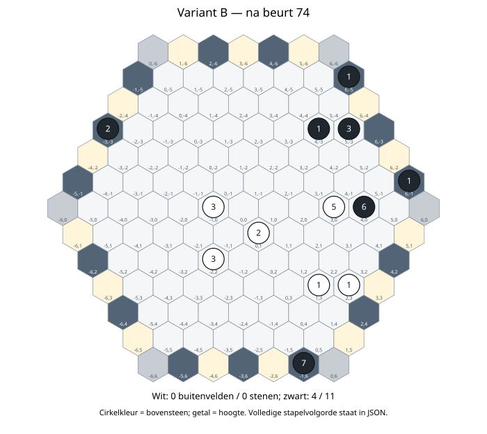
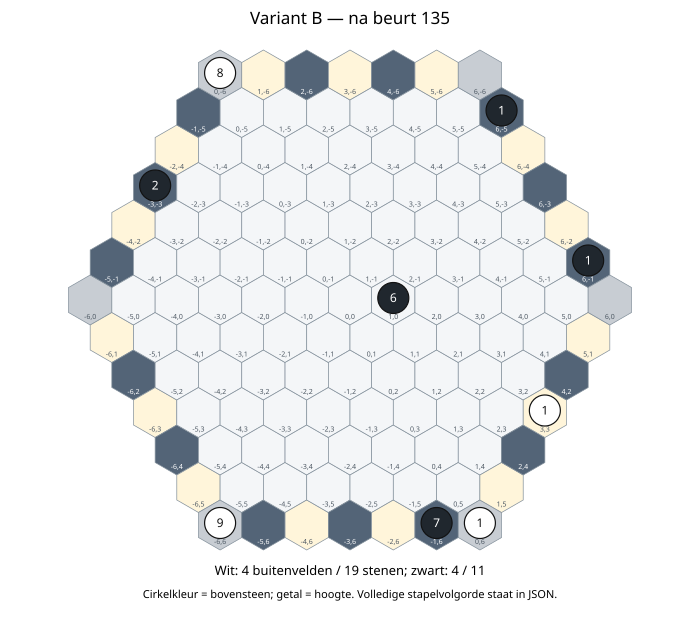

# Partij B-baseline_B-g000031382

Variant **B**, afloop **wit wint**, 135 beurten.

Seed `3975178610736981847`, partij-index `31382`. Wit: Willekeurig; zwart: Willekeurig.

Voorraadbeleid wit/zwart: `0/0`. Ontsnappingsvoorkeur: `False/False`. Faseschema's: `[-1, -1, -1]` / `[-1, -1, -1]`.

Slagzetten: **28**. Grootste stapel: **12**. Zetlimiet: 10000.

Geselecteerd voor: Grootste comeback in ontsnappingsscore.

[Volledig reproduceerbaar JSON-bestand](B-baseline_B-g000031382.json) · [Zetten als CSV](B-baseline_B-g000031382.csv) · [Bordcoördinaten en buitenkleuren](../board.json)

Selectie **Grootste comeback in ontsnappingsscore**, speler wit: `{"ply": 74, "field_deficit": 4, "stone_deficit": 11}`.

## Volledig zetverloop

Coördinaten zijn axiaal: het midden is (0,0). Stapels worden in JSON van onder naar boven weergegeven; 0 is wit, 1 is zwart.

| Beurt | Speler | Handeling | Voorraad W/Z | Buitenvelden W/Z | Ontsnapte stenen W/Z |
|---:|---|---|---|---|---|
| 1 | wit | plaatsen op (0,0) | 17/18 | 0/0 | 0/0 |
| 2 | zwart | plaatsen op (-1,0) | 17/17 | 0/0 | 0/0 |
| 3 | wit | plaatsen op (0,1) | 16/17 | 0/0 | 0/0 |
| 4 | zwart | plaatsen op (0,2) | 16/16 | 0/0 | 0/0 |
| 5 | wit | slaan (0, 1) → (0,2) | 16/16 | 0/0 | 0/0 |
| 6 | zwart | plaatsen op (0,1) | 16/15 | 0/0 | 0/0 |
| 7 | wit | plaatsen op (1,2) | 15/15 | 0/0 | 0/0 |
| 8 | zwart | plaatsen op (2,2) | 15/14 | 0/0 | 0/0 |
| 9 | wit | plaatsen op (0,-1) | 14/14 | 0/0 | 0/0 |
| 10 | zwart | slaan (0, 1) → (0,0) | 14/14 | 0/0 | 0/0 |
| 11 | wit | plaatsen op (1,0) | 13/14 | 0/0 | 0/0 |
| 12 | zwart | slaan (2, 2) → (1,2) | 13/14 | 0/0 | 0/0 |
| 13 | wit | plaatsen op (-1,2) | 12/14 | 0/0 | 0/0 |
| 14 | zwart | slaan (1, 2) → (1,0) | 12/14 | 0/0 | 0/0 |
| 15 | wit | plaatsen op (2,0) | 11/14 | 0/0 | 0/0 |
| 16 | zwart | plaatsen op (-2,3) | 11/13 | 0/0 | 0/0 |
| 17 | wit | slaan (0, -1) → (0,0) | 11/13 | 0/0 | 0/0 |
| 18 | zwart | plaatsen op (-1,-1) | 11/12 | 0/0 | 0/0 |
| 19 | wit | plaatsen op (-2,-1) | 10/12 | 0/0 | 0/0 |
| 20 | zwart | plaatsen op (-1,-2) | 10/11 | 0/0 | 0/0 |
| 21 | wit | plaatsen op (-2,-2) | 9/11 | 0/0 | 0/0 |
| 22 | zwart | slaan (-1, -2) → (-2,-2) | 9/11 | 0/0 | 0/0 |
| 23 | wit | plaatsen op (2,-1) | 8/11 | 0/0 | 0/0 |
| 24 | zwart | plaatsen op (-2,0) | 8/10 | 0/0 | 0/0 |
| 25 | wit | plaatsen op (0,3) | 7/10 | 0/0 | 0/0 |
| 26 | zwart | plaatsen op (-3,4) | 7/9 | 0/0 | 0/0 |
| 27 | wit | plaatsen op (-2,4) | 6/9 | 0/0 | 0/0 |
| 28 | zwart | plaatsen op (1,-1) | 6/8 | 0/0 | 0/0 |
| 29 | wit | plaatsen op (0,4) | 5/8 | 0/0 | 0/0 |
| 30 | zwart | plaatsen op (3,-2) | 5/7 | 0/0 | 0/0 |
| 31 | wit | plaatsen op (1,3) | 4/7 | 0/0 | 0/0 |
| 32 | zwart | plaatsen op (-2,5) | 4/6 | 0/0 | 0/0 |
| 33 | wit | slaan (2, 0) → (1,0) | 4/6 | 0/0 | 0/0 |
| 34 | zwart | plaatsen op (4,-2) | 4/5 | 0/0 | 0/0 |
| 35 | wit | plaatsen op (5,-2) | 3/5 | 0/0 | 0/0 |
| 36 | zwart | plaatsen op (-1,1) | 3/4 | 0/0 | 0/0 |
| 37 | wit | plaatsen op (2,3) | 2/4 | 0/0 | 0/0 |
| 38 | zwart | plaatsen op (4,-3) | 2/3 | 0/0 | 0/0 |
| 39 | wit | plaatsen op (-3,1) | 1/3 | 0/0 | 0/0 |
| 40 | zwart | plaatsen op (5,-1) | 1/2 | 0/0 | 0/0 |
| 41 | wit | slaan (5, -2) → (4,-2) | 1/2 | 0/0 | 0/0 |
| 42 | zwart | plaatsen op (5,-4) | 1/1 | 0/0 | 0/0 |
| 43 | wit | plaatsen op (-1,4) | 0/1 | 0/0 | 0/0 |
| 44 | zwart | slaan (-1, 1) → (-1,2) | 0/1 | 0/0 | 0/0 |
| 45 | wit | slaan (-2, 4) → (-3,4) | 0/1 | 0/0 | 0/0 |
| 46 | zwart | slaan (3, -2) → (4,-2) | 0/1 | 0/0 | 0/0 |
| 47 | wit | slaan (-2, -1) → (-1,-1) | 0/1 | 0/0 | 0/0 |
| 48 | zwart | plaatsen op (-4,5) | 0/0 | 0/0 | 0/0 |
| 49 | wit | slaan (2, -1) → (1,-1) | 0/0 | 0/0 | 0/0 |
| 50 | zwart | slaan (-2, 0) → (-3,1) | 0/0 | 0/0 | 0/0 |
| 51 | wit | slaan (-1, 4) → (-2,5) | 0/0 | 0/0 | 0/0 |
| 52 | zwart | slaan (-1, 0) → (-1,-1) | 0/0 | 0/0 | 0/0 |
| 53 | wit | slaan (-2, 5) → (-4,5) | 0/0 | 0/0 | 0/0 |
| 54 | zwart | slaan (-2, 3) → (-3,4) | 0/0 | 0/0 | 0/0 |
| 55 | wit | slaan (1, -1) → (-1,-1) | 0/0 | 0/0 | 0/0 |
| 56 | zwart | slaan (-3, 4) → (0,4) | 0/0 | 0/0 | 0/0 |
| 57 | wit | slaan (0, 3) → (0,4) | 0/0 | 0/0 | 0/0 |
| 58 | zwart | slaan (-1, 2) → (1,0) | 0/0 | 0/0 | 0/0 |
| 59 | wit | bewegen (0, 0) → (0,-3) | 0/0 | 0/0 | 0/0 |
| 60 | zwart | slaan (-3, 1) → (-1,-1) | 0/0 | 0/0 | 0/0 |
| 61 | wit | bewegen (-4, 5) → (-5,5) | 0/0 | 0/0 | 0/0 |
| 62 | zwart | bewegen (-2, -2) → (-3,-1) | 0/0 | 0/0 | 0/0 |
| 63 | wit | bewegen (0, -3) → (2,-3) | 0/0 | 0/0 | 0/0 |
| 64 | zwart | bewegen (1, 0) → (4,0) | 0/0 | 0/0 | 0/0 |
| 65 | wit | bewegen (-5, 5) → (-2,2) | 0/0 | 0/0 | 0/0 |
| 66 | zwart | ontsnappen (-1, -1) → (-1,6) | 0/0 | 0/1 | 0/7 |
| 67 | wit | bewegen (0, 4) → (-1,4) | 0/0 | 0/1 | 0/7 |
| 68 | zwart | ontsnappen (-3, -1) → (-3,-3) | 0/0 | 0/2 | 0/9 |
| 69 | wit | bewegen (2, -3) → (-1,0) | 0/0 | 0/2 | 0/9 |
| 70 | zwart | ontsnappen (5, -4) → (6,-5) | 0/0 | 0/3 | 0/10 |
| 71 | wit | bewegen (-1, 4) → (3,0) | 0/0 | 0/3 | 0/10 |
| 72 | zwart | bewegen (4, -2) → (5,-3) | 0/0 | 0/3 | 0/10 |
| 73 | wit | bewegen (0, 2) → (0,1) | 0/0 | 0/3 | 0/10 |
| 74 | zwart | ontsnappen (5, -1) → (6,-1) | 0/0 | 0/4 | 0/11 |
| 75 | wit | bewegen (1, 3) → (0,4) | 0/0 | 0/4 | 0/11 |
| 76 | zwart | bewegen (5, -3) → (5,-2) | 0/0 | 0/4 | 0/11 |
| 77 | wit | ontsnappen (2, 3) → (3,3) | 0/0 | 1/4 | 1/11 |
| 78 | zwart | bewegen (5, -2) → (4,-1) | 0/0 | 1/4 | 1/11 |
| 79 | wit | bewegen (-2, 2) → (-5,2) | 0/0 | 1/4 | 1/11 |
| 80 | zwart | bewegen (4, -3) → (4,-2) | 0/0 | 1/4 | 1/11 |
| 81 | wit | bewegen (-5, 2) → (-2,-1) | 0/0 | 1/4 | 1/11 |
| 82 | zwart | bewegen (4, -2) → (5,-3) | 0/0 | 1/4 | 1/11 |
| 83 | wit | bewegen (-2, -1) → (-2,1) | 0/0 | 1/4 | 1/11 |
| 84 | zwart | bewegen (4, 0) → (2,2) | 0/0 | 1/4 | 1/11 |
| 85 | wit | bewegen (3, 0) → (3,-2) | 0/0 | 1/4 | 1/11 |
| 86 | zwart | bewegen (4, -1) → (1,-1) | 0/0 | 1/4 | 1/11 |
| 87 | wit | bewegen (0, 1) → (2,-1) | 0/0 | 1/4 | 1/11 |
| 88 | zwart | bewegen (2, 2) → (2,0) | 0/0 | 1/4 | 1/11 |
| 89 | wit | slaan (-1, 0) → (2,0) | 0/0 | 1/4 | 1/11 |
| 90 | zwart | bewegen (5, -3) → (4,-2) | 0/0 | 1/4 | 1/11 |
| 91 | wit | bewegen (2, -1) → (2,-2) | 0/0 | 1/4 | 1/11 |
| 92 | zwart | slaan (4, -2) → (3,-2) | 0/0 | 1/4 | 1/11 |
| 93 | wit | bewegen (2, 0) → (3,-1) | 0/0 | 1/4 | 1/11 |
| 94 | zwart | bewegen (1, -1) → (2,-1) | 0/0 | 1/4 | 1/11 |
| 95 | wit | bewegen (-2, 1) → (0,1) | 0/0 | 1/4 | 1/11 |
| 96 | zwart | bewegen (3, -2) → (5,-2) | 0/0 | 1/4 | 1/11 |
| 97 | wit | bewegen (3, -1) → (3,-2) | 0/0 | 1/4 | 1/11 |
| 98 | zwart | bewegen (5, -2) → (4,-1) | 0/0 | 1/4 | 1/11 |
| 99 | wit | bewegen (2, -2) → (3,-3) | 0/0 | 1/4 | 1/11 |
| 100 | zwart | bewegen (4, -1) → (3,-1) | 0/0 | 1/4 | 1/11 |
| 101 | wit | bewegen (0, 1) → (1,1) | 0/0 | 1/4 | 1/11 |
| 102 | zwart | bewegen (2, -1) → (1,0) | 0/0 | 1/4 | 1/11 |
| 103 | wit | bewegen (3, -3) → (5,-3) | 0/0 | 1/4 | 1/11 |
| 104 | zwart | bewegen (3, -1) → (4,-2) | 0/0 | 1/4 | 1/11 |
| 105 | wit | slaan (1, 1) → (4,-2) | 0/0 | 1/4 | 1/11 |
| 106 | zwart | bewegen (1, 0) → (2,-1) | 0/0 | 1/4 | 1/11 |
| 107 | wit | bewegen (3, -2) → (3,-3) | 0/0 | 1/4 | 1/11 |
| 108 | zwart | bewegen (2, -1) → (-1,-1) | 0/0 | 1/4 | 1/11 |
| 109 | wit | bewegen (4, -2) → (0,-2) | 0/0 | 1/4 | 1/11 |
| 110 | zwart | bewegen (-1, -1) → (-4,2) | 0/0 | 1/4 | 1/11 |
| 111 | wit | ontsnappen (3, -3) → (-6,6) | 0/0 | 2/4 | 10/11 |
| 112 | zwart | bewegen (-4, 2) → (-4,0) | 0/0 | 2/4 | 10/11 |
| 113 | wit | bewegen (0, -2) → (-1,-2) | 0/0 | 2/4 | 10/11 |
| 114 | zwart | bewegen (-4, 0) → (-4,3) | 0/0 | 2/4 | 10/11 |
| 115 | wit | bewegen (0, 4) → (0,5) | 0/0 | 2/4 | 10/11 |
| 116 | zwart | bewegen (-4, 3) → (-4,1) | 0/0 | 2/4 | 10/11 |
| 117 | wit | bewegen (5, -3) → (3,-3) | 0/0 | 2/4 | 10/11 |
| 118 | zwart | slaan (-4, 1) → (-1,-2) | 0/0 | 2/4 | 10/11 |
| 119 | wit | bewegen (3, -3) → (5,-5) | 0/0 | 2/4 | 10/11 |
| 120 | zwart | bewegen (-1, -2) → (-2,-2) | 0/0 | 2/4 | 10/11 |
| 121 | wit | ontsnappen (0, 5) → (0,6) | 0/0 | 3/4 | 11/11 |
| 122 | zwart | splitsen (-2, -2) → (-2,-1); onderstuk 6 blijft | 0/0 | 3/4 | 11/11 |
| 123 | wit | bewegen (5, -5) → (4,-5) | 0/0 | 3/4 | 11/11 |
| 124 | zwart | bewegen (-2, -1) → (-5,2) | 0/0 | 3/4 | 11/11 |
| 125 | wit | bewegen (4, -5) → (2,-3) | 0/0 | 3/4 | 11/11 |
| 126 | zwart | bewegen (-2, -2) → (3,-2) | 0/0 | 3/4 | 11/11 |
| 127 | wit | bewegen (2, -3) → (1,-2) | 0/0 | 3/4 | 11/11 |
| 128 | zwart | bewegen (3, -2) → (1,0) | 0/0 | 3/4 | 11/11 |
| 129 | wit | slaan (1, -2) → (1,0) | 0/0 | 3/4 | 11/11 |
| 130 | zwart | bewegen (-5, 2) → (-5,0) | 0/0 | 3/4 | 11/11 |
| 131 | wit | bewegen (1, 0) → (2,0) | 0/0 | 3/4 | 11/11 |
| 132 | zwart | bewegen (-5, 0) → (-1,0) | 0/0 | 3/4 | 11/11 |
| 133 | wit | bewegen (2, 0) → (0,2) | 0/0 | 3/4 | 11/11 |
| 134 | zwart | bewegen (-1, 0) → (1,0) | 0/0 | 3/4 | 11/11 |
| 135 | wit | ontsnappen (0, 2) → (0,-6) | 0/0 | 4/4 | 19/11 |
